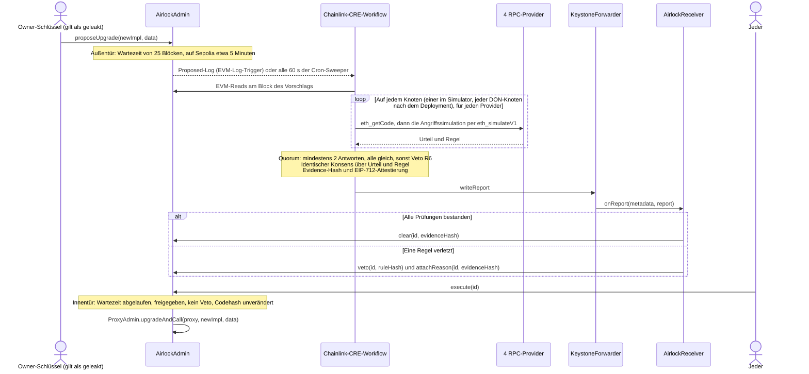

<div align="center">

# Upgrade Airlock

**Jedes Proxy-Upgrade muss durch zwei Türen: eine Wartezeit und eine Chainlink-CRE-Freigabe, die nur Code erhält, der eine Angriffssimulation übersteht.**

[English](README.md) · [简体中文](README.zh-CN.md) · [繁體中文](README.zh-TW.md) · [日本語](README.ja.md) · [한국어](README.ko.md) · [Español](README.es.md) · [Français](README.fr.md) · **Deutsch** · [Português (Brasil)](README.pt-BR.md) · [Русский](README.ru.md) · [Tiếng Việt](README.vi.md)

[](https://github.com/tedinroc/upgrade-airlock/actions/workflows/ci.yml)
[](LICENSE)
[](https://upgrade-airlock.pages.dev)
[](https://upgrade-airlock.pages.dev/video/)
[](https://sepolia.etherscan.io/address/0x28e7aAC40560804F480e454bF9C12F50C83b700B)
[](#chainlink-cre)

[Highlights](#highlights) · [Funktionsweise](#how-it-works) · [Regeln](#rules) · [Chainlink CRE](#chainlink-cre) · [Live auf Sepolia](#live-on-sepolia) · [Schnellstart](#quick-start) · [Sicherheitsmodell](#security-model)

</div>

> **2nd place, ETH Shenzhen 2026.** This is Ted Chen's copy of the entry; the official submission is [gitlab.com/jiapunk/upgrade-airlock](https://gitlab.com/jiapunk/upgrade-airlock).

## Überblick

Upgrade Airlock stellt jedem Contract-Upgrade zwei Türen in den Weg. Die **Außentür** ist eine in Blöcken gemessene
Wartezeit. Die **Innentür** öffnet sich nur mit einer on-chain verbuchten Freigabe. Automatisch heißt das: Ein
Chainlink-CRE-Workflow hat die neue Implementierung in einem Simulator angegriffen und dabei vier unabhängige
RPC-Provider abgefragt, mindestens zwei haben geantwortet und alle Antworten stimmen überein, der Konsensschritt des
Workflows (`consensusIdenticalAggregation`) hat sich auf das Urteil geeinigt, und ein signierter **Clear**-Report ist
on-chain eingetroffen. Kann CRE gar nicht antworten, darf der Approver-Schlüssel mit dokumentierten Nachweisen von
Hand freigeben; der Sweeper beurteilt einen solchen Vorschlag weiterhin, solange er unter den neuesten 20 IDs ist, und
ein Veto von CRE oder einem Guardian hat Vorrang. Eine bösartige Implementierung, die die Angriffssuche erreicht,
erhält stattdessen ein signiertes **Veto** und kommt nicht zur Ausführung, selbst wenn der Angreifer den
Upgrade-Schlüssel besitzt; für das, was eine begrenzte Suche nicht erreicht, ergänzt der Strict-Modus ein menschliches
Code-Review. Heute stammen die Urteile von der offiziellen CRE CLI (`cre workflow simulate --broadcast`), die den
Workflow auf einem Server ausführt; derselbe Workflow und derselbe Contract-Code lassen sich auf ein DON deployen.
Entwickelt für ETH Shenzhen 2026 auf Ethereum Sepolia.

> [!TIP]
> **Live-Demo: [upgrade-airlock.pages.dev](https://upgrade-airlock.pages.dev)** · **Demo-Video:
> [upgrade-airlock.pages.dev/video](https://upgrade-airlock.pages.dev/video/)** (vereinfachtes Chinesisch und
> Englisch)
>
> Der War Room liest Ethereum Sepolia direkt aus dem Browser, rein lesend. Jeder Vorschlag erscheint als Luftschleuse:
> Die **Außentür** erfasst den Vorschlag, die **Kammer** zählt die Wartezeit herunter, und die **Innentür** bleibt
> verriegelt, bis eine Freigabe on-chain eingetroffen ist (das Clear von Chainlink CRE oder eine Freigabe des
> Approvers von Hand, die der War Room als solche kennzeichnet). Ein Veto stößt den Vorschlag samt Regel,
> Evidence-Hash und Transaktion aus. Beim ersten Besuch öffnet sich eine Angriffsauswahl: Jede Karte (sechs Angriffe
> und das ehrliche Upgrade v2) spielt den neuesten echten Sepolia-Vorschlag ihrer Art erneut ab, als Wiederholung
> gekennzeichnet. Die Seite startet in vereinfachtem Chinesisch:
> [`?lang=en`](https://upgrade-airlock.pages.dev/?lang=en) schaltet auf Englisch um,
> [`?lang=zh-TW`](https://upgrade-airlock.pages.dev/?lang=zh-TW) auf traditionelles Chinesisch. Die zugrunde liegenden
> Transaktionen (Vorschläge #1–#10) sind in [den Belegen des Live-Laufs](docs/evidence/sepolia-live.md) aufgeführt.

## Highlights

- **Konstruktionsbedingt fail-closed.** Ein Upgrade läuft nur mit einer Freigabe on-chain. Ein verpasstes Log, ein
  RPC-Ausfall, uneinige Provider oder ein fehlgeschlagener Lauf lassen den Vorschlag ohne Freigabe oder führen zu
  einem Veto: Das kann ein Upgrade verzögern, aber nie eines durchlassen. Ein Veto hat stets Vorrang vor einer Freigabe.
- **Ein Angriff, keine Checkliste.** Der Workflow (in einem DON-Deployment auf jedem Knoten) führt das Upgrade mit
  `eth_simulateV1` bei vier RPC-Providern gegen den realen Zustand des Proxys aus. Eine fremde Adresse mit Guthaben ruft jeden Selektor im neuen Bytecode auf,
  auf Inhaber zugeschnittene Argumente treffen jede neue Funktion, und Supply, Ownership und Salden werden vorher und
  nachher verglichen. Mindestens zwei Provider müssen antworten, und alle Antworten müssen übereinstimmen.
- **An den Vorschlag gebundene Urteile.** Der Identical-Consensus-Schritt des Workflows einigt sich auf `{verdict, rule}`. Der Report enthält eine
  EIP-712-Attestierung, die an den exakten Inhalt des Vorschlags (`proposalDigest`), die Chain, den Receiver und eine
  Block-Deadline gebunden ist, dazu einen Evidence-Hash, den jeder aus Chain-Daten nachrechnen kann.
- **Verpasste Logs werden nachgeholt.** Ein Cron-Sweeper prüft alle 60 Sekunden die neuesten 20 Vorschläge und
  beurteilt jeden, den der Log-Trigger verpasst hat, auch Upgrades, die der Approver manuell freigegeben hat; sein Veto
  hat Vorrang. Ein Vorschlag, der unter die neuesten 20 IDs gedrückt wurde, wird nicht mehr beurteilt: Er bleibt ohne
  Freigabe, sofern der Approver ihn nicht manuell freigegeben hat ([das Sweep-Fenster](docs/design.md#the-sweep-window)).
- **Live auf Ethereum Sepolia.** Die offizielle CRE CLI hat den Workflow auf einem Server ausgeführt und jeden
  Vorschlag on-chain beantwortet (zehn, Stand 2026-10-23): ein ehrliches Upgrade freigegeben und ausgeführt, neun
  Angriffe per Veto gestoppt (R1, R2, R3, R3B, R7, R9). Jeder Contract ist auf Sourcify verifiziert.
- **End-to-End getestet.** In der [CI](.github/workflows/ci.yml) laufen 117 Foundry-Tests, 118 Workflow-Unit-Tests
  und 387 der 394 Selbsttest-Checks des War Rooms (die übrigen 7 brauchen die Forge-Build-Ausgabe und cast, die der
  CI-Job nicht hat); ein End-to-End-Skript auf einem Fork spielt den kompletten Ablauf im CRE-Simulator durch.

## Das Problem

Bei einem upgradefähigen Proxy hängt das gesamte Protokoll an seinem Upgrade-Schlüssel. Ist dieser Schlüssel einmal
geleakt, ist der Angriff schnell erledigt: bösartige Implementierung deployen, den Proxy darauf umstellen, minten oder
abziehen. Das ist schon oft passiert:

- **PAID Network, März 2021.** Mit den Schlüsseln des Proxy-Owners wurde der auditierte Token-Code gegen eine Version
  mit Burn- und Mint-Funktionen ausgetauscht, und der Angreifer mintete rund 59,5 Millionen PAID.
  ([Post-Mortem von CertiK](https://www.certik.com/blog/paid-network-post-mortem))
- **Ankr, Dezember 2022.** Mit dem kompromittierten Deployer-Schlüssel ersetzte der Angreifer die
  aBNBc-Implementierung durch eine, die ohne Berechtigungsprüfung mintete: 60 Billionen aBNBc.
  ([Bericht von Ankr](https://www.ankr.com/blog/the-abnbc-token-report/))
- **Radiant Capital, Oktober 2024.** Ein Angreifer, der 3 von 11 Multisig-Unterzeichnern kontrollierte, übernahm den
  Lending-Pool-Provider und spielte ein Upgrade der Lending-Pool-Implementierung ein; abgezogen wurden über
  53 Millionen US-Dollar.
  ([rekt.news](https://rekt.news/radiant-capital-rekt2))

Ein Timelock lässt den Angreifer nur warten, und niemand ist verpflichtet, in dieser Zeit hinzusehen. Lange
Verzögerungen blockieren zudem Notfall-Fixes. Upgrade Airlock lässt die Wartezeit für sich arbeiten: Ein Upgrade kann
erst laufen, wenn es eine unabhängige Prüfung (dezentral, sobald sie auf ein CRE-DON deployt ist) bestanden hat, und diese Prüfung läuft bei jedem Vorschlag
automatisch.

## <a id="how-it-works"></a>Funktionsweise



1. **Vorschlagen.** `AirlockAdmin` besitzt den OpenZeppelin-`ProxyAdmin` und das `Ownable` des Tokens. Der
   Owner-Schlüssel kann nur vorschlagen: Er ist niemals Guardian, Approver oder Freigabe-Orakel. Jeder Vorschlag (ein
   Upgrade oder eine Änderung an der Airlock selbst: Guardians, Verzögerung, Break-Glass-Ziel) erhält
   `readyBlock = block.number + delayBlocks`. Ein Upgrade- oder Break-Glass-Ziel muss gewöhnlicher Contract-Code sein:
   Ein per EIP-7702 delegierter Account, dessen Schlüssel ihn nach dem Urteil umleiten könnte, wird abgelehnt
   (`DelegatedAccount`).
2. **Beurteilen.** Der CRE-Log-Trigger feuert bei `Proposed`. Eine Änderung an der Airlock wird anhand von Chain-Reads
   beurteilt (R7). Ein Upgrade durchläuft zuerst die statischen Regeln (R5, R8), dann die Angriffssimulation, fixiert
   auf den Block des Vorschlags: Der ERC-1967-Implementation-Slot des Proxys wird mit dem neuen Code überschrieben, und
   eine frische fremde Adresse (abgeleitet aus dem Hash des Vorschlagsblocks) wird wie ein echter Nutzer ausgestattet,
   mit Tokens von einem zweiten Inhaber und mit ETH. Ein Inhaber führt einen Transfer aus, die fremde Adresse ruft
   `transferFrom` ohne Allowance auf, danach jeden im neuen Bytecode gefundenen Selektor mit fünf Argumentformen.
   Jeder Selektor außerhalb der Standard-Token-Schnittstelle wird zusätzlich mit auf Inhaber zugeschnittenen
   Argumenten aufgerufen: der Inhaber mit Guthaben in jeder der ersten vier Argumentpositionen, der Testbetrag in
   einer weiteren, die fremde Adresse oder der Proxy in den übrigen. Supply, Owner und jeder überwachte Saldo werden
   vorher und nachher gelesen, der Saldo des Inhabers direkt nach jedem dieser Inhaber-Aufrufe, und die eigenen Events
   jedes Prüfaufrufs werden kontrolliert (R1 bis R4, R3B). Zum Schluss wird der neue Bytecode nach Opcodes durchsucht,
   die sich in einem echten Block anders verhalten als in einer Simulation (R9).
3. **Einigen.** Jeder Knoten (in einem DON-Deployment jeder DON-Knoten; heute der CLI-Simulator) führt die Simulation
   bei vier Providern aus. Mindestens zwei müssen antworten, und jede Antwort muss dasselbe Urteil liefern; alles
   andere ist ein Veto (R6). Anschließend einigt sich der Konsensschritt auf das identische `{verdict, rule}`.
4. **Berichten.** Der Workflow hasht ein kanonisches Evidence-JSON, signiert ein EIP-712-Urteil mit seinem
   Attester-Schlüssel (ein CRE-Secret) und schreibt den Report über den Forwarder. `AirlockReceiver` prüft Absender,
   Aktualität und Signatur sowie die Bindung des Urteils an genau diesen Vorschlag (`proposalDigest`) und ruft dann auf
   `AirlockAdmin` entweder `clear` oder `veto` und `attachReason` auf.
5. **Ausführen.** Jeder darf `execute(id)` aufrufen, sobald die Wartezeit vorbei ist. Der Aufruf revertiert während
   der Wartezeit mit `TooEarly`, ohne Freigabe mit `NotCleared`, nach einem Veto mit `ProposalVetoed` und mit
   `CodehashChanged`, wenn das Ziel nicht mehr den Code enthält, der vorgeschlagen und beurteilt wurde. Ein Veto hat
   stets Vorrang vor einer Freigabe.
6. **Nachprüfen.** Ein Cron-Trigger prüft alle 60 Sekunden erneut die neuesten Vorschläge und beurteilt jeden offenen,
   den CRE noch nicht beantwortet hat (`oracleJudged`): ein Log, das der Trigger verpasst hat, ein `Proposed`-Event,
   das für die Zustellung zu groß ist, oder ein Upgrade, das der Approver manuell freigegeben hat. Sein Veto hat
   Vorrang vor dieser Freigabe.

**Jeder Fehler wirkt in dieselbe Richtung.** Ein verpasstes Log, ein RPC-Ausfall, uneinige Provider oder ein
fehlgeschlagener Lauf lassen den Vorschlag ohne Freigabe oder belegen ihn mit einem Veto; ein Upgrade wird dadurch
verzögert, aber nie durchgelassen. Kann CRE überhaupt nicht antworten, lässt sich ein Upgrade mit dem
Approver-Schlüssel manuell freigeben, mit hinterlegtem Nachweis; der Sweeper beurteilt dieses Upgrade trotzdem,
sobald CRE wieder antwortet, und ein Veto von CRE oder einem Guardian hat weiterhin Vorrang. Mit `breakGlass()` können
der Owner oder jeder Guardian den Proxy sofort auf eine vorab registrierte pausierte Implementierung umschalten. Der Weg
aus dem pausierten Zustand ist ein Upgrade durch beide Türen; eine Freigabe verfällt nie, daher kann auch ein früher
freigegebenes Upgrade die Pause beenden ([bekannte Einschränkungen](docs/design.md#known-limitations)).

Weitere Details: [docs/design.md](docs/design.md) (Bedrohungsmodell, Zustandsautomat der Freigabe, Report-Bindung,
Budgets) und [cre/README.md](cre/README.md) (der Workflow).

## <a id="rules"></a>Regeln

`ruleHash = keccak256("GUARD/<ID>")` wird bei jedem Veto on-chain festgehalten.

| Regel | Veto, wenn | Entschieden durch |
|---|---|---|
| R1 `TOTAL_SUPPLY` | der Aufruf einer fremden Adresse `totalSupply` verändert | Angriffssimulation |
| R2 `OWNER` | der Aufruf einer fremden Adresse `owner()` verändert | Angriffssimulation |
| R3 `TRANSFER_CONSERVATION` | ein Transfer von X durch einen Inhaber nicht genau X bewegt oder den Saldo eines Dritten verändert | Angriffssimulation |
| R3B `THIRD_PARTY_FUNDS` | ein Außenstehender Tokens eines beliebigen Inhabers bewegt: Das `transferFrom` der fremden Adresse mit Guthaben gelingt ohne Allowance, oder einer ihrer Prüfaufrufe bewegt Tokens Dritter, mintet oder verbrennt Tokens, überträgt die Ownership oder hinterlässt einen niedrigeren Saldo beim Inhaber, selbst ohne Event oder wenn ein späterer Aufruf das rückgängig macht | Angriffssimulation |
| R4 `TRANSFER_LIVENESS` | ein einfacher Transfer eines Inhabers fehlschlägt | Angriffssimulation |
| R5 `STRICT_CODEHASH` | der strikte Modus aktiv ist und der Approver den Codehash nicht genehmigt hat | Chain-Reads |
| R6 `SIM_FAILURE` | die Simulation zu keiner Entscheidung kommt: Provider sind uneinig, zu wenige antworten, der Code stimmt nicht überein, ein View-Aufruf oder die Ausstattung der fremden Adresse revertiert, oder die Prüfaufrufe passen nicht in die konfigurierten Requests | Simulation und Quorum |
| R7 `CONFIG_GUARD` | eine Guardian-Änderung, eine kürzere Verzögerung oder ein neues Break-Glass-Ziel ohne vorherige Genehmigung des Approvers vorgeschlagen wird | Chain-Reads |
| R8 `INIT_DATA` | ein Upgrade Init-Daten mitbringt, die der Approver nicht zusammen mit dem Codehash genehmigt hat | Chain-Reads |
| R9 `NEW_OPCODES` | der neue Code einen Opcode für Block- oder Transaktionskontext (BASEFEE, TIMESTAMP, NUMBER, ORIGIN, GAS und weitere), einen externen Aufruf, ein Create oder ein Selfdestruct enthält, die von der festen Allowlist der Konfiguration (standardmäßig leer) nicht abgedeckt sind, es sei denn, der Approver hat genau diesen Codehash genehmigt | Bytecode |

**R9 unterbindet die Umgehung der Simulation.** `EvilBaseFeeImpl` verhält sich wie v1, solange
`block.basefee == 0` gilt, wie es ein `eth_simulateV1`-Aufruf sieht, und lässt in einem echten Block jeden minten.
Jede simulierte Invariante hält; sein `BASEFEE`-Opcode führt zum Veto. Die Allowlist hängt nie vom Code ab, den der
Proxy heute ausführt, daher deckt eine Genehmigung genau einen Codehash ab und kein späteres Upgrade. Der Scan
überspringt den Metadaten-Anhang des Compilers nur, wenn er eine exakte solc-CBOR-Map ist, die keine Instruktion
erreichen kann; alles andere wird als Code gescannt. Die Genehmigung eines Codehashs nimmt ihn von R9 aus und lässt
gekürzte Prüfaufrufe zu (R6), mehr nicht: Alle anderen Regeln laufen weiterhin.

**R3B stoppt den stillen Drain.** `EvilDrainImpl` ist v1 plus `rescue(from, to, amount)` ohne Zugriffskontrolle.
Supply, Owner, Transfers und Opcodes entsprechen v1, also bestehen R1 bis R4 und R9 allesamt. `rescue` ist keine
Standard-Token-Funktion, daher ruft die fremde Adresse sie zusätzlich mit auf Inhaber zugeschnittenen Argumenten auf;
der Aufruf mit dem Inhaber als `from` bewegt dessen Tokens, und R3B legt ein Veto ein. Auch ein Drain, der sich hinter
„nur für Aufrufer, die Tokens oder ETH halten“ versteckt, wird erfasst, weil die fremde Adresse beides hält.

### Automatischer und strikter Modus

Im **automatischen Modus**, der Standardeinstellung, gibt CRE jedes Upgrade selbstständig frei oder stoppt es per
Veto, gestützt auf eine begrenzte Angriffssuche: ein Aufrufer von außen mit Guthaben, jeder Selektor im neuen Code und
der Inhaber in jeder der ersten vier Argumentpositionen jeder neuen Funktion. Der **strikte Modus** (R5) ergänzt ein
menschliches Review: Jeder neue Codehash einer Implementierung muss zuerst vom Approver-Schlüssel genehmigt werden,
und die Angriffssimulation läuft weiterhin. Der automatische Modus passt zu einem Token, der Routine-Upgrades binnen
Minuten freigegeben haben will; der strikte Modus macht ein Code-Review zum Teil der Freigabe
([die beiden Modi](docs/design.md#two-modes-automatic-and-strict)).

## Chainlink CRE

CRE ist die Orchestrierungsschicht von Upgrade Airlock: Der Workflow ist der einzige automatisierte Weg durch die
Innentür und übernimmt jeden Schritt vom On-Chain-Trigger bis zum On-Chain-Urteil. Er ist mit dem CRE TypeScript SDK
(`@chainlink/cre-sdk` 1.23.0) geschrieben und mit der CRE CLI v1.37.0 zu WASM kompiliert.

| Chainlink-Technologie | Wo | Was sie hier leistet |
|---|---|---|
| CRE-Workflow-Runner | [`cre/veto/main.ts#L1-L9`](cre/veto/main.ts#L1-L9), [`cre/veto/workflow.yaml`](cre/veto/workflow.yaml), [`cre/project.yaml`](cre/project.yaml) | Zwei Handler, Targets `sepolia` und `sepolia-fork` |
| EVM-Log-Trigger | [`cre/veto/workflow.ts#L202-L211`](cre/veto/workflow.ts#L202-L211), [`#L193-L198`](cre/veto/workflow.ts#L193-L198), [`#L54-L65`](cre/veto/workflow.ts#L54-L65) | `AirlockAdmin.Proposed` bei `LATEST`: Ein Vorschlag wird beurteilt, sobald er erscheint, eine ganze Wartezeit, bevor er laufen könnte |
| Cron-Trigger | [`cre/veto/workflow.ts#L200`](cre/veto/workflow.ts#L200), [`#L209`](cre/veto/workflow.ts#L209), [`cre/veto/airlock.ts#L323-L389`](cre/veto/airlock.ts#L323-L389) | Der Sweeper: die neuesten 20 IDs, jede Minute |
| EVM-Read (`callContract`) | [`cre/veto/workflow.ts#L114-L122`](cre/veto/workflow.ts#L114-L122), [`#L137-L142`](cre/veto/workflow.ts#L137-L142), [`cre/veto/chain.ts`](cre/veto/chain.ts) | Vorschlag, Freigabe, `oracleJudged`, Genehmigungen und Salden, gebündelt über Multicall3 am Block des Vorschlags oder bei `LATEST` |
| EVM-Read (`headerByNumber`) | [`cre/veto/workflow.ts#L125-L136`](cre/veto/workflow.ts#L125-L136) | Der neueste Block und der Hash des Vorschlagsblocks, aus dem die simulierte fremde Adresse abgeleitet wird |
| HTTP-Capability im Node-Modus | [`cre/veto/workflow.ts#L167-L189`](cre/veto/workflow.ts#L167-L189), [`#L80-L94`](cre/veto/workflow.ts#L80-L94), [`cre/veto/judge.ts#L157-L220`](cre/veto/judge.ts#L157-L220) | Jeder Knoten sendet an jeden Provider `eth_getCode`, dann ein oder zwei `eth_simulateV1`-Requests (jeweils unter dem Request-Limit von 120 kb) |
| `consensusIdenticalAggregation` | [`cre/veto/workflow.ts#L184-L188`](cre/veto/workflow.ts#L184-L188), Quorum in [`cre/veto/judge.ts#L244-L277`](cre/veto/judge.ts#L244-L277) | Identischer Konsens über `{verdict, rule}` (höchstens 52 Bytes; jeder DON-Knoten nach dem Deployment) |
| Secrets | [`cre/veto/workflow.ts#L160-L166`](cre/veto/workflow.ts#L160-L166), [`cre/secrets.yaml`](cre/secrets.yaml) | Der EIP-712-Attester-Schlüssel, einmal pro Lauf abgerufen |
| Report + `writeReport` | [`cre/veto/workflow.ts#L143-L149`](cre/veto/workflow.ts#L143-L149), [`cre/veto/airlock.ts#L229-L282`](cre/veto/airlock.ts#L229-L282), [`cre/veto/report.ts`](cre/veto/report.ts) | `runtime.report` (ECDSA, keccak256) und `evm.writeReport`, danach ein Read des Vorschlags zur Bestätigung des Ergebnisses |
| Forwarder + `IReceiver` | [`src/cre/AirlockReceiver.sol#L88-L120`](src/cre/AirlockReceiver.sol#L88-L120), [`#L156-L169`](src/cre/AirlockReceiver.sol#L156-L169), [`src/cre/IReceiver.sol`](src/cre/IReceiver.sol), [`script/DeployEth.s.sol#L142`](script/DeployEth.s.sol#L142) | `onReport` akzeptiert nur den konfigurierten Forwarder und prüft Workflow-ID und Owner, sofern konfiguriert |
| Chain-Selektoren | [`cre/veto/workflow.ts#L100-L104`](cre/veto/workflow.ts#L100-L104) | `ethereum-testnet-sepolia` |
| CRE CLI | [`cre/setup.sh`](cre/setup.sh), [`cre/scripts/fork-e2e.sh`](cre/scripts/fork-e2e.sh), [`scripts/sepolia/airlock.sh`](scripts/sepolia/airlock.sh), [`scripts/sepolia/sweep.sh`](scripts/sepolia/sweep.sh) | `cre workflow build`, `cre workflow simulate --broadcast` |

**So läuft der Workflow heute.** Der Workflow läuft über `cre workflow simulate --broadcast` der CRE CLI gegen
Ethereum Sepolia. Der Listener ([`scripts/sepolia/airlock.sh`](scripts/sepolia/airlock.sh)) hält den Log-Trigger im
Listen-Modus, der Sweeper ([`scripts/sepolia/sweep.sh`](scripts/sepolia/sweep.sh)) führt den Cron-Handler minütlich
aus, und jedes Clear und jedes Veto ist eine echte Sepolia-Transaktion über Chainlinks Sepolia-MockKeystoneForwarder
[`0x15fC6ae953E024d975e77382eEeC56A9101f9F88`](https://docs.chain.link/cre/guides/workflow/using-evm-client/forwarder-directory-ts).
`AirlockReceiver` ist ohne Änderung bereit für ein DON-Deployment: Wird er mit `FORWARDER` auf den produktiven
KeystoneForwarder und gesetzten `WORKFLOW_ID` / `WORKFLOW_OWNER` deployt, prüft `onReport` zusätzlich die vom DON
signierten Workflow-Metadaten. `DeployEth` lehnt den permissionless MockKeystoneForwarder ab, es sei denn, beide sind
gesetzt oder `ALLOW_MOCK_FORWARDER=1` erlaubt ihn ausdrücklich
([`script/DeployEth.s.sol#L96-L104`](script/DeployEth.s.sol#L96-L104)).

**Ausgelegt auf die Limits von CRE pro Lauf.** Höchstens 15 Chain-Reads (Multicall3-Batches unter dem Payload-Limit
von 5 kb), 12 von 15 HTTP-Aufrufen bei vier Providern, eine Angriffssimulation pro Lauf und ein Konsenswert von
höchstens 52 Bytes. Die Budgets stehen in [docs/design.md](docs/design.md#budgets).

## <a id="live-on-sepolia"></a>Live auf Sepolia

Ethereum Sepolia, Chain-ID 11155111. Deployt mit [`script/DeployEth.s.sol`](script/DeployEth.s.sol) in den
Blöcken 11950684–11950699 (13 Transaktionen; AirlockAdmin in Block 11950697); jeder Contract ist auf Sourcify verifiziert. Owner, Approver, Notfall-Guardian und
Attester sind vier verschiedene Schlüssel. Die Wartezeit beträgt 25 Blöcke.

| Contract | Adresse |
|---|---|
| AirlockAdmin | [`0x28e7aAC40560804F480e454bF9C12F50C83b700B`](https://sepolia.etherscan.io/address/0x28e7aAC40560804F480e454bF9C12F50C83b700B) |
| AirlockReceiver | [`0xE40D463116F4Aa24d5E79776a65ED0f1b088c670`](https://sepolia.etherscan.io/address/0xE40D463116F4Aa24d5E79776a65ED0f1b088c670) |
| DemoBTC-Proxy (dBTC) | [`0x88Cc569265faDAEAc2a16B69f35E10B2158e4b71`](https://sepolia.etherscan.io/address/0x88Cc569265faDAEAc2a16B69f35E10B2158e4b71) |
| ProxyAdmin | [`0x51a3fE6AD22BF7753574B7b7FD56aE9a65bd593E`](https://sepolia.etherscan.io/address/0x51a3fE6AD22BF7753574B7b7FD56aE9a65bd593E) |
| DemoBTC v1 | [`0x8f7d6453d77B3f3b008CBE4A144d82c5742eB108`](https://sepolia.etherscan.io/address/0x8f7d6453d77B3f3b008CBE4A144d82c5742eB108) |
| DemoBTC v2 (ehrliches Upgrade) | [`0x4D959f981C01E3B81ac6C9A20E84816Fe5f6Bce3`](https://sepolia.etherscan.io/address/0x4D959f981C01E3B81ac6C9A20E84816Fe5f6Bce3) |
| EvilMintImpl | [`0x01502c4af90c27f53B2E1293941670C6B761CAAA`](https://sepolia.etherscan.io/address/0x01502c4af90c27f53B2E1293941670C6B761CAAA) |
| EvilOwnerImpl | [`0xBe849DE8e0a4D9b0010ba1468f94Eeb24A42d488`](https://sepolia.etherscan.io/address/0xBe849DE8e0a4D9b0010ba1468f94Eeb24A42d488) |
| EvilFeeImpl | [`0xB95Ffa7b970B1a73488e2fC32B787fA536F12AF5`](https://sepolia.etherscan.io/address/0xB95Ffa7b970B1a73488e2fC32B787fA536F12AF5) |
| EvilBaseFeeImpl | [`0xE1AAa4E88DB9cc7ceCca14722eE2874D834e0310`](https://sepolia.etherscan.io/address/0xE1AAa4E88DB9cc7ceCca14722eE2874D834e0310) |
| EvilDrainImpl | [`0x1d98D64BC5204AE139B5A0747855841Fa5333b6d`](https://sepolia.etherscan.io/address/0x1d98D64BC5204AE139B5A0747855841Fa5333b6d) |
| PausedImpl (Break-Glass-Ziel) | [`0xb6573006fB607E96966d0F578B96AAB25413F5BE`](https://sepolia.etherscan.io/address/0xb6573006fB607E96966d0F578B96AAB25413F5BE) |
| Chainlink MockKeystoneForwarder | [`0x15fC6ae953E024d975e77382eEeC56A9101f9F88`](https://sepolia.etherscan.io/address/0x15fC6ae953E024d975e77382eEeC56A9101f9F88) |

Der erste Lauf: sieben Vorschläge, sieben On-Chain-Urteile (spätere Läufe #8–#10 stehen in
[docs/evidence/sepolia-live.md](docs/evidence/sepolia-live.md)). Die Blocknummer in jedem Link ist der Block, in den die Transaktion
aufgenommen wurde; `(+n)` gibt an, wie viele Blöcke nach dem Vorschlag das CRE-Urteil eintraf.

| Karte | Vorschlag | CRE-Urteil | Vorschlags-Tx | Report-Tx | Danach |
|---|---|---|---|---|---|
| `v2`: ehrliches Upgrade | #4 | Clear | [11950745](https://sepolia.etherscan.io/tx/0x3cd96ac220391e2b404d35591d1a96808b75256e7c685a414e2ca5a63bc54145) | [11950747 (+2)](https://sepolia.etherscan.io/tx/0x2c02d2a23016a72509900eb7ce92dabc06b0dd93a2394d076a62d687ce467efb) | `execute` [11950772](https://sepolia.etherscan.io/tx/0x01913c1854b9862763af74ddacd7be23a7f55232af7334714aa8213aa7021890), `version()` = "2" |
| `evil-mint`: jeder kann minten | #1 | Veto R1 | [11950735](https://sepolia.etherscan.io/tx/0x862c5fdf826a8fef09fe2ff278d3e58191f93c267dbdd38ad9aaa270f39937b0) | [11950736 (+1)](https://sepolia.etherscan.io/tx/0xb0d74e25e2528fb9aad7d21de202dac288cd256048f2986b5214280fda4b84f6) | `execute` revertiert mit `ProposalVetoed` |
| `evil-owner`: jeder kann die Ownership übernehmen | #6 | Veto R2 | [11950788](https://sepolia.etherscan.io/tx/0x32eb22039bd43602e0406b1a8f9a02c5cbcdb5cf2ef1c389919a45d05820da25) | [11950790 (+2)](https://sepolia.etherscan.io/tx/0x49451bee7a2f3351b18992d94b5f89b9ff89cf53be65a937400ab95fb79be551) | `execute` revertiert mit `ProposalVetoed` |
| `evil-fee`: Transfers zweigen 10 % ab | #7 | Veto R3 | [11950792](https://sepolia.etherscan.io/tx/0xe06924c2e3961ab27d2803c0654b783fc06e52107345bda9bfeff391053fcad3) | [11950794 (+2)](https://sepolia.etherscan.io/tx/0x01f6055a683e0dabc8f34ae094e5daa5a81ddb11c687aa9c5ac6e30c7a7f3d3b) | `execute` revertiert mit `ProposalVetoed` |
| `evil-basefee`: Minten wird in einem echten Block möglich | #3 | Veto R9 | [11950742](https://sepolia.etherscan.io/tx/0x3c29c118ca395ca92500abcaae6126244924fbd8e14f846af57b70f113cad6e1) | [11950743 (+1)](https://sepolia.etherscan.io/tx/0xb6db2d832112384287e5a7ccdd086127931360900d09c80645c21eac2bc165db) | `execute` revertiert mit `ProposalVetoed` |
| `evil-drain`: jeder bewegt die Tokens eines Inhabers | #2 | Veto R3B | [11950737](https://sepolia.etherscan.io/tx/0x0e52369921040eb0c901ac3a077aff762d370b4efd9503a52c91360d56366b16) | [11950740 (+3)](https://sepolia.etherscan.io/tx/0x40bbe374a8cee47a94da977f973cf66a67573c12bc84117483fcbd11430f90cb) | `execute` revertiert mit `ProposalVetoed` |
| `remove-receiver`: CRE als Guardian entfernen | #5 | Veto R7 | [11950749](https://sepolia.etherscan.io/tx/0xda2bd1c9dc5f7770da3926358b8da3ffe5a1cd3154b499cafae440387eebb934) | [11950750 (+1)](https://sepolia.etherscan.io/tx/0xaa2f598bdcc7f46727e5456528521e50ac5c1d8e423805042cbf2d10a4c4cdac) | `execute` revertiert mit `ProposalVetoed` |

Jedes Urteil oben stammt von der offiziellen CRE CLI, die diesen Workflow auf einem Server ausführte (der
Log-Trigger-Listener plus der 60-Sekunden-Sweeper, [`scripts/sepolia/systemd/`](scripts/sepolia/systemd)); die
Logzeilen des Workflows selbst stehen in [`docs/evidence/sepolia-live.md`](docs/evidence/sepolia-live.md).

## <a id="quick-start"></a>Schnellstart

### Voraussetzungen

- [Foundry](https://getfoundry.sh) (`forge`, `cast`, `anvil`), `jq` und Node 22.
- Ein CRE-Account für den Simulator (`cre login`), benötigt für den End-to-End-Lauf auf dem Fork und das Operator-Kit.
- [`cre/setup.sh`](cre/setup.sh) installiert die CRE CLI v1.37.0 (per SHA-256 gepinnt) und bun 1.4.2 in `cre/.tools`.

### Bauen und testen

```bash
git clone https://github.com/tedinroc/upgrade-airlock.git
cd upgrade-airlock

# Contracts (OpenZeppelin und forge-std sind in lib/ mitgeliefert)
forge build                     # lädt einmalig das gepinnte solc 0.8.37
forge test --offline            # 117 Tests

# der CRE-Workflow
cre/setup.sh
export PATH="$PWD/cre/.tools/bin:$PWD/cre/.tools/node_modules/.bin:$PATH"
(cd cre/veto && bun test && bun run typecheck)    # 118 Tests: Regeln, Prüfaufrufe, Bytecode, Reports, Budgets, Handler

# der War Room
(cd web && npm ci && npm run selftest)            # 394 Checks: Live-Ansicht und Angriffsauswahl, Offline-Wiedergabe, Operator-API
```

### End-to-End auf einem Sepolia-Fork

```bash
cre login                       # einmalig; der Simulator braucht einen CRE-Account
cre/scripts/fork-e2e.sh         # ein lokaler anvil-Fork von Sepolia: nichts wird an ein Live-Netzwerk gesendet
```

[`cre/scripts/fork-e2e.sh`](cre/scripts/fork-e2e.sh) deployt den Stack auf dem Fork, führt den Workflow im
CRE-Simulator mit `--broadcast` aus und prüft jedes Ergebnis on-chain:

- **Log-Trigger:** EvilMint per Veto R1 gestoppt, EvilOwner per R2, EvilFee per R3, EvilBaseFee per R9 (nennt
  `BASEFEE`), EvilDrain per R3B (nennt `rescue`; alle anderen Regeln bestehen); sieben weitere Drains
  ([`test/fixtures/DrainVariants.sol`](test/fixtures/DrainVariants.sol)) allein per R3B gestoppt: vertauschte
  Argumente, ein Guard auf die Token-Adresse, ein Drain nur für Aufrufer mit Tokens oder ETH, einer ohne
  `Transfer`-Event und ein `transferFrom`, das für Token-Inhaber die Allowance überspringt; das ehrliche v2 nach der
  Wartezeit freigegeben und ausgeführt; das Entfernen des Receivers als Guardian per Veto R7 gestoppt; eine vom
  Approver vorab genehmigte kürzere Verzögerung freigegeben.
- **Sweeper:** Ein Upgrade, das niemand beurteilt hat, revertiert nach der Wartezeit mit `NotCleared`, ein
  Sweeper-Lauf gibt es frei, und es wird ausgeführt; zwei Vorschläge, die der Approver manuell freigegeben hat,
  beurteilt der nächste Lauf: EvilDrain erhält trotz der Freigabe ein Veto R3B, eine längere Verzögerung wird
  zusätzlich von CRE freigegeben; ein Upgrade mit 6 KB Init-Daten erhält im darauffolgenden Lauf ein Veto R8.
- **Belege:** Jeder per Veto gestoppte Vorschlag revertiert mit `ProposalVetoed`, und der Evidence-Hash jedes Urteils
  wird aus Chain-Daten nachgerechnet ([`cre/veto/tools/check-evidence.ts`](cre/veto/tools/check-evidence.ts)).

### Operator-Kit für Sepolia

[`scripts/sepolia/`](scripts/sepolia/README.md) betreibt die Live-Demo. Die Schlüssel liegen außerhalb des Repos, ein
Hex-Schlüssel pro Datei in `KEY_DIR` (`owner.key`, `attester.key`, `sender.key`, `approver.key`,
`emergency.key`, dazu optional `sweeper.key`); die Skripte geben sie
nie aus, und `deploy.sh` bricht ab, wenn Owner, Approver, Notfall-Guardian und Attester nicht vier verschiedene
Schlüssel sind. Jedes Skript läuft mit `FORK=<port>` auch gegen einen lokalen Fork, sodass sich die Demo ohne Kosten
proben lässt.

```bash
scripts/sepolia/deploy.sh                    # 13 Transaktionen, schreibt deployments/sepolia.json (FORCE=1 ersetzt ein bestehendes)
bun scripts/sepolia/make-config.mjs          # die Workflow-Konfiguration, 4 Provider, Quorum 2
scripts/sepolia/fund-sender.sh 0.05          # ETH für die Report-Transaktionen
scripts/sepolia/airlock.sh                   # Terminal A: der CRE-Listener (Log-Trigger)
scripts/sepolia/propose.sh v2                # Terminal B: danach evil-mint, evil-owner, evil-fee, evil-basefee, evil-drain, remove-receiver
scripts/sepolia/execute.sh <id>              # führt einen freigegebenen Vorschlag nach seiner Wartezeit aus, zeigt sonst den Revert
scripts/sepolia/status.sh                    # jeder Vorschlag: Urteil, von CRE beurteilt oder nicht, Regel, Nachweis, Txs
```

`sweep.sh` führt den Cron-Sweeper einmal aus, `clear.sh` ist die manuelle Freigabe des Approvers, `fork.sh` startet,
sichert und stellt einen Sepolia-Fork wieder her, `probe-rpcs.ts` prüft jeden Provider mit dem Beurteilungscode des
Workflows selbst, und `systemd/` betreibt Listener und Sweeper auf einem Linux-Server.

### War Room

```bash
cd web
npm ci
npm run dev                     # http://127.0.0.1:5173/
npm run build:airlock           # übernimmt deployments/sepolia.json in die Seite, baut web/dist-airlock
```

Die Seite liest Sepolia direkt; sie hält keinen Schlüssel, signiert und sendet nie. Sie zeigt jeden Vorschlag als
Luftschleuse: die Wartezeit, die CRE-Freigabe, das Veto mit Regel und Nachweis. Besucher wählen eine von sieben Karten
(sechs Angriffe und das ehrliche Upgrade v2) und sehen eine gekennzeichnete Wiederholung des neuesten echten
Sepolia-Vorschlags dieser Art (oder den Live-Vorschlag, solange er in seiner Wartezeit ist), siehe [die
Angriffsauswahl](web/README.md#attack-picker-what-a-visitor-sees). Für die vortragende Person gibt es einen
Operator-Modus (`web/operator/`, `web/functions/`): auf dem Dev-Server nur über Loopback, auf Cloudflare Pages nur mit
Token, und dort ist er aus, solange nicht beide Secrets `OWNER_KEY` und `OPERATOR_TOKEN` gesetzt sind. Er sendet einen
der gleichen sieben festen Vorschläge über `POST /api/operator/propose`, serverseitig mit dem Owner-Schlüssel signiert
(das Design geht ohnehin davon aus, dass dieser Schlüssel leakt: Er kann nur vorschlagen); die Seite eines normalen
Besuchers ruft ihn nie auf, siehe [den Operator-Modus](web/README.md#operator-mode-real-attacks-on-sepolia).

| URL-Parameter | Wirkung |
|---|---|
| `?mode=airlock` | Standard. Live-Ansicht von Ethereum Sepolia, nur lesend |
| `?mode=offline` | Spielt einen aufgezeichneten Lauf ganz ohne Netzwerkverbindung ab |
| `?lang=en`, `?lang=zh-TW`, `?lang=zh-CN` | Sprache der Oberfläche (Standard `zh-CN`; `L` schaltet reihum durch) |
| `?rpc=http://127.0.0.1:<port>` | Liest stattdessen einen lokalen Sepolia-Fork, für Proben |
| `?op=1` | Operator-Modus: fragt nach dem Operator-Token (nur für die vortragende Person) |

Mit `P` lassen sich im Live-Modus die jüngsten Vorschläge anhand ihrer Chain-Events erneut abspielen, mit `1` bis `7`
eine Karte der Angriffsauswahl.

## Repository-Struktur

```
src/AirlockAdmin.sol            die zwei Türen: Vorschläge, Wartezeit, Guardian-Veto, Freigabe, execute, breakGlass
src/cre/AirlockReceiver.sol     Empfänger der CRE-Reports: Forwarder, Workflow-Metadaten, EIP-712-Attestierung, Digest-Bindung
src/cre/IReceiver.sol           Receiver-Interface von Chainlink CRE
src/DemoBTC.sol, DemoBTCV2.sol  Demo-Token (dBTC) v1 und das ehrliche v2
src/PausedImpl.sol              Break-Glass-Ziel: jede Saldoänderung revertiert
src/attack/                     EvilMintImpl, EvilOwnerImpl, EvilFeeImpl, EvilBaseFeeImpl, EvilDrainImpl
script/DeployEth.s.sol          Deployment (13 Transaktionen) mit Prüfung von Rollen, Forwarder und Verdrahtung nach dem Deployment
test/                           Foundry-Tests; fixtures/DrainVariants.sol enthält die sieben Drain-Varianten
cre/veto/                       der CRE-Workflow: workflow.ts (Capabilities), airlock.ts (Handler), judge.ts (Regeln,
                                Quorum), simulate.ts (eth_simulateV1), bytecode.ts (Selektoren, R9), report.ts
                                (Report, EIP-712, Nachweis), chain.ts (Read-Budget), keys.ts, rules.ts, config.ts
cre/veto/test/                  Bun-Unit-Tests
cre/veto/tools/                 check-evidence.ts rechnet jeden On-Chain-Evidence-Hash nach
cre/scripts/fork-e2e.sh         End-to-End auf einem anvil-Fork von Sepolia
cre/setup.sh                    gepinnte CRE CLI und bun
scripts/sepolia/                Operator-Kit für die Live-Demo, mit systemd-Units für einen Server
web/                            War Room (Vite, TypeScript, viem)
web/operator/, web/functions/   Operator-Modus: sieben feste Vorschläge, serverseitig signiert (Dev-Server, Pages Functions)
deployments/sepolia.json        das Live-Deployment
docs/design.md                  Bedrohungsmodell, Zustandsautomat der Freigabe, Report-Bindung, Budgets
docs/evidence/                  der aufgezeichnete Live-Lauf
.github/workflows/ci.yml        Prüfungen für Contracts, Workflow und War Room
```

## <a id="security-model"></a>Sicherheitsmodell

Upgrade Airlock geht davon aus, dass der Owner-Schlüssel leakt, und ist so gebaut, dass der Owner-Schlüssel allein
niemals ein Upgrade ausführen kann.

| Rolle | Liegt bei | Darf |
|---|---|---|
| Owner | ein Schlüssel | Upgrades und Änderungen an der Airlock vorschlagen (Guardians, Verzögerung, Break-Glass-Ziel); `breakGlass` |
| Approver | ein separater Schlüssel | manuell freigeben, wenn CRE nicht antworten kann; Codehashes, Init-Daten und Änderungen an der Airlock genehmigen (`approveCodehash`) |
| Notfall-Guardian | ein separater Schlüssel | `veto` gegen einen offenen Vorschlag; `breakGlass` |
| Attester | ein CRE-Secret, eigener Schlüssel | die EIP-712-Urteile signieren, die `AirlockReceiver` akzeptiert |
| AirlockReceiver | der CRE-Report-Empfänger | Freigabe-Orakel (`clear`) und Guardian (`veto`, `attachReason`) |
| Jeder | | `execute` für einen Vorschlag, der beide Türen passiert hat |

Rollen überschneiden sich nie. Der Konstruktor von `AirlockAdmin` lehnt einen Owner ab, der zugleich Approver,
Guardian oder Freigabe-Orakel ist (`RoleOverlap`), und `DeployEth` deployt nur, wenn Owner, Approver,
Notfall-Guardian und Attester vier verschiedene Adressen sind.

**Ein geleakter Owner-Schlüssel kann vorschlagen.** Jeder Vorschlag durchläuft die Wartezeit öffentlich sichtbar,
während CRE ihn beurteilt, und braucht eine Freigabe, die sich der Owner nicht selbst erteilen kann. Der Owner kann
außerdem die Notbremse ziehen (`breakGlass`), die den Proxy lediglich auf die vorab registrierte pausierte
Implementierung umschaltet; der Weg zurück ist ein Upgrade durch beide Türen, und auch ein früher freigegebenes, nie
ausgeführtes Upgrade kann sie beenden.

**Derselbe Schlüssel kann nicht:**

- ohne Freigabe ausführen: `AirlockAdmin` hat keinen generischen Call-Pfad, und der einzige Weg, die Implementierung
  zu ändern, ist `execute` eines freigegebenen Upgrades (oder `breakGlass` auf die pausierte Implementierung);
- zuerst die Airlock schwächen: Das Entfernen des CRE-Receivers, das Verkürzen der Verzögerung oder der Austausch des
  Break-Glass-Ziels sind ebenfalls Vorschläge, und R7 legt ohne vorherige Genehmigung des Approvers ein Veto ein;
- den Code nach dem Urteil austauschen: `execute` prüft den Codehash des Ziels erneut (`CodehashChanged`), und per
  EIP-7702 delegierte Accounts werden abgelehnt (`DelegatedAccount`);
- ein Urteil fälschen oder wiederverwenden: `AirlockReceiver` akzeptiert einen Report nur vom konfigurierten
  Forwarder, vom Attester signiert, spätestens bis zu seinem `validUntilBlock` und gebunden an den `proposalDigest`
  des Vorschlags auf dieser Chain und diesem Receiver.

Die manuelle Freigabe durch den Approver ist ein Override für den Fall, dass CRE nicht antworten kann: Der Sweeper
beurteilt diesen Vorschlag trotzdem, solange er unter den neuesten 20 IDs ist, und ein Veto von CRE oder einem
Guardian hat Vorrang. Das vollständige Bedrohungsmodell steht in [docs/design.md](docs/design.md#threat-model).

Dies sind Testnet-Demo-Contracts mit bekannten Einschränkungen, die jeweils ein bestandener Test festhält: Freigaben
verfallen nie, der Owner-Schlüssel lässt sich nicht austauschen (ein gestohlener kann den Token nach jeder Aufhebung der
Pause erneut pausieren), und ein einzelner böswilliger Guardian kann ihn pausiert halten. Sie sind in
[docs/design.md](docs/design.md#known-limitations) aufgeführt.

## Technologien

- **Solidity 0.8.37** und **Foundry**, mit OpenZeppelin Contracts 5.7.0 (`ProxyAdmin`,
  `TransparentUpgradeableProxy`, `EIP712`, `ECDSA`)
- **Chainlink CRE**: das TypeScript-SDK (`@chainlink/cre-sdk` 1.23.0) und die CRE CLI v1.37.0, auf Bun 1.4.2
- **viem** für ABI-Encoding und Chain-Reads, im Workflow und im War Room
- **Vite** und TypeScript für den War Room

## KI-Werkzeuge

Upgrade Airlock wurde unter der Leitung des Autors mit [Claude Code](https://claude.com/claude-code) gebaut: Die
Contracts, der CRE-Workflow, die Tests, die Skripte, der War Room und diese Dokumente wurden damit geschrieben und
geprüft.

## Lizenz

[MIT](LICENSE) © 2026 jiapunk
