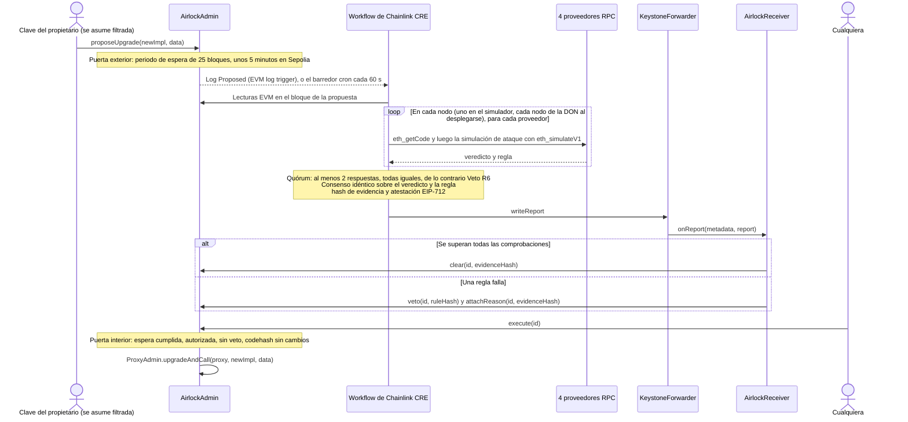

<div align="center">

# Upgrade Airlock

**Cada actualización de un proxy cruza dos puertas: un periodo de espera y una autorización de Chainlink CRE que solo puede obtener el código que sobrevive a una simulación de ataque.**

[English](README.md) · [简体中文](README.zh-CN.md) · [繁體中文](README.zh-TW.md) · [日本語](README.ja.md) · [한국어](README.ko.md) · **Español** · [Français](README.fr.md) · [Deutsch](README.de.md) · [Português (Brasil)](README.pt-BR.md) · [Русский](README.ru.md) · [Tiếng Việt](README.vi.md)

[](https://github.com/tedinroc/upgrade-airlock/actions/workflows/ci.yml)
[](LICENSE)
[](https://upgrade-airlock.pages.dev)
[](https://upgrade-airlock.pages.dev/video/)
[](https://sepolia.etherscan.io/address/0x28e7aAC40560804F480e454bF9C12F50C83b700B)
[](#chainlink-cre)

[Aspectos destacados](#highlights) · [Cómo funciona](#how-it-works) · [Reglas](#rules) · [Chainlink CRE](#chainlink-cre) · [En vivo en Sepolia](#live-on-sepolia) · [Inicio rápido](#quick-start) · [Modelo de seguridad](#security-model)

</div>

> **2nd place, ETH Shenzhen 2026.** This is Ted Chen's copy of the entry; the official submission is [gitlab.com/jiapunk/upgrade-airlock](https://gitlab.com/jiapunk/upgrade-airlock).

## Descripción general

Upgrade Airlock pone dos puertas a cada actualización de contrato. La **puerta exterior** es un periodo de espera
medido en bloques. La **puerta interior** solo se abre con una autorización registrada en la cadena. De forma
automática, eso significa que un workflow de Chainlink CRE ha atacado la nueva implementación en un simulador
consultando a cuatro proveedores RPC independientes, al menos dos han respondido y todas las respuestas han
coincidido, el paso de consenso del workflow (`consensusIdenticalAggregation`) ha acordado el veredicto y un informe
**Clear** firmado ha llegado a la cadena. Cuando CRE no puede responder en absoluto, la clave del aprobador puede
autorizar a mano con evidencia registrada; el barredor sigue juzgando esa propuesta mientras esté entre los 20 ids más
recientes, y un veto de CRE o de un guardián prevalece. Una implementación maliciosa que la búsqueda de ataques
alcanza recibe en cambio un **Veto** firmado y no se ejecuta, aunque el atacante tenga la clave de actualización; el
modo estricto añade una revisión humana del código para lo que una búsqueda acotada no alcanza. Hoy los veredictos los
produce la CLI oficial de CRE (`cre workflow simulate --broadcast`) ejecutando el workflow en un servidor; el mismo
workflow y el mismo código de los contratos pueden desplegarse en una DON. Creado para ETH Shenzhen 2026 sobre
Ethereum Sepolia.

> [!TIP]
> **Demo en vivo: [upgrade-airlock.pages.dev](https://upgrade-airlock.pages.dev)** · **Video de la demo:
> [upgrade-airlock.pages.dev/video](https://upgrade-airlock.pages.dev/video/)** (en chino simplificado e inglés)
>
> La sala de control (war room) lee Ethereum Sepolia directamente desde el navegador, en modo de solo lectura. Cada
> propuesta se representa como una esclusa de aire: la **puerta exterior** registra la propuesta, la **cámara** lleva
> la cuenta regresiva del periodo de espera y la **puerta interior** permanece bloqueada hasta que llega a la cadena
> una autorización (el Clear de Chainlink CRE, o una autorización manual del aprobador, que la sala de control señala
> como tal). Un Veto expulsa la propuesta, con su regla, su hash de evidencia y su transacción. La primera visita abre
> un selector de ataques: cada tarjeta (seis ataques y la actualización honesta v2) reproduce la propuesta real más
> reciente de su tipo en Sepolia, marcada como repetición. La página se abre en chino simplificado:
> [`?lang=en`](https://upgrade-airlock.pages.dev/?lang=en) cambia a inglés y
> [`?lang=zh-TW`](https://upgrade-airlock.pages.dev/?lang=zh-TW) a chino tradicional. Las transacciones que la
> respaldan (propuestas #1–#10) figuran en [la evidencia de la ejecución en vivo](docs/evidence/sepolia-live.md).

## <a id="highlights"></a>Aspectos destacados

- **Cerrado ante fallos (fail-closed) por construcción.** Una actualización solo se ejecuta con una autorización en
  la cadena. Un log no detectado, una caída de RPC, proveedores en desacuerdo o una ejecución fallida dejan la
  propuesta sin autorizar o vetada: eso puede retrasar una actualización, nunca dejarla pasar. Un veto siempre
  prevalece sobre una autorización.
- **Un ataque, no una lista de comprobación.** El workflow (en cada nodo, en un despliegue en una DON) ejecuta la
  actualización contra el estado real del proxy con `eth_simulateV1` en cuatro proveedores RPC. Un desconocido con fondos llama a cada selector del nuevo
  bytecode, argumentos con forma de titular alcanzan cada función nueva, y el suministro, la propiedad y los saldos se
  comparan antes y después. Al menos dos proveedores deben responder y todas las respuestas deben coincidir.
- **Veredictos vinculados a la propuesta.** El paso de consenso idéntico del workflow acuerda `{verdict, rule}`. El informe incluye una
  atestación EIP-712 vinculada al contenido exacto de la propuesta (`proposalDigest`), a la cadena, al receptor y a un
  plazo límite en bloques, además de un hash de evidencia que cualquiera puede recalcular a partir de datos de la
  cadena.
- **Los logs perdidos se recuperan.** Un barredor (sweeper) basado en cron revisa las 20 propuestas más recientes cada
  60 segundos y juzga las que el log trigger haya pasado por alto, incluidas las actualizaciones que el aprobador
  autorizó a mano; su veto prevalece. Una propuesta desplazada por debajo de los 20 ids más recientes ya no se juzga:
  queda sin autorizar salvo que el aprobador la autorizara a mano ([la ventana de barrido](docs/design.md#the-sweep-window)).
- **En vivo en Ethereum Sepolia.** La CLI oficial de CRE ejecutó el workflow en un servidor y respondió en la cadena a
  cada propuesta (diez a 2026-10-23): una actualización honesta autorizada y ejecutada, y nueve ataques vetados (R1,
  R2, R3, R3B, R7, R9). Todos los contratos están verificados en Sourcify.
- **Probado de extremo a extremo.** En [CI](.github/workflows/ci.yml) se ejecutan 117 pruebas de Foundry, 118 pruebas
  unitarias del workflow y 387 de las 394 comprobaciones de autoprueba de la sala de control (las otras 7 necesitan la
  salida de compilación de forge y cast, que el job de CI no tiene); un script de extremo a extremo sobre un fork
  recorre el ciclo completo a través del simulador de CRE.

## El problema

Un proxy actualizable deja todo el protocolo en manos de su clave de actualización. Si esa clave se filtra, el ataque
es corto: desplegar una implementación maliciosa, apuntar el proxy hacia ella, acuñar o drenar. Ha ocurrido muchas
veces:

- **PAID Network, marzo de 2021.** Con las claves del propietario del proxy se sustituyó el código auditado del token
  por una versión con funciones de quema y acuñación, y el atacante acuñó unos 59.5 millones de PAID.
  ([análisis post mortem de CertiK](https://www.certik.com/blog/paid-network-post-mortem))
- **Ankr, diciembre de 2022.** Con la clave comprometida de la cuenta de despliegue, el atacante reemplazó la
  implementación de aBNBc por una que acuñaba sin comprobaciones de autorización: 60 billones de aBNBc.
  ([informe de Ankr](https://www.ankr.com/blog/the-abnbc-token-report/))
- **Radiant Capital, octubre de 2024.** Un atacante que controlaba 3 de los 11 firmantes de la multifirma tomó el
  control del proveedor de los pools de préstamo y actualizó la implementación de esos pools, con lo que drenó más de
  53 millones de dólares.
  ([rekt.news](https://rekt.news/radiant-capital-rekt2))

Un timelock solo hace esperar al atacante, y nadie está obligado a mirar durante la espera. Además, los retrasos
largos bloquean las correcciones de emergencia. Upgrade Airlock pone la espera a trabajar: una actualización no puede
ejecutarse hasta que una comprobación independiente (descentralizada una vez desplegada en una DON de CRE) la haya
aprobado, y esa comprobación se ejecuta
automáticamente en cada propuesta.

## <a id="how-it-works"></a>Cómo funciona



1. **Proponer.** `AirlockAdmin` es el propietario del `ProxyAdmin` de OpenZeppelin y del `Ownable` del token. La clave
   del propietario (owner) solo puede proponer: nunca es guardián, ni el aprobador, ni el oráculo de autorización. Cada
   propuesta (una actualización o un cambio en la propia esclusa: guardianes, retraso, destino de break-glass) recibe
   `readyBlock = block.number + delayBlocks`. El destino de una actualización o de break-glass debe ser código de
   contrato ordinario: una cuenta delegada EIP-7702, cuya clave podría redirigirla después del veredicto, se rechaza
   (`DelegatedAccount`).
2. **Juzgar.** El log trigger de CRE se dispara con `Proposed`. Un cambio en la esclusa se juzga a partir de lecturas
   de la cadena (R7). Una actualización pasa primero por las reglas estáticas (R5, R8) y luego por la simulación de
   ataque, fijada al bloque de la propuesta: el slot de implementación ERC-1967 del proxy se sobrescribe con el nuevo
   código, y una dirección desconocida recién generada (derivada del hash del bloque de la propuesta) recibe fondos
   como un usuario real, con tokens de un segundo titular y ETH. Un titular hace una transferencia, el desconocido
   llama a `transferFrom` sin allowance y después a cada selector encontrado en el nuevo bytecode con cinco formas de
   argumentos. Cada selector ajeno a la interfaz estándar de tokens se llama además con argumentos con forma de
   titular: el titular con fondos en cada una de las cuatro primeras posiciones de argumento, la cantidad de prueba en
   otra y el desconocido o el proxy en el resto. El suministro, el propietario y cada saldo vigilado se leen antes y
   después; el saldo del titular, además, justo después de cada llamada con forma de titular; y se comprueban los
   eventos propios de cada sonda (R1 a R4, R3B). Por último, se analiza el nuevo bytecode en busca de opcodes que no se
   comportan igual en un bloque real que en una simulación (R9).
3. **Acordar.** Cada nodo (cada nodo de la DON en un despliegue en una DON; hoy, el simulador de la CLI) ejecuta la
   simulación en cuatro proveedores. Al menos dos deben responder y todas las respuestas deben dar el mismo veredicto;
   cualquier otro resultado es un veto (R6). Después, el paso de consenso acuerda un `{verdict, rule}` idéntico.
4. **Informar.** El workflow calcula el hash de un JSON de evidencia canónico, firma un veredicto EIP-712 con su clave
   de atestador (un secreto de CRE) y escribe el informe a través del forwarder. `AirlockReceiver` comprueba el
   remitente, la vigencia, la firma y que el veredicto esté vinculado a esta propuesta exacta (`proposalDigest`), y luego
   llama a `clear`, o a `veto` y `attachReason`, en `AirlockAdmin`.
5. **Ejecutar.** Cualquiera puede llamar a `execute(id)` una vez terminado el periodo de espera. Revierte con
   `TooEarly` durante el periodo de espera, `NotCleared` sin autorización, `ProposalVetoed` tras un veto y
   `CodehashChanged` cuando el destino ya no contiene el código que se propuso y se juzgó. Un veto siempre prevalece
   sobre una autorización.
6. **Barrer.** Un cron trigger vuelve a revisar las propuestas más recientes cada 60 segundos y juzga cada propuesta
   pendiente a la que CRE aún no ha respondido (`oracleJudged`): un log que el trigger pasó por alto, un evento
   `Proposed` demasiado grande para entregarse o una actualización que el aprobador autorizó a mano. Su veto prevalece
   sobre esa autorización.

**Todo fallo apunta en la misma dirección.** Un log no detectado, una caída de RPC, proveedores en desacuerdo o una
ejecución fallida dejan la propuesta sin autorización o la vetan, de modo que retrasan una actualización y nunca la
dejan pasar. Cuando CRE no puede responder en absoluto, la clave del aprobador puede autorizar una actualización a mano
con evidencia registrada; el barredor juzga igualmente esa actualización en cuanto CRE vuelve a responder, y un veto de
CRE o de un guardián sigue prevaleciendo. `breakGlass()` permite al propietario o a cualquier guardián cambiar de
inmediato el proxy a una implementación pausada registrada de antemano. Salir del estado pausado es una actualización
que cruza ambas puertas; una propuesta autorizada nunca caduca, así que una actualización autorizada antes también puede
terminar la pausa ([limitaciones conocidas](docs/design.md#known-limitations)).

Más detalles: [docs/design.md](docs/design.md) (modelo de amenazas, máquina de estados de la autorización, vinculación
del informe, presupuestos) y [cre/README.md](cre/README.md) (el workflow).

## <a id="rules"></a>Reglas

`ruleHash = keccak256("GUARD/<ID>")`, registrado en la cadena con cada veto.

| Regla | Veta cuando | Lo decide |
|---|---|---|
| R1 `TOTAL_SUPPLY` | la llamada de un desconocido cambia `totalSupply` | simulación de ataque |
| R2 `OWNER` | la llamada de un desconocido cambia `owner()` | simulación de ataque |
| R3 `TRANSFER_CONSERVATION` | la transferencia de X por parte de un titular no mueve exactamente X, o mueve el saldo de cualquier otra cuenta | simulación de ataque |
| R3B `THIRD_PARTY_FUNDS` | un tercero mueve los tokens de cualquier titular: el `transferFrom` sin allowance del desconocido con fondos tiene éxito, o una de sus sondas mueve tokens de cualquier otra cuenta, acuña, quema o transfiere la propiedad, o deja más bajo el saldo del titular, incluso sin evento o cuando una llamada posterior lo deshace | simulación de ataque |
| R4 `TRANSFER_LIVENESS` | falla una transferencia simple de un titular | simulación de ataque |
| R5 `STRICT_CODEHASH` | el modo estricto está activado y el aprobador no ha aprobado el codehash | lecturas de la cadena |
| R6 `SIM_FAILURE` | la simulación no puede decidir: los proveedores discrepan, responden demasiado pocos, el código no coincide, una llamada view o la financiación del desconocido revierte, o las sondas no caben en las solicitudes configuradas | simulación y quórum |
| R7 `CONFIG_GUARD` | un cambio de guardianes, un retraso más corto o un nuevo destino de break-glass sin la preaprobación del aprobador | lecturas de la cadena |
| R8 `INIT_DATA` | una actualización lleva datos de inicialización que el aprobador no ha aprobado junto con el codehash | lecturas de la cadena |
| R9 `NEW_OPCODES` | el nuevo código contiene un opcode de contexto de bloque o de transacción (BASEFEE, TIMESTAMP, NUMBER, ORIGIN, GAS y otros), una llamada externa, un create o un selfdestruct que la lista de permitidos (allowlist) fija de la configuración (vacía por defecto) no cubre, salvo que el aprobador haya aprobado ese codehash exacto | bytecode |

**R9 cierra la evasión de la simulación.** `EvilBaseFeeImpl` se comporta como v1 mientras `block.basefee == 0`, que es
lo que ve una llamada `eth_simulateV1`, y permite que cualquiera acuñe en un bloque real. Todos los invariantes
simulados se cumplen; su opcode `BASEFEE` provoca el veto. La lista de permitidos nunca depende del código que el
proxy ejecuta hoy, así que una aprobación cubre un único codehash y ninguna actualización posterior. El análisis omite
la cola de metadatos del compilador solo cuando es un mapa CBOR exacto de solc que ninguna instrucción puede alcanzar;
todo lo demás se analiza como código. Aprobar un codehash lo exime de R9 y hace que se tolere el truncamiento de
sondas (R6), nada más: todas las demás reglas se siguen ejecutando.

**R3B cierra el drenaje silencioso.** `EvilDrainImpl` es v1 más `rescue(from, to, amount)` sin control de acceso. El
suministro, el propietario, las transferencias y los opcodes son los de v1, así que R1 a R4 y R9 se superan todas.
`rescue` no es una función estándar de token, de modo que el desconocido también la llama con argumentos con forma de
titular; la llamada con el titular como `from` mueve los tokens del titular y R3B la veta. También se alcanza un
drenaje que se esconde tras "solo para quienes llaman con tokens o ETH", porque el desconocido tiene ambos.

### Modo automático y modo estricto

**El modo automático**, el predeterminado, hace que CRE autorice o vete cada actualización por sí solo mediante una
búsqueda de ataques acotada: un llamador externo con fondos, cada selector del nuevo código y el titular en cada una de
las cuatro primeras posiciones de argumento de cada función nueva. **El modo estricto** (R5) añade una revisión
humana: el codehash de cada nueva implementación debe aprobarlo primero la clave del aprobador, y la simulación de
ataque se sigue ejecutando. El modo automático es adecuado para un token que quiere que sus actualizaciones rutinarias
se autoricen en minutos; el modo estricto hace que una revisión de código forme parte de la autorización
([los dos modos](docs/design.md#two-modes-automatic-and-strict)).

## Chainlink CRE

CRE es la capa de orquestación de Upgrade Airlock: el workflow es la única vía automatizada para cruzar la puerta
interior, y se encarga de cada paso, desde el trigger en la cadena hasta el veredicto en la cadena. Está escrito con el
SDK de TypeScript de CRE (`@chainlink/cre-sdk` 1.23.0) y se compila a WASM con la CLI de CRE v1.37.0.

| Tecnología de Chainlink | Dónde | Qué hace aquí |
|---|---|---|
| CRE workflow runner | [`cre/veto/main.ts#L1-L9`](cre/veto/main.ts#L1-L9), [`cre/veto/workflow.yaml`](cre/veto/workflow.yaml), [`cre/project.yaml`](cre/project.yaml) | Dos handlers y los targets `sepolia` y `sepolia-fork` |
| EVM log trigger | [`cre/veto/workflow.ts#L202-L211`](cre/veto/workflow.ts#L202-L211), [`#L193-L198`](cre/veto/workflow.ts#L193-L198), [`#L54-L65`](cre/veto/workflow.ts#L54-L65) | `AirlockAdmin.Proposed` en `LATEST`: una propuesta se juzga en cuanto aparece, todo un periodo de espera antes de que pueda ejecutarse |
| Cron trigger | [`cre/veto/workflow.ts#L200`](cre/veto/workflow.ts#L200), [`#L209`](cre/veto/workflow.ts#L209), [`cre/veto/airlock.ts#L323-L389`](cre/veto/airlock.ts#L323-L389) | El barredor: los 20 ids más recientes, cada minuto |
| Lectura EVM (`callContract`) | [`cre/veto/workflow.ts#L114-L122`](cre/veto/workflow.ts#L114-L122), [`#L137-L142`](cre/veto/workflow.ts#L137-L142), [`cre/veto/chain.ts`](cre/veto/chain.ts) | Propuesta, autorización, `oracleJudged`, aprobaciones y saldos, agrupados con Multicall3 en el bloque de la propuesta o en `LATEST` |
| Lectura EVM (`headerByNumber`) | [`cre/veto/workflow.ts#L125-L136`](cre/veto/workflow.ts#L125-L136) | El último bloque y el hash del bloque de la propuesta, que sirve de semilla para el desconocido simulado |
| Capacidad HTTP en modo nodo (node mode) | [`cre/veto/workflow.ts#L167-L189`](cre/veto/workflow.ts#L167-L189), [`#L80-L94`](cre/veto/workflow.ts#L80-L94), [`cre/veto/judge.ts#L157-L220`](cre/veto/judge.ts#L157-L220) | Cada nodo envía a cada proveedor `eth_getCode` y luego una o dos solicitudes `eth_simulateV1` (cada una por debajo del límite de 120 kb por solicitud) |
| `consensusIdenticalAggregation` | [`cre/veto/workflow.ts#L184-L188`](cre/veto/workflow.ts#L184-L188), quórum en [`cre/veto/judge.ts#L244-L277`](cre/veto/judge.ts#L244-L277) | Consenso idéntico sobre `{verdict, rule}` (como máximo 52 bytes; cada nodo de la DON al desplegarse) |
| Secretos (Secrets) | [`cre/veto/workflow.ts#L160-L166`](cre/veto/workflow.ts#L160-L166), [`cre/secrets.yaml`](cre/secrets.yaml) | La clave de atestador EIP-712, obtenida una vez por ejecución |
| Informe (report) + `writeReport` | [`cre/veto/workflow.ts#L143-L149`](cre/veto/workflow.ts#L143-L149), [`cre/veto/airlock.ts#L229-L282`](cre/veto/airlock.ts#L229-L282), [`cre/veto/report.ts`](cre/veto/report.ts) | `runtime.report` (ECDSA, keccak256) y `evm.writeReport`, seguidos de una lectura de la propuesta para confirmar el resultado |
| Forwarder + `IReceiver` | [`src/cre/AirlockReceiver.sol#L88-L120`](src/cre/AirlockReceiver.sol#L88-L120), [`#L156-L169`](src/cre/AirlockReceiver.sol#L156-L169), [`src/cre/IReceiver.sol`](src/cre/IReceiver.sol), [`script/DeployEth.s.sol#L142`](script/DeployEth.s.sol#L142) | `onReport` solo acepta el forwarder configurado y comprueba el ID y el propietario del workflow cuando están configurados |
| Selectores de cadena (chain selectors) | [`cre/veto/workflow.ts#L100-L104`](cre/veto/workflow.ts#L100-L104) | `ethereum-testnet-sepolia` |
| CRE CLI | [`cre/setup.sh`](cre/setup.sh), [`cre/scripts/fork-e2e.sh`](cre/scripts/fork-e2e.sh), [`scripts/sepolia/airlock.sh`](scripts/sepolia/airlock.sh), [`scripts/sepolia/sweep.sh`](scripts/sepolia/sweep.sh) | `cre workflow build`, `cre workflow simulate --broadcast` |

**Cómo se ejecuta hoy el workflow.** El workflow se ejecuta con `cre workflow simulate --broadcast` de la CLI de CRE
contra Ethereum Sepolia. El listener ([`scripts/sepolia/airlock.sh`](scripts/sepolia/airlock.sh)) mantiene el log
trigger en modo de escucha, el barredor ([`scripts/sepolia/sweep.sh`](scripts/sepolia/sweep.sh)) ejecuta el handler
de cron cada minuto, y cada Clear y cada Veto es una transacción real en Sepolia a través del MockKeystoneForwarder de
Chainlink en Sepolia
[`0x15fC6ae953E024d975e77382eEeC56A9101f9F88`](https://docs.chain.link/cre/guides/workflow/using-evm-client/forwarder-directory-ts).
`AirlockReceiver` está listo tal cual para un despliegue en una DON: al desplegarlo con `FORWARDER` apuntando al
KeystoneForwarder de producción y con `WORKFLOW_ID` / `WORKFLOW_OWNER` definidos, `onReport` comprueba además los
metadatos del workflow firmados por la DON. `DeployEth` rechaza el MockKeystoneForwarder, abierto a cualquiera
(permissionless), salvo que ambos estén definidos o que `ALLOW_MOCK_FORWARDER=1` lo indique explícitamente
([`script/DeployEth.s.sol#L96-L104`](script/DeployEth.s.sol#L96-L104)).

**Diseñado para los límites por ejecución de CRE.** Como máximo 15 lecturas de la cadena (lotes de Multicall3 por
debajo del límite de payload de 5 kb), 12 de 15 llamadas HTTP con cuatro proveedores, una simulación de ataque por
ejecución y un valor de consenso de como máximo 52 bytes. Los presupuestos están en
[docs/design.md](docs/design.md#budgets).

## <a id="live-on-sepolia"></a>En vivo en Sepolia

Ethereum Sepolia, chain id 11155111. Desplegado con [`script/DeployEth.s.sol`](script/DeployEth.s.sol) en los bloques
11950684–11950699 (13 transacciones; AirlockAdmin en el bloque 11950697); todos los contratos están verificados en Sourcify. El propietario, el aprobador, el
guardián de emergencia y el atestador son cuatro claves distintas. El periodo de espera es de 25 bloques.

| Contrato | Dirección |
|---|---|
| AirlockAdmin | [`0x28e7aAC40560804F480e454bF9C12F50C83b700B`](https://sepolia.etherscan.io/address/0x28e7aAC40560804F480e454bF9C12F50C83b700B) |
| AirlockReceiver | [`0xE40D463116F4Aa24d5E79776a65ED0f1b088c670`](https://sepolia.etherscan.io/address/0xE40D463116F4Aa24d5E79776a65ED0f1b088c670) |
| Proxy de DemoBTC (dBTC) | [`0x88Cc569265faDAEAc2a16B69f35E10B2158e4b71`](https://sepolia.etherscan.io/address/0x88Cc569265faDAEAc2a16B69f35E10B2158e4b71) |
| ProxyAdmin | [`0x51a3fE6AD22BF7753574B7b7FD56aE9a65bd593E`](https://sepolia.etherscan.io/address/0x51a3fE6AD22BF7753574B7b7FD56aE9a65bd593E) |
| DemoBTC v1 | [`0x8f7d6453d77B3f3b008CBE4A144d82c5742eB108`](https://sepolia.etherscan.io/address/0x8f7d6453d77B3f3b008CBE4A144d82c5742eB108) |
| DemoBTC v2 (actualización honesta) | [`0x4D959f981C01E3B81ac6C9A20E84816Fe5f6Bce3`](https://sepolia.etherscan.io/address/0x4D959f981C01E3B81ac6C9A20E84816Fe5f6Bce3) |
| EvilMintImpl | [`0x01502c4af90c27f53B2E1293941670C6B761CAAA`](https://sepolia.etherscan.io/address/0x01502c4af90c27f53B2E1293941670C6B761CAAA) |
| EvilOwnerImpl | [`0xBe849DE8e0a4D9b0010ba1468f94Eeb24A42d488`](https://sepolia.etherscan.io/address/0xBe849DE8e0a4D9b0010ba1468f94Eeb24A42d488) |
| EvilFeeImpl | [`0xB95Ffa7b970B1a73488e2fC32B787fA536F12AF5`](https://sepolia.etherscan.io/address/0xB95Ffa7b970B1a73488e2fC32B787fA536F12AF5) |
| EvilBaseFeeImpl | [`0xE1AAa4E88DB9cc7ceCca14722eE2874D834e0310`](https://sepolia.etherscan.io/address/0xE1AAa4E88DB9cc7ceCca14722eE2874D834e0310) |
| EvilDrainImpl | [`0x1d98D64BC5204AE139B5A0747855841Fa5333b6d`](https://sepolia.etherscan.io/address/0x1d98D64BC5204AE139B5A0747855841Fa5333b6d) |
| PausedImpl (destino de break-glass) | [`0xb6573006fB607E96966d0F578B96AAB25413F5BE`](https://sepolia.etherscan.io/address/0xb6573006fB607E96966d0F578B96AAB25413F5BE) |
| Chainlink MockKeystoneForwarder | [`0x15fC6ae953E024d975e77382eEeC56A9101f9F88`](https://sepolia.etherscan.io/address/0x15fC6ae953E024d975e77382eEeC56A9101f9F88) |

La primera ejecución: siete propuestas, siete veredictos en la cadena (las ejecuciones posteriores #8–#10 se
listan en [docs/evidence/sepolia-live.md](docs/evidence/sepolia-live.md)). El bloque de cada enlace es el bloque en el que se incluyó la
transacción; `(+n)` indica cuántos bloques después de la propuesta llegó el veredicto de CRE.

| Tarjeta | Propuesta | Veredicto de CRE | Tx de la propuesta | Tx del informe | Después |
|---|---|---|---|---|---|
| `v2`: actualización honesta | #4 | Clear | [11950745](https://sepolia.etherscan.io/tx/0x3cd96ac220391e2b404d35591d1a96808b75256e7c685a414e2ca5a63bc54145) | [11950747 (+2)](https://sepolia.etherscan.io/tx/0x2c02d2a23016a72509900eb7ce92dabc06b0dd93a2394d076a62d687ce467efb) | `execute` [11950772](https://sepolia.etherscan.io/tx/0x01913c1854b9862763af74ddacd7be23a7f55232af7334714aa8213aa7021890), `version()` = "2" |
| `evil-mint`: cualquiera puede acuñar | #1 | Veto R1 | [11950735](https://sepolia.etherscan.io/tx/0x862c5fdf826a8fef09fe2ff278d3e58191f93c267dbdd38ad9aaa270f39937b0) | [11950736 (+1)](https://sepolia.etherscan.io/tx/0xb0d74e25e2528fb9aad7d21de202dac288cd256048f2986b5214280fda4b84f6) | `execute` revierte con `ProposalVetoed` |
| `evil-owner`: cualquiera puede tomar la propiedad | #6 | Veto R2 | [11950788](https://sepolia.etherscan.io/tx/0x32eb22039bd43602e0406b1a8f9a02c5cbcdb5cf2ef1c389919a45d05820da25) | [11950790 (+2)](https://sepolia.etherscan.io/tx/0x49451bee7a2f3351b18992d94b5f89b9ff89cf53be65a937400ab95fb79be551) | `execute` revierte con `ProposalVetoed` |
| `evil-fee`: las transferencias desvían un 10% | #7 | Veto R3 | [11950792](https://sepolia.etherscan.io/tx/0xe06924c2e3961ab27d2803c0654b783fc06e52107345bda9bfeff391053fcad3) | [11950794 (+2)](https://sepolia.etherscan.io/tx/0x01f6055a683e0dabc8f34ae094e5daa5a81ddb11c687aa9c5ac6e30c7a7f3d3b) | `execute` revierte con `ProposalVetoed` |
| `evil-basefee`: la acuñación se abre en un bloque real | #3 | Veto R9 | [11950742](https://sepolia.etherscan.io/tx/0x3c29c118ca395ca92500abcaae6126244924fbd8e14f846af57b70f113cad6e1) | [11950743 (+1)](https://sepolia.etherscan.io/tx/0xb6db2d832112384287e5a7ccdd086127931360900d09c80645c21eac2bc165db) | `execute` revierte con `ProposalVetoed` |
| `evil-drain`: cualquiera mueve los tokens de un titular | #2 | Veto R3B | [11950737](https://sepolia.etherscan.io/tx/0x0e52369921040eb0c901ac3a077aff762d370b4efd9503a52c91360d56366b16) | [11950740 (+3)](https://sepolia.etherscan.io/tx/0x40bbe374a8cee47a94da977f973cf66a67573c12bc84117483fcbd11430f90cb) | `execute` revierte con `ProposalVetoed` |
| `remove-receiver`: retirar a CRE como guardián | #5 | Veto R7 | [11950749](https://sepolia.etherscan.io/tx/0xda2bd1c9dc5f7770da3926358b8da3ffe5a1cd3154b499cafae440387eebb934) | [11950750 (+1)](https://sepolia.etherscan.io/tx/0xaa2f598bdcc7f46727e5456528521e50ac5c1d8e423805042cbf2d10a4c4cdac) | `execute` revierte con `ProposalVetoed` |

Todos los veredictos anteriores proceden de la CLI oficial de CRE, que ejecutó este workflow en un servidor (el
listener del log trigger más el barredor de 60 segundos, [`scripts/sepolia/systemd/`](scripts/sepolia/systemd)); las
líneas de log del propio workflow están en [`docs/evidence/sepolia-live.md`](docs/evidence/sepolia-live.md).

## <a id="quick-start"></a>Inicio rápido

### Requisitos previos

- [Foundry](https://getfoundry.sh) (`forge`, `cast`, `anvil`), `jq` y Node 22.
- Una cuenta de CRE para el simulador (`cre login`), que utilizan la ejecución de extremo a extremo sobre el fork y el
  kit del operador.
- [`cre/setup.sh`](cre/setup.sh) instala la CLI de CRE v1.37.0 (con su SHA-256 fijado) y bun 1.4.2 en `cre/.tools`.

### Compilar y probar

```bash
git clone https://github.com/tedinroc/upgrade-airlock.git
cd upgrade-airlock

# contratos (OpenZeppelin y forge-std vienen incluidos en lib/)
forge build                     # descarga una sola vez el solc 0.8.37 fijado
forge test --offline            # 117 pruebas

# el workflow de CRE
cre/setup.sh
export PATH="$PWD/cre/.tools/bin:$PWD/cre/.tools/node_modules/.bin:$PATH"
(cd cre/veto && bun test && bun run typecheck)    # 118 pruebas: reglas, sondas, bytecode, informes, presupuestos, handlers

# la sala de control
(cd web && npm ci && npm run selftest)            # 394 comprobaciones: vista en vivo y selector de ataques, reproducción sin conexión, API del operador
```

### De extremo a extremo sobre un fork de Sepolia

```bash
cre login                       # una sola vez; el simulador necesita una cuenta de CRE
cre/scripts/fork-e2e.sh         # un fork local de Sepolia con anvil: no se envía nada a una red real
```

[`cre/scripts/fork-e2e.sh`](cre/scripts/fork-e2e.sh) despliega el stack en el fork, ejecuta el workflow en el
simulador de CRE con `--broadcast` y comprueba cada resultado en la cadena:

- **Log trigger:** EvilMint vetado por R1, EvilOwner por R2, EvilFee por R3, EvilBaseFee por R9 (señala `BASEFEE`),
  EvilDrain por R3B (señala `rescue`, con todas las demás reglas superadas); siete drenajes más
  ([`test/fixtures/DrainVariants.sol`](test/fixtures/DrainVariants.sol)) vetados solo por R3B: argumentos
  reordenados, una condición de guarda sobre la dirección del token, un drenaje abierto solo a quienes llaman con
  tokens o ETH, uno sin evento `Transfer` y un `transferFrom` que omite el allowance para los titulares de tokens; la
  v2 honesta, autorizada y ejecutada tras el periodo de espera; la retirada del receptor como guardián, vetada por R7;
  un retraso más corto preaprobado por el aprobador, autorizado.
- **Barredor:** una actualización que nadie juzgó revierte con `NotCleared` tras el periodo de espera, una pasada del
  barredor la autoriza y se ejecuta; dos propuestas que el aprobador autorizó a mano las juzga la pasada siguiente:
  EvilDrain, vetado por R3B por encima de la autorización, y un retraso más largo, autorizado también por CRE; una
  actualización con 6 KB de datos de inicialización queda vetada por R8 en la pasada posterior.
- **Evidencia:** cada propuesta vetada revierte con `ProposalVetoed`, y el hash de evidencia de cada veredicto se
  recalcula a partir de datos de la cadena ([`cre/veto/tools/check-evidence.ts`](cre/veto/tools/check-evidence.ts)).

### Kit del operador para Sepolia

[`scripts/sepolia/`](scripts/sepolia/README.md) ejecuta la demo en vivo. Las claves se guardan fuera del repositorio,
una clave hexadecimal por archivo en `KEY_DIR` (`owner.key`, `attester.key`, `sender.key`, `approver.key`,
`emergency.key`, más un `sweeper.key` opcional); los scripts
nunca las imprimen, y `deploy.sh` se niega a continuar salvo que el propietario, el aprobador, el guardián de
emergencia y el atestador sean cuatro claves distintas. Cada script funciona también contra un fork local con
`FORK=<port>`, de modo que la demo puede ensayarse sin gastar nada.

```bash
scripts/sepolia/deploy.sh                    # 13 transacciones, escribe deployments/sepolia.json (FORCE=1 reemplaza uno existente)
bun scripts/sepolia/make-config.mjs          # la configuración del workflow, 4 proveedores, quórum 2
scripts/sepolia/fund-sender.sh 0.05          # ETH para las transacciones de los informes
scripts/sepolia/airlock.sh                   # terminal A: el listener de CRE (log trigger)
scripts/sepolia/propose.sh v2                # terminal B: después evil-mint, evil-owner, evil-fee, evil-basefee, evil-drain, remove-receiver
scripts/sepolia/execute.sh <id>              # ejecuta una propuesta autorizada tras su periodo de espera; si no, muestra el revert
scripts/sepolia/status.sh                    # cada propuesta: veredicto, si CRE la juzgó, regla, evidencia, txs
```

`sweep.sh` ejecuta una vez el barredor cron, `clear.sh` es la autorización manual del aprobador, `fork.sh` arranca,
guarda y restaura un fork de Sepolia, `probe-rpcs.ts` comprueba cada proveedor con el propio código de evaluación del
workflow, y `systemd/` ejecuta el listener y el barredor en un servidor Linux.

### Sala de control (war room)

```bash
cd web
npm ci
npm run dev                     # http://127.0.0.1:5173/
npm run build:airlock           # sincroniza deployments/sepolia.json con la página y compila web/dist-airlock
```

La página lee Sepolia directamente; no guarda ninguna clave y nunca firma ni envía nada. Muestra cada propuesta como
una esclusa de aire: el periodo de espera, la autorización de CRE, el veto con su regla y su evidencia. Los visitantes
eligen una de siete tarjetas (seis ataques y la actualización honesta v2) y ven una repetición, marcada como tal, de
la propuesta real más reciente de ese tipo en Sepolia (o la propuesta en vivo mientras esté en su periodo de espera):
véase [el selector de ataques](web/README.md#attack-picker-what-a-visitor-sees). Para quien presenta hay un modo
operador (`web/operator/`, `web/functions/`): solo por loopback en el servidor de desarrollo y con token en Cloudflare
Pages, donde está apagado salvo que existan los dos secretos `OWNER_KEY` y `OPERATOR_TOKEN`. Envía una de las mismas
siete propuestas fijas mediante `POST /api/operator/propose`, firmada en el servidor con la clave del propietario (el
diseño ya asume que esa clave se filtra: solo puede proponer), y la página de un visitante nunca lo llama: véase [el
modo operador](web/README.md#operator-mode-real-attacks-on-sepolia).

| Parámetro de URL | Efecto |
|---|---|
| `?mode=airlock` | Predeterminado. Vista en vivo de Ethereum Sepolia, de solo lectura |
| `?mode=offline` | Reproduce una ejecución grabada sin ninguna conexión de red |
| `?lang=en`, `?lang=zh-TW`, `?lang=zh-CN` | Idioma de la interfaz (predeterminado `zh-CN`; `L` los recorre en ciclo) |
| `?rpc=http://127.0.0.1:<port>` | Lee en su lugar un fork local de Sepolia, para ensayos |
| `?op=1` | Modo operador: pide el token del operador (solo para quien presenta) |

En el modo en vivo, la tecla `P` vuelve a reproducir las propuestas más recientes a partir de sus eventos en la
cadena, y las teclas `1` a `7` reproducen una tarjeta del selector.

## Estructura del repositorio

```
src/AirlockAdmin.sol            las dos puertas: propuestas, periodo de espera, veto de guardianes, autorización,
                                execute, breakGlass
src/cre/AirlockReceiver.sol     receptor de informes de CRE: forwarder, metadatos del workflow, atestación EIP-712,
                                vinculación al digest
src/cre/IReceiver.sol           interfaz de receptor de Chainlink CRE
src/DemoBTC.sol, DemoBTCV2.sol  token de demostración (dBTC) v1 y la v2 honesta
src/PausedImpl.sol              destino de break-glass: todo cambio de saldo revierte
src/attack/                     EvilMintImpl, EvilOwnerImpl, EvilFeeImpl, EvilBaseFeeImpl, EvilDrainImpl
script/DeployEth.s.sol          despliegue (13 transacciones) con comprobaciones de roles, del forwarder y del
                                cableado posterior al despliegue
test/                           pruebas de Foundry; fixtures/DrainVariants.sol contiene las siete variantes de drenaje
cre/veto/                       el workflow de CRE: workflow.ts (capacidades), airlock.ts (handlers), judge.ts
                                (reglas, quórum), simulate.ts (eth_simulateV1), bytecode.ts (selectores, R9),
                                report.ts (informe, EIP-712, evidencia), chain.ts (presupuesto de lecturas), keys.ts,
                                rules.ts, config.ts
cre/veto/test/                  pruebas unitarias con Bun
cre/veto/tools/                 check-evidence.ts recalcula cada hash de evidencia registrado en la cadena
cre/scripts/fork-e2e.sh         de extremo a extremo sobre un fork de Sepolia con anvil
cre/setup.sh                    CLI de CRE y bun con versiones fijadas
scripts/sepolia/                kit del operador para la demo en vivo, con unidades systemd para un servidor
web/                            sala de control (Vite, TypeScript, viem)
web/operator/, web/functions/   modo operador: siete propuestas fijas firmadas en el servidor (servidor de desarrollo, Pages Functions)
deployments/sepolia.json        el despliegue en vivo
docs/design.md                  modelo de amenazas, máquina de estados de la autorización, vinculación del informe,
                                presupuestos
docs/evidence/                  la ejecución en vivo registrada
.github/workflows/ci.yml        comprobaciones de los contratos, del workflow y de la sala de control
```

## <a id="security-model"></a>Modelo de seguridad

Upgrade Airlock parte de que la clave del propietario se filtra, y está construido para que esa clave por sí sola
nunca pueda ejecutar una actualización.

| Rol | En manos de | Puede |
|---|---|---|
| Propietario (owner) | una clave | proponer actualizaciones y cambios en la esclusa (guardianes, retraso, destino de break-glass); `breakGlass` |
| Aprobador (approver) | una clave aparte | autorizar a mano cuando CRE no puede responder; aprobar codehashes, datos de inicialización y cambios en la esclusa (`approveCodehash`) |
| Guardián de emergencia | una clave aparte | aplicar `veto` a una propuesta pendiente; `breakGlass` |
| Atestador (attester) | un secreto de CRE, con su propia clave | firmar los veredictos EIP-712 que acepta `AirlockReceiver` |
| AirlockReceiver | el receptor de informes de CRE | oráculo de autorización (`clear`) y guardián (`veto`, `attachReason`) |
| Cualquiera | | ejecutar con `execute` una propuesta que ha cruzado ambas puertas |

Los roles nunca se solapan. El constructor de `AirlockAdmin` rechaza un propietario que sea también el aprobador, un
guardián o el oráculo de autorización (`RoleOverlap`), y `DeployEth` solo despliega cuando el propietario, el
aprobador, el guardián de emergencia y el atestador son cuatro direcciones distintas.

**Una clave de propietario filtrada puede proponer.** Cada propuesta cumple su periodo de espera a la vista de todos
mientras CRE la juzga, y necesita una autorización que el propietario no puede darse a sí mismo. El propietario
también puede accionar el freno de emergencia (`breakGlass`), que solo cambia el proxy a la implementación pausada
registrada de antemano; salir de ella es una actualización que cruza ambas puertas, y una actualización autorizada
antes y nunca ejecutada también puede terminarla.

**Esa misma clave no puede:**

- ejecutar sin autorización: `AirlockAdmin` no tiene una ruta de llamada genérica, y la única forma de cambiar la
  implementación es `execute` de una actualización autorizada (o `breakGlass` hacia la implementación pausada);
- debilitar antes la esclusa: retirar el receptor de CRE, acortar el retraso o cambiar el destino de break-glass
  también son propuestas, y R7 las veta sin la preaprobación del aprobador;
- cambiar el código después del veredicto: `execute` vuelve a comprobar el codehash del destino (`CodehashChanged`),
  y las cuentas delegadas EIP-7702 se rechazan (`DelegatedAccount`);
- falsificar o reutilizar un veredicto: `AirlockReceiver` solo acepta un informe que llegue del forwarder
  configurado, firmado por el atestador, no más tarde de su `validUntilBlock` y vinculado al `proposalDigest` de la
  propuesta en esta cadena y este receptor.

La autorización manual del aprobador es un mecanismo de excepción para cuando CRE no puede responder: el barredor sigue
juzgando esa propuesta mientras esté entre los 20 ids más recientes, y un veto de CRE o de un guardián prevalece. El
modelo de amenazas completo está en [docs/design.md](docs/design.md#threat-model).

Son contratos de demostración para testnet con limitaciones conocidas, cada una fijada por una prueba que pasa: las
autorizaciones nunca caducan, la clave del propietario no se puede rotar (una robada puede volver a pausar el token
tras cada reanudación) y un solo guardián deshonesto puede mantenerlo en pausa. Están listadas en
[docs/design.md](docs/design.md#known-limitations).

## Tecnologías

- **Solidity 0.8.37** y **Foundry**, con OpenZeppelin Contracts 5.7.0 (`ProxyAdmin`,
  `TransparentUpgradeableProxy`, `EIP712`, `ECDSA`)
- **Chainlink CRE**: el SDK de TypeScript (`@chainlink/cre-sdk` 1.23.0) y la CLI de CRE v1.37.0, sobre Bun 1.4.2
- **viem** para la codificación ABI y las lecturas de la cadena, en el workflow y en la sala de control
- **Vite** y TypeScript para la sala de control

## Herramientas de IA

Upgrade Airlock se construyó con [Claude Code](https://claude.com/claude-code) bajo la dirección de su autor: los
contratos, el workflow de CRE, las pruebas, los scripts, la sala de control y estos documentos se escribieron y
verificaron con esta herramienta.

## Licencia

[MIT](LICENSE) © 2026 jiapunk
