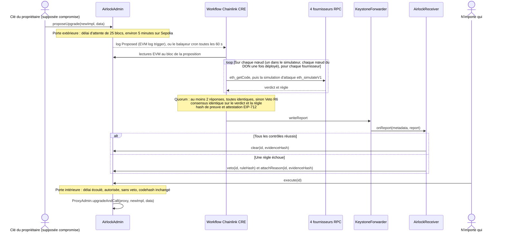

<div align="center">

# Upgrade Airlock

**Chaque mise à niveau de proxy franchit deux portes : un délai d'attente, puis une autorisation Chainlink CRE que seul un code ayant survécu à une simulation d'attaque peut obtenir.**

[English](README.md) · [简体中文](README.zh-CN.md) · [繁體中文](README.zh-TW.md) · [日本語](README.ja.md) · [한국어](README.ko.md) · [Español](README.es.md) · **Français** · [Deutsch](README.de.md) · [Português (Brasil)](README.pt-BR.md) · [Русский](README.ru.md) · [Tiếng Việt](README.vi.md)

[](https://github.com/jiapunk/upgrade-airlock/actions/workflows/ci.yml)
[](LICENSE)
[](https://upgrade-airlock.pages.dev)
[](https://upgrade-airlock.pages.dev/video/)
[](https://sepolia.etherscan.io/address/0x28e7aAC40560804F480e454bF9C12F50C83b700B)
[](#chainlink-cre)

[Points forts](#highlights) · [Fonctionnement](#how-it-works) · [Règles](#rules) · [Chainlink CRE](#chainlink-cre) · [En direct sur Sepolia](#live-on-sepolia) · [Démarrage rapide](#quick-start) · [Modèle de sécurité](#security-model)

</div>

## Vue d'ensemble

Upgrade Airlock dote chaque mise à niveau de contrat de deux portes. La **porte extérieure** est un délai d'attente
mesuré en blocs. La **porte intérieure** ne s'ouvre qu'avec une autorisation inscrite on-chain. Automatiquement, cela
signifie qu'un workflow Chainlink CRE a attaqué la nouvelle implémentation dans un simulateur en interrogeant quatre
fournisseurs RPC indépendants, qu'au moins deux ont répondu et que toutes les réponses concordent, que l'étape de
consensus du workflow (`consensusIdenticalAggregation`) s'est accordée sur le verdict et qu'un rapport **Clear** signé
a été inscrit on-chain. Quand CRE ne peut pas répondre du tout, la clé de l'approbateur peut autoriser à la main, avec
des preuves enregistrées ; le balayeur juge quand même cette proposition tant qu'elle fait partie des 20 ids les plus
récents, et un veto de CRE ou d'un gardien l'emporte. Une implémentation malveillante que la recherche d'attaques
atteint reçoit à la place un **Veto** signé et ne s'exécute pas, même lorsque l'attaquant détient la clé de mise à
niveau ; le mode strict ajoute une revue humaine du code pour ce qu'une recherche bornée ne peut pas atteindre.
Aujourd'hui, les verdicts viennent de la CLI CRE officielle (`cre workflow simulate --broadcast`), qui exécute le
workflow sur un serveur ; le même workflow et le même code de contrats peuvent être déployés sur un DON. Conçu pour
ETH Shenzhen 2026 sur Ethereum Sepolia.

> [!TIP]
> **Démo en ligne : [upgrade-airlock.pages.dev](https://upgrade-airlock.pages.dev)** · **Vidéo de démo :
> [upgrade-airlock.pages.dev/video](https://upgrade-airlock.pages.dev/video/)** (chinois simplifié et anglais)
>
> La salle de crise lit Ethereum Sepolia directement depuis votre navigateur, en lecture seule. Chaque proposition y
> est représentée comme un sas : la **porte extérieure** enregistre la proposition, la **chambre** décompte le délai
> d'attente, et la **porte intérieure** reste verrouillée jusqu'à ce qu'une autorisation soit inscrite on-chain (le
> Clear de Chainlink CRE, ou une autorisation manuelle de l'approbateur, que la salle de crise signale comme telle).
> Un Veto éjecte la proposition, avec sa règle, son hash de preuve et sa transaction. Une première visite ouvre un
> sélecteur d'attaques : chaque carte (six attaques et la mise à niveau honnête v2) rejoue la proposition réelle la
> plus récente de son type sur Sepolia, signalée comme une relecture. La page s'ouvre en chinois simplifié :
> [`?lang=en`](https://upgrade-airlock.pages.dev/?lang=en) passe en anglais et
> [`?lang=zh-TW`](https://upgrade-airlock.pages.dev/?lang=zh-TW) en chinois traditionnel. Les transactions
> correspondantes (propositions #1 à #10) sont répertoriées dans [les preuves de l'exécution en
> direct](docs/evidence/sepolia-live.md).

## <a id="highlights"></a>Points forts

- **Fail-closed par construction.** Une mise à niveau ne s'exécute qu'avec une autorisation on-chain. Un log manqué, une
  panne RPC, des fournisseurs en désaccord ou une exécution ratée laissent la proposition non autorisée ou la frappent
  d'un veto : cela peut retarder une mise à niveau, jamais en laisser passer une. Un veto l'emporte toujours sur une
  autorisation.
- **Une attaque, pas une checklist.** Le workflow (sur chaque nœud, dans un déploiement sur un DON) exécute la mise à
  niveau contre l'état réel du proxy avec `eth_simulateV1` sur quatre fournisseurs RPC. Un inconnu doté de fonds appelle chaque sélecteur du nouveau bytecode,
  des arguments de type détenteur visent chaque nouvelle fonction, et l'offre totale, la propriété et les soldes sont
  comparés avant et après. Au moins deux fournisseurs doivent répondre, et toutes les réponses doivent concorder.
- **Des verdicts liés à la proposition.** L'étape de consensus identique du workflow s'accorde sur `{verdict, rule}`. Le rapport porte une
  attestation EIP-712 liée au contenu exact de la proposition (`proposalDigest`), à la chaîne, au récepteur et à un
  bloc d'échéance, ainsi qu'un hash de preuve que chacun peut recalculer à partir des données de la chaîne.
- **Les logs manqués sont rattrapés.** Un balayeur cron examine les 20 propositions les plus récentes toutes les 60
  secondes et juge celles que le déclencheur de log a manquées, y compris les mises à niveau que l'approbateur a
  autorisées manuellement ; son veto l'emporte. Une proposition repoussée sous les 20 ids les plus récents n'est plus
  jugée : elle reste sans autorisation, sauf si l'approbateur l'a autorisée manuellement
  ([la fenêtre de balayage](docs/design.md#the-sweep-window)).
- **En direct sur Ethereum Sepolia.** La CLI CRE officielle a exécuté le workflow sur un serveur et répondu on-chain à
  chaque proposition (dix au 2026-10-23) : une mise à niveau honnête autorisée puis exécutée, neuf attaques bloquées
  par veto (R1, R2, R3, R3B, R7, R9). Tous les contrats sont vérifiés sur Sourcify.
- **Testé de bout en bout.** La [CI](.github/workflows/ci.yml) exécute 117 tests Foundry, 118 tests unitaires du
  workflow et 387 des 394 vérifications d'autotest de la salle de crise (les 7 autres ont besoin de la sortie de
  compilation de forge et de cast, que le job de CI n'a pas) ; un script de bout en bout sur fork pilote la boucle
  complète à travers le simulateur CRE.

## Le problème

Avec un proxy upgradeable, tout le protocole repose sur la clé de mise à niveau. Dès que cette clé fuit, l'attaque est
courte : déployer une implémentation malveillante, faire pointer le proxy dessus, minter ou vider les fonds. C'est déjà
arrivé à de nombreuses reprises :

- **PAID Network, mars 2021.** Les clés du propriétaire du proxy ont remplacé le code audité du token par une version
  dotée de fonctions burn et mint, et l'attaquant a minté environ 59,5 millions de PAID.
  ([post-mortem de CertiK](https://www.certik.com/blog/paid-network-post-mortem))
- **Ankr, décembre 2022.** Avec la clé compromise du déployeur, l'attaquant a remplacé l'implémentation d'aBNBc par une
  version qui mintait sans contrôle d'autorisation : 60 000 milliards d'aBNBc.
  ([rapport d'Ankr](https://www.ankr.com/blog/the-abnbc-token-report/))
- **Radiant Capital, octobre 2024.** Un attaquant contrôlant 3 des 11 signataires du multisig s'est emparé du
  fournisseur des pools de prêt (lending pool provider) et a mis à niveau leur implémentation, siphonnant plus de
  53 millions de dollars.
  ([rekt.news](https://rekt.news/radiant-capital-rekt2))

Un timelock se contente de faire attendre l'attaquant, et personne n'est tenu de surveiller pendant ce temps. De longs
délais bloquent aussi les correctifs d'urgence. Upgrade Airlock fait travailler l'attente : une mise à niveau ne peut
pas s'exécuter tant qu'une vérification indépendante (décentralisée une fois déployée sur un DON CRE) ne l'a pas
validée, et cette vérification
s'exécute automatiquement sur chaque proposition.

## <a id="how-it-works"></a>Fonctionnement



1. **Proposer.** `AirlockAdmin` détient le `ProxyAdmin` d'OpenZeppelin et le `Ownable` du token. La clé du
   propriétaire peut uniquement proposer : elle n'est jamais gardien, approbateur ni oracle d'autorisation. Chaque
   proposition (une mise à niveau, ou une modification du sas lui-même : gardiens, délai, cible de bris de glace)
   reçoit `readyBlock = block.number + delayBlocks`. La cible d'une mise à niveau ou du bris de glace doit être du code
   de contrat ordinaire : un compte délégué EIP-7702, dont la clé pourrait le rediriger après le verdict, est refusé
   (`DelegatedAccount`).
2. **Juger.** Le déclencheur de log CRE réagit à `Proposed`. Une modification du sas est jugée à partir de lectures
   on-chain (R7). Une mise à niveau est d'abord soumise aux règles statiques (R5, R8), puis à la simulation d'attaque,
   ancrée au bloc de la proposition : le slot d'implémentation ERC-1967 du proxy est remplacé par le nouveau code, et
   une nouvelle adresse inconnue (dérivée du hash du bloc de la proposition) est approvisionnée comme un véritable
   utilisateur, en tokens venant d'un second détenteur et en ETH. Un détenteur effectue un transfert,
   l'inconnu appelle `transferFrom` sans allowance, puis chaque sélecteur trouvé dans le nouveau bytecode avec cinq
   formes d'arguments. Chaque sélecteur hors de l'interface standard du token est aussi appelé avec des arguments de
   type détenteur : le détenteur approvisionné dans chacun des quatre premiers emplacements d'argument, le montant de
   test dans un autre, l'inconnu ou le proxy dans les autres. L'offre, le propriétaire et chaque solde surveillé sont
   lus avant et après, le solde du détenteur juste après chaque appel de type détenteur, et les événements émis par
   chaque sonde sont vérifiés (R1 à R4, R3B). Enfin, le nouveau bytecode est analysé à la recherche d'opcodes qui ne
   se comportent pas de la même façon sur un bloc réel et en simulation (R9).
3. **S'accorder.** Chaque nœud (chaque nœud du DON dans un déploiement sur un DON ; aujourd'hui, le simulateur de la
   CLI) exécute la simulation sur quatre fournisseurs. Au moins deux doivent répondre et toutes les réponses doivent
   donner le même verdict ; dans tout autre cas, c'est un veto (R6). L'étape de consensus s'accorde ensuite sur un
   `{verdict, rule}` identique.
4. **Transmettre.** Le workflow calcule le hash d'un JSON de preuve canonique, signe un verdict EIP-712 avec sa clé
   d'attesteur (un secret CRE) et écrit le rapport via le forwarder. `AirlockReceiver` vérifie l'expéditeur, la
   fraîcheur et la signature, ainsi que le lien du verdict avec cette proposition précise (`proposalDigest`), puis
   appelle `clear`, ou `veto` et `attachReason`, sur `AirlockAdmin`.
5. **Exécuter.** N'importe qui peut appeler `execute(id)` une fois le délai écoulé. L'appel échoue avec `TooEarly`
   pendant le délai, `NotCleared` sans autorisation, `ProposalVetoed` après un veto, et `CodehashChanged` lorsque la
   cible ne contient plus le code qui a été proposé et jugé. Un veto l'emporte toujours sur une autorisation.
6. **Balayer.** Un déclencheur cron revérifie les propositions les plus récentes toutes les 60 secondes et juge chaque
   proposition en attente à laquelle CRE n'a pas encore répondu (`oracleJudged`) : un log manqué par le déclencheur, un
   événement `Proposed` trop volumineux pour être livré, ou une mise à niveau que l'approbateur a autorisée
   manuellement. Son veto l'emporte sur cette autorisation.

**Toute défaillance va dans le même sens.** Un log manqué, une panne RPC, des fournisseurs en désaccord ou une
exécution ratée laissent la proposition sans autorisation ou la frappent d'un veto : la mise à niveau est retardée,
jamais laissée passer. Lorsque CRE ne peut pas répondre du tout, la clé d'approbateur peut autoriser manuellement une
mise à niveau en consignant des preuves ; le balayeur juge tout de même cette mise à niveau dès que CRE répond à
nouveau, et un veto de CRE ou d'un gardien l'emporte toujours. `breakGlass()` permet au propriétaire ou à n'importe quel
gardien de basculer immédiatement le proxy vers une implémentation en pause préenregistrée. Sortir de l'état de pause
est une mise à niveau qui franchit les deux portes ; une proposition autorisée n'expire jamais, si bien qu'une mise à
niveau autorisée plus tôt peut aussi mettre fin à la pause ([limites connues](docs/design.md#known-limitations)).

Plus de détails : [docs/design.md](docs/design.md) (modèle de menace, machine à états de l'autorisation, liaison des
rapports, budgets) et [cre/README.md](cre/README.md) (le workflow).

## <a id="rules"></a>Règles

`ruleHash = keccak256("GUARD/<ID>")`, enregistré on-chain avec chaque veto.

| Règle | Veto si | Décidé par |
|---|---|---|
| R1 `TOTAL_SUPPLY` | un appel de l'inconnu modifie `totalSupply` | simulation d'attaque |
| R2 `OWNER` | un appel de l'inconnu modifie `owner()` | simulation d'attaque |
| R3 `TRANSFER_CONSERVATION` | un transfert de X par un détenteur ne déplace pas exactement X, ou modifie le solde de quelqu'un d'autre | simulation d'attaque |
| R3B `THIRD_PARTY_FUNDS` | un tiers déplace les tokens d'un détenteur : le `transferFrom` sans allowance de l'inconnu approvisionné réussit, ou l'une de ses sondes déplace les tokens de quelqu'un d'autre, minte, brûle ou transfère la propriété, ou laisse le solde du détenteur plus bas, même sans événement ou lorsqu'un appel ultérieur l'annule | simulation d'attaque |
| R4 `TRANSFER_LIVENESS` | un simple transfert d'un détenteur échoue | simulation d'attaque |
| R5 `STRICT_CODEHASH` | le mode strict est activé et l'approbateur n'a pas approuvé le codehash | lectures on-chain |
| R6 `SIM_FAILURE` | la simulation ne peut pas trancher : fournisseurs en désaccord, trop peu de réponses, code non concordant, revert d'une fonction view ou de l'approvisionnement de l'inconnu, ou sondes qui ne tiennent pas dans les requêtes configurées | simulation et quorum |
| R7 `CONFIG_GUARD` | un changement de gardien, un délai raccourci ou une nouvelle cible de bris de glace sans pré-approbation de l'approbateur | lectures on-chain |
| R8 `INIT_DATA` | une mise à niveau embarque des données d'initialisation que l'approbateur n'a pas approuvées conjointement avec le codehash | lectures on-chain |
| R9 `NEW_OPCODES` | le nouveau code contient un opcode de contexte de bloc ou de transaction (BASEFEE, TIMESTAMP, NUMBER, ORIGIN, GAS, etc.), un appel externe, un create ou un selfdestruct que la liste d'autorisation fixe de la configuration (vide par défaut) ne couvre pas, sauf si l'approbateur a approuvé ce codehash exact | bytecode |

**R9 bloque le contournement de la simulation.** `EvilBaseFeeImpl` se comporte comme v1 tant que
`block.basefee == 0`, ce que voit un appel `eth_simulateV1`, et permet à n'importe qui de minter sur un bloc réel. Tous
les invariants simulés passent ; son opcode `BASEFEE` déclenche le veto. La liste d'autorisation ne dépend jamais du
code que le proxy exécute aujourd'hui : une approbation couvre donc un seul codehash et aucune mise à niveau
ultérieure. L'analyse n'ignore la queue de métadonnées du compilateur que lorsqu'il s'agit d'une map CBOR solc exacte
qu'aucune instruction ne peut atteindre ; tout le reste est analysé comme du code. Approuver un codehash l'exempte de
R9 et tolère la troncature des sondes (R6), rien de plus : toutes les autres règles s'appliquent toujours.

**R3B bloque le siphonnage discret.** `EvilDrainImpl`, c'est v1 plus `rescue(from, to, amount)`, sans contrôle
d'accès. L'offre, le propriétaire, les transferts et les opcodes sont ceux de v1, donc R1 à R4 et R9 passent tous.
Comme `rescue` n'est pas une fonction standard de token, l'inconnu l'appelle aussi avec des arguments de type
détenteur ; l'appel avec le détenteur comme `from` déplace les tokens du détenteur, et R3B y oppose son veto. Un
siphonnage qui se cache derrière « réservé aux appelants qui détiennent des tokens ou de l'ETH » est atteint lui aussi,
car l'inconnu détient les deux.

### Mode automatique et mode strict

Le **mode automatique**, par défaut, laisse CRE autoriser ou bloquer seul chaque mise à niveau au moyen d'une
recherche d'attaque bornée : un appelant externe approvisionné, chaque sélecteur du nouveau code, et le détenteur dans
chacun des quatre premiers emplacements d'argument de chaque nouvelle fonction. Le **mode strict** (R5) ajoute une revue
humaine : chaque nouveau codehash d'implémentation doit d'abord être approuvé par la clé d'approbateur, et la simulation
d'attaque s'exécute toujours. Le mode automatique convient à un token qui veut voir ses mises à niveau de routine
autorisées en quelques minutes ; le mode strict intègre une revue de code à l'autorisation
([les deux modes](docs/design.md#two-modes-automatic-and-strict)).

## Chainlink CRE

CRE est la couche d'orchestration d'Upgrade Airlock : le workflow est la seule voie automatisée pour franchir la porte
intérieure, et il prend en charge chaque étape, du déclencheur on-chain jusqu'au verdict on-chain. Il est écrit avec le SDK
TypeScript de CRE (`@chainlink/cre-sdk` 1.23.0) et compilé en WASM avec la CLI CRE v1.37.0.

| Technologie Chainlink | Où | Rôle ici |
|---|---|---|
| Exécution du workflow CRE | [`cre/veto/main.ts#L1-L9`](cre/veto/main.ts#L1-L9), [`cre/veto/workflow.yaml`](cre/veto/workflow.yaml), [`cre/project.yaml`](cre/project.yaml) | Deux handlers, cibles `sepolia` et `sepolia-fork` |
| EVM log trigger | [`cre/veto/workflow.ts#L202-L211`](cre/veto/workflow.ts#L202-L211), [`#L193-L198`](cre/veto/workflow.ts#L193-L198), [`#L54-L65`](cre/veto/workflow.ts#L54-L65) | `AirlockAdmin.Proposed` à `LATEST` : une proposition est jugée dès son apparition, tout un délai d'attente avant qu'elle puisse s'exécuter |
| Cron trigger | [`cre/veto/workflow.ts#L200`](cre/veto/workflow.ts#L200), [`#L209`](cre/veto/workflow.ts#L209), [`cre/veto/airlock.ts#L323-L389`](cre/veto/airlock.ts#L323-L389) | Le balayeur : les 20 ids les plus récents, chaque minute |
| Lecture EVM (`callContract`) | [`cre/veto/workflow.ts#L114-L122`](cre/veto/workflow.ts#L114-L122), [`#L137-L142`](cre/veto/workflow.ts#L137-L142), [`cre/veto/chain.ts`](cre/veto/chain.ts) | Proposition, autorisation, `oracleJudged`, approbations et soldes, regroupés via Multicall3 au bloc de la proposition ou à `LATEST` |
| Lecture EVM (`headerByNumber`) | [`cre/veto/workflow.ts#L125-L136`](cre/veto/workflow.ts#L125-L136) | Le dernier bloc, et le hash du bloc de la proposition qui sert de graine à l'inconnu simulé |
| Capacité HTTP en mode nœud (node mode) | [`cre/veto/workflow.ts#L167-L189`](cre/veto/workflow.ts#L167-L189), [`#L80-L94`](cre/veto/workflow.ts#L80-L94), [`cre/veto/judge.ts#L157-L220`](cre/veto/judge.ts#L157-L220) | Chaque nœud envoie à chaque fournisseur `eth_getCode`, puis une ou deux requêtes `eth_simulateV1` (chacune sous la limite de 120 kb par requête) |
| `consensusIdenticalAggregation` | [`cre/veto/workflow.ts#L184-L188`](cre/veto/workflow.ts#L184-L188), quorum dans [`cre/veto/judge.ts#L244-L277`](cre/veto/judge.ts#L244-L277) | Consensus identique sur `{verdict, rule}` (52 octets au plus ; chaque nœud du DON une fois déployé) |
| Secrets | [`cre/veto/workflow.ts#L160-L166`](cre/veto/workflow.ts#L160-L166), [`cre/secrets.yaml`](cre/secrets.yaml) | La clé d'attesteur EIP-712, récupérée une fois par exécution |
| Report + `writeReport` | [`cre/veto/workflow.ts#L143-L149`](cre/veto/workflow.ts#L143-L149), [`cre/veto/airlock.ts#L229-L282`](cre/veto/airlock.ts#L229-L282), [`cre/veto/report.ts`](cre/veto/report.ts) | `runtime.report` (ECDSA, keccak256) et `evm.writeReport`, puis une lecture de la proposition pour confirmer le résultat |
| Forwarder + `IReceiver` | [`src/cre/AirlockReceiver.sol#L88-L120`](src/cre/AirlockReceiver.sol#L88-L120), [`#L156-L169`](src/cre/AirlockReceiver.sol#L156-L169), [`src/cre/IReceiver.sol`](src/cre/IReceiver.sol), [`script/DeployEth.s.sol#L142`](script/DeployEth.s.sol#L142) | `onReport` n'accepte que le forwarder configuré et vérifie l'id et le propriétaire du workflow lorsqu'ils sont configurés |
| Chain selectors | [`cre/veto/workflow.ts#L100-L104`](cre/veto/workflow.ts#L100-L104) | `ethereum-testnet-sepolia` |
| CLI CRE | [`cre/setup.sh`](cre/setup.sh), [`cre/scripts/fork-e2e.sh`](cre/scripts/fork-e2e.sh), [`scripts/sepolia/airlock.sh`](scripts/sepolia/airlock.sh), [`scripts/sepolia/sweep.sh`](scripts/sepolia/sweep.sh) | `cre workflow build`, `cre workflow simulate --broadcast` |

**Fonctionnement actuel du workflow.** Le workflow s'exécute sur Ethereum Sepolia avec la commande
`cre workflow simulate --broadcast` de la CLI CRE. Le listener ([`scripts/sepolia/airlock.sh`](scripts/sepolia/airlock.sh)) maintient le
déclencheur de log en mode écoute, le balayeur ([`scripts/sepolia/sweep.sh`](scripts/sepolia/sweep.sh)) exécute le
handler cron chaque minute, et chaque Clear et chaque Veto est une véritable transaction Sepolia passant par le
MockKeystoneForwarder Sepolia de Chainlink
[`0x15fC6ae953E024d975e77382eEeC56A9101f9F88`](https://docs.chain.link/cre/guides/workflow/using-evm-client/forwarder-directory-ts).
`AirlockReceiver` est prêt tel quel pour un déploiement sur un DON : déployez-le avec `FORWARDER` pointant vers le
KeystoneForwarder de production et `WORKFLOW_ID` / `WORKFLOW_OWNER` renseignés, et `onReport` vérifie en plus les
métadonnées du workflow signées par le DON. `DeployEth` refuse le MockKeystoneForwarder, ouvert à tous, à moins que les
deux ne soient renseignés ou que `ALLOW_MOCK_FORWARDER=1` l'autorise explicitement
([`script/DeployEth.s.sol#L96-L104`](script/DeployEth.s.sol#L96-L104)).

**Conçu pour les limites par exécution de CRE.** Au plus 15 lectures de chaîne (lots Multicall3 sous la limite de
charge utile de 5 kb), 12 appels HTTP sur 15 avec quatre fournisseurs, une seule simulation d'attaque par exécution, et
une valeur de consensus de 52 octets au plus. Les budgets sont détaillés dans
[docs/design.md](docs/design.md#budgets).

## <a id="live-on-sepolia"></a>En direct sur Sepolia

Ethereum Sepolia, chain id 11155111. Déployé avec [`script/DeployEth.s.sol`](script/DeployEth.s.sol) dans les
blocs 11950684–11950699 (13 transactions ; AirlockAdmin au bloc 11950697) ; tous les contrats sont vérifiés sur Sourcify. Propriétaire, approbateur, gardien d'urgence
et attesteur sont quatre clés différentes. Le délai d'attente est de 25 blocs.

| Contrat | Adresse |
|---|---|
| AirlockAdmin | [`0x28e7aAC40560804F480e454bF9C12F50C83b700B`](https://sepolia.etherscan.io/address/0x28e7aAC40560804F480e454bF9C12F50C83b700B) |
| AirlockReceiver | [`0xE40D463116F4Aa24d5E79776a65ED0f1b088c670`](https://sepolia.etherscan.io/address/0xE40D463116F4Aa24d5E79776a65ED0f1b088c670) |
| Proxy DemoBTC (dBTC) | [`0x88Cc569265faDAEAc2a16B69f35E10B2158e4b71`](https://sepolia.etherscan.io/address/0x88Cc569265faDAEAc2a16B69f35E10B2158e4b71) |
| ProxyAdmin | [`0x51a3fE6AD22BF7753574B7b7FD56aE9a65bd593E`](https://sepolia.etherscan.io/address/0x51a3fE6AD22BF7753574B7b7FD56aE9a65bd593E) |
| DemoBTC v1 | [`0x8f7d6453d77B3f3b008CBE4A144d82c5742eB108`](https://sepolia.etherscan.io/address/0x8f7d6453d77B3f3b008CBE4A144d82c5742eB108) |
| DemoBTC v2 (mise à niveau honnête) | [`0x4D959f981C01E3B81ac6C9A20E84816Fe5f6Bce3`](https://sepolia.etherscan.io/address/0x4D959f981C01E3B81ac6C9A20E84816Fe5f6Bce3) |
| EvilMintImpl | [`0x01502c4af90c27f53B2E1293941670C6B761CAAA`](https://sepolia.etherscan.io/address/0x01502c4af90c27f53B2E1293941670C6B761CAAA) |
| EvilOwnerImpl | [`0xBe849DE8e0a4D9b0010ba1468f94Eeb24A42d488`](https://sepolia.etherscan.io/address/0xBe849DE8e0a4D9b0010ba1468f94Eeb24A42d488) |
| EvilFeeImpl | [`0xB95Ffa7b970B1a73488e2fC32B787fA536F12AF5`](https://sepolia.etherscan.io/address/0xB95Ffa7b970B1a73488e2fC32B787fA536F12AF5) |
| EvilBaseFeeImpl | [`0xE1AAa4E88DB9cc7ceCca14722eE2874D834e0310`](https://sepolia.etherscan.io/address/0xE1AAa4E88DB9cc7ceCca14722eE2874D834e0310) |
| EvilDrainImpl | [`0x1d98D64BC5204AE139B5A0747855841Fa5333b6d`](https://sepolia.etherscan.io/address/0x1d98D64BC5204AE139B5A0747855841Fa5333b6d) |
| PausedImpl (cible de bris de glace) | [`0xb6573006fB607E96966d0F578B96AAB25413F5BE`](https://sepolia.etherscan.io/address/0xb6573006fB607E96966d0F578B96AAB25413F5BE) |
| Chainlink MockKeystoneForwarder | [`0x15fC6ae953E024d975e77382eEeC56A9101f9F88`](https://sepolia.etherscan.io/address/0x15fC6ae953E024d975e77382eEeC56A9101f9F88) |

Le premier passage : sept propositions, sept verdicts on-chain (les passages suivants, #8 à #10, sont listés dans
[docs/evidence/sepolia-live.md](docs/evidence/sepolia-live.md)). Le bloc indiqué dans chaque lien est celui dans lequel la transaction a été
incluse ; `(+n)` indique combien de blocs après la proposition le verdict CRE est arrivé.

| Carte | Proposition | Verdict CRE | Tx de proposition | Tx de rapport | Ensuite |
|---|---|---|---|---|---|
| `v2` : mise à niveau honnête | #4 | Clear | [11950745](https://sepolia.etherscan.io/tx/0x3cd96ac220391e2b404d35591d1a96808b75256e7c685a414e2ca5a63bc54145) | [11950747 (+2)](https://sepolia.etherscan.io/tx/0x2c02d2a23016a72509900eb7ce92dabc06b0dd93a2394d076a62d687ce467efb) | `execute` [11950772](https://sepolia.etherscan.io/tx/0x01913c1854b9862763af74ddacd7be23a7f55232af7334714aa8213aa7021890), `version()` = "2" |
| `evil-mint` : n'importe qui peut minter | #1 | Veto R1 | [11950735](https://sepolia.etherscan.io/tx/0x862c5fdf826a8fef09fe2ff278d3e58191f93c267dbdd38ad9aaa270f39937b0) | [11950736 (+1)](https://sepolia.etherscan.io/tx/0xb0d74e25e2528fb9aad7d21de202dac288cd256048f2986b5214280fda4b84f6) | `execute` échoue avec `ProposalVetoed` |
| `evil-owner` : n'importe qui peut devenir propriétaire | #6 | Veto R2 | [11950788](https://sepolia.etherscan.io/tx/0x32eb22039bd43602e0406b1a8f9a02c5cbcdb5cf2ef1c389919a45d05820da25) | [11950790 (+2)](https://sepolia.etherscan.io/tx/0x49451bee7a2f3351b18992d94b5f89b9ff89cf53be65a937400ab95fb79be551) | `execute` échoue avec `ProposalVetoed` |
| `evil-fee` : chaque transfert est ponctionné de 10 % | #7 | Veto R3 | [11950792](https://sepolia.etherscan.io/tx/0xe06924c2e3961ab27d2803c0654b783fc06e52107345bda9bfeff391053fcad3) | [11950794 (+2)](https://sepolia.etherscan.io/tx/0x01f6055a683e0dabc8f34ae094e5daa5a81ddb11c687aa9c5ac6e30c7a7f3d3b) | `execute` échoue avec `ProposalVetoed` |
| `evil-basefee` : le mint s'ouvre sur un bloc réel | #3 | Veto R9 | [11950742](https://sepolia.etherscan.io/tx/0x3c29c118ca395ca92500abcaae6126244924fbd8e14f846af57b70f113cad6e1) | [11950743 (+1)](https://sepolia.etherscan.io/tx/0xb6db2d832112384287e5a7ccdd086127931360900d09c80645c21eac2bc165db) | `execute` échoue avec `ProposalVetoed` |
| `evil-drain` : n'importe qui déplace les tokens d'un détenteur | #2 | Veto R3B | [11950737](https://sepolia.etherscan.io/tx/0x0e52369921040eb0c901ac3a077aff762d370b4efd9503a52c91360d56366b16) | [11950740 (+3)](https://sepolia.etherscan.io/tx/0x40bbe374a8cee47a94da977f973cf66a67573c12bc84117483fcbd11430f90cb) | `execute` échoue avec `ProposalVetoed` |
| `remove-receiver` : retirer CRE des gardiens | #5 | Veto R7 | [11950749](https://sepolia.etherscan.io/tx/0xda2bd1c9dc5f7770da3926358b8da3ffe5a1cd3154b499cafae440387eebb934) | [11950750 (+1)](https://sepolia.etherscan.io/tx/0xaa2f598bdcc7f46727e5456528521e50ac5c1d8e423805042cbf2d10a4c4cdac) | `execute` échoue avec `ProposalVetoed` |

Chacun des verdicts ci-dessus provient de la CLI CRE officielle exécutant ce workflow sur un serveur (le listener du
déclencheur de log et le balayeur toutes les 60 secondes, [`scripts/sepolia/systemd/`](scripts/sepolia/systemd)) ; les
lignes de log du workflow lui-même figurent dans [`docs/evidence/sepolia-live.md`](docs/evidence/sepolia-live.md).

## <a id="quick-start"></a>Démarrage rapide

### Prérequis

- [Foundry](https://getfoundry.sh) (`forge`, `cast`, `anvil`), `jq` et Node 22.
- Un compte CRE pour le simulateur (`cre login`), utilisé par l'exécution de bout en bout sur fork et par le kit
  opérateur.
- [`cre/setup.sh`](cre/setup.sh) installe la CLI CRE v1.37.0 (épinglée par SHA-256) et bun 1.4.2 dans `cre/.tools`.

### Compiler et tester

```bash
git clone https://github.com/jiapunk/upgrade-airlock.git
cd upgrade-airlock

# contrats (OpenZeppelin et forge-std sont embarqués dans lib/)
forge build                     # récupère une seule fois le solc 0.8.37 épinglé
forge test --offline            # 117 tests

# le workflow CRE
cre/setup.sh
export PATH="$PWD/cre/.tools/bin:$PWD/cre/.tools/node_modules/.bin:$PATH"
(cd cre/veto && bun test && bun run typecheck)    # 118 tests : règles, sondes, bytecode, rapports, budgets, handlers

# la salle de crise
(cd web && npm ci && npm run selftest)            # 394 vérifications : vue en direct et sélecteur d'attaques, relecture hors ligne, API opérateur
```

### De bout en bout sur un fork de Sepolia

```bash
cre login                       # une seule fois ; le simulateur nécessite un compte CRE
cre/scripts/fork-e2e.sh         # un fork anvil local de Sepolia : rien n'est envoyé sur un réseau réel
```

[`cre/scripts/fork-e2e.sh`](cre/scripts/fork-e2e.sh) déploie la pile sur le fork, exécute le workflow dans le
simulateur CRE avec `--broadcast` et vérifie chaque résultat on-chain :

- **Déclencheur de log :** veto R1 pour EvilMint, R2 pour EvilOwner, R3 pour EvilFee, R9 pour EvilBaseFee (le veto
  désigne `BASEFEE`), R3B pour EvilDrain (le veto désigne `rescue`, toutes les autres règles passant) ; sept autres
  variantes de siphonnage ([`test/fixtures/DrainVariants.sol`](test/fixtures/DrainVariants.sol)) bloquées par R3B
  seule : arguments réordonnés, garde sur l'adresse du token, siphonnage ouvert uniquement aux appelants détenant des
  tokens ou de l'ETH, siphonnage sans événement `Transfer`, et `transferFrom` qui ignore l'allowance pour les
  détenteurs de tokens ; la v2 honnête autorisée puis exécutée après le délai ; le retrait du récepteur des gardiens
  bloqué par R7 ; un délai raccourci, pré-approuvé par l'approbateur, autorisé.
- **Balayeur :** une mise à niveau que personne n'a jugée échoue avec `NotCleared` après le délai, un passage du
  balayeur l'autorise, puis elle s'exécute ; deux propositions autorisées manuellement par l'approbateur sont jugées au
  passage suivant : EvilDrain reçoit un veto R3B qui l'emporte sur l'autorisation, et un délai allongé est également
  autorisé par CRE ; une mise à niveau avec 6 KB de données d'initialisation reçoit un veto R8 au passage d'après.
- **Preuves :** l'exécution de chaque proposition bloquée échoue avec `ProposalVetoed`, et le hash de preuve de chaque
  verdict est recalculé à partir des données de la chaîne
  ([`cre/veto/tools/check-evidence.ts`](cre/veto/tools/check-evidence.ts)).

### Kit opérateur Sepolia

[`scripts/sepolia/`](scripts/sepolia/README.md) fait tourner la démo en direct. Les clés sont conservées hors du dépôt,
une clé hexadécimale par fichier dans `KEY_DIR` (`owner.key`, `attester.key`, `sender.key`,
`approver.key`, `emergency.key`, plus un `sweeper.key` facultatif) ; les scripts
ne les affichent jamais, et `deploy.sh` refuse de s'exécuter si propriétaire, approbateur, gardien d'urgence et
attesteur ne sont pas quatre clés différentes. Chaque script peut aussi cibler un fork local avec `FORK=<port>`, ce qui
permet de répéter la démo sans rien dépenser.

```bash
scripts/sepolia/deploy.sh                    # 13 transactions, écrit deployments/sepolia.json (FORCE=1 remplace un déploiement existant)
bun scripts/sepolia/make-config.mjs          # la config du workflow, 4 fournisseurs, quorum 2
scripts/sepolia/fund-sender.sh 0.05          # de l'ETH pour les transactions de rapport
scripts/sepolia/airlock.sh                   # terminal A : le listener CRE (log trigger)
scripts/sepolia/propose.sh v2                # terminal B : puis evil-mint, evil-owner, evil-fee, evil-basefee, evil-drain, remove-receiver
scripts/sepolia/execute.sh <id>              # exécute une proposition autorisée après son délai, affiche le revert sinon
scripts/sepolia/status.sh                    # chaque proposition : verdict, jugée par CRE ou non, règle, preuve, txs
```

`sweep.sh` exécute une fois le balayeur cron, `clear.sh` est l'autorisation manuelle de l'approbateur, `fork.sh`
démarre, sauvegarde et restaure un fork de Sepolia, `probe-rpcs.ts` vérifie chaque fournisseur avec le code de jugement
du workflow lui-même, et `systemd/` fait tourner le listener et le balayeur sur un serveur Linux.

### Salle de crise

```bash
cd web
npm ci
npm run dev                     # http://127.0.0.1:5173/
npm run build:airlock           # synchronise deployments/sepolia.json dans la page, construit web/dist-airlock
```

La page lit Sepolia directement ; elle ne détient aucune clé et ne signe ni n'envoie jamais rien. Elle présente chaque
proposition comme un sas : le délai d'attente, l'autorisation CRE, le veto avec sa règle et sa preuve. Les visiteurs
choisissent l'une des sept cartes (six attaques et la mise à niveau honnête v2) et regardent une relecture, signalée
comme telle, de la proposition réelle la plus récente de ce type sur Sepolia (ou la proposition en direct tant qu'elle
est dans son délai d'attente) : voir [le sélecteur d'attaques](web/README.md#attack-picker-what-a-visitor-sees). Pour
la personne qui présente, il existe un mode opérateur (`web/operator/`, `web/functions/`) : en loopback uniquement sur
le serveur de développement, protégé par jeton sur Cloudflare Pages, où il reste désactivé tant que les deux secrets
`OWNER_KEY` et `OPERATOR_TOKEN` n'existent pas. Il envoie l'une des mêmes sept propositions fixes via `POST
/api/operator/propose`, signée côté serveur avec la clé du propriétaire (la conception suppose déjà que cette clé
fuite : elle ne peut que proposer), et la page d'un visiteur ne l'appelle jamais : voir [le mode
opérateur](web/README.md#operator-mode-real-attacks-on-sepolia).

| Paramètre d'URL | Effet |
|---|---|
| `?mode=airlock` | Par défaut. Vue en direct d'Ethereum Sepolia, en lecture seule |
| `?mode=offline` | Rejoue une exécution enregistrée sans aucune connexion réseau |
| `?lang=en`, `?lang=zh-TW`, `?lang=zh-CN` | Langue de l'interface (par défaut `zh-CN` ; `L` passe de l'une à l'autre) |
| `?rpc=http://127.0.0.1:<port>` | Lit plutôt un fork local de Sepolia, pour les répétitions |
| `?op=1` | Mode opérateur : demande le jeton d'opérateur (réservé à la personne qui présente) |

Appuyez sur `P` en mode direct pour rejouer les propositions les plus récentes à partir de leurs événements on-chain,
et sur `1` à `7` pour rejouer une carte du sélecteur.

## Structure du dépôt

```
src/AirlockAdmin.sol            les deux portes : propositions, délai d'attente, veto des gardiens, autorisation, execute, breakGlass
src/cre/AirlockReceiver.sol     récepteur des rapports CRE : forwarder, métadonnées du workflow, attestation EIP-712, liaison au digest
src/cre/IReceiver.sol           interface de récepteur Chainlink CRE
src/DemoBTC.sol, DemoBTCV2.sol  token de démo (dBTC) v1 et la v2 honnête
src/PausedImpl.sol              cible de bris de glace : toute modification de solde est annulée (revert)
src/attack/                     EvilMintImpl, EvilOwnerImpl, EvilFeeImpl, EvilBaseFeeImpl, EvilDrainImpl
script/DeployEth.s.sol          déploiement (13 transactions) avec vérification des rôles, du forwarder et du câblage post-déploiement
test/                           tests Foundry ; fixtures/DrainVariants.sol contient les sept variantes de siphonnage
cre/veto/                       le workflow CRE : workflow.ts (capacités), airlock.ts (handlers), judge.ts (règles,
                                quorum), simulate.ts (eth_simulateV1), bytecode.ts (sélecteurs, R9), report.ts
                                (rapport, EIP-712, preuves), chain.ts (budget de lectures), keys.ts, rules.ts, config.ts
cre/veto/test/                  tests unitaires Bun
cre/veto/tools/                 check-evidence.ts recalcule chaque hash de preuve on-chain
cre/scripts/fork-e2e.sh         de bout en bout sur un fork anvil de Sepolia
cre/setup.sh                    CLI CRE et bun épinglés
scripts/sepolia/                kit opérateur de la démo en direct, avec des unités systemd pour un serveur
web/                            salle de crise (Vite, TypeScript, viem)
web/operator/, web/functions/   mode opérateur : sept propositions fixes signées côté serveur (serveur de dev, Pages Functions)
deployments/sepolia.json        le déploiement en direct
docs/design.md                  modèle de menace, machine à états de l'autorisation, liaison des rapports, budgets
docs/evidence/                  l'exécution en direct enregistrée
.github/workflows/ci.yml        vérifications des contrats, du workflow et de la salle de crise
```

## <a id="security-model"></a>Modèle de sécurité

Upgrade Airlock part du principe que la clé du propriétaire sera compromise, et il est conçu pour que cette clé ne
puisse jamais, à elle seule, exécuter une mise à niveau.

| Rôle | Détenu par | Peut |
|---|---|---|
| Propriétaire | une clé | proposer des mises à niveau et des modifications du sas (gardiens, délai, cible de bris de glace) ; `breakGlass` |
| Approbateur | une clé distincte | autoriser manuellement quand CRE ne peut pas répondre ; approuver codehashes, données d'initialisation et modifications du sas (`approveCodehash`) |
| Gardien d'urgence | une clé distincte | opposer un `veto` à une proposition en attente ; `breakGlass` |
| Attesteur | un secret CRE, avec sa propre clé | signer les verdicts EIP-712 qu'accepte `AirlockReceiver` |
| AirlockReceiver | le récepteur des rapports CRE | oracle d'autorisation (`clear`) et gardien (`veto`, `attachReason`) |
| N'importe qui | | appeler `execute` sur une proposition qui a franchi les deux portes |

Les rôles ne se recoupent jamais. Le constructeur d'`AirlockAdmin` refuse un propriétaire qui serait aussi
l'approbateur, un gardien ou l'oracle d'autorisation (`RoleOverlap`), et `DeployEth` ne déploie que si propriétaire,
approbateur, gardien d'urgence et attesteur sont quatre adresses différentes.

**Une clé de propriétaire compromise peut proposer.** Chaque proposition attend la fin du délai au vu de tous pendant
que CRE la juge, et requiert une autorisation que le propriétaire ne peut pas s'accorder lui-même. Le propriétaire peut
aussi tirer le frein d'urgence (`breakGlass`), qui ne fait que basculer le proxy vers l'implémentation en pause
préenregistrée ; en sortir est une mise à niveau qui franchit les deux portes, et une mise à niveau autorisée plus tôt
mais jamais exécutée peut aussi y mettre fin.

**Cette même clé ne peut pas :**

- exécuter sans autorisation : `AirlockAdmin` n'a aucun chemin d'appel générique, et la seule façon de changer
  l'implémentation est `execute` sur une mise à niveau autorisée (ou `breakGlass` vers l'implémentation en pause) ;
- affaiblir d'abord le sas : retirer le récepteur CRE, raccourcir le délai ou remplacer la cible de bris de glace sont
  aussi des propositions, et R7 y oppose son veto sans pré-approbation de l'approbateur ;
- remplacer le code après le verdict : `execute` revérifie le codehash de la cible (`CodehashChanged`), et les comptes
  délégués EIP-7702 sont refusés (`DelegatedAccount`) ;
- falsifier ou réutiliser un verdict : `AirlockReceiver` n'accepte un rapport que s'il provient du forwarder configuré,
  est signé par l'attesteur, arrive au plus tard à son `validUntilBlock` et est lié au `proposalDigest` de la
  proposition sur cette chaîne et ce récepteur.

L'autorisation manuelle de l'approbateur est un recours pour les cas où CRE ne peut pas répondre : le balayeur juge
tout de même cette proposition tant qu'elle figure parmi les 20 ids les plus récents, et un veto de CRE ou d'un
gardien l'emporte. Le modèle de menace complet se trouve dans [docs/design.md](docs/design.md#threat-model).

Ce sont des contrats de démonstration pour testnet, avec des limites connues, chacune fixée par un test qui passe : les
autorisations n'expirent jamais, la clé du propriétaire ne peut pas être changée (une clé volée peut remettre le jeton
en pause après chaque reprise) et un seul gardien malveillant peut le maintenir en pause. Elles sont listées dans
[docs/design.md](docs/design.md#known-limitations).

## Technologies utilisées

- **Solidity 0.8.37** et **Foundry**, avec OpenZeppelin Contracts 5.7.0 (`ProxyAdmin`,
  `TransparentUpgradeableProxy`, `EIP712`, `ECDSA`)
- **Chainlink CRE** : le SDK TypeScript (`@chainlink/cre-sdk` 1.23.0) et la CLI CRE v1.37.0, sur Bun 1.4.2
- **viem** pour l'encodage ABI et les lectures de chaîne, dans le workflow et la salle de crise
- **Vite** et TypeScript pour la salle de crise

## Outils d'IA

Upgrade Airlock a été développé avec [Claude Code](https://claude.com/claude-code) sous la direction de l'auteur : les
contrats, le workflow CRE, les tests, les scripts, la salle de crise et ces documents ont été écrits et vérifiés avec
cet outil.

## Licence

[MIT](LICENSE) © 2026 jiapunk
