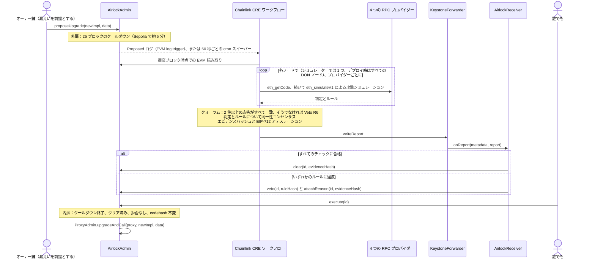

<div align="center">

# Upgrade Airlock

**プロキシのアップグレードは必ず 2 つの扉を通ります。1 つはクールダウン、もう 1 つは攻撃シミュレーションを耐え抜いたコードだけが得られる Chainlink CRE のクリアランスです。**

[English](README.md) · [简体中文](README.zh-CN.md) · [繁體中文](README.zh-TW.md) · **日本語** · [한국어](README.ko.md) · [Español](README.es.md) · [Français](README.fr.md) · [Deutsch](README.de.md) · [Português (Brasil)](README.pt-BR.md) · [Русский](README.ru.md) · [Tiếng Việt](README.vi.md)

[](https://github.com/jiapunk/upgrade-airlock/actions/workflows/ci.yml)
[](LICENSE)
[](https://upgrade-airlock.pages.dev)
[](https://upgrade-airlock.pages.dev/video/)
[](https://sepolia.etherscan.io/address/0x28e7aAC40560804F480e454bF9C12F50C83b700B)
[](#chainlink-cre)

[ハイライト](#highlights) · [仕組み](#how-it-works) · [ルール](#rules) · [Chainlink CRE](#chainlink-cre) · [Sepolia での稼働](#live-on-sepolia) · [クイックスタート](#quick-start) · [セキュリティモデル](#security-model)

</div>

## 概要

Upgrade Airlock は、コントラクトのアップグレードごとに 2 つの扉を設けます。**外扉**はブロック数で測るクールダウンです。**内扉**が開くのは、クリアランスがオンチェーンに記録されたときだけです。自動で開く条件は、Chainlink CRE ワークフローがシミュレーターで新しい実装を攻撃して 4 つの独立した RPC プロバイダーに問い合わせ、少なくとも 2 つが応答してすべての応答が一致し、ワークフローのコンセンサスステップ（`consensusIdenticalAggregation`）が判定に合意し、署名付きの **Clear** レポートがオンチェーンに記録されることです。CRE がまったく応答できないときは、承認者の鍵が記録付きのエビデンスを添えて手動でクリアできます。その提案が最新 20 件の id に含まれている間はスイーパーが引き続き判定し、CRE またはガーディアンの拒否が優先されます。攻撃探索が到達した悪意ある実装には代わりに署名付きの **Veto** が下り、攻撃者がアップグレード鍵を握っていても実行されません。範囲の限られた探索では届かない部分には、厳格モードが人によるコードレビューを加えます。現在の判定は、サーバー上でこのワークフローを動かす公式 CRE CLI（`cre workflow simulate --broadcast`）によるものです。同じワークフローとコントラクトコードは DON にデプロイできます。ETH Shenzhen 2026 向けに、Ethereum Sepolia 上で構築しました。

> [!TIP]
> **ライブデモ：[upgrade-airlock.pages.dev](https://upgrade-airlock.pages.dev)** · **デモ動画：[upgrade-airlock.pages.dev/video](https://upgrade-airlock.pages.dev/video/)**（簡体字中国語と英語）
>
> ウォールーム（作戦室）は、ブラウザから Ethereum Sepolia を読み取り専用で直接参照します。各提案はエアロックとして描かれ、**外扉**が提案を記録し、**チャンバー**がクールダウンをカウントダウンし、**内扉**はクリアランス（Chainlink CRE の Clear、または承認者の手動クリアランス。後者はウォールーム上でその旨が表示されます）がオンチェーンに届くまでロックされたままです。Veto が下った提案は、そのルール、エビデンスハッシュ、トランザクションとともに排出されます。初めて開くと攻撃ピッカーが表示され、各カード（6 種類の攻撃と正当なアップグレード v2）は、同じ種類の Sepolia 上で最新の実際の提案を、リプレイであると明示して再生します。ページは簡体字中国語で表示され、[`?lang=en`](https://upgrade-airlock.pages.dev/?lang=en) で英語に、[`?lang=zh-TW`](https://upgrade-airlock.pages.dev/?lang=zh-TW) で繁体字中国語に切り替わります。デモの裏付けとなるトランザクション（提案 #1〜#10）は、[ライブ実行のエビデンス](docs/evidence/sepolia-live.md)に一覧で掲載しています。

## <a id="highlights"></a>ハイライト

- **構造上フェイルクローズド。** アップグレードが実行されるのは、オンチェーンにクリアランスがあるときだけです。ログの取りこぼし、RPC の障害、プロバイダー間の不一致、実行の失敗が起きても、提案は未クリアのままか拒否されます。アップグレードを遅らせることはあっても、通してしまうことはありません。拒否は常にクリアランスに優先します。
- **チェックリストではなく、攻撃。** ワークフローが（DON にデプロイした場合はすべてのノードで）、4 つの RPC プロバイダー上で `eth_simulateV1` を使い、プロキシの実際の状態に対してアップグレードを実行します。資金を持たせた部外者が新しいバイトコードのすべてのセレクターを呼び出し、新規関数にはすべて、ホルダーを当てはめた引数での呼び出しも行います。供給量・所有権・残高は前後で比較します。少なくとも 2 つのプロバイダーが応答し、すべての応答が一致しなければなりません。
- **提案に紐づいた判定。** ワークフローの同一性コンセンサスステップが `{verdict, rule}` に合意します。レポートには、提案の正確な内容（`proposalDigest`）、チェーン、レシーバー、ブロック期限に紐づいた EIP-712 アテステーションと、誰でもチェーンデータから再計算できるエビデンスハッシュが含まれます。
- **取りこぼしたログは拾い直す。** cron スイーパーが 60 秒ごとに最新 20 件の提案を確認し、ログトリガーが取りこぼした提案（承認者が手動でクリアしたアップグレードを含む）を判定します。スイーパーの拒否が優先されます。最新 20 件の id より下に押し出された提案はもう判定されず、承認者が手動でクリアしていない限りクリアされないままです（[スイープ範囲](docs/design.md#the-sweep-window)）。
- **Ethereum Sepolia で稼働中。** 公式 CRE CLI がサーバー上でワークフローを実行し、すべての提案（2026-10-23 時点で 10 件）にオンチェーンで判定を返しました。正当なアップグレード 1 件はクリアされて実行され、攻撃 9 件は拒否されました（R1、R2、R3、R3B、R7、R9）。すべてのコントラクトは Sourcify で検証済みです。
- **エンドツーエンドでテスト済み。** [CI](.github/workflows/ci.yml) では 117 件の Foundry テスト、118 件のワークフロー単体テスト、394 項目のウォールーム自己テストのうち 387 項目が実行されます（残る 7 項目には forge のビルド出力と cast が必要で、CI ジョブにはそれがありません）。フォーク上のエンドツーエンドスクリプトは、CRE シミュレーターを通してループ全体を動かします。

## 課題

アップグレード可能なプロキシは、プロトコル全体をアップグレード鍵 1 本に委ねています。その鍵が漏れれば、攻撃の手順はごく短いものです。悪意ある実装をデプロイし、プロキシをそこへ向け、ミントするか資金を抜き取るだけです。実際に何度も起きています。

- **PAID Network（2021 年 3 月）。** プロキシオーナーの鍵によって、監査済みのトークンコードがバーン関数とミント関数を持つバージョンに差し替えられ、攻撃者は約 5,950 万 PAID をミントしました。
  （[CertiK のポストモーテム](https://www.certik.com/blog/paid-network-post-mortem)）
- **Ankr（2022 年 12 月）。** 攻撃者は侵害されたデプロイヤー鍵を使い、aBNBc の実装を権限チェックなしでミントできるものに置き換え、60 兆 aBNBc をミントしました。
  （[Ankr のレポート](https://www.ankr.com/blog/the-abnbc-token-report/)）
- **Radiant Capital（2024 年 10 月）。** マルチシグ署名者 11 人のうち 3 人を掌握した攻撃者が、レンディングプールのプロバイダーを乗っ取り、レンディングプールの実装をアップグレードして 5,300 万ドル超を流出させました。
  （[rekt.news](https://rekt.news/radiant-capital-rekt2)）

タイムロックは攻撃者を待たせるだけで、その間に誰かが確認する義務はありません。遅延を長くすれば、緊急の修正まで止まってしまいます。Upgrade Airlock は、その待ち時間に仕事をさせます。独立したチェック（CRE DON にデプロイすれば分散型）に合格するまでアップグレードは実行できず、そのチェックはすべての提案に対して自動で走ります。

## <a id="how-it-works"></a>仕組み



1. **提案。** `AirlockAdmin` は OpenZeppelin の `ProxyAdmin` とトークンの `Ownable` を所有します。オーナー鍵にできるのは提案だけで、ガーディアン、承認者、クリアランスオラクルのいずれにもなりません。すべての提案（アップグレード、またはガーディアン・遅延・ブレークグラス先といったエアロック自体の変更）には `readyBlock = block.number + delayBlocks` が設定されます。アップグレード先とブレークグラス先は通常のコントラクトコードでなければなりません。判定後にその鍵で委任先を差し替えられる EIP-7702 委任アカウントは受け付けません（`DelegatedAccount`）。
2. **判定。** CRE のログトリガーが `Proposed` で発火します。エアロック自体の変更はチェーン読み取りで判定します（R7）。アップグレードはまず静的ルール（R5、R8）を通り、続いて提案ブロックに固定した攻撃シミュレーションを受けます。プロキシの ERC-1967 実装スロットを新しいコードで上書きし、提案ブロックのハッシュから導出した新しい部外者アドレスに、実ユーザーと同じように資金（2 人目のホルダーからのトークンと ETH）を持たせます。ホルダーが送金を行い、部外者が allowance なしで `transferFrom` を呼び、続いて新しいバイトコードで見つかったすべてのセレクターを 5 通りの引数パターンで呼び出します。標準トークンインターフェース以外のセレクターは、ホルダーを当てはめた引数でも呼び出します。資金を持つホルダーを先頭 4 つの引数スロットのそれぞれに置き、別のスロットにテスト金額を、残りのスロットに部外者かプロキシを入れます。供給量、オーナー、監視対象のすべての残高を前後で読み取り、ホルダーの残高はホルダーを当てはめた各呼び出しの直後にも読み取り、さらに各プローブ自身が発行したイベントを確認します（R1〜R4、R3B）。最後に、実ブロックとシミュレーションで挙動が異なるオペコードがないか、新しいバイトコードをスキャンします（R9）。
3. **合意。** 各ノード（DON デプロイではすべての DON ノード、現在は CLI シミュレーター）が 4 つのプロバイダーでシミュレーションを実行します。少なくとも 2 つが応答し、すべての応答が同じ判定でなければならず、それ以外はすべて拒否となります（R6）。そのうえでコンセンサスステップが同一の `{verdict, rule}` に合意します。
4. **報告。** ワークフローは正規化したエビデンス JSON をハッシュし、アテスター鍵（CRE シークレット）で EIP-712 の判定に署名し、フォワーダー経由でレポートを書き込みます。`AirlockReceiver` は送信元、鮮度、署名、そして判定がまさにこの提案に紐づいていること（`proposalDigest`）を確認したうえで、`AirlockAdmin` の `clear`、または `veto` と `attachReason` を呼び出します。
5. **実行。** クールダウンが終われば、誰でも `execute(id)` を呼び出せます。クールダウン中は `TooEarly`、クリアランスがなければ `NotCleared`、拒否後は `ProposalVetoed`、提案され判定されたコードをターゲットがもう保持していない場合は `CodehashChanged` で revert します。拒否は常にクリアランスに優先します。
6. **スイープ。** cron トリガーが 60 秒ごとに最新の提案を再確認し、CRE がまだ応答していない保留中の提案（`oracleJudged`）をすべて判定します。トリガーが取りこぼしたログ、配信できないほど大きい `Proposed` イベント、承認者が手動でクリアしたアップグレードがその対象です。スイーパーの拒否は、その手動クリアランスに優先します。

**どんな失敗も同じ方向に倒れます。** ログの取りこぼし、RPC の障害、プロバイダー間の不一致、実行の失敗は、いずれも提案をクリアランスのないままにするか拒否します。アップグレードを遅らせることはあっても、通すことはありません。CRE がまったく応答できないときは、承認者鍵がエビデンスを記録したうえで手動でクリアできます。CRE が再び応答すればスイーパーがそのアップグレードを判定し、CRE またはガーディアンの拒否が引き続き優先されます。`breakGlass()` を使えば、オーナーまたは任意のガーディアンが、事前登録済みの一時停止実装へプロキシを即座に切り替えられます。一時停止状態からの復帰も、2 つの扉を通るアップグレードです。ただしクリアされた提案は失効しないため、以前にクリアされたアップグレードでも一時停止を終わらせられます（[既知の制限](docs/design.md#known-limitations)）。

詳しくは [docs/design.md](docs/design.md)（脅威モデル、クリアランスのステートマシン、レポートの紐づけ、バジェット）と [cre/README.md](cre/README.md)（ワークフロー）を参照してください。

## <a id="rules"></a>ルール

`ruleHash = keccak256("GUARD/<ID>")` は、拒否のたびにオンチェーンに記録されます。

| ルール | 拒否する条件 | 判定手段 |
|---|---|---|
| R1 `TOTAL_SUPPLY` | 部外者の呼び出しで `totalSupply` が変わる | 攻撃シミュレーション |
| R2 `OWNER` | 部外者の呼び出しで `owner()` が変わる | 攻撃シミュレーション |
| R3 `TRANSFER_CONSERVATION` | ホルダーが X を送金しても正確に X が動かない、または他の誰かの残高が動く | 攻撃シミュレーション |
| R3B `THIRD_PARTY_FUNDS` | 部外者がいずれかのホルダーのトークンを動かす：資金を持つ部外者による allowance なしの `transferFrom` が成功する、またはそのプローブのいずれかが他人のトークンを動かす・ミントする・バーンする・所有権を移す・ホルダーの残高を減らす（イベントがなくても、後続の呼び出しで元に戻されても該当） | 攻撃シミュレーション |
| R4 `TRANSFER_LIVENESS` | ホルダーによる通常の送金が失敗する | 攻撃シミュレーション |
| R5 `STRICT_CODEHASH` | 厳格モードが有効で、承認者がその codehash を承認していない | チェーン読み取り |
| R6 `SIM_FAILURE` | シミュレーションで判定できない：プロバイダー間の不一致、応答数の不足、コードの不一致、view 呼び出しまたは部外者への資金付与の revert、あるいは設定されたリクエスト数にプローブが収まらない | シミュレーションとクォーラム |
| R7 `CONFIG_GUARD` | 承認者の事前承認がないガーディアン変更、遅延の短縮、新しいブレークグラス先 | チェーン読み取り |
| R8 `INIT_DATA` | アップグレードが、承認者が codehash と併せて承認していない初期化データを含む | チェーン読み取り |
| R9 `NEW_OPCODES` | 新しいコードに、設定の固定許可リスト（デフォルトは空）でカバーされないブロック／トランザクションコンテキストのオペコード（BASEFEE、TIMESTAMP、NUMBER、ORIGIN、GAS など）、外部呼び出し、create、selfdestruct が含まれる（承認者がその codehash そのものを承認している場合を除く） | バイトコード |

**R9 はシミュレーション回避を封じます。** `EvilBaseFeeImpl` は、`eth_simulateV1` の呼び出しから見える `block.basefee == 0` の間は v1 と同じように振る舞い、実ブロック上では誰でもミントできるようになります。シミュレーション上の不変条件はすべて満たしますが、`BASEFEE` オペコードによって拒否されます。許可リストはプロキシが現在実行しているコードに一切依存しないため、承認が及ぶのは 1 つの codehash だけで、以降のアップグレードには及びません。スキャンがコンパイラのメタデータ末尾を飛ばすのは、それがどの命令からも到達できない厳密な solc CBOR マップである場合だけで、それ以外はすべてコードとしてスキャンします。codehash を承認すると R9 の対象外となり、プローブの打ち切り（R6）も許容されますが、効果はそこまでです。ほかのルールはすべて引き続き適用されます。

**R3B は静かな資金抜き取りを封じます。** `EvilDrainImpl` は、v1 にアクセス制御のない `rescue(from, to, amount)` を加えたものです。供給量、オーナー、送金、オペコードは v1 と同じなので、R1〜R4 と R9 はすべて通過します。`rescue` は標準のトークン関数ではないため、部外者はホルダーを当てはめた引数でもこれを呼び出します。ホルダーを `from` にした呼び出しでホルダーのトークンが動き、R3B が拒否します。「トークンか ETH を持つ呼び出し元だけ」という条件の陰に隠れた抜き取りにもプローブが届きます。部外者はその両方を持っているからです。

### 自動モードと厳格モード

デフォルトの**自動モード**では、CRE が範囲を限定した攻撃探索によって、すべてのアップグレードを自らクリアまたは拒否します。探索の対象は、資金を持つ外部の呼び出し元、新しいコードのすべてのセレクター、そしてすべての新規関数の先頭 4 つの引数スロットのそれぞれに置いたホルダーです。**厳格モード**（R5）は人によるレビューを加えます。新しい実装の codehash はすべて、まず承認者鍵による承認が必要で、攻撃シミュレーションもそのまま実行されます。自動モードは、定例のアップグレードを数分でクリアしたいトークンに向いています。厳格モードでは、コードレビューがクリアランスの一部になります（[2 つのモード](docs/design.md#two-modes-automatic-and-strict)）。

## Chainlink CRE

CRE は Upgrade Airlock のオーケストレーション層です。ワークフローは内扉を通る唯一の自動化された経路であり、オンチェーンのトリガーからオンチェーンの判定まで、すべてのステップを担います。CRE TypeScript SDK（`@chainlink/cre-sdk` 1.23.0）で記述し、CRE CLI v1.37.0 で WASM にコンパイルしています。

| Chainlink の技術 | 場所 | ここでの役割 |
|---|---|---|
| CRE ワークフローランナー | [`cre/veto/main.ts#L1-L9`](cre/veto/main.ts#L1-L9)、[`cre/veto/workflow.yaml`](cre/veto/workflow.yaml)、[`cre/project.yaml`](cre/project.yaml) | 2 つのハンドラー。ターゲットは `sepolia` と `sepolia-fork` |
| EVM log trigger | [`cre/veto/workflow.ts#L202-L211`](cre/veto/workflow.ts#L202-L211)、[`#L193-L198`](cre/veto/workflow.ts#L193-L198)、[`#L54-L65`](cre/veto/workflow.ts#L54-L65) | `LATEST` で `AirlockAdmin.Proposed` を監視。提案は現れた時点、つまり実行可能になるクールダウン 1 回分も前に判定される |
| Cron trigger | [`cre/veto/workflow.ts#L200`](cre/veto/workflow.ts#L200)、[`#L209`](cre/veto/workflow.ts#L209)、[`cre/veto/airlock.ts#L323-L389`](cre/veto/airlock.ts#L323-L389) | スイーパー：最新 20 件の id を毎分確認 |
| EVM 読み取り（`callContract`） | [`cre/veto/workflow.ts#L114-L122`](cre/veto/workflow.ts#L114-L122)、[`#L137-L142`](cre/veto/workflow.ts#L137-L142)、[`cre/veto/chain.ts`](cre/veto/chain.ts) | 提案、クリアランス、`oracleJudged`、承認、残高を、提案ブロックまたは `LATEST` で Multicall3 によりバッチ取得 |
| EVM 読み取り（`headerByNumber`） | [`cre/veto/workflow.ts#L125-L136`](cre/veto/workflow.ts#L125-L136) | 最新ブロックと、シミュレーション上の部外者のシードとなる提案ブロックのハッシュ |
| HTTP capability（node mode） | [`cre/veto/workflow.ts#L167-L189`](cre/veto/workflow.ts#L167-L189)、[`#L80-L94`](cre/veto/workflow.ts#L80-L94)、[`cre/veto/judge.ts#L157-L220`](cre/veto/judge.ts#L157-L220) | 各ノードが各プロバイダーに `eth_getCode` を送り、続いて 1〜2 件の `eth_simulateV1` リクエストを送信（いずれも 120 kb のリクエスト上限内） |
| `consensusIdenticalAggregation` | [`cre/veto/workflow.ts#L184-L188`](cre/veto/workflow.ts#L184-L188)、クォーラムは [`cre/veto/judge.ts#L244-L277`](cre/veto/judge.ts#L244-L277) | `{verdict, rule}`（最大 52 バイト）に同一性コンセンサスで合意（デプロイ時はすべての DON ノード） |
| Secrets | [`cre/veto/workflow.ts#L160-L166`](cre/veto/workflow.ts#L160-L166)、[`cre/secrets.yaml`](cre/secrets.yaml) | EIP-712 のアテスター鍵。1 回の実行につき 1 度だけ取得 |
| Report + `writeReport` | [`cre/veto/workflow.ts#L143-L149`](cre/veto/workflow.ts#L143-L149)、[`cre/veto/airlock.ts#L229-L282`](cre/veto/airlock.ts#L229-L282)、[`cre/veto/report.ts`](cre/veto/report.ts) | `runtime.report`（ECDSA、keccak256）と `evm.writeReport`。その後に提案を読み取って結果を確認 |
| Forwarder + `IReceiver` | [`src/cre/AirlockReceiver.sol#L88-L120`](src/cre/AirlockReceiver.sol#L88-L120)、[`#L156-L169`](src/cre/AirlockReceiver.sol#L156-L169)、[`src/cre/IReceiver.sol`](src/cre/IReceiver.sol)、[`script/DeployEth.s.sol#L142`](script/DeployEth.s.sol#L142) | `onReport` は設定されたフォワーダーからのみ受け付け、設定されていればワークフロー ID とオーナーも検証 |
| チェーンセレクター | [`cre/veto/workflow.ts#L100-L104`](cre/veto/workflow.ts#L100-L104) | `ethereum-testnet-sepolia` |
| CRE CLI | [`cre/setup.sh`](cre/setup.sh)、[`cre/scripts/fork-e2e.sh`](cre/scripts/fork-e2e.sh)、[`scripts/sepolia/airlock.sh`](scripts/sepolia/airlock.sh)、[`scripts/sepolia/sweep.sh`](scripts/sepolia/sweep.sh) | `cre workflow build`、`cre workflow simulate --broadcast` |

**現在のワークフローの稼働方法。** ワークフローは CRE CLI の `cre workflow simulate --broadcast` で Ethereum Sepolia に対して実行しています。リスナー（[`scripts/sepolia/airlock.sh`](scripts/sepolia/airlock.sh)）がログトリガーを待ち受けモードで保持し、スイーパー（[`scripts/sepolia/sweep.sh`](scripts/sepolia/sweep.sh)）が毎分 cron ハンドラーを実行します。すべての Clear と Veto は、Chainlink の Sepolia MockKeystoneForwarder [`0x15fC6ae953E024d975e77382eEeC56A9101f9F88`](https://docs.chain.link/cre/guides/workflow/using-evm-client/forwarder-directory-ts) を経由した実際の Sepolia トランザクションです。`AirlockReceiver` はそのまま DON へのデプロイに対応しています。`FORWARDER` に本番の KeystoneForwarder を、さらに `WORKFLOW_ID` / `WORKFLOW_OWNER` を設定してデプロイすれば、`onReport` は DON が署名したワークフローメタデータも検証します。`DeployEth` は、この 2 つが設定されているか、`ALLOW_MOCK_FORWARDER=1` で明示的に許可されない限り、パーミッションレスな MockKeystoneForwarder を受け付けません（[`script/DeployEth.s.sol#L96-L104`](script/DeployEth.s.sol#L96-L104)）。

**CRE の実行ごとの上限に合わせた設計。** チェーン読み取りは最大 15 回（Multicall3 のバッチは 5 kb のペイロード上限内）、HTTP 呼び出しは上限 15 回のうち 12 回（4 プロバイダー時）、攻撃シミュレーションは 1 回の実行につき 1 回、コンセンサス値は最大 52 バイトです。バジェットの詳細は [docs/design.md](docs/design.md#budgets) にあります。

## <a id="live-on-sepolia"></a>Sepolia での稼働

Ethereum Sepolia（chain id 11155111）。[`script/DeployEth.s.sol`](script/DeployEth.s.sol) によりブロック 11950684〜11950699 でデプロイし（13 トランザクション。AirlockAdmin はブロック 11950697）、すべてのコントラクトは Sourcify で検証済みです。オーナー、承認者、緊急ガーディアン、アテスターはそれぞれ異なる 4 つの鍵です。クールダウンは 25 ブロックです。

| コントラクト | アドレス |
|---|---|
| AirlockAdmin | [`0x28e7aAC40560804F480e454bF9C12F50C83b700B`](https://sepolia.etherscan.io/address/0x28e7aAC40560804F480e454bF9C12F50C83b700B) |
| AirlockReceiver | [`0xE40D463116F4Aa24d5E79776a65ED0f1b088c670`](https://sepolia.etherscan.io/address/0xE40D463116F4Aa24d5E79776a65ED0f1b088c670) |
| DemoBTC プロキシ（dBTC） | [`0x88Cc569265faDAEAc2a16B69f35E10B2158e4b71`](https://sepolia.etherscan.io/address/0x88Cc569265faDAEAc2a16B69f35E10B2158e4b71) |
| ProxyAdmin | [`0x51a3fE6AD22BF7753574B7b7FD56aE9a65bd593E`](https://sepolia.etherscan.io/address/0x51a3fE6AD22BF7753574B7b7FD56aE9a65bd593E) |
| DemoBTC v1 | [`0x8f7d6453d77B3f3b008CBE4A144d82c5742eB108`](https://sepolia.etherscan.io/address/0x8f7d6453d77B3f3b008CBE4A144d82c5742eB108) |
| DemoBTC v2（正当なアップグレード） | [`0x4D959f981C01E3B81ac6C9A20E84816Fe5f6Bce3`](https://sepolia.etherscan.io/address/0x4D959f981C01E3B81ac6C9A20E84816Fe5f6Bce3) |
| EvilMintImpl | [`0x01502c4af90c27f53B2E1293941670C6B761CAAA`](https://sepolia.etherscan.io/address/0x01502c4af90c27f53B2E1293941670C6B761CAAA) |
| EvilOwnerImpl | [`0xBe849DE8e0a4D9b0010ba1468f94Eeb24A42d488`](https://sepolia.etherscan.io/address/0xBe849DE8e0a4D9b0010ba1468f94Eeb24A42d488) |
| EvilFeeImpl | [`0xB95Ffa7b970B1a73488e2fC32B787fA536F12AF5`](https://sepolia.etherscan.io/address/0xB95Ffa7b970B1a73488e2fC32B787fA536F12AF5) |
| EvilBaseFeeImpl | [`0xE1AAa4E88DB9cc7ceCca14722eE2874D834e0310`](https://sepolia.etherscan.io/address/0xE1AAa4E88DB9cc7ceCca14722eE2874D834e0310) |
| EvilDrainImpl | [`0x1d98D64BC5204AE139B5A0747855841Fa5333b6d`](https://sepolia.etherscan.io/address/0x1d98D64BC5204AE139B5A0747855841Fa5333b6d) |
| PausedImpl（ブレークグラス先） | [`0xb6573006fB607E96966d0F578B96AAB25413F5BE`](https://sepolia.etherscan.io/address/0xb6573006fB607E96966d0F578B96AAB25413F5BE) |
| Chainlink MockKeystoneForwarder | [`0x15fC6ae953E024d975e77382eEeC56A9101f9F88`](https://sepolia.etherscan.io/address/0x15fC6ae953E024d975e77382eEeC56A9101f9F88) |

最初の実行では 7 件の提案に、7 件のオンチェーン判定（その後の #8〜#10 は [docs/evidence/sepolia-live.md](docs/evidence/sepolia-live.md) に掲載）。各リンクの数字はトランザクションが取り込まれたブロックで、`(+n)` は提案から何ブロック後に CRE の判定が届いたかを示します。

| カード | 提案 | CRE の判定 | 提案 tx | レポート tx | その後 |
|---|---|---|---|---|---|
| `v2`：正当なアップグレード | #4 | Clear | [11950745](https://sepolia.etherscan.io/tx/0x3cd96ac220391e2b404d35591d1a96808b75256e7c685a414e2ca5a63bc54145) | [11950747 (+2)](https://sepolia.etherscan.io/tx/0x2c02d2a23016a72509900eb7ce92dabc06b0dd93a2394d076a62d687ce467efb) | `execute` [11950772](https://sepolia.etherscan.io/tx/0x01913c1854b9862763af74ddacd7be23a7f55232af7334714aa8213aa7021890)、`version()` = "2" |
| `evil-mint`：誰でもミントできる | #1 | Veto R1 | [11950735](https://sepolia.etherscan.io/tx/0x862c5fdf826a8fef09fe2ff278d3e58191f93c267dbdd38ad9aaa270f39937b0) | [11950736 (+1)](https://sepolia.etherscan.io/tx/0xb0d74e25e2528fb9aad7d21de202dac288cd256048f2986b5214280fda4b84f6) | `execute` は `ProposalVetoed` で revert |
| `evil-owner`：誰でも所有権を奪える | #6 | Veto R2 | [11950788](https://sepolia.etherscan.io/tx/0x32eb22039bd43602e0406b1a8f9a02c5cbcdb5cf2ef1c389919a45d05820da25) | [11950790 (+2)](https://sepolia.etherscan.io/tx/0x49451bee7a2f3351b18992d94b5f89b9ff89cf53be65a937400ab95fb79be551) | `execute` は `ProposalVetoed` で revert |
| `evil-fee`：送金から 10% を抜き取る | #7 | Veto R3 | [11950792](https://sepolia.etherscan.io/tx/0xe06924c2e3961ab27d2803c0654b783fc06e52107345bda9bfeff391053fcad3) | [11950794 (+2)](https://sepolia.etherscan.io/tx/0x01f6055a683e0dabc8f34ae094e5daa5a81ddb11c687aa9c5ac6e30c7a7f3d3b) | `execute` は `ProposalVetoed` で revert |
| `evil-basefee`：実ブロックでミントが開放される | #3 | Veto R9 | [11950742](https://sepolia.etherscan.io/tx/0x3c29c118ca395ca92500abcaae6126244924fbd8e14f846af57b70f113cad6e1) | [11950743 (+1)](https://sepolia.etherscan.io/tx/0xb6db2d832112384287e5a7ccdd086127931360900d09c80645c21eac2bc165db) | `execute` は `ProposalVetoed` で revert |
| `evil-drain`：誰でもホルダーのトークンを動かせる | #2 | Veto R3B | [11950737](https://sepolia.etherscan.io/tx/0x0e52369921040eb0c901ac3a077aff762d370b4efd9503a52c91360d56366b16) | [11950740 (+3)](https://sepolia.etherscan.io/tx/0x40bbe374a8cee47a94da977f973cf66a67573c12bc84117483fcbd11430f90cb) | `execute` は `ProposalVetoed` で revert |
| `remove-receiver`：CRE をガーディアンから外す | #5 | Veto R7 | [11950749](https://sepolia.etherscan.io/tx/0xda2bd1c9dc5f7770da3926358b8da3ffe5a1cd3154b499cafae440387eebb934) | [11950750 (+1)](https://sepolia.etherscan.io/tx/0xaa2f598bdcc7f46727e5456528521e50ac5c1d8e423805042cbf2d10a4c4cdac) | `execute` は `ProposalVetoed` で revert |

上記の判定はすべて、公式 CRE CLI がサーバー上でこのワークフローを実行して出したものです（ログトリガーのリスナーと 60 秒間隔のスイーパー、[`scripts/sepolia/systemd/`](scripts/sepolia/systemd)）。ワークフロー自身のログ出力は [`docs/evidence/sepolia-live.md`](docs/evidence/sepolia-live.md) にあります。

## <a id="quick-start"></a>クイックスタート

### 前提条件

- [Foundry](https://getfoundry.sh)（`forge`、`cast`、`anvil`）、`jq`、Node 22。
- シミュレーター用の CRE アカウント（`cre login`）。フォークでのエンドツーエンド実行とオペレーターキットで使用します。
- [`cre/setup.sh`](cre/setup.sh) が CRE CLI v1.37.0（SHA-256 で固定）と bun 1.4.2 を `cre/.tools` にインストールします。

### ビルドとテスト

```bash
git clone https://github.com/jiapunk/upgrade-airlock.git
cd upgrade-airlock

# コントラクト（OpenZeppelin と forge-std は lib/ に同梱）
forge build                     # 固定バージョンの solc 0.8.37 を初回のみ取得
forge test --offline            # 117 件のテスト

# CRE ワークフロー
cre/setup.sh
export PATH="$PWD/cre/.tools/bin:$PWD/cre/.tools/node_modules/.bin:$PATH"
(cd cre/veto && bun test && bun run typecheck)    # 118 件のテスト：ルール、プローブ、バイトコード、レポート、バジェット、ハンドラー

# ウォールーム
(cd web && npm ci && npm run selftest)            # 394 項目のチェック：ライブビューと攻撃ピッカー、オフライン再生、オペレーター API
```

### Sepolia フォークでのエンドツーエンド

```bash
cre login                       # 初回のみ。シミュレーターには CRE アカウントが必要
cre/scripts/fork-e2e.sh         # Sepolia のローカル anvil フォーク。実ネットワークには何も送信しない
```

[`cre/scripts/fork-e2e.sh`](cre/scripts/fork-e2e.sh) はフォーク上にスタック一式をデプロイし、CRE シミュレーターで `--broadcast` 付きでワークフローを実行して、すべての結果をオンチェーンで確認します。

- **ログトリガー：** EvilMint は R1、EvilOwner は R2、EvilFee は R3、EvilBaseFee は R9（`BASEFEE` を名指し）、EvilDrain は R3B（`rescue` を名指しし、ほかのルールはすべて通過）で拒否されます。さらに 7 つの抜き取り実装（[`test/fixtures/DrainVariants.sol`](test/fixtures/DrainVariants.sol)）が R3B 単独で拒否されます。引数の順序を入れ替えたもの、トークンアドレスによるガード付きのもの、トークンか ETH を持つ呼び出し元にだけ開く抜き取り、`Transfer` イベントを出さないもの、トークンホルダーに対して allowance を省略する `transferFrom` です。正当な v2 はクリアされ、クールダウン後に実行されます。レシーバーをガーディアンから外す変更は R7 で拒否され、承認者が事前承認した遅延の短縮はクリアされます。
- **スイーパー：** 誰も判定していないアップグレードはクールダウン後に `NotCleared` で revert し、スイーパーを 1 回実行するとクリアされて実行されます。承認者が手動でクリアした 2 件の提案は次の実行で判定され、EvilDrain はそのクリアランスを覆して R3B で拒否、遅延の延長は CRE でもクリアされます。6 KB の初期化データを持つアップグレードは、その次の実行で R8 により拒否されます。
- **エビデンス：** 拒否された提案はすべて `ProposalVetoed` で revert し、すべての判定のエビデンスハッシュをチェーンデータから再計算します（[`cre/veto/tools/check-evidence.ts`](cre/veto/tools/check-evidence.ts)）。

### Sepolia オペレーターキット

[`scripts/sepolia/`](scripts/sepolia/README.md) がライブデモを動かします。鍵はリポジトリの外に置き、`KEY_DIR` に 1 ファイル 1 鍵の hex 形式で保存します（`owner.key`、`attester.key`、`sender.key`、`approver.key`、`emergency.key`、任意で `sweeper.key`）。スクリプトが鍵を出力することはなく、`deploy.sh` はオーナー、承認者、緊急ガーディアン、アテスターが 4 つの異なる鍵でない限り実行しません。すべてのスクリプトは `FORK=<port>` でローカルフォークに対しても実行できるため、費用をかけずにデモをリハーサルできます。

```bash
scripts/sepolia/deploy.sh                    # 13 トランザクション。deployments/sepolia.json を書き出す（FORCE=1 で既存を置き換え）
bun scripts/sepolia/make-config.mjs          # ワークフロー設定。4 プロバイダー、クォーラム 2
scripts/sepolia/fund-sender.sh 0.05          # レポート送信トランザクション用の ETH
scripts/sepolia/airlock.sh                   # ターミナル A：CRE リスナー（ログトリガー）
scripts/sepolia/propose.sh v2                # ターミナル B：続けて evil-mint, evil-owner, evil-fee, evil-basefee, evil-drain, remove-receiver
scripts/sepolia/execute.sh <id>              # クリア済みの提案をクールダウン後に実行。それ以外は revert を表示
scripts/sepolia/status.sh                    # 全提案の判定、CRE 判定済みか否か、ルール、エビデンス、tx
```

`sweep.sh` は cron スイーパーを 1 回実行し、`clear.sh` は承認者による手動クリアランス、`fork.sh` は Sepolia フォークの起動・保存・復元を行います。`probe-rpcs.ts` はワークフロー自身の判定コードですべてのプロバイダーを検査し、`systemd/` は Linux サーバー上でリスナーとスイーパーを動かします。

### ウォールーム

```bash
cd web
npm ci
npm run dev                     # http://127.0.0.1:5173/
npm run build:airlock           # deployments/sepolia.json をページに同期し、web/dist-airlock をビルド
```

ページは Sepolia を直接読み取るだけで、鍵を持たず、署名も送信も一切行いません。各提案をエアロックとして表示し、クールダウン、CRE のクリアランス、拒否とそのルールおよびエビデンスを示します。訪問者は 7 枚のカード（6 種類の攻撃と正当なアップグレード v2）から 1 枚を選び、同じ種類の Sepolia 上で最新の実際の提案のリプレイ（リプレイと明示。その攻撃がクールダウン中ならライブの提案）を見られます。詳しくは[攻撃ピッカー](web/README.md#attack-picker-what-a-visitor-sees)を参照してください。発表者向けにはオペレーターモード（`web/operator/`、`web/functions/`）があります。開発サーバーではループバック接続のみ、Cloudflare Pages ではトークンが必要で、`OWNER_KEY` と `OPERATOR_TOKEN` の両方のシークレットがない限りオフです。同じ 7 種類の固定提案のいずれかを `POST /api/operator/propose` 経由で送信し、サーバー側でオーナー鍵により署名します（設計はもともとこの鍵の漏洩を前提にしており、この鍵にできるのは提案だけです）。一般の訪問者のページがこれを呼び出すことはありません。詳しくは[オペレーターモード](web/README.md#operator-mode-real-attacks-on-sepolia)を参照してください。

| URL パラメーター | 効果 |
|---|---|
| `?mode=airlock` | デフォルト。Ethereum Sepolia のライブビュー（読み取り専用） |
| `?mode=offline` | 記録済みの実行を、ネットワーク接続なしで再生 |
| `?lang=en`、`?lang=zh-TW`、`?lang=zh-CN` | 表示言語（デフォルトは `zh-CN`。`L` キーで順に切り替え） |
| `?rpc=http://127.0.0.1:<port>` | 代わりにローカルの Sepolia フォークを読み取る（リハーサル用） |
| `?op=1` | オペレーターモード：オペレータートークンの入力を求める（発表者専用） |

ライブモードで `P` を押すと、直近の提案をチェーンイベントから再生します。`1`〜`7` でピッカーの各カードを再生します。

## リポジトリ構成

```
src/AirlockAdmin.sol            2 つの扉：提案、クールダウン、ガーディアンの拒否、クリアランス、execute、breakGlass
src/cre/AirlockReceiver.sol     CRE レポートのレシーバー：フォワーダー、ワークフローメタデータ、EIP-712 アテステーション、digest の紐づけ
src/cre/IReceiver.sol           Chainlink CRE のレシーバーインターフェース
src/DemoBTC.sol, DemoBTCV2.sol  デモトークン（dBTC）の v1 と正当な v2
src/PausedImpl.sol              ブレークグラス先：残高を変える操作はすべて revert
src/attack/                     EvilMintImpl, EvilOwnerImpl, EvilFeeImpl, EvilBaseFeeImpl, EvilDrainImpl
script/DeployEth.s.sol          デプロイ（13 トランザクション）。ロール、フォワーダー、デプロイ後の配線を検査
test/                           Foundry テスト。fixtures/DrainVariants.sol に 7 つの抜き取り亜種
cre/veto/                       CRE ワークフロー：workflow.ts（capability）、airlock.ts（ハンドラー）、
                                judge.ts（ルール、クォーラム）、simulate.ts（eth_simulateV1）、
                                bytecode.ts（セレクター、R9）、report.ts（レポート、EIP-712、エビデンス）、
                                chain.ts（読み取りバジェット）、keys.ts、rules.ts、config.ts
cre/veto/test/                  Bun 単体テスト
cre/veto/tools/                 check-evidence.ts がオンチェーンのエビデンスハッシュをすべて再計算
cre/scripts/fork-e2e.sh         Sepolia の anvil フォークでのエンドツーエンド
cre/setup.sh                    バージョン固定の CRE CLI と bun
scripts/sepolia/                ライブデモ用オペレーターキット（サーバー向け systemd ユニット付き）
web/                            ウォールーム（Vite、TypeScript、viem）
web/operator/, web/functions/   オペレーターモード：サーバー側で署名する 7 種類の固定提案（開発サーバー、Pages Functions）
deployments/sepolia.json        稼働中のデプロイ情報
docs/design.md                  脅威モデル、クリアランスの状態機械、レポートの紐づけ、バジェット
docs/evidence/                  ライブ実行の記録
.github/workflows/ci.yml        コントラクト、ワークフロー、ウォールームのチェック
```

## <a id="security-model"></a>セキュリティモデル

Upgrade Airlock はオーナー鍵が漏えいすることを前提とし、オーナー鍵だけでは決してアップグレードを実行できないように設計されています。

| ロール | 保持者 | できること |
|---|---|---|
| オーナー | 1 つの鍵 | アップグレードとエアロック自体の変更（ガーディアン、遅延、ブレークグラス先）の提案、`breakGlass` |
| 承認者 | 別の鍵 | CRE が応答できないときの手動クリア、codehash・初期化データ・エアロック変更の承認（`approveCodehash`） |
| 緊急ガーディアン | 別の鍵 | 保留中の提案への `veto`、`breakGlass` |
| アテスター | CRE シークレット（専用の鍵） | `AirlockReceiver` が受け付ける EIP-712 判定への署名 |
| AirlockReceiver | CRE レポートのレシーバー | クリアランスオラクル（`clear`）とガーディアン（`veto`、`attachReason`） |
| 誰でも | | 2 つの扉を通過した提案の `execute` |

ロールが重なることはありません。`AirlockAdmin` のコンストラクタは、承認者・ガーディアン・クリアランスオラクルを兼ねるオーナーを受け付けず（`RoleOverlap`）、`DeployEth` はオーナー、承認者、緊急ガーディアン、アテスターが 4 つの異なるアドレスである場合にのみデプロイします。

**漏えいしたオーナー鍵にできるのは提案までです。** どの提案も、CRE が判定する間、誰の目にも見える形でクールダウンを待ち、さらにオーナーが自分では与えられないクリアランスを必要とします。オーナーは非常ブレーキ（`breakGlass`）も引けますが、これはプロキシを事前登録済みの一時停止実装に切り替えるだけで、そこから戻るには 2 つの扉を通るアップグレードが必要です。また、以前にクリアされたまま実行されていないアップグレードでも一時停止を終わらせられます。

**同じ鍵でも、次のことはできません。**

- クリアランスなしでの実行：`AirlockAdmin` には汎用の呼び出し経路がなく、実装を変更する唯一の方法は、クリアされたアップグレードの `execute`（または一時停止実装への `breakGlass`）です。
- 先にエアロックを弱めること：CRE レシーバーの削除、遅延の短縮、ブレークグラス先の差し替えもすべて提案であり、承認者の事前承認がなければ R7 が拒否します。
- 判定後のコードのすり替え：`execute` はターゲットの codehash を再確認し（`CodehashChanged`）、EIP-7702 委任アカウントは受け付けません（`DelegatedAccount`）。
- 判定の偽造や再利用：`AirlockReceiver` が受け付けるのは、設定されたフォワーダーから届き、アテスターが署名し、`validUntilBlock` を過ぎておらず、このチェーンとレシーバー上で提案の `proposalDigest` に紐づいたレポートだけです。

承認者による手動クリアランスは、CRE が応答できないときのためのオーバーライドです。その提案が最新 20 件の id に含まれている間はスイーパーが引き続き判定し、CRE またはガーディアンの拒否が優先されます。脅威モデルの全体は [docs/design.md](docs/design.md#threat-model) にあります。

これらはテストネット用のデモコントラクトで、既知の制限があり、それぞれ合格するテストで固定されています。クリアランスは失効せず、オーナー鍵はローテーションできず（盗まれた鍵は一時停止の解除のたびにトークンを再び一時停止できます）、不正なガーディアン 1 人でトークンを一時停止させ続けられます。一覧は [docs/design.md](docs/design.md#known-limitations) にあります。

## 使用技術

- **Solidity 0.8.37** と **Foundry**、OpenZeppelin Contracts 5.7.0（`ProxyAdmin`、`TransparentUpgradeableProxy`、`EIP712`、`ECDSA`）
- **Chainlink CRE**：TypeScript SDK（`@chainlink/cre-sdk` 1.23.0）と CRE CLI v1.37.0、実行環境は Bun 1.4.2
- **viem**：ワークフローとウォールームでの ABI エンコードとチェーン読み取り
- **Vite** と TypeScript：ウォールーム

## AI ツール

Upgrade Airlock は、作者の指揮のもと [Claude Code](https://claude.com/claude-code) を使って開発しました。コントラクト、CRE ワークフロー、テスト、スクリプト、ウォールーム、そしてこれらのドキュメントは、Claude Code で作成・検証しています。

## ライセンス

[MIT](LICENSE) © 2026 jiapunk
