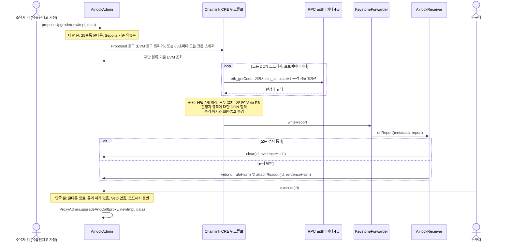

<div align="center">

# Upgrade Airlock

**모든 프록시 업그레이드는 두 개의 문을 지나야 합니다. 하나는 쿨다운이고, 다른 하나는 공격 시뮬레이션을 견뎌 낸 코드만 받을 수 있는 Chainlink CRE 통과 허가입니다.**

[English](README.md) · [简体中文](README.zh-CN.md) · [繁體中文](README.zh-TW.md) · [日本語](README.ja.md) · **한국어** · [Español](README.es.md) · [Français](README.fr.md) · [Deutsch](README.de.md) · [Português (Brasil)](README.pt-BR.md) · [Русский](README.ru.md) · [Tiếng Việt](README.vi.md)

[](https://github.com/jiapunk/upgrade-airlock/actions/workflows/ci.yml)
[](LICENSE)
[](https://upgrade-airlock.pages.dev)
[](https://sepolia.etherscan.io/address/0x28e7aAC40560804F480e454bF9C12F50C83b700B)
[](#chainlink-cre)

[주요 특징](#highlights) · [작동 방식](#how-it-works) · [규칙](#rules) · [Chainlink CRE](#chainlink-cre) · [Sepolia 라이브 배포](#live-on-sepolia) · [빠른 시작](#quick-start) · [보안 모델](#security-model)

</div>

## 개요

Upgrade Airlock은 모든 컨트랙트 업그레이드 앞에 두 개의 문을 둡니다. **바깥 문**은 블록 수로 측정하는 쿨다운입니다. **안쪽 문**은 Chainlink CRE 워크플로가 독립된 RPC 프로바이더 네 곳의 시뮬레이터에서 새 구현 컨트랙트를 공격하고, 모든 응답이 일치하고, DON이 판정에 합의하고, 서명된 **Clear**(통과) 리포트가 온체인에 기록되어야만 열립니다. 악의적인 구현 컨트랙트는 Clear 대신 서명된 **Veto**(거부)를 받으며, 공격자가 업그레이드 키를 쥐고 있더라도 결코 실행될 수 없습니다. ETH Shenzhen 2026을 위해 Ethereum Sepolia 기반으로 구축했습니다.

> [!TIP]
> **라이브 데모: [upgrade-airlock.pages.dev](https://upgrade-airlock.pages.dev)**
>
> 워룸은 브라우저에서 Ethereum Sepolia를 직접 읽으며, 읽기 전용으로 동작합니다. 각 제안은 하나의 에어록으로 그려집니다. **바깥 문**은 제안을 기록하고, **챔버**는 쿨다운을 카운트다운하며, **안쪽 문**은 Chainlink CRE의 Clear가 온체인에 기록될 때까지 잠겨 있습니다. Veto를 받은 제안은 해당 규칙, 증거 해시, 트랜잭션과 함께 밖으로 배출됩니다. 페이지는 중국어 간체로 열리며, [`?lang=en`](https://upgrade-airlock.pages.dev/?lang=en)을 붙이면 영어로, [`?lang=zh-TW`](https://upgrade-airlock.pages.dev/?lang=zh-TW)를 붙이면 중국어 번체로 바뀝니다. 이 데모를 뒷받침하는 모든 트랜잭션은 [라이브 실행 증거](docs/evidence/sepolia-live.md)에 정리되어 있습니다.

## <a id="highlights"></a>주요 특징

- **설계부터 fail-closed(실패 시 차단).** 업그레이드는 온체인 통과 허가가 있어야만 실행됩니다. 로그 누락, RPC 장애, 프로바이더 간 불일치, 워크플로 실행 실패가 생기면 제안은 통과 허가 없이 남거나 거부됩니다. 업그레이드를 늦출 수는 있어도 통과시키지는 못합니다. Veto는 언제나 통과 허가보다 우선합니다.
- **체크리스트가 아니라 실제 공격.** 모든 DON 노드가 RPC 프로바이더 네 곳에서 `eth_simulateV1`로 프록시의 실제 상태를 기준으로 업그레이드를 실행합니다. 자금을 받은 외부인이 새 바이트코드의 모든 셀렉터를 호출하고, 보유자를 끼워 넣은 인자로 모든 새 함수를 공략하며, 총공급량·소유권·잔액의 전후 값을 비교합니다. 최소 두 곳의 프로바이더가 응답해야 하고, 모든 응답이 일치해야 합니다.
- **제안에 묶인 판정.** DON은 `{verdict, rule}`에 합의합니다. 리포트에는 제안의 정확한 내용(`proposalDigest`), 체인, 리시버, 블록 기한에 묶인 EIP-712 증명과 함께, 누구나 체인 데이터로 다시 계산할 수 있는 증거 해시가 담깁니다.
- **판정에서 빠지는 제안은 없습니다.** 크론 스위퍼가 60초마다 최신 제안 20개를 확인해 로그 트리거가 놓친 제안을 모두 판정합니다. 승인자가 수동으로 통과시킨 업그레이드도 예외가 아니며, 스위퍼의 Veto가 우선합니다.
- **Ethereum Sepolia에서 실제 가동.** 공식 CRE CLI가 서버에서 워크플로를 실행해 제안 일곱 건에 온체인으로 응답했습니다. 정직한 업그레이드 한 건은 통과 후 실행되었고, 공격 여섯 건은 거부되었습니다(R1, R2, R3, R3B, R7, R9). 모든 컨트랙트는 Sourcify에서 검증되었습니다.
- **엔드 투 엔드 검증.** Foundry 테스트 117개, 워크플로 단위 테스트 118개, 워룸 자체 점검 137개가 [CI](.github/workflows/ci.yml)에서 실행되며, 포크 엔드 투 엔드 스크립트가 CRE 시뮬레이터를 거쳐 전체 루프를 구동합니다.

## 해결하려는 문제

업그레이드 가능한 프록시는 프로토콜 전체를 업그레이드 키 하나에 맡깁니다. 그 키가 유출되면 공격 절차는 짧습니다. 악의적인 구현 컨트랙트를 배포하고, 프록시가 그것을 가리키게 한 뒤, 토큰을 민팅하거나 자금을 빼내면 됩니다. 실제로 여러 차례 일어난 일입니다.

- **PAID Network, 2021년 3월.** 프록시 소유자 키로 감사를 마친 토큰 코드가 소각·민팅 함수가 들어간 버전으로 바꿔치기되었고, 공격자는 약 5,950만 PAID를 민팅했습니다.
  ([CertiK 사후 분석](https://www.certik.com/blog/paid-network-post-mortem))
- **Ankr, 2022년 12월.** 공격자는 탈취된 배포자 키로 aBNBc 구현 컨트랙트를 권한 검사 없이 민팅하는 버전으로 교체했고, 그 결과 60조 aBNBc가 민팅되었습니다.
  ([Ankr 보고서](https://www.ankr.com/blog/the-abnbc-token-report/))
- **Radiant Capital, 2024년 10월.** 멀티시그 서명자 11명 중 3명을 장악한 공격자가 렌딩 풀 프로바이더를 탈취하고 렌딩 풀의 구현 컨트랙트를 업그레이드해 5,300만 달러 이상을 빼냈습니다.
  ([rekt.news](https://rekt.news/radiant-capital-rekt2))

타임락은 공격자를 기다리게 할 뿐이며, 그사이 누군가 확인해야 할 의무도 없습니다. 지연을 길게 잡으면 긴급 수정까지 막힙니다. Upgrade Airlock은 그 대기 시간이 실제로 일을 하게 만듭니다. 독립적이고 탈중앙화된 검사를 통과하기 전에는 업그레이드를 실행할 수 없으며, 그 검사는 모든 제안마다 자동으로 실행됩니다.

## <a id="how-it-works"></a>작동 방식



1. **제안.** `AirlockAdmin`이 OpenZeppelin `ProxyAdmin`과 토큰의 `Ownable`을 소유합니다. 소유자 키는 제안만 할 수 있으며, 가디언이나 승인자, 통과 허가 오라클이 될 수 없습니다. 모든 제안(업그레이드, 또는 에어록 자체에 대한 변경: 가디언, 지연 시간, 비상 정지 대상)에는 `readyBlock = block.number + delayBlocks`가 부여됩니다. 업그레이드 대상과 비상 정지 대상은 일반 컨트랙트 코드여야 합니다. EIP-7702 위임 계정은 판정 이후 해당 계정의 키로 위임 대상을 바꿀 수 있으므로 거부됩니다(`DelegatedAccount`).
2. **판정.** `Proposed` 이벤트가 발생하면 CRE 로그 트리거가 실행됩니다. 에어록 자체에 대한 변경은 체인 조회 결과로 판정합니다(R7). 업그레이드는 먼저 정적 규칙(R5, R8)을 거친 뒤, 제안 블록에 고정된 공격 시뮬레이션을 받습니다. 프록시의 ERC-1967 구현 슬롯을 새 코드로 덮어쓰고, (제안 블록의 해시에서 도출한) 새 외부인 주소에 실제 사용자처럼 두 번째 보유자의 토큰과 ETH를 지급합니다. 보유자가 전송을 한 번 하고, 외부인이 allowance 없이 `transferFrom`을 호출한 다음, 새 바이트코드에서 찾은 모든 셀렉터를 다섯 가지 인자 형태로 호출합니다. 표준 토큰 인터페이스 밖의 모든 셀렉터는 보유자를 끼워 넣은 인자로도 호출합니다. 자금을 받은 보유자를 앞쪽 네 인자 슬롯에 하나씩 넣고, 다른 슬롯 하나에 테스트 금액을, 나머지 슬롯에 외부인이나 프록시를 넣는 방식입니다. 총공급량, 소유자, 감시 대상 잔액은 모두 호출 전후로 읽고, 보유자 잔액은 보유자를 끼워 넣은 호출 직후마다 읽으며, 각 프로브가 직접 발생시킨 이벤트도 확인합니다(R1~R4, R3B). 마지막으로 실제 블록과 시뮬레이션에서 다르게 동작하는 옵코드가 있는지 새 바이트코드를 스캔합니다(R9).
3. **합의.** 각 DON 노드는 프로바이더 네 곳에서 시뮬레이션을 실행합니다. 최소 두 곳이 응답해야 하고 모든 응답이 같은 판정이어야 하며, 그렇지 않으면 Veto입니다(R6). 이어서 DON이 동일한 `{verdict, rule}`에 합의합니다.
4. **리포트.** 워크플로는 정규화된 증거 JSON을 해시하고, 증명자 키(CRE 시크릿)로 EIP-712 판정에 서명한 뒤, 포워더를 통해 리포트를 기록합니다. `AirlockReceiver`는 발신자, 유효 기한, 서명, 그리고 판정이 바로 이 제안(`proposalDigest`)에 묶여 있는지를 확인한 다음, `AirlockAdmin`에서 `clear`를 호출하거나 `veto`와 `attachReason`을 호출합니다.
5. **실행.** 쿨다운이 끝나면 누구나 `execute(id)`를 호출할 수 있습니다. 쿨다운 중에는 `TooEarly`, 통과 허가가 없으면 `NotCleared`, Veto 이후에는 `ProposalVetoed`, 대상이 제안·판정 당시의 코드를 더 이상 담고 있지 않으면 `CodehashChanged`로 revert됩니다. Veto는 언제나 통과 허가보다 우선합니다.
6. **스윕.** 크론 트리거가 60초마다 최신 제안을 다시 확인해, CRE가 아직 응답하지 않은(`oracleJudged`) 대기 중인 제안을 모두 판정합니다. 트리거가 놓친 로그, 전달하기에 너무 큰 `Proposed` 이벤트, 승인자가 수동으로 통과시킨 업그레이드가 여기에 해당합니다. 이때 스위퍼의 Veto가 그 수동 통과 허가보다 우선합니다.

**모든 실패는 같은 방향을 향합니다.** 로그 누락, RPC 장애, 프로바이더 간 불일치, 워크플로 실행 실패가 생기면 제안은 통과 허가 없이 남거나 거부되므로, 업그레이드를 늦출 뿐 결코 통과시키지 않습니다. CRE가 전혀 응답할 수 없을 때는 승인자 키가 증거를 기록하면서 업그레이드를 수동으로 통과시킬 수 있습니다. 이 경우에도 CRE가 다시 응답하면 스위퍼가 그 업그레이드를 판정하며, CRE나 가디언의 Veto가 여전히 우선합니다. `breakGlass()`를 사용하면 소유자나 어느 가디언이든 프록시를 미리 등록된 일시 정지 구현 컨트랙트로 즉시 전환할 수 있습니다. 일시 정지 상태를 해제하는 것은 두 문을 모두 거치는 일반 업그레이드입니다.

더 자세한 내용: [docs/design.md](docs/design.md)(위협 모델, 통과 허가 상태 머신, 리포트 바인딩, 실행 예산)와 [cre/README.md](cre/README.md)(워크플로).

## <a id="rules"></a>규칙

모든 Veto에는 `ruleHash = keccak256("GUARD/<ID>")`가 함께 온체인에 기록됩니다.

| 규칙 | 거부 조건 | 판정 근거 |
|---|---|---|
| R1 `TOTAL_SUPPLY` | 외부인의 호출이 `totalSupply`를 바꿈 | 공격 시뮬레이션 |
| R2 `OWNER` | 외부인의 호출이 `owner()`를 바꿈 | 공격 시뮬레이션 |
| R3 `TRANSFER_CONSERVATION` | 보유자가 X를 전송했는데 정확히 X가 이동하지 않거나, 다른 누군가의 잔액이 움직임 | 공격 시뮬레이션 |
| R3B `THIRD_PARTY_FUNDS` | 외부인이 어떤 보유자의 토큰이든 옮김: 자금을 받은 외부인의 allowance 없는 `transferFrom`이 성공하거나, 외부인의 프로브 중 하나가 다른 누군가의 토큰을 옮기거나 민팅·소각하거나 소유권을 옮기거나 보유자의 잔액을 줄여 놓음. 이벤트가 없거나 이후 호출이 이를 되돌려도 마찬가지 | 공격 시뮬레이션 |
| R4 `TRANSFER_LIVENESS` | 보유자의 일반 전송이 실패함 | 공격 시뮬레이션 |
| R5 `STRICT_CODEHASH` | 엄격 모드가 켜져 있고 승인자가 코드해시를 승인하지 않음 | 체인 조회 |
| R6 `SIM_FAILURE` | 시뮬레이션이 결론을 내리지 못함: 프로바이더 간 불일치, 응답 수 부족, 코드 불일치, view 호출이나 외부인 자금 지급의 revert, 또는 프로브가 설정된 요청 수 안에 들어가지 않음 | 시뮬레이션과 쿼럼 |
| R7 `CONFIG_GUARD` | 승인자의 사전 승인 없는 가디언 변경, 지연 단축, 새 비상 정지 대상 지정 | 체인 조회 |
| R8 `INIT_DATA` | 업그레이드에 승인자가 코드해시와 함께 승인하지 않은 초기화 데이터가 포함됨 | 체인 조회 |
| R9 `NEW_OPCODES` | 새 코드에 블록·트랜잭션 컨텍스트 옵코드(BASEFEE, TIMESTAMP, NUMBER, ORIGIN, GAS 등), 외부 호출, create, selfdestruct가 있고 설정의 고정 허용 목록(기본값은 비어 있음)에 포함되지 않음. 단, 승인자가 바로 그 코드해시를 승인한 경우는 제외 | 바이트코드 |

**R9 규칙은 시뮬레이션 회피를 막습니다.** `EvilBaseFeeImpl` 컨트랙트는 `block.basefee == 0`인 동안, 즉 `eth_simulateV1` 호출이 보는 환경에서는 v1처럼 동작하다가, 실제 블록에서는 누구나 민팅할 수 있게 합니다. 시뮬레이션의 모든 불변식은 통과하지만, `BASEFEE` 옵코드 때문에 거부됩니다. 허용 목록은 프록시가 현재 실행하는 코드에 의존하지 않으므로, 한 번의 승인은 하나의 코드해시에만 적용되고 이후 업그레이드에는 적용되지 않습니다. 스캔은 컴파일러가 덧붙인 메타데이터 말미가 어떤 명령어로도 도달할 수 없는 정확한 solc CBOR 맵일 때만 그 부분을 건너뛰며, 그 밖의 경우는 모두 코드로 간주해 스캔합니다. 코드해시를 승인하면 R9에서 면제되고 프로브 잘림(R6)이 허용될 뿐, 그 이상은 없습니다. 다른 모든 규칙은 그대로 실행됩니다.

**R3B 규칙은 조용한 탈취를 막습니다.** `EvilDrainImpl` 컨트랙트는 v1에 접근 제어 없는 `rescue(from, to, amount)`를 더한 것입니다. 총공급량, 소유자, 전송, 옵코드가 모두 v1과 같으므로 R1~R4와 R9는 모두 통과합니다. `rescue`는 표준 토큰 함수가 아니므로 외부인은 보유자를 끼워 넣은 인자로도 이를 호출합니다. 보유자를 `from`에 넣은 호출이 보유자의 토큰을 옮기므로 R3B가 이를 거부합니다. "토큰이나 ETH를 가진 호출자만" 쓸 수 있도록 숨겨 둔 탈취도 걸러냅니다. 외부인이 둘 다 보유하고 있기 때문입니다.

### 자동 모드와 엄격 모드

기본값인 **자동 모드**에서는 범위가 정해진 공격 탐색을 통해 CRE가 모든 업그레이드를 스스로 통과시키거나 거부합니다. 자금을 받은 외부 호출자, 새 코드의 모든 셀렉터, 그리고 모든 새 함수의 앞쪽 네 인자 슬롯에 하나씩 넣은 보유자가 그 탐색 범위입니다. **엄격 모드**(R5)는 사람의 검토를 더합니다. 새 구현 컨트랙트의 코드해시는 모두 먼저 승인자 키의 승인을 받아야 하며, 공격 시뮬레이션도 그대로 실행됩니다. 자동 모드는 일상적인 업그레이드를 몇 분 안에 통과시키려는 토큰에 적합하고, 엄격 모드는 코드 리뷰를 통과 허가의 일부로 만듭니다([두 가지 모드](docs/design.md#two-modes-automatic-and-strict)).

## Chainlink CRE

CRE는 Upgrade Airlock의 오케스트레이션 계층입니다. 워크플로는 안쪽 문을 여는 유일한 자동화 경로이며, 온체인 트리거부터 온체인 판정까지 모든 단계를 담당합니다. CRE TypeScript SDK(`@chainlink/cre-sdk` 1.23.0)로 작성했으며, CRE CLI v1.37.0을 사용해 WASM으로 컴파일합니다.

| Chainlink 기술 | 위치 | 이 프로젝트에서 하는 일 |
|---|---|---|
| CRE 워크플로 러너 | [`cre/veto/main.ts#L1-L9`](cre/veto/main.ts#L1-L9), [`cre/veto/workflow.yaml`](cre/veto/workflow.yaml), [`cre/project.yaml`](cre/project.yaml) | 핸들러 두 개, 타깃 `sepolia`와 `sepolia-fork` |
| EVM 로그 트리거 | [`cre/veto/workflow.ts#L202-L211`](cre/veto/workflow.ts#L202-L211), [`#L193-L198`](cre/veto/workflow.ts#L193-L198), [`#L54-L65`](cre/veto/workflow.ts#L54-L65) | `LATEST` 기준 `AirlockAdmin.Proposed`: 제안이 올라오는 즉시, 실행 가능 시점보다 쿨다운 전체만큼 앞서 판정 |
| 크론 트리거 | [`cre/veto/workflow.ts#L200`](cre/veto/workflow.ts#L200), [`#L209`](cre/veto/workflow.ts#L209), [`cre/veto/airlock.ts#L323-L389`](cre/veto/airlock.ts#L323-L389) | 스위퍼: 최신 id 20개, 1분마다 |
| EVM 조회(`callContract`) | [`cre/veto/workflow.ts#L114-L122`](cre/veto/workflow.ts#L114-L122), [`#L137-L142`](cre/veto/workflow.ts#L137-L142), [`cre/veto/chain.ts`](cre/veto/chain.ts) | 제안, 통과 허가, `oracleJudged`, 승인 내역, 잔액을 제안 블록 또는 `LATEST` 기준으로 Multicall3에 묶어 조회 |
| EVM 조회(`headerByNumber`) | [`cre/veto/workflow.ts#L125-L136`](cre/veto/workflow.ts#L125-L136) | 최신 블록, 그리고 시뮬레이션 외부인의 시드가 되는 제안 블록 해시 |
| 노드 모드의 HTTP capability | [`cre/veto/workflow.ts#L167-L189`](cre/veto/workflow.ts#L167-L189), [`#L80-L94`](cre/veto/workflow.ts#L80-L94), [`cre/veto/judge.ts#L157-L220`](cre/veto/judge.ts#L157-L220) | 모든 노드가 각 프로바이더에 `eth_getCode`를 보낸 뒤 `eth_simulateV1` 요청을 한두 번 보냄(각 요청은 120 kb 요청 한도 이내) |
| `consensusIdenticalAggregation` | [`cre/veto/workflow.ts#L184-L188`](cre/veto/workflow.ts#L184-L188), 쿼럼은 [`cre/veto/judge.ts#L244-L277`](cre/veto/judge.ts#L244-L277) | DON이 `{verdict, rule}`(최대 52바이트)에 합의 |
| 시크릿 | [`cre/veto/workflow.ts#L160-L166`](cre/veto/workflow.ts#L160-L166), [`cre/secrets.yaml`](cre/secrets.yaml) | EIP-712 증명자 키, 실행당 한 번 가져옴 |
| 리포트 + `writeReport` | [`cre/veto/workflow.ts#L143-L149`](cre/veto/workflow.ts#L143-L149), [`cre/veto/airlock.ts#L229-L282`](cre/veto/airlock.ts#L229-L282), [`cre/veto/report.ts`](cre/veto/report.ts) | `runtime.report`(ECDSA, keccak256)와 `evm.writeReport`, 이후 제안을 다시 읽어 결과 확인 |
| 포워더 + `IReceiver` | [`src/cre/AirlockReceiver.sol#L88-L120`](src/cre/AirlockReceiver.sol#L88-L120), [`#L156-L169`](src/cre/AirlockReceiver.sol#L156-L169), [`src/cre/IReceiver.sol`](src/cre/IReceiver.sol), [`script/DeployEth.s.sol#L142`](script/DeployEth.s.sol#L142) | `onReport`는 설정된 포워더만 받아들이며, 설정된 경우 워크플로 id와 소유자도 확인 |
| 체인 셀렉터 | [`cre/veto/workflow.ts#L100-L104`](cre/veto/workflow.ts#L100-L104) | `ethereum-testnet-sepolia` |
| CRE CLI | [`cre/setup.sh`](cre/setup.sh), [`cre/scripts/fork-e2e.sh`](cre/scripts/fork-e2e.sh), [`scripts/sepolia/airlock.sh`](scripts/sepolia/airlock.sh), [`scripts/sepolia/sweep.sh`](scripts/sepolia/sweep.sh) | `cre workflow build`, `cre workflow simulate --broadcast` |

**현재 워크플로 실행 방식.** 워크플로는 CRE CLI의 `cre workflow simulate --broadcast`로 Ethereum Sepolia를 대상으로 실행됩니다. 리스너([`scripts/sepolia/airlock.sh`](scripts/sepolia/airlock.sh))가 로그 트리거를 수신 대기 모드로 유지하고, 스위퍼([`scripts/sepolia/sweep.sh`](scripts/sepolia/sweep.sh))가 1분마다 크론 핸들러를 실행하며, 모든 Clear와 Veto는 Chainlink의 Sepolia MockKeystoneForwarder [`0x15fC6ae953E024d975e77382eEeC56A9101f9F88`](https://docs.chain.link/cre/guides/workflow/using-evm-client/forwarder-directory-ts)를 거치는 실제 Sepolia 트랜잭션입니다. `AirlockReceiver`는 지금 그대로 DON 배포에 사용할 수 있습니다. `FORWARDER`를 프로덕션 KeystoneForwarder로 지정하고 `WORKFLOW_ID` / `WORKFLOW_OWNER`를 설정해 배포하면 `onReport`가 DON이 서명한 워크플로 메타데이터까지 확인합니다. `DeployEth`는 두 값이 모두 설정되어 있거나 `ALLOW_MOCK_FORWARDER=1`로 명시적으로 허용하지 않는 한, 누구나 호출할 수 있는(permissionless) MockKeystoneForwarder를 거부합니다([`script/DeployEth.s.sol#L96-L104`](script/DeployEth.s.sol#L96-L104)).

**CRE의 실행당 한도에 맞춘 설계.** 체인 조회는 최대 15회(Multicall3 배치, 5 kb 페이로드 한도 이내), HTTP 호출은 프로바이더 네 곳 기준 15회 중 12회, 공격 시뮬레이션은 실행당 1회, 합의 값은 최대 52바이트입니다. 실행 예산은 [docs/design.md](docs/design.md#budgets)에 정리되어 있습니다.

## <a id="live-on-sepolia"></a>Sepolia 라이브 배포

Ethereum Sepolia, 체인 id 11155111. [`script/DeployEth.s.sol`](script/DeployEth.s.sol)로 블록 11950682에서 배포했으며(트랜잭션 13건), 모든 컨트랙트는 Sourcify에서 검증되었습니다. 소유자, 승인자, 긴급 가디언, 증명자는 서로 다른 네 개의 키입니다. 쿨다운은 25블록입니다.

| 컨트랙트 | 주소 |
|---|---|
| AirlockAdmin | [`0x28e7aAC40560804F480e454bF9C12F50C83b700B`](https://sepolia.etherscan.io/address/0x28e7aAC40560804F480e454bF9C12F50C83b700B) |
| AirlockReceiver | [`0xE40D463116F4Aa24d5E79776a65ED0f1b088c670`](https://sepolia.etherscan.io/address/0xE40D463116F4Aa24d5E79776a65ED0f1b088c670) |
| DemoBTC 프록시 (dBTC) | [`0x88Cc569265faDAEAc2a16B69f35E10B2158e4b71`](https://sepolia.etherscan.io/address/0x88Cc569265faDAEAc2a16B69f35E10B2158e4b71) |
| ProxyAdmin | [`0x51a3fE6AD22BF7753574B7b7FD56aE9a65bd593E`](https://sepolia.etherscan.io/address/0x51a3fE6AD22BF7753574B7b7FD56aE9a65bd593E) |
| DemoBTC v1 | [`0x8f7d6453d77B3f3b008CBE4A144d82c5742eB108`](https://sepolia.etherscan.io/address/0x8f7d6453d77B3f3b008CBE4A144d82c5742eB108) |
| DemoBTC v2 (정직한 업그레이드) | [`0x4D959f981C01E3B81ac6C9A20E84816Fe5f6Bce3`](https://sepolia.etherscan.io/address/0x4D959f981C01E3B81ac6C9A20E84816Fe5f6Bce3) |
| EvilMintImpl | [`0x01502c4af90c27f53B2E1293941670C6B761CAAA`](https://sepolia.etherscan.io/address/0x01502c4af90c27f53B2E1293941670C6B761CAAA) |
| EvilOwnerImpl | [`0xBe849DE8e0a4D9b0010ba1468f94Eeb24A42d488`](https://sepolia.etherscan.io/address/0xBe849DE8e0a4D9b0010ba1468f94Eeb24A42d488) |
| EvilFeeImpl | [`0xB95Ffa7b970B1a73488e2fC32B787fA536F12AF5`](https://sepolia.etherscan.io/address/0xB95Ffa7b970B1a73488e2fC32B787fA536F12AF5) |
| EvilBaseFeeImpl | [`0xE1AAa4E88DB9cc7ceCca14722eE2874D834e0310`](https://sepolia.etherscan.io/address/0xE1AAa4E88DB9cc7ceCca14722eE2874D834e0310) |
| EvilDrainImpl | [`0x1d98D64BC5204AE139B5A0747855841Fa5333b6d`](https://sepolia.etherscan.io/address/0x1d98D64BC5204AE139B5A0747855841Fa5333b6d) |
| PausedImpl (비상 정지 대상) | [`0xb6573006fB607E96966d0F578B96AAB25413F5BE`](https://sepolia.etherscan.io/address/0xb6573006fB607E96966d0F578B96AAB25413F5BE) |
| Chainlink MockKeystoneForwarder | [`0x15fC6ae953E024d975e77382eEeC56A9101f9F88`](https://sepolia.etherscan.io/address/0x15fC6ae953E024d975e77382eEeC56A9101f9F88) |

제안 일곱 건, 온체인 판정 일곱 건. 각 링크의 블록 번호는 해당 트랜잭션이 포함된 블록이며, `(+n)`은 제안 후 몇 블록 만에 CRE 판정이 도착했는지를 나타냅니다.

| 카드 | 제안 | CRE 판정 | 제안 tx | 리포트 tx | 이후 |
|---|---|---|---|---|---|
| `v2`: 정직한 업그레이드 | #4 | Clear | [11950745](https://sepolia.etherscan.io/tx/0x3cd96ac220391e2b404d35591d1a96808b75256e7c685a414e2ca5a63bc54145) | [11950747 (+2)](https://sepolia.etherscan.io/tx/0x2c02d2a23016a72509900eb7ce92dabc06b0dd93a2394d076a62d687ce467efb) | `execute` [11950772](https://sepolia.etherscan.io/tx/0x01913c1854b9862763af74ddacd7be23a7f55232af7334714aa8213aa7021890), `version()` = "2" |
| `evil-mint`: 누구나 민팅 가능 | #1 | Veto R1 | [11950735](https://sepolia.etherscan.io/tx/0x862c5fdf826a8fef09fe2ff278d3e58191f93c267dbdd38ad9aaa270f39937b0) | [11950736 (+1)](https://sepolia.etherscan.io/tx/0xb0d74e25e2528fb9aad7d21de202dac288cd256048f2986b5214280fda4b84f6) | `execute`가 `ProposalVetoed`로 revert |
| `evil-owner`: 누구나 소유권 탈취 가능 | #6 | Veto R2 | [11950788](https://sepolia.etherscan.io/tx/0x32eb22039bd43602e0406b1a8f9a02c5cbcdb5cf2ef1c389919a45d05820da25) | [11950790 (+2)](https://sepolia.etherscan.io/tx/0x49451bee7a2f3351b18992d94b5f89b9ff89cf53be65a937400ab95fb79be551) | `execute`가 `ProposalVetoed`로 revert |
| `evil-fee`: 전송할 때마다 10%를 가로챔 | #7 | Veto R3 | [11950792](https://sepolia.etherscan.io/tx/0xe06924c2e3961ab27d2803c0654b783fc06e52107345bda9bfeff391053fcad3) | [11950794 (+2)](https://sepolia.etherscan.io/tx/0x01f6055a683e0dabc8f34ae094e5daa5a81ddb11c687aa9c5ac6e30c7a7f3d3b) | `execute`가 `ProposalVetoed`로 revert |
| `evil-basefee`: 실제 블록에서 민팅이 열림 | #3 | Veto R9 | [11950742](https://sepolia.etherscan.io/tx/0x3c29c118ca395ca92500abcaae6126244924fbd8e14f846af57b70f113cad6e1) | [11950743 (+1)](https://sepolia.etherscan.io/tx/0xb6db2d832112384287e5a7ccdd086127931360900d09c80645c21eac2bc165db) | `execute`가 `ProposalVetoed`로 revert |
| `evil-drain`: 누구나 보유자의 토큰을 옮길 수 있음 | #2 | Veto R3B | [11950737](https://sepolia.etherscan.io/tx/0x0e52369921040eb0c901ac3a077aff762d370b4efd9503a52c91360d56366b16) | [11950740 (+3)](https://sepolia.etherscan.io/tx/0x40bbe374a8cee47a94da977f973cf66a67573c12bc84117483fcbd11430f90cb) | `execute`가 `ProposalVetoed`로 revert |
| `remove-receiver`: CRE를 가디언에서 제거 | #5 | Veto R7 | [11950749](https://sepolia.etherscan.io/tx/0xda2bd1c9dc5f7770da3926358b8da3ffe5a1cd3154b499cafae440387eebb934) | [11950750 (+1)](https://sepolia.etherscan.io/tx/0xaa2f598bdcc7f46727e5456528521e50ac5c1d8e423805042cbf2d10a4c4cdac) | `execute`가 `ProposalVetoed`로 revert |

위의 모든 판정은 공식 CRE CLI가 서버에서 이 워크플로를 실행해 내린 것입니다(로그 트리거 리스너와 60초 주기 스위퍼, [`scripts/sepolia/systemd/`](scripts/sepolia/systemd)). 워크플로가 직접 남긴 로그는 [`docs/evidence/sepolia-live.md`](docs/evidence/sepolia-live.md)에 있습니다.

## <a id="quick-start"></a>빠른 시작

### 사전 준비

- [Foundry](https://getfoundry.sh)(`forge`, `cast`, `anvil`), `jq`, Node 22.
- 시뮬레이터용 CRE 계정(`cre login`). 포크 엔드 투 엔드 실행과 운영 키트에서 사용합니다.
- [`cre/setup.sh`](cre/setup.sh)가 CRE CLI v1.37.0(SHA-256 고정)과 bun 1.4.2를 `cre/.tools`에 설치합니다.

### 빌드와 테스트

```bash
git clone https://github.com/jiapunk/upgrade-airlock.git
cd upgrade-airlock

# 컨트랙트 (OpenZeppelin과 forge-std는 lib/에 포함)
forge build                     # 고정된 solc 0.8.37을 처음 한 번 내려받음
forge test --offline            # 테스트 117개

# CRE 워크플로
cre/setup.sh
export PATH="$PWD/cre/.tools/bin:$PWD/cre/.tools/node_modules/.bin:$PATH"
(cd cre/veto && bun test && bun run typecheck)    # 테스트 118개: 규칙, 프로브, 바이트코드, 리포트, 실행 예산, 핸들러

# 워룸
(cd web && npm ci && npm run selftest)            # 점검 137개: 라이브 뷰와 오프라인 재생
```

### Sepolia 포크에서 엔드 투 엔드 실행

```bash
cre login                       # 한 번만. 시뮬레이터에 CRE 계정이 필요함
cre/scripts/fork-e2e.sh         # Sepolia의 로컬 anvil 포크: 실제 네트워크로는 아무것도 보내지 않음
```

[`cre/scripts/fork-e2e.sh`](cre/scripts/fork-e2e.sh)는 포크에 전체 스택을 배포하고, CRE 시뮬레이터에서 `--broadcast`로 워크플로를 실행한 뒤 모든 결과를 온체인에서 확인합니다.

- **로그 트리거:** EvilMint는 R1, EvilOwner는 R2, EvilFee는 R3, EvilBaseFee는 R9(`BASEFEE`를 지목), EvilDrain은 R3B(`rescue`를 지목하며 다른 규칙은 모두 통과)로 거부됩니다. 추가 탈취 변형 일곱 개([`test/fixtures/DrainVariants.sol`](test/fixtures/DrainVariants.sol))는 R3B 하나만으로 거부됩니다. 인자 순서를 바꾼 것, 토큰 주소 가드를 둔 것, 토큰이나 ETH를 가진 호출자에게만 열린 것, `Transfer` 이벤트가 없는 것, 토큰 보유자에게는 allowance를 건너뛰는 `transferFrom`입니다. 정직한 v2는 통과되어 쿨다운 후 실행되고, 리시버를 가디언에서 제거하는 제안은 R7로 거부되며, 승인자가 사전 승인한 지연 단축은 통과됩니다.
- **스위퍼:** 아무도 판정하지 않은 업그레이드는 쿨다운 후 `NotCleared`로 revert되고, 스위퍼가 한 번 실행되면 통과되어 실행됩니다. 승인자가 수동으로 통과시킨 제안 두 건은 다음 실행에서 판정됩니다. EvilDrain은 수동 통과 허가를 뒤집고 R3B로 거부되며, 지연 연장은 CRE도 통과시킵니다. 6 KB 초기화 데이터를 실은 업그레이드는 그다음 실행에서 R8로 거부됩니다.
- **증거:** 거부된 제안은 모두 `ProposalVetoed`로 revert되며, 모든 판정의 증거 해시는 체인 데이터로부터 다시 계산됩니다([`cre/veto/tools/check-evidence.ts`](cre/veto/tools/check-evidence.ts)).

### Sepolia 운영 키트

[`scripts/sepolia/`](scripts/sepolia/README.md)로 라이브 데모를 운영합니다. 키는 저장소 밖에 두며, `KEY_DIR`에 파일 하나당 16진수 키 하나씩(`owner`, `attester`, `sender`, `approver`, `emergency`) 보관합니다. 스크립트는 키를 절대 출력하지 않으며, `deploy.sh`는 소유자, 승인자, 긴급 가디언, 증명자가 서로 다른 네 개의 키가 아니면 실행을 거부합니다. 모든 스크립트는 `FORK=<port>`로 로컬 포크를 대상으로도 실행할 수 있어, 비용 없이 데모를 리허설할 수 있습니다.

```bash
scripts/sepolia/deploy.sh                    # 트랜잭션 13건, deployments/sepolia.json 작성 (기존 파일은 FORCE=1로 교체)
bun scripts/sepolia/make-config.mjs          # 워크플로 설정, 프로바이더 4곳, 쿼럼 2
scripts/sepolia/fund-sender.sh 0.05          # 리포트 트랜잭션용 ETH
scripts/sepolia/airlock.sh                   # 터미널 A: CRE 리스너 (로그 트리거)
scripts/sepolia/propose.sh v2                # 터미널 B: 이어서 evil-mint, evil-owner, evil-fee, evil-basefee, evil-drain, remove-receiver
scripts/sepolia/execute.sh <id>              # 통과된 제안을 쿨다운 후 실행하고, 그렇지 않으면 revert를 보여 줌
scripts/sepolia/status.sh                    # 모든 제안: 판정, CRE 판정 여부, 규칙, 증거, tx
```

`sweep.sh`는 크론 스위퍼를 한 번 실행하고, `clear.sh`는 승인자의 수동 통과 허가를 처리하며, `fork.sh`는 Sepolia 포크를 시작·저장·복원합니다. `probe-rpcs.ts`는 워크플로 자체의 판정 코드로 모든 프로바이더를 점검하고, `systemd/`는 리눅스 서버에서 리스너와 스위퍼를 실행합니다.

### 워룸

```bash
cd web
npm ci
npm run dev                     # http://127.0.0.1:5173/
npm run build:airlock           # deployments/sepolia.json을 페이지에 동기화하고 web/dist-airlock을 빌드
```

워룸은 Sepolia를 직접 읽으며, 서명하거나 트랜잭션을 보내는 일은 없습니다. 각 제안을 하나의 에어록으로 보여 줍니다. 쿨다운, CRE 통과 허가, 그리고 규칙과 증거가 붙은 Veto까지 표시합니다.

| URL 파라미터 | 효과 |
|---|---|
| `?mode=airlock` | 기본값. Ethereum Sepolia 라이브 뷰, 읽기 전용 |
| `?mode=offline` | 네트워크 연결 없이 녹화된 실행을 재생 |
| `?lang=en`, `?lang=zh-TW`, `?lang=zh-CN` | 인터페이스 언어(기본값 `zh-CN`, `L` 키로 순환 전환) |
| `?rpc=http://127.0.0.1:<port>` | 리허설용으로 로컬 Sepolia 포크를 대신 읽음 |

라이브 모드에서 `P`를 누르면 최근 제안을 체인 이벤트로부터 재생합니다.

## 저장소 구조

```
src/AirlockAdmin.sol            두 개의 문: 제안, 쿨다운, 가디언 Veto, 통과 허가, execute, breakGlass
src/cre/AirlockReceiver.sol     CRE 리포트 리시버: 포워더, 워크플로 메타데이터, EIP-712 증명, 다이제스트 바인딩
src/cre/IReceiver.sol           Chainlink CRE 리시버 인터페이스
src/DemoBTC.sol, DemoBTCV2.sol  데모 토큰(dBTC) v1과 정직한 v2
src/PausedImpl.sol              비상 정지 대상: 모든 잔액 변경이 revert됨
src/attack/                     EvilMintImpl, EvilOwnerImpl, EvilFeeImpl, EvilBaseFeeImpl, EvilDrainImpl
script/DeployEth.s.sol          배포(트랜잭션 13건)와 역할·포워더·배포 후 연결 검사
test/                           Foundry 테스트, fixtures/DrainVariants.sol에 탈취 변형 일곱 개
cre/veto/                       CRE 워크플로: workflow.ts (capability), airlock.ts (핸들러), judge.ts (규칙,
                                쿼럼), simulate.ts (eth_simulateV1), bytecode.ts (셀렉터, R9), report.ts
                                (리포트, EIP-712, 증거), chain.ts (조회 예산), keys.ts, rules.ts, config.ts
cre/veto/test/                  Bun 단위 테스트
cre/veto/tools/                 check-evidence.ts가 온체인 증거 해시를 모두 다시 계산
cre/scripts/fork-e2e.sh         Sepolia anvil 포크에서 엔드 투 엔드 실행
cre/setup.sh                    고정 버전의 CRE CLI와 bun
scripts/sepolia/                라이브 데모 운영 키트, 서버용 systemd 유닛 포함
web/                            워룸 (Vite, TypeScript, viem)
deployments/sepolia.json        라이브 배포 정보
docs/design.md                  위협 모델, 통과 허가 상태 머신, 리포트 바인딩, 실행 예산
docs/evidence/                  기록된 라이브 실행
.github/workflows/ci.yml        컨트랙트, 워크플로, 워룸 검사
```

## <a id="security-model"></a>보안 모델

Upgrade Airlock은 소유자 키가 유출된다고 가정하며, 소유자 키만으로는 절대 업그레이드를 실행할 수 없도록 설계되었습니다.

| 역할 | 보유 주체 | 권한 |
|---|---|---|
| 소유자(Owner) | 키 하나 | 업그레이드와 에어록 변경(가디언, 지연 시간, 비상 정지 대상) 제안, `breakGlass` |
| 승인자(Approver) | 별도의 키 | CRE가 응답할 수 없을 때 수동 통과 허가, 코드해시·초기화 데이터·에어록 변경 승인(`approveCodehash`) |
| 긴급 가디언 | 별도의 키 | 대기 중인 제안에 `veto`, `breakGlass` |
| 증명자(Attester) | CRE 시크릿, 전용 키 | `AirlockReceiver`가 받아들이는 EIP-712 판정에 서명 |
| AirlockReceiver | CRE 리포트 리시버 | 통과 허가 오라클(`clear`)이자 가디언(`veto`, `attachReason`) |
| 누구나 | | 두 문을 모두 통과한 제안을 `execute` |

역할은 결코 겹치지 않습니다. `AirlockAdmin` 생성자는 소유자가 승인자, 가디언, 통과 허가 오라클을 겸하면 거부하며(`RoleOverlap`), `DeployEth`는 소유자, 승인자, 긴급 가디언, 증명자가 서로 다른 네 개의 주소일 때만 배포합니다.

**유출된 소유자 키로는 제안할 수 있습니다.** 모든 제안은 CRE가 판정하는 동안 공개된 상태로 쿨다운을 기다려야 하며, 소유자가 스스로 줄 수 없는 통과 허가가 필요합니다. 소유자는 비상 브레이크(`breakGlass`)도 당길 수 있지만, 이는 프록시를 미리 등록된 일시 정지 구현 컨트랙트로 전환할 뿐이며, 여기서 벗어나려면 두 문을 모두 거치는 업그레이드가 필요합니다.

**같은 키로도 할 수 없는 일:**

- 통과 허가 없이 실행하기: `AirlockAdmin`에는 범용 호출 경로가 없으며, 구현 컨트랙트를 바꾸는 유일한 방법은 통과된 업그레이드의 `execute`(또는 일시 정지 구현 컨트랙트로의 `breakGlass`)입니다.
- 에어록을 먼저 약화시키기: CRE 리시버 제거, 지연 단축, 비상 정지 대상 교체도 모두 제안이며, 승인자의 사전 승인이 없으면 R7로 거부됩니다.
- 판정 후 코드 바꿔치기: `execute`가 대상의 코드해시를 다시 확인하며(`CodehashChanged`), EIP-7702 위임 계정은 거부됩니다(`DelegatedAccount`).
- 판정 위조 또는 재사용: `AirlockReceiver`는 설정된 포워더에서 왔고, 증명자가 서명했고, `validUntilBlock`을 넘기지 않았으며, 이 체인과 리시버에서 해당 제안의 `proposalDigest`에 묶인 리포트만 받아들입니다.

승인자의 수동 통과 허가는 CRE가 응답할 수 없을 때를 위한 오버라이드입니다. 해당 제안이 최신 id 20개 안에 있는 동안 스위퍼는 계속 그 제안을 판정하며, CRE나 가디언의 Veto가 우선합니다. 전체 위협 모델은 [docs/design.md](docs/design.md#threat-model)에 있습니다.

## 기술 스택

- **Solidity 0.8.37**과 **Foundry**, OpenZeppelin Contracts 5.7.0(`ProxyAdmin`,
  `TransparentUpgradeableProxy`, `EIP712`, `ECDSA`)
- **Chainlink CRE**: TypeScript SDK(`@chainlink/cre-sdk` 1.23.0)와 CRE CLI v1.37.0, Bun 1.4.2 기반
- **viem**: 워크플로와 워룸의 ABI 인코딩 및 체인 조회
- **Vite**와 TypeScript: 워룸

## AI 도구

Upgrade Airlock은 작성자의 지시에 따라 [Claude Code](https://claude.com/claude-code)로 만들었습니다. 컨트랙트, CRE 워크플로, 테스트, 스크립트, 워룸, 그리고 이 문서들을 Claude Code로 작성하고 검증했습니다.

## 라이선스

[MIT](LICENSE) © 2026 jiapunk
