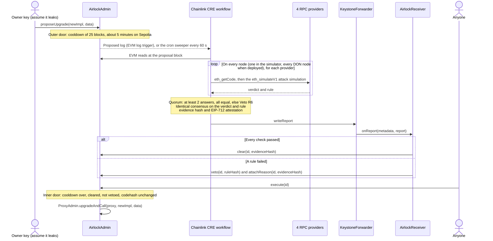

<div align="center">

# Upgrade Airlock

**Every proxy upgrade passes two doors: a cooldown, and a Chainlink CRE clearance that only code surviving an attack simulation can earn.**

**English** · [简体中文](README.zh-CN.md) · [繁體中文](README.zh-TW.md) · [日本語](README.ja.md) · [한국어](README.ko.md) · [Español](README.es.md) · [Français](README.fr.md) · [Deutsch](README.de.md) · [Português (Brasil)](README.pt-BR.md) · [Русский](README.ru.md) · [Tiếng Việt](README.vi.md)

[](https://github.com/jiapunk/upgrade-airlock/actions/workflows/ci.yml)
[](LICENSE)
[](https://upgrade-airlock.pages.dev)
[](https://upgrade-airlock.pages.dev/video/)
[](https://sepolia.etherscan.io/address/0x28e7aAC40560804F480e454bF9C12F50C83b700B)
[](#chainlink-cre)

[Highlights](#highlights) · [How it works](#how-it-works) · [Rules](#rules) · [Chainlink CRE](#chainlink-cre) · [Live on Sepolia](#live-on-sepolia) · [Quick start](#quick-start) · [Security model](#security-model)

</div>

## Overview

Upgrade Airlock gives every contract upgrade two doors. The **outer door** is a cooldown measured in blocks. The
**inner door** opens only on a clearance recorded on chain. Automatically, that means a Chainlink CRE workflow has
attacked the new implementation in a simulator, querying four independent RPC providers; at least two have answered
and every answer has agreed, the workflow's consensus step (`consensusIdenticalAggregation`) has agreed on the
verdict, and a signed **Clear** report has landed on chain. When CRE cannot answer at all, the approver key can clear
by hand with recorded evidence; the sweeper still judges that proposal while it is among the newest 20 ids, and a CRE
or guardian veto wins. A malicious implementation that the attack search reaches gets a signed **Veto** instead and
never runs, even when the attacker holds the upgrade key; strict mode adds a human code review for what a bounded
search cannot reach. Today the verdicts come from the official CRE CLI (`cre workflow simulate --broadcast`) running
the workflow on a server; the same workflow and contract code can be deployed to a DON. Built for ETH Shenzhen 2026 on
Ethereum Sepolia.

> [!TIP]
> **Live demo: [upgrade-airlock.pages.dev](https://upgrade-airlock.pages.dev)** ·
> **Demo video: [upgrade-airlock.pages.dev/video](https://upgrade-airlock.pages.dev/video/)** (Simplified Chinese and
> English)
>
> The war room reads Ethereum Sepolia straight from your browser, read-only. Each proposal is drawn as an airlock: the
> **outer door** records the proposal, the **chamber** counts down the cooldown, and the **inner door** stays locked
> until a clearance lands on chain (Chainlink CRE's Clear, or an approver's hand clearance, which the war room labels
> as one). A Veto ejects the proposal, with its rule, evidence hash and transaction. A first visit opens on an attack
> picker: each card replays the newest real Sepolia proposal of its kind (six attacks and the honest v2), labelled as
> a replay. The page opens in Simplified Chinese: [`?lang=en`](https://upgrade-airlock.pages.dev/?lang=en) switches to
> English and [`?lang=zh-TW`](https://upgrade-airlock.pages.dev/?lang=zh-TW) to Traditional Chinese. The transactions
> behind it (proposals #1–#10) are listed in [the live-run evidence](docs/evidence/sepolia-live.md).

## Highlights

- **Fail-closed by construction.** An upgrade runs only with a clearance on chain. A missed log, an RPC outage,
  disagreeing providers or a failed run leaves the proposal uncleared or vetoed: it can delay an upgrade, never let
  one through. A veto always beats a clearance.
- **An attack, not a checklist.** The workflow runs the upgrade (on every node, in a DON deployment) against the
  proxy's real state with `eth_simulateV1` on four RPC providers. A funded stranger calls every selector in the new bytecode, holder-shaped
  arguments hit every new function, and supply, ownership and balances are compared before and after. At least two
  providers must answer, and every answer must agree.
- **Verdicts bound to the proposal.** The workflow's identical-consensus step agrees on `{verdict, rule}`. The report carries an EIP-712
  attestation bound to the proposal's exact content (`proposalDigest`), the chain, the receiver and a block
  deadline, plus an evidence hash anyone can recompute from chain data.
- **Missed logs are swept up.** A cron sweeper checks the newest 20 proposals every 60 seconds and judges any the
  log trigger missed, including upgrades the approver cleared by hand; its veto wins. A proposal pushed below the
  newest 20 ids is no longer judged: it stays uncleared unless the approver cleared it by hand
  ([the sweep window](docs/design.md#the-sweep-window)).
- **Live on Ethereum Sepolia.** The official CRE CLI ran the workflow on a server and answered every proposal on
  chain (ten as of 2026-10-23): one honest upgrade cleared and executed, nine attacks vetoed (R1, R2, R3, R3B, R7,
  R9). Every contract is verified on Sourcify.
- **Tested end to end.** [CI](.github/workflows/ci.yml) runs 117 Foundry tests, 118 workflow unit tests and 387 of the
  394 war-room self-test checks (the other 7 need forge build output and cast, which the CI job does not have); a fork
  end-to-end script drives the full loop through the CRE simulator.

## The problem

An upgradeable proxy puts the whole protocol behind its upgrade key. Once that key leaks, the attack is short: deploy a
malicious implementation, point the proxy at it, mint or drain. It has happened many times:

- **PAID Network, March 2021.** The proxy owner's keys swapped the audited token code for a version with burn and
  mint functions, and the attacker minted about 59.5 million PAID.
  ([CertiK post-mortem](https://www.certik.com/blog/paid-network-post-mortem))
- **Ankr, December 2022.** With the compromised deployer key, the attacker replaced the aBNBc implementation with
  one that minted without authorization checks: 60 trillion aBNBc.
  ([Ankr's report](https://www.ankr.com/blog/the-abnbc-token-report/))
- **Radiant Capital, October 2024.** An attacker controlling 3 of 11 multisig signers took over the lending pool
  provider and upgraded the lending pools' implementation, draining over $53 million.
  ([rekt.news](https://rekt.news/radiant-capital-rekt2))

A timelock only makes the attacker wait, and nobody is obliged to look during the wait. Long delays also block
emergency fixes. Upgrade Airlock makes the wait do the work: an upgrade cannot run until an independent check
(decentralized once deployed to a CRE DON) has passed it, and that check runs automatically on every proposal.

## How it works



1. **Propose.** `AirlockAdmin` owns the OpenZeppelin `ProxyAdmin` and the token's `Ownable`. The owner key can only
   propose: it is never a guardian, the approver or the clearance oracle. Every proposal (an upgrade, or a change to
   the airlock itself: guardians, delay, break-glass target) gets `readyBlock = block.number + delayBlocks`. An
   upgrade or break-glass target must be ordinary contract code: an EIP-7702 delegated account, whose key could
   re-point it after the verdict, is refused (`DelegatedAccount`).
2. **Judge.** The CRE log trigger fires on `Proposed`. A change to the airlock is judged from chain reads (R7). An
   upgrade first meets the static rules (R5, R8), then the attack simulation, pinned to the proposal block: the
   proxy's ERC-1967 implementation slot is overridden with the new code, and a fresh stranger address (derived from
   the proposal block's hash) is funded like a real user, with tokens from a second holder and ETH. A holder makes
   a transfer, the stranger calls `transferFrom` without allowance, then every selector found in the new bytecode
   with five argument shapes. Every selector outside the standard token interface is also called with holder-shaped
   arguments: the funded holder in each of the first four argument slots, the test amount in another, the stranger
   or the proxy in the rest. Supply, owner and every watched balance are read before and after, the holder's balance
   right after each holder-shaped call, and every probe's own events are checked (R1 to R4, R3B). Finally the new
   bytecode is scanned for opcodes that behave differently on a real block than in a simulation (R9).
3. **Agree.** Each node (every DON node in a DON deployment; the CLI simulator today) runs the simulation on four
   providers. At least two must answer and every answer must be the same verdict; anything else is a veto (R6). The
   consensus step then agrees on the identical `{verdict, rule}`.
4. **Report.** The workflow hashes a canonical evidence JSON, signs an EIP-712 verdict with its attester key (a CRE
   secret), and writes the report through the forwarder. `AirlockReceiver` checks the sender, the freshness, the
   signature and that the verdict is bound to this exact proposal (`proposalDigest`), then calls `clear`, or `veto`
   and `attachReason`, on `AirlockAdmin`.
5. **Execute.** Anyone may call `execute(id)` once the cooldown is over. It reverts `TooEarly` during the cooldown,
   `NotCleared` without a clearance, `ProposalVetoed` after a veto, and `CodehashChanged` when the target no longer
   holds the code that was proposed and judged. A veto always beats a clearance.
6. **Sweep.** A cron trigger re-checks the newest proposals every 60 seconds and judges every pending one the CRE
   has not answered yet (`oracleJudged`): a log the trigger missed, a `Proposed` event too large to deliver, or an
   upgrade the approver cleared by hand. Its veto wins over that clearance.

**Every failure points the same way.** A missed log, an RPC outage, disagreeing providers or a failed run leaves the
proposal without a clearance or vetoes it, so it delays an upgrade and never lets one through. When CRE cannot answer
at all, the approver key can clear an upgrade by hand with recorded evidence; the sweeper still judges that upgrade
once CRE answers again, and a CRE or guardian veto still wins. `breakGlass()` lets the owner or any guardian switch
the proxy to a pre-registered paused implementation at once. Leaving the paused state is an upgrade through both
doors; a cleared proposal never expires, so an earlier cleared upgrade can also end the pause
([known limitations](docs/design.md#known-limitations)).

More detail: [docs/design.md](docs/design.md) (threat model, clearance state machine, report binding, budgets) and
[cre/README.md](cre/README.md) (the workflow).

## Rules

`ruleHash = keccak256("GUARD/<ID>")`, recorded on chain with every veto.

| Rule | Vetoes when | Decided by |
|---|---|---|
| R1 `TOTAL_SUPPLY` | a stranger's call changes `totalSupply` | attack simulation |
| R2 `OWNER` | a stranger's call changes `owner()` | attack simulation |
| R3 `TRANSFER_CONSERVATION` | a holder's transfer of X does not move exactly X, or moves anyone else's balance | attack simulation |
| R3B `THIRD_PARTY_FUNDS` | an outsider moves any holder's tokens: the funded stranger's `transferFrom` without allowance succeeds, or one of its probes moves anyone else's tokens, mints, burns or moves ownership, or leaves the holder's balance lower, even with no event or when a later call undoes it | attack simulation |
| R4 `TRANSFER_LIVENESS` | a plain holder transfer fails | attack simulation |
| R5 `STRICT_CODEHASH` | strict mode is on and the approver has not approved the codehash | chain reads |
| R6 `SIM_FAILURE` | the simulation cannot decide: providers disagree, too few answer, code mismatch, a view or the stranger's funding reverts, or the probes do not fit in the configured requests | simulation and quorum |
| R7 `CONFIG_GUARD` | a guardian change, a shorter delay or a new break-glass target without the approver's pre-approval | chain reads |
| R8 `INIT_DATA` | an upgrade carries init data the approver has not approved together with the codehash | chain reads |
| R9 `NEW_OPCODES` | the new code contains a block or transaction context opcode (BASEFEE, TIMESTAMP, NUMBER, ORIGIN, GAS and more), an external call, create or selfdestruct that the config's fixed allowlist (empty by default) does not cover, unless the approver approved that exact codehash | bytecode |

**R9 closes simulation evasion.** `EvilBaseFeeImpl` behaves like v1 while `block.basefee == 0`, which is what an
`eth_simulateV1` call sees, and lets anyone mint on a real block. Every simulated invariant passes; its `BASEFEE`
opcode vetoes it. The allowlist never depends on the code the proxy runs today, so an approval covers one codehash
and no later upgrade. The scan skips the compiler's metadata tail only when it is an exact solc CBOR map that no
instruction can reach; anything else is scanned as code. Approving a codehash exempts it from R9 and excuses probe
truncation (R6), nothing more: every other rule still runs.

**R3B closes the quiet drain.** `EvilDrainImpl` is v1 plus `rescue(from, to, amount)` with no access control.
Supply, owner, transfers and opcodes are those of v1, so R1 to R4 and R9 all pass. `rescue` is not a standard token
function, so the stranger also calls it with holder-shaped arguments; the call with the holder as `from` moves the
holder's tokens, and R3B vetoes it. A drain that hides behind "only for callers who hold tokens or ETH" is reached
too, because the stranger holds both.

### Automatic and strict mode

**Automatic mode**, the default, has CRE clear or veto every upgrade on its own through a bounded attack search: a
funded outside caller, every selector in the new code, and the holder in each of the first four argument slots of
every new function. **Strict mode** (R5) adds a human review: every new implementation codehash must first be
approved by the approver key, and the attack simulation still runs. Automatic mode fits a token that wants routine
upgrades cleared in minutes; strict mode makes a code review part of the clearance
([the two modes](docs/design.md#two-modes-automatic-and-strict)).

## Chainlink CRE

CRE is the orchestration layer of Upgrade Airlock: the workflow is the only automated way through the inner door,
and it carries every step from the on-chain trigger to the on-chain verdict. It is written with the CRE TypeScript
SDK (`@chainlink/cre-sdk` 1.23.0) and compiled to WASM with the CRE CLI v1.37.0.

| Chainlink technology | Where | What it does here |
|---|---|---|
| CRE workflow runner | [`cre/veto/main.ts#L1-L9`](cre/veto/main.ts#L1-L9), [`cre/veto/workflow.yaml`](cre/veto/workflow.yaml), [`cre/project.yaml`](cre/project.yaml) | Two handlers, targets `sepolia` and `sepolia-fork` |
| EVM log trigger | [`cre/veto/workflow.ts#L202-L211`](cre/veto/workflow.ts#L202-L211), [`#L193-L198`](cre/veto/workflow.ts#L193-L198), [`#L54-L65`](cre/veto/workflow.ts#L54-L65) | `AirlockAdmin.Proposed` at `LATEST`: a proposal is judged as soon as it appears, a whole cooldown before it could run |
| Cron trigger | [`cre/veto/workflow.ts#L200`](cre/veto/workflow.ts#L200), [`#L209`](cre/veto/workflow.ts#L209), [`cre/veto/airlock.ts#L323-L389`](cre/veto/airlock.ts#L323-L389) | The sweeper: newest 20 ids, every minute |
| EVM read (`callContract`) | [`cre/veto/workflow.ts#L114-L122`](cre/veto/workflow.ts#L114-L122), [`#L137-L142`](cre/veto/workflow.ts#L137-L142), [`cre/veto/chain.ts`](cre/veto/chain.ts) | Proposal, clearance, `oracleJudged`, approvals and balances, batched through Multicall3 at the proposal block or `LATEST` |
| EVM read (`headerByNumber`) | [`cre/veto/workflow.ts#L125-L136`](cre/veto/workflow.ts#L125-L136) | The latest block, and the proposal block's hash that seeds the simulated stranger |
| HTTP capability in node mode | [`cre/veto/workflow.ts#L167-L189`](cre/veto/workflow.ts#L167-L189), [`#L80-L94`](cre/veto/workflow.ts#L80-L94), [`cre/veto/judge.ts#L157-L220`](cre/veto/judge.ts#L157-L220) | Every node sends each provider `eth_getCode`, then one or two `eth_simulateV1` requests (each under the 120 kb request limit) |
| `consensusIdenticalAggregation` | [`cre/veto/workflow.ts#L184-L188`](cre/veto/workflow.ts#L184-L188), quorum in [`cre/veto/judge.ts#L244-L277`](cre/veto/judge.ts#L244-L277) | Identical consensus on `{verdict, rule}` (at most 52 bytes; every DON node when deployed) |
| Secrets | [`cre/veto/workflow.ts#L160-L166`](cre/veto/workflow.ts#L160-L166), [`cre/secrets.yaml`](cre/secrets.yaml) | The EIP-712 attester key, fetched once per run |
| Report + `writeReport` | [`cre/veto/workflow.ts#L143-L149`](cre/veto/workflow.ts#L143-L149), [`cre/veto/airlock.ts#L229-L282`](cre/veto/airlock.ts#L229-L282), [`cre/veto/report.ts`](cre/veto/report.ts) | `runtime.report` (ECDSA, keccak256) and `evm.writeReport`, then a read of the proposal to confirm the result |
| Forwarder + `IReceiver` | [`src/cre/AirlockReceiver.sol#L88-L120`](src/cre/AirlockReceiver.sol#L88-L120), [`#L156-L169`](src/cre/AirlockReceiver.sol#L156-L169), [`src/cre/IReceiver.sol`](src/cre/IReceiver.sol), [`script/DeployEth.s.sol#L142`](script/DeployEth.s.sol#L142) | `onReport` accepts only the configured forwarder and checks the workflow id and owner when configured |
| Chain selectors | [`cre/veto/workflow.ts#L100-L104`](cre/veto/workflow.ts#L100-L104) | `ethereum-testnet-sepolia` |
| CRE CLI | [`cre/setup.sh`](cre/setup.sh), [`cre/scripts/fork-e2e.sh`](cre/scripts/fork-e2e.sh), [`scripts/sepolia/airlock.sh`](scripts/sepolia/airlock.sh), [`scripts/sepolia/sweep.sh`](scripts/sepolia/sweep.sh) | `cre workflow build`, `cre workflow simulate --broadcast` |

**How the workflow runs today.** The workflow runs with the CRE CLI's `cre workflow simulate --broadcast` against
Ethereum Sepolia. The listener ([`scripts/sepolia/airlock.sh`](scripts/sepolia/airlock.sh)) keeps the log trigger
in listen mode, the sweeper ([`scripts/sepolia/sweep.sh`](scripts/sepolia/sweep.sh)) runs the cron handler every
minute, and every Clear and Veto is a real Sepolia transaction through Chainlink's Sepolia MockKeystoneForwarder
[`0x15fC6ae953E024d975e77382eEeC56A9101f9F88`](https://docs.chain.link/cre/guides/workflow/using-evm-client/forwarder-directory-ts).
`AirlockReceiver` is ready for a DON deployment as it is: deploy with `FORWARDER` set to the production
KeystoneForwarder and `WORKFLOW_ID` / `WORKFLOW_OWNER` set, and `onReport` also checks the DON-signed workflow
metadata. `DeployEth` refuses the permissionless MockKeystoneForwarder unless both are set or `ALLOW_MOCK_FORWARDER=1`
says so explicitly ([`script/DeployEth.s.sol#L96-L104`](script/DeployEth.s.sol#L96-L104)).

**Built for CRE's per-run limits.** At most 15 chain reads (Multicall3 batches under the 5 kb payload limit), 12 of
15 HTTP calls with four providers, one attack simulation per run, and a consensus value of at most 52 bytes. The
budgets are in [docs/design.md](docs/design.md#budgets).

## Live on Sepolia

Ethereum Sepolia, chain id 11155111. Deployed with [`script/DeployEth.s.sol`](script/DeployEth.s.sol) in blocks
11950684–11950699 (13 transactions; AirlockAdmin in block 11950697); every contract is verified on Sourcify. Owner,
approver, emergency guardian and attester are four different keys. The cooldown is 25 blocks.

| Contract | Address |
|---|---|
| AirlockAdmin | [`0x28e7aAC40560804F480e454bF9C12F50C83b700B`](https://sepolia.etherscan.io/address/0x28e7aAC40560804F480e454bF9C12F50C83b700B) |
| AirlockReceiver | [`0xE40D463116F4Aa24d5E79776a65ED0f1b088c670`](https://sepolia.etherscan.io/address/0xE40D463116F4Aa24d5E79776a65ED0f1b088c670) |
| DemoBTC proxy (dBTC) | [`0x88Cc569265faDAEAc2a16B69f35E10B2158e4b71`](https://sepolia.etherscan.io/address/0x88Cc569265faDAEAc2a16B69f35E10B2158e4b71) |
| ProxyAdmin | [`0x51a3fE6AD22BF7753574B7b7FD56aE9a65bd593E`](https://sepolia.etherscan.io/address/0x51a3fE6AD22BF7753574B7b7FD56aE9a65bd593E) |
| DemoBTC v1 | [`0x8f7d6453d77B3f3b008CBE4A144d82c5742eB108`](https://sepolia.etherscan.io/address/0x8f7d6453d77B3f3b008CBE4A144d82c5742eB108) |
| DemoBTC v2 (honest upgrade) | [`0x4D959f981C01E3B81ac6C9A20E84816Fe5f6Bce3`](https://sepolia.etherscan.io/address/0x4D959f981C01E3B81ac6C9A20E84816Fe5f6Bce3) |
| EvilMintImpl | [`0x01502c4af90c27f53B2E1293941670C6B761CAAA`](https://sepolia.etherscan.io/address/0x01502c4af90c27f53B2E1293941670C6B761CAAA) |
| EvilOwnerImpl | [`0xBe849DE8e0a4D9b0010ba1468f94Eeb24A42d488`](https://sepolia.etherscan.io/address/0xBe849DE8e0a4D9b0010ba1468f94Eeb24A42d488) |
| EvilFeeImpl | [`0xB95Ffa7b970B1a73488e2fC32B787fA536F12AF5`](https://sepolia.etherscan.io/address/0xB95Ffa7b970B1a73488e2fC32B787fA536F12AF5) |
| EvilBaseFeeImpl | [`0xE1AAa4E88DB9cc7ceCca14722eE2874D834e0310`](https://sepolia.etherscan.io/address/0xE1AAa4E88DB9cc7ceCca14722eE2874D834e0310) |
| EvilDrainImpl | [`0x1d98D64BC5204AE139B5A0747855841Fa5333b6d`](https://sepolia.etherscan.io/address/0x1d98D64BC5204AE139B5A0747855841Fa5333b6d) |
| PausedImpl (break-glass target) | [`0xb6573006fB607E96966d0F578B96AAB25413F5BE`](https://sepolia.etherscan.io/address/0xb6573006fB607E96966d0F578B96AAB25413F5BE) |
| Chainlink MockKeystoneForwarder | [`0x15fC6ae953E024d975e77382eEeC56A9101f9F88`](https://sepolia.etherscan.io/address/0x15fC6ae953E024d975e77382eEeC56A9101f9F88) |

The first run: seven proposals, seven on-chain verdicts (later runs #8–#10 are listed in
[docs/evidence/sepolia-live.md](docs/evidence/sepolia-live.md)). The block in each link is the block the transaction landed in; `(+n)` is
how many blocks after the proposal the CRE verdict arrived.

| Card | Proposal | CRE verdict | Proposal tx | Report tx | Then |
|---|---|---|---|---|---|
| `v2`: honest upgrade | #4 | Clear | [11950745](https://sepolia.etherscan.io/tx/0x3cd96ac220391e2b404d35591d1a96808b75256e7c685a414e2ca5a63bc54145) | [11950747 (+2)](https://sepolia.etherscan.io/tx/0x2c02d2a23016a72509900eb7ce92dabc06b0dd93a2394d076a62d687ce467efb) | `execute` [11950772](https://sepolia.etherscan.io/tx/0x01913c1854b9862763af74ddacd7be23a7f55232af7334714aa8213aa7021890), `version()` = "2" |
| `evil-mint`: anyone can mint | #1 | Veto R1 | [11950735](https://sepolia.etherscan.io/tx/0x862c5fdf826a8fef09fe2ff278d3e58191f93c267dbdd38ad9aaa270f39937b0) | [11950736 (+1)](https://sepolia.etherscan.io/tx/0xb0d74e25e2528fb9aad7d21de202dac288cd256048f2986b5214280fda4b84f6) | `execute` reverts `ProposalVetoed` |
| `evil-owner`: anyone can take ownership | #6 | Veto R2 | [11950788](https://sepolia.etherscan.io/tx/0x32eb22039bd43602e0406b1a8f9a02c5cbcdb5cf2ef1c389919a45d05820da25) | [11950790 (+2)](https://sepolia.etherscan.io/tx/0x49451bee7a2f3351b18992d94b5f89b9ff89cf53be65a937400ab95fb79be551) | `execute` reverts `ProposalVetoed` |
| `evil-fee`: transfers skim 10% | #7 | Veto R3 | [11950792](https://sepolia.etherscan.io/tx/0xe06924c2e3961ab27d2803c0654b783fc06e52107345bda9bfeff391053fcad3) | [11950794 (+2)](https://sepolia.etherscan.io/tx/0x01f6055a683e0dabc8f34ae094e5daa5a81ddb11c687aa9c5ac6e30c7a7f3d3b) | `execute` reverts `ProposalVetoed` |
| `evil-basefee`: mint opens on a real block | #3 | Veto R9 | [11950742](https://sepolia.etherscan.io/tx/0x3c29c118ca395ca92500abcaae6126244924fbd8e14f846af57b70f113cad6e1) | [11950743 (+1)](https://sepolia.etherscan.io/tx/0xb6db2d832112384287e5a7ccdd086127931360900d09c80645c21eac2bc165db) | `execute` reverts `ProposalVetoed` |
| `evil-drain`: anyone moves a holder's tokens | #2 | Veto R3B | [11950737](https://sepolia.etherscan.io/tx/0x0e52369921040eb0c901ac3a077aff762d370b4efd9503a52c91360d56366b16) | [11950740 (+3)](https://sepolia.etherscan.io/tx/0x40bbe374a8cee47a94da977f973cf66a67573c12bc84117483fcbd11430f90cb) | `execute` reverts `ProposalVetoed` |
| `remove-receiver`: drop CRE as a guardian | #5 | Veto R7 | [11950749](https://sepolia.etherscan.io/tx/0xda2bd1c9dc5f7770da3926358b8da3ffe5a1cd3154b499cafae440387eebb934) | [11950750 (+1)](https://sepolia.etherscan.io/tx/0xaa2f598bdcc7f46727e5456528521e50ac5c1d8e423805042cbf2d10a4c4cdac) | `execute` reverts `ProposalVetoed` |

Every verdict above came from the official CRE CLI running this workflow on a server (the log-trigger listener plus
the 60-second sweeper, [`scripts/sepolia/systemd/`](scripts/sepolia/systemd)); the workflow's own log lines are in
[`docs/evidence/sepolia-live.md`](docs/evidence/sepolia-live.md).

## Quick start

### Prerequisites

- [Foundry](https://getfoundry.sh) (`forge`, `cast`, `anvil`), `jq` and Node 22.
- A CRE account for the simulator (`cre login`), used by the fork end-to-end run and the operator kit.
- [`cre/setup.sh`](cre/setup.sh) installs the CRE CLI v1.37.0 (SHA-256 pinned) and bun 1.4.2 into `cre/.tools`.

### Build and test

```bash
git clone https://github.com/jiapunk/upgrade-airlock.git
cd upgrade-airlock

# contracts (OpenZeppelin and forge-std are vendored in lib/)
forge build                     # fetches the pinned solc 0.8.37 once
forge test --offline            # 117 tests

# the CRE workflow
cre/setup.sh
export PATH="$PWD/cre/.tools/bin:$PWD/cre/.tools/node_modules/.bin:$PATH"
(cd cre/veto && bun test && bun run typecheck)    # 118 tests: rules, probes, bytecode, reports, budgets, handlers

# the war room
(cd web && npm ci && npm run selftest)            # 394 checks: live view and attack picker, offline playback, operator API
```

### End to end on a Sepolia fork

```bash
cre login                       # once; the simulator needs a CRE account
cre/scripts/fork-e2e.sh         # a local anvil fork of Sepolia: nothing is sent to a live network
```

[`cre/scripts/fork-e2e.sh`](cre/scripts/fork-e2e.sh) deploys the stack on the fork, runs the workflow in the CRE
simulator with `--broadcast` and checks every outcome on chain:

- **Log trigger:** EvilMint vetoed R1, EvilOwner R2, EvilFee R3, EvilBaseFee R9 (it names `BASEFEE`), EvilDrain R3B
  (it names `rescue`, every other rule passing); seven more drains
  ([`test/fixtures/DrainVariants.sol`](test/fixtures/DrainVariants.sol)) vetoed R3B alone: reordered arguments, a
  token-address guard, a drain open only to callers holding tokens or ETH, one without a `Transfer` event, and a
  `transferFrom` that skips the allowance for token holders; honest v2 cleared and executed after the cooldown;
  removing the receiver as a guardian vetoed R7; a shorter delay pre-approved by the approver cleared.
- **Sweeper:** an upgrade nobody judged reverts `NotCleared` after the cooldown, one sweeper run clears it and it
  executes; two proposals the approver cleared by hand are judged by the next run: EvilDrain vetoed R3B over the
  clearance, a longer delay cleared by CRE as well; an upgrade with 6 KB of init data is vetoed R8 by the run after.
- **Evidence:** every vetoed proposal reverts `ProposalVetoed`, and every verdict's evidence hash is recomputed from
  chain data ([`cre/veto/tools/check-evidence.ts`](cre/veto/tools/check-evidence.ts)).

### Sepolia operator kit

[`scripts/sepolia/`](scripts/sepolia/README.md) runs the live demo. The keys live outside the repo, one hex key per
file in `KEY_DIR` (`owner.key`, `attester.key`, `sender.key`, `approver.key`, `emergency.key`, plus an optional
`sweeper.key`); the scripts never print them, and
`deploy.sh` refuses unless owner, approver, emergency guardian and attester are four different keys. Every script
also runs against a local fork with `FORK=<port>`, so the demo can be rehearsed without spending anything.

```bash
scripts/sepolia/deploy.sh                    # 13 transactions, writes deployments/sepolia.json (FORCE=1 replaces one)
bun scripts/sepolia/make-config.mjs          # the workflow config, 4 providers, quorum 2
scripts/sepolia/fund-sender.sh 0.05          # ETH for the report transactions
scripts/sepolia/airlock.sh                   # terminal A: the CRE listener (log trigger)
scripts/sepolia/propose.sh v2                # terminal B: then evil-mint, evil-owner, evil-fee, evil-basefee, evil-drain, remove-receiver
scripts/sepolia/execute.sh <id>              # runs a cleared proposal after its cooldown, shows the revert otherwise
scripts/sepolia/status.sh                    # every proposal: verdict, CRE judged or not, rule, evidence, txs
```

`sweep.sh` runs the cron sweeper once, `clear.sh` is the approver's manual clearance, `fork.sh` starts, saves and
restores a Sepolia fork, `probe-rpcs.ts` checks every provider with the workflow's own judging code, and `systemd/`
runs the listener and the sweeper on a Linux server.

### War room

```bash
cd web
npm ci
npm run dev                     # http://127.0.0.1:5173/
npm run build:airlock           # syncs deployments/sepolia.json into the page, builds web/dist-airlock
```

The page reads Sepolia directly; it never holds a key, signs or sends. It shows each proposal as an airlock: the
cooldown, the CRE clearance, the veto with its rule and evidence. Visitors pick one of seven cards (six attacks and
the honest v2) and watch a labelled replay of the newest real Sepolia proposal of that kind (or the live one while it
is in its cooldown): see [the attack picker](web/README.md#attack-picker-what-a-visitor-sees). For the presenter there
is an operator mode (`web/operator/`, `web/functions/`): loopback-only on the dev server, token-gated on Cloudflare
Pages, where it is off unless both the `OWNER_KEY` and `OPERATOR_TOKEN` secrets exist. It sends one of the same seven
fixed proposals through `POST /api/operator/propose`, signed server-side with the owner key (the design already
assumes that key leaks: it can only propose), and a public visitor's page never calls it: see [operator
mode](web/README.md#operator-mode-real-attacks-on-sepolia).

| URL parameter | Effect |
|---|---|
| `?mode=airlock` | Default. Live view of Ethereum Sepolia, read-only |
| `?mode=offline` | Plays a recorded run with no network connection at all |
| `?lang=en`, `?lang=zh-TW`, `?lang=zh-CN` | Interface language (default `zh-CN`; `L` cycles through them) |
| `?rpc=http://127.0.0.1:<port>` | Reads a local Sepolia fork instead, for rehearsals |
| `?op=1` | Operator mode: asks for the operator token (presenter only) |

Press `P` in live mode to replay the most recent proposals from their chain events, and `1` to `7` to replay a
picker card.

## Repository layout

```
src/AirlockAdmin.sol            the two doors: proposals, cooldown, guardian veto, clearance, execute, breakGlass
src/cre/AirlockReceiver.sol     CRE report receiver: forwarder, workflow metadata, EIP-712 attestation, digest binding
src/cre/IReceiver.sol           Chainlink CRE receiver interface
src/DemoBTC.sol, DemoBTCV2.sol  demo token (dBTC) v1 and the honest v2
src/PausedImpl.sol              break-glass target: every balance change reverts
src/attack/                     EvilMintImpl, EvilOwnerImpl, EvilFeeImpl, EvilBaseFeeImpl, EvilDrainImpl
script/DeployEth.s.sol          deployment (13 transactions) with role, forwarder and post-deploy wiring checks
test/                           Foundry tests; fixtures/DrainVariants.sol holds the seven drain variants
cre/veto/                       the CRE workflow: workflow.ts (capabilities), airlock.ts (handlers), judge.ts (rules,
                                quorum), simulate.ts (eth_simulateV1), bytecode.ts (selectors, R9), report.ts
                                (report, EIP-712, evidence), chain.ts (read budget), keys.ts, rules.ts, config.ts
cre/veto/test/                  Bun unit tests
cre/veto/tools/                 check-evidence.ts recomputes every on-chain evidence hash
cre/scripts/fork-e2e.sh         end to end on an anvil fork of Sepolia
cre/setup.sh                    pinned CRE CLI and bun
scripts/sepolia/                operator kit for the live demo, with systemd units for a server
web/                            war room (Vite, TypeScript, viem)
web/operator/, web/functions/   operator mode: seven fixed proposals signed server-side (dev server, Pages Functions)
deployments/sepolia.json        the live deployment
docs/design.md                  threat model, clearance state machine, report binding, budgets
docs/evidence/                  the recorded live run
.github/workflows/ci.yml        contracts, workflow and war room checks
```

## Security model

Upgrade Airlock assumes the owner key leaks, and is built so that the owner key alone can never run an upgrade.

| Role | Held by | Can |
|---|---|---|
| Owner | one key | propose upgrades and changes to the airlock (guardians, delay, break-glass target); `breakGlass` |
| Approver | a separate key | clear by hand when CRE cannot answer; approve codehashes, init data and airlock changes (`approveCodehash`) |
| Emergency guardian | a separate key | `veto` a pending proposal; `breakGlass` |
| Attester | a CRE secret, its own key | sign the EIP-712 verdicts `AirlockReceiver` accepts |
| AirlockReceiver | the CRE report receiver | clearance oracle (`clear`) and guardian (`veto`, `attachReason`) |
| Anyone | | `execute` a proposal that has passed both doors |

Roles never overlap. The `AirlockAdmin` constructor refuses an owner that is also the approver, a guardian or the
clearance oracle (`RoleOverlap`), and `DeployEth` deploys only when owner, approver, emergency guardian and attester
are four different addresses.

**A leaked owner key can propose.** Every proposal waits out the cooldown in plain view while CRE judges it, and
needs a clearance the owner cannot give itself. The owner can also pull the emergency brake (`breakGlass`), which
only switches the proxy to the pre-registered paused implementation; leaving it is an upgrade through both doors,
and an earlier cleared upgrade that was never executed can end it too.

**The same key cannot:**

- execute without a clearance: `AirlockAdmin` has no generic call path, and the only way to change the
  implementation is `execute` of a cleared upgrade (or `breakGlass` to the paused implementation);
- weaken the airlock first: removing the CRE receiver, shortening the delay or swapping the break-glass target are
  proposals too, and R7 vetoes them without the approver's pre-approval;
- swap the code after the verdict: `execute` re-checks the target's codehash (`CodehashChanged`), and EIP-7702
  delegated accounts are refused (`DelegatedAccount`);
- forge or reuse a verdict: `AirlockReceiver` accepts a report only from the configured forwarder, signed by the
  attester, no later than its `validUntilBlock`, and bound to the proposal's `proposalDigest` on this chain and
  receiver.

The approver's hand clearance is an override for when CRE cannot answer: the sweeper still judges that proposal
while it is among the newest 20 ids, and a CRE or guardian veto wins. The full threat model is in
[docs/design.md](docs/design.md#threat-model).

These are testnet demo contracts with known limitations, each pinned by a passing test: clearances never expire, the
owner key cannot be rotated (a stolen one can re-pause the token after every unpause), and one rogue guardian can keep
it paused. They are listed in [docs/design.md](docs/design.md#known-limitations).

## Built with

- **Solidity 0.8.37** and **Foundry**, with OpenZeppelin Contracts 5.7.0 (`ProxyAdmin`,
  `TransparentUpgradeableProxy`, `EIP712`, `ECDSA`)
- **Chainlink CRE**: the TypeScript SDK (`@chainlink/cre-sdk` 1.23.0) and the CRE CLI v1.37.0, on Bun 1.4.2
- **viem** for ABI encoding and chain reads, in the workflow and the war room
- **Vite** and TypeScript for the war room

## AI tools

Upgrade Airlock was built with [Claude Code](https://claude.com/claude-code) under the author's direction: the
contracts, the CRE workflow, the tests, the scripts, the war room and these documents were written and checked with
it.

## License

[MIT](LICENSE) © 2026 jiapunk
