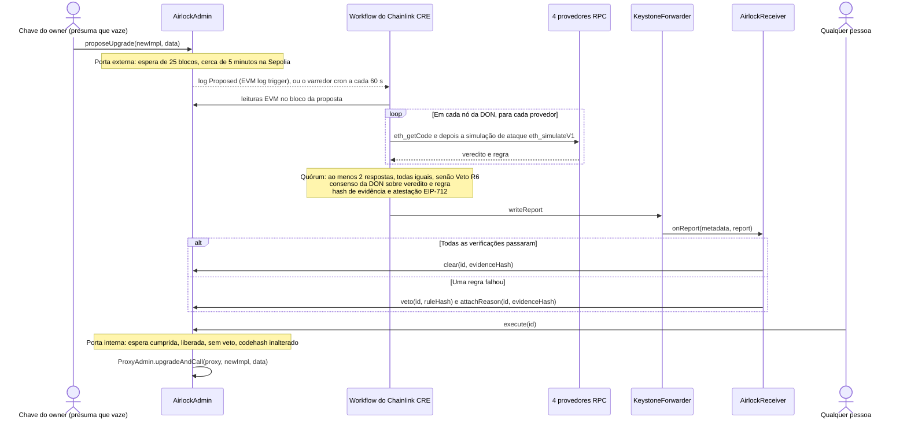

<div align="center">

# Upgrade Airlock

**Todo upgrade de proxy passa por duas portas: um período de espera e uma liberação do Chainlink CRE que só o código que sobrevive a uma simulação de ataque consegue obter.**

[English](README.md) · [简体中文](README.zh-CN.md) · [繁體中文](README.zh-TW.md) · [日本語](README.ja.md) · [한국어](README.ko.md) · [Español](README.es.md) · [Français](README.fr.md) · [Deutsch](README.de.md) · **Português (Brasil)** · [Русский](README.ru.md) · [Tiếng Việt](README.vi.md)

[](https://github.com/jiapunk/upgrade-airlock/actions/workflows/ci.yml)
[](LICENSE)
[](https://upgrade-airlock.pages.dev)
[](https://sepolia.etherscan.io/address/0x28e7aAC40560804F480e454bF9C12F50C83b700B)
[](#chainlink-cre)

[Destaques](#highlights) · [Como funciona](#how-it-works) · [Regras](#rules) · [Chainlink CRE](#chainlink-cre) · [Ao vivo na Sepolia](#live-on-sepolia) · [Início rápido](#quick-start) · [Modelo de segurança](#security-model)

</div>

## Visão geral

O Upgrade Airlock coloca duas portas diante de cada upgrade de contrato. A **porta externa** é um período de espera
(cooldown) medido em blocos. A **porta interna** só se abre quando um workflow do Chainlink CRE já atacou a nova
implementação em um simulador em quatro provedores RPC independentes, todas as respostas coincidiram, a DON chegou a
um consenso sobre o veredito e um relatório **Clear** (liberação) assinado foi registrado on-chain. Uma implementação
maliciosa recebe, em vez disso, um **Veto** assinado e nunca chega a ser executada, mesmo que o atacante detenha a
chave de upgrade. Desenvolvido para o ETH Shenzhen 2026, na Ethereum Sepolia.

> [!TIP]
> **Demo ao vivo: [upgrade-airlock.pages.dev](https://upgrade-airlock.pages.dev)**
>
> A war room lê a Ethereum Sepolia direto do seu navegador, em modo somente leitura. Cada proposta é representada
> como uma câmara de descompressão: a **porta externa** registra a proposta, a **câmara** faz a contagem regressiva do
> período de espera e a **porta interna** continua trancada até que o Clear do Chainlink CRE chegue on-chain. Um Veto
> ejeta a proposta, com a respectiva regra, o hash de evidência e a transação. A página abre em chinês simplificado:
> [`?lang=en`](https://upgrade-airlock.pages.dev/?lang=en) muda para inglês e
> [`?lang=zh-TW`](https://upgrade-airlock.pages.dev/?lang=zh-TW) para chinês tradicional.
> Todas as transações por trás dela estão listadas na [evidência da execução ao vivo](docs/evidence/sepolia-live.md).

## <a id="highlights"></a>Destaques

- **Fail-closed por construção.** Um upgrade só é executado com uma liberação on-chain. Um log perdido, uma queda de
  RPC, provedores em desacordo ou uma execução com falha deixam a proposta sem liberação ou vetada: isso pode atrasar
  um upgrade, nunca deixá-lo passar. Um veto sempre prevalece sobre uma liberação.
- **Um ataque, não um checklist.** Cada nó da DON executa o upgrade sobre o estado real do proxy com
  `eth_simulateV1` em quatro provedores RPC. Um desconhecido com fundos chama todos os seletores do novo bytecode,
  argumentos no formato de detentor atingem cada função nova, e supply, propriedade e saldos são comparados antes e
  depois. Pelo menos dois provedores precisam responder, e todas as respostas precisam coincidir.
- **Vereditos vinculados à proposta.** A DON chega a um consenso sobre `{verdict, rule}`. O relatório carrega uma
  atestação EIP-712 vinculada ao conteúdo exato da proposta (`proposalDigest`), à chain, ao receiver e a um prazo em
  blocos, além de um hash de evidência que qualquer pessoa pode recalcular a partir dos dados da chain.
- **Nada fica sem julgamento.** Um varredor cron verifica as 20 propostas mais recentes a cada 60 segundos e julga
  qualquer uma que o log trigger tenha deixado passar, inclusive upgrades que o aprovador liberou manualmente; o veto
  do varredor prevalece.
- **Ao vivo na Ethereum Sepolia.** A CRE CLI oficial executou o workflow em um servidor e respondeu a sete propostas
  on-chain: um upgrade honesto liberado e executado, seis ataques vetados (R1, R2, R3, R3B, R7, R9). Todos os
  contratos estão verificados no Sourcify.
- **Testado de ponta a ponta.** 117 testes Foundry, 118 testes unitários do workflow e 137 verificações de autoteste
  da war room rodam na [CI](.github/workflows/ci.yml); um script de ponta a ponta em fork percorre o ciclo completo no
  simulador do CRE.

## O problema

Um proxy atualizável deixa o protocolo inteiro à mercê da sua chave de upgrade. Quando essa chave vaza, o ataque é
curto: fazer o deploy de uma implementação maliciosa, apontar o proxy para ela, cunhar ou drenar. Isso já aconteceu
muitas vezes:

- **PAID Network, março de 2021.** As chaves do owner do proxy trocaram o código auditado do token por uma versão com
  funções de burn e mint, e o atacante cunhou cerca de 59,5 milhões de PAID.
  ([post-mortem da CertiK](https://www.certik.com/blog/paid-network-post-mortem))
- **Ankr, dezembro de 2022.** Com a chave de deployer comprometida, o atacante substituiu a implementação do aBNBc
  por uma que cunhava sem verificação de autorização: 60 trilhões de aBNBc.
  ([relatório da Ankr](https://www.ankr.com/blog/the-abnbc-token-report/))
- **Radiant Capital, outubro de 2024.** Um atacante que controlava 3 de 11 signatários do multisig assumiu o
  controle do provider dos pools de empréstimo e fez upgrade da implementação desses pools, drenando mais de
  US$ 53 milhões.
  ([rekt.news](https://rekt.news/radiant-capital-rekt2))

Um timelock só faz o atacante esperar, e ninguém é obrigado a olhar durante a espera. Atrasos longos também bloqueiam
correções emergenciais. O Upgrade Airlock coloca a espera para trabalhar: um upgrade não pode ser executado até que
uma verificação independente e descentralizada o aprove, e essa verificação roda automaticamente em toda proposta.

## <a id="how-it-works"></a>Como funciona



1. **Propor.** O `AirlockAdmin` é dono do `ProxyAdmin` da OpenZeppelin e do `Ownable` do token. A chave do owner só
   pode propor: nunca é guardião, aprovador nem oráculo de liberação. Toda proposta (um upgrade ou uma mudança no
   próprio airlock: guardiões, atraso, alvo do break-glass) recebe `readyBlock = block.number + delayBlocks`. O alvo
   de um upgrade ou do break-glass precisa ser código de contrato comum: uma conta delegada via EIP-7702, cuja chave
   poderia redirecioná-la depois do veredito, é recusada (`DelegatedAccount`).
2. **Julgar.** O log trigger do CRE dispara no evento `Proposed`. Uma mudança no airlock é julgada a partir de
   leituras on-chain (R7). Um upgrade passa primeiro pelas regras estáticas (R5, R8) e depois pela simulação de
   ataque, fixada no bloco da proposta: o slot de implementação ERC-1967 do proxy é sobrescrito com o novo código, e um
   endereço desconhecido recém-gerado (derivado do hash do bloco da proposta) recebe fundos como um usuário real, com
   tokens de um segundo detentor e ETH. Um detentor faz uma transferência, o desconhecido chama `transferFrom` sem
   allowance e, em seguida, todos os seletores encontrados no novo bytecode com cinco formatos de argumentos. Todo
   seletor fora da interface padrão de token também é chamado com argumentos no formato de detentor: o detentor com
   fundos em cada um dos quatro primeiros slots de argumento, o valor de teste em outro, o desconhecido ou o proxy nos
   demais. Supply, owner e cada saldo observado são lidos antes e depois, o saldo do detentor logo após cada chamada no
   formato de detentor, e os eventos emitidos por cada sonda são verificados (R1 a R4, R3B). Por fim, o novo bytecode
   é varrido em busca de opcodes que se comportam de forma diferente em um bloco real e em uma simulação (R9).
3. **Concordar.** Cada nó da DON executa a simulação em quatro provedores. Pelo menos dois precisam responder e todas
   as respostas precisam trazer o mesmo veredito; qualquer outro resultado é um veto (R6). Em seguida, a DON chega a
   um consenso sobre um `{verdict, rule}` idêntico.
4. **Reportar.** O workflow calcula o hash de um JSON canônico de evidência, assina um veredito EIP-712 com sua chave
   de attester (um secret do CRE) e grava o relatório por meio do forwarder. O `AirlockReceiver` verifica o
   remetente, se o relatório ainda está dentro do prazo, a assinatura e se o veredito está vinculado exatamente a esta
   proposta (`proposalDigest`), e então chama `clear`, ou `veto` e `attachReason`, no `AirlockAdmin`.
5. **Executar.** Qualquer pessoa pode chamar `execute(id)` assim que o período de espera terminar. A chamada reverte
   com `TooEarly` durante o período de espera, `NotCleared` sem liberação, `ProposalVetoed` após um veto e
   `CodehashChanged` quando o alvo já não contém o código que foi proposto e julgado. Um veto sempre prevalece sobre
   uma liberação.
6. **Varrer.** Um cron trigger reverifica as propostas mais recentes a cada 60 segundos e julga toda proposta
   pendente a que o CRE ainda não respondeu (`oracleJudged`): um log que o trigger deixou passar, um evento `Proposed`
   grande demais para ser entregue ou um upgrade que o aprovador liberou manualmente. O veto do varredor prevalece
   sobre essa liberação.

**Toda falha aponta na mesma direção.** Um log perdido, uma queda de RPC, provedores em desacordo ou uma execução com
falha deixam a proposta sem liberação ou a vetam; assim, atrasam um upgrade e nunca deixam um passar. Quando o CRE
não consegue responder de forma alguma, a chave do aprovador pode liberar um upgrade manualmente, com evidência
registrada; o varredor ainda julga esse upgrade assim que o CRE voltar a responder, e um veto do CRE ou de um guardião
continua prevalecendo. `breakGlass()` permite que o owner ou qualquer guardião troque o proxy imediatamente para uma
implementação pausada pré-registrada. Sair do estado pausado é um upgrade comum, pelas duas portas.

Mais detalhes: [docs/design.md](docs/design.md) (modelo de ameaças, máquina de estados da liberação, vinculação do
relatório, orçamentos) e [cre/README.md](cre/README.md) (o workflow).

## <a id="rules"></a>Regras

`ruleHash = keccak256("GUARD/<ID>")`, registrado on-chain a cada veto.

| Regra | Veta quando | Decidido por |
|---|---|---|
| R1 `TOTAL_SUPPLY` | uma chamada de um desconhecido altera `totalSupply` | simulação de ataque |
| R2 `OWNER` | uma chamada de um desconhecido altera `owner()` | simulação de ataque |
| R3 `TRANSFER_CONSERVATION` | a transferência de X feita por um detentor não move exatamente X, ou altera o saldo de qualquer outra pessoa | simulação de ataque |
| R3B `THIRD_PARTY_FUNDS` | um terceiro movimenta tokens de qualquer detentor: o `transferFrom` do desconhecido com fundos, sem allowance, é bem-sucedido, ou uma de suas sondas move tokens de outra pessoa, cunha, queima ou transfere a propriedade, ou deixa o saldo do detentor menor, mesmo sem evento ou quando uma chamada posterior desfaz a alteração | simulação de ataque |
| R4 `TRANSFER_LIVENESS` | uma transferência simples de um detentor falha | simulação de ataque |
| R5 `STRICT_CODEHASH` | o modo estrito está ativado e o aprovador não aprovou o codehash | leituras on-chain |
| R6 `SIM_FAILURE` | a simulação não consegue decidir: provedores discordam, poucos respondem, o código não confere, uma view ou o financiamento do desconhecido reverte, ou as sondas não cabem nas requisições configuradas | simulação e quórum |
| R7 `CONFIG_GUARD` | uma mudança de guardião, um atraso menor ou um novo alvo de break-glass sem a pré-aprovação do aprovador | leituras on-chain |
| R8 `INIT_DATA` | um upgrade traz dados de inicialização que o aprovador não aprovou junto com o codehash | leituras on-chain |
| R9 `NEW_OPCODES` | o novo código contém um opcode de contexto de bloco ou de transação (BASEFEE, TIMESTAMP, NUMBER, ORIGIN, GAS e outros), uma chamada externa, create ou selfdestruct que a allowlist fixa da configuração (vazia por padrão) não cobre, a menos que o aprovador tenha aprovado exatamente esse codehash | bytecode |

**A R9 bloqueia a evasão da simulação.** `EvilBaseFeeImpl` se comporta como a v1 enquanto `block.basefee == 0`, que
é o que uma chamada `eth_simulateV1` enxerga, e permite que qualquer um cunhe em um bloco real. Todos os invariantes
simulados passam; o opcode `BASEFEE` faz com que ela seja vetada. A allowlist nunca depende do código que o proxy
executa hoje, então uma aprovação cobre um único codehash e nenhum upgrade posterior. A varredura ignora a cauda de
metadados do compilador apenas quando ela é um mapa CBOR exato do solc que nenhuma instrução consegue alcançar;
qualquer outra coisa é varrida como código. Aprovar um codehash o isenta da R9 e tolera o truncamento das sondas (R6),
nada além disso: todas as outras regras continuam rodando.

**A R3B bloqueia o dreno silencioso.** `EvilDrainImpl` é a v1 mais `rescue(from, to, amount)` sem controle de acesso.
Supply, owner, transferências e opcodes são os da v1, então R1 a R4 e R9 passam todas. `rescue` não é uma função
padrão de token, então o desconhecido também a chama com argumentos no formato de detentor; a chamada com o detentor
como `from` move os tokens do detentor, e a R3B a veta. Um dreno que se esconde atrás de "apenas para chamadores que possuem
tokens ou ETH" também é alcançado, porque o desconhecido possui os dois.

### Modo automático e modo estrito

**O modo automático**, o padrão, faz o CRE liberar ou vetar cada upgrade por conta própria, por meio de uma busca de
ataque limitada: um chamador externo com fundos, todos os seletores do novo código e o detentor em cada um dos quatro
primeiros slots de argumento de toda função nova. **O modo estrito** (R5) acrescenta uma revisão humana: o codehash
de cada nova implementação precisa antes ser aprovado pela chave do aprovador, e a simulação de ataque continua
rodando. O modo automático é indicado para um token que quer upgrades de rotina liberados em minutos; o modo estrito
torna uma revisão de código parte da liberação ([os dois modos](docs/design.md#two-modes-automatic-and-strict)).

## Chainlink CRE

O CRE é a camada de orquestração do Upgrade Airlock: o workflow é o único caminho automatizado pela porta interna e
conduz cada etapa, do trigger on-chain ao veredito on-chain. Ele foi escrito com o SDK TypeScript do CRE
(`@chainlink/cre-sdk` 1.23.0) e compilado para WASM com a CRE CLI v1.37.0.

| Tecnologia Chainlink | Onde | O que faz aqui |
|---|---|---|
| CRE workflow runner | [`cre/veto/main.ts#L1-L9`](cre/veto/main.ts#L1-L9), [`cre/veto/workflow.yaml`](cre/veto/workflow.yaml), [`cre/project.yaml`](cre/project.yaml) | Dois handlers, targets `sepolia` e `sepolia-fork` |
| EVM log trigger | [`cre/veto/workflow.ts#L202-L211`](cre/veto/workflow.ts#L202-L211), [`#L193-L198`](cre/veto/workflow.ts#L193-L198), [`#L54-L65`](cre/veto/workflow.ts#L54-L65) | `AirlockAdmin.Proposed` em `LATEST`: uma proposta é julgada assim que aparece, um período de espera inteiro antes de poder ser executada |
| Cron trigger | [`cre/veto/workflow.ts#L200`](cre/veto/workflow.ts#L200), [`#L209`](cre/veto/workflow.ts#L209), [`cre/veto/airlock.ts#L323-L389`](cre/veto/airlock.ts#L323-L389) | O varredor: os 20 ids mais recentes, a cada minuto |
| EVM read (`callContract`) | [`cre/veto/workflow.ts#L114-L122`](cre/veto/workflow.ts#L114-L122), [`#L137-L142`](cre/veto/workflow.ts#L137-L142), [`cre/veto/chain.ts`](cre/veto/chain.ts) | Proposta, liberação, `oracleJudged`, aprovações e saldos, agrupados via Multicall3 no bloco da proposta ou em `LATEST` |
| EVM read (`headerByNumber`) | [`cre/veto/workflow.ts#L125-L136`](cre/veto/workflow.ts#L125-L136) | O bloco mais recente e o hash do bloco da proposta, que serve de semente para o desconhecido simulado |
| HTTP capability em node mode | [`cre/veto/workflow.ts#L167-L189`](cre/veto/workflow.ts#L167-L189), [`#L80-L94`](cre/veto/workflow.ts#L80-L94), [`cre/veto/judge.ts#L157-L220`](cre/veto/judge.ts#L157-L220) | Cada nó envia a cada provedor `eth_getCode` e, em seguida, uma ou duas requisições `eth_simulateV1` (cada uma abaixo do limite de 120 kb por requisição) |
| `consensusIdenticalAggregation` | [`cre/veto/workflow.ts#L184-L188`](cre/veto/workflow.ts#L184-L188), quórum em [`cre/veto/judge.ts#L244-L277`](cre/veto/judge.ts#L244-L277) | A DON concorda sobre `{verdict, rule}` (no máximo 52 bytes) |
| Secrets | [`cre/veto/workflow.ts#L160-L166`](cre/veto/workflow.ts#L160-L166), [`cre/secrets.yaml`](cre/secrets.yaml) | A chave de attester EIP-712, buscada uma vez por execução |
| Report + `writeReport` | [`cre/veto/workflow.ts#L143-L149`](cre/veto/workflow.ts#L143-L149), [`cre/veto/airlock.ts#L229-L282`](cre/veto/airlock.ts#L229-L282), [`cre/veto/report.ts`](cre/veto/report.ts) | `runtime.report` (ECDSA, keccak256) e `evm.writeReport`, seguidos de uma leitura da proposta para confirmar o resultado |
| Forwarder + `IReceiver` | [`src/cre/AirlockReceiver.sol#L88-L120`](src/cre/AirlockReceiver.sol#L88-L120), [`#L156-L169`](src/cre/AirlockReceiver.sol#L156-L169), [`src/cre/IReceiver.sol`](src/cre/IReceiver.sol), [`script/DeployEth.s.sol#L142`](script/DeployEth.s.sol#L142) | `onReport` aceita apenas o forwarder configurado e verifica o workflow id e o owner quando configurados |
| Chain selectors | [`cre/veto/workflow.ts#L100-L104`](cre/veto/workflow.ts#L100-L104) | `ethereum-testnet-sepolia` |
| CRE CLI | [`cre/setup.sh`](cre/setup.sh), [`cre/scripts/fork-e2e.sh`](cre/scripts/fork-e2e.sh), [`scripts/sepolia/airlock.sh`](scripts/sepolia/airlock.sh), [`scripts/sepolia/sweep.sh`](scripts/sepolia/sweep.sh) | `cre workflow build`, `cre workflow simulate --broadcast` |

**Como o workflow roda hoje.** O workflow roda com o `cre workflow simulate --broadcast` da CRE CLI na Ethereum
Sepolia. O listener ([`scripts/sepolia/airlock.sh`](scripts/sepolia/airlock.sh)) mantém o log trigger em modo de
escuta, o varredor ([`scripts/sepolia/sweep.sh`](scripts/sepolia/sweep.sh)) executa o handler cron a cada minuto, e
cada Clear e Veto é uma transação real na Sepolia através do MockKeystoneForwarder da Chainlink na Sepolia
[`0x15fC6ae953E024d975e77382eEeC56A9101f9F88`](https://docs.chain.link/cre/guides/workflow/using-evm-client/forwarder-directory-ts).
O `AirlockReceiver` está pronto para um deploy em DON tal como está: faça o deploy com `FORWARDER` apontando para o
KeystoneForwarder de produção e com `WORKFLOW_ID` / `WORKFLOW_OWNER` definidos, e `onReport` passa a verificar também
os metadados do workflow assinados pela DON. O `DeployEth` recusa o MockKeystoneForwarder permissionless, a menos que
ambos estejam definidos ou que `ALLOW_MOCK_FORWARDER=1` o autorize explicitamente
([`script/DeployEth.s.sol#L96-L104`](script/DeployEth.s.sol#L96-L104)).

**Feito para os limites por execução do CRE.** No máximo 15 leituras on-chain (lotes Multicall3 abaixo do limite de
payload de 5 kb), 12 de 15 chamadas HTTP com quatro provedores, uma simulação de ataque por execução e um valor de
consenso de no máximo 52 bytes. Os orçamentos estão em [docs/design.md](docs/design.md#budgets).

## <a id="live-on-sepolia"></a>Ao vivo na Sepolia

Ethereum Sepolia, chain id 11155111. Deploy feito com [`script/DeployEth.s.sol`](script/DeployEth.s.sol) no bloco
11950682 (13 transações); todos os contratos estão verificados no Sourcify. Owner, aprovador, guardião de emergência
e attester são quatro chaves diferentes. O período de espera é de 25 blocos.

| Contrato | Endereço |
|---|---|
| AirlockAdmin | [`0x28e7aAC40560804F480e454bF9C12F50C83b700B`](https://sepolia.etherscan.io/address/0x28e7aAC40560804F480e454bF9C12F50C83b700B) |
| AirlockReceiver | [`0xE40D463116F4Aa24d5E79776a65ED0f1b088c670`](https://sepolia.etherscan.io/address/0xE40D463116F4Aa24d5E79776a65ED0f1b088c670) |
| Proxy DemoBTC (dBTC) | [`0x88Cc569265faDAEAc2a16B69f35E10B2158e4b71`](https://sepolia.etherscan.io/address/0x88Cc569265faDAEAc2a16B69f35E10B2158e4b71) |
| ProxyAdmin | [`0x51a3fE6AD22BF7753574B7b7FD56aE9a65bd593E`](https://sepolia.etherscan.io/address/0x51a3fE6AD22BF7753574B7b7FD56aE9a65bd593E) |
| DemoBTC v1 | [`0x8f7d6453d77B3f3b008CBE4A144d82c5742eB108`](https://sepolia.etherscan.io/address/0x8f7d6453d77B3f3b008CBE4A144d82c5742eB108) |
| DemoBTC v2 (upgrade honesto) | [`0x4D959f981C01E3B81ac6C9A20E84816Fe5f6Bce3`](https://sepolia.etherscan.io/address/0x4D959f981C01E3B81ac6C9A20E84816Fe5f6Bce3) |
| EvilMintImpl | [`0x01502c4af90c27f53B2E1293941670C6B761CAAA`](https://sepolia.etherscan.io/address/0x01502c4af90c27f53B2E1293941670C6B761CAAA) |
| EvilOwnerImpl | [`0xBe849DE8e0a4D9b0010ba1468f94Eeb24A42d488`](https://sepolia.etherscan.io/address/0xBe849DE8e0a4D9b0010ba1468f94Eeb24A42d488) |
| EvilFeeImpl | [`0xB95Ffa7b970B1a73488e2fC32B787fA536F12AF5`](https://sepolia.etherscan.io/address/0xB95Ffa7b970B1a73488e2fC32B787fA536F12AF5) |
| EvilBaseFeeImpl | [`0xE1AAa4E88DB9cc7ceCca14722eE2874D834e0310`](https://sepolia.etherscan.io/address/0xE1AAa4E88DB9cc7ceCca14722eE2874D834e0310) |
| EvilDrainImpl | [`0x1d98D64BC5204AE139B5A0747855841Fa5333b6d`](https://sepolia.etherscan.io/address/0x1d98D64BC5204AE139B5A0747855841Fa5333b6d) |
| PausedImpl (alvo do break-glass) | [`0xb6573006fB607E96966d0F578B96AAB25413F5BE`](https://sepolia.etherscan.io/address/0xb6573006fB607E96966d0F578B96AAB25413F5BE) |
| Chainlink MockKeystoneForwarder | [`0x15fC6ae953E024d975e77382eEeC56A9101f9F88`](https://sepolia.etherscan.io/address/0x15fC6ae953E024d975e77382eEeC56A9101f9F88) |

Sete propostas, sete vereditos on-chain. O bloco em cada link é o bloco em que a transação foi incluída; `(+n)` indica
quantos blocos após a proposta o veredito do CRE chegou.

| Cartão | Proposta | Veredito do CRE | Tx da proposta | Tx do relatório | Depois |
|---|---|---|---|---|---|
| `v2`: upgrade honesto | #4 | Clear | [11950745](https://sepolia.etherscan.io/tx/0x3cd96ac220391e2b404d35591d1a96808b75256e7c685a414e2ca5a63bc54145) | [11950747 (+2)](https://sepolia.etherscan.io/tx/0x2c02d2a23016a72509900eb7ce92dabc06b0dd93a2394d076a62d687ce467efb) | `execute` [11950772](https://sepolia.etherscan.io/tx/0x01913c1854b9862763af74ddacd7be23a7f55232af7334714aa8213aa7021890), `version()` = "2" |
| `evil-mint`: qualquer um pode cunhar | #1 | Veto R1 | [11950735](https://sepolia.etherscan.io/tx/0x862c5fdf826a8fef09fe2ff278d3e58191f93c267dbdd38ad9aaa270f39937b0) | [11950736 (+1)](https://sepolia.etherscan.io/tx/0xb0d74e25e2528fb9aad7d21de202dac288cd256048f2986b5214280fda4b84f6) | `execute` reverte com `ProposalVetoed` |
| `evil-owner`: qualquer um pode tomar a propriedade | #6 | Veto R2 | [11950788](https://sepolia.etherscan.io/tx/0x32eb22039bd43602e0406b1a8f9a02c5cbcdb5cf2ef1c389919a45d05820da25) | [11950790 (+2)](https://sepolia.etherscan.io/tx/0x49451bee7a2f3351b18992d94b5f89b9ff89cf53be65a937400ab95fb79be551) | `execute` reverte com `ProposalVetoed` |
| `evil-fee`: transferências desviam 10% | #7 | Veto R3 | [11950792](https://sepolia.etherscan.io/tx/0xe06924c2e3961ab27d2803c0654b783fc06e52107345bda9bfeff391053fcad3) | [11950794 (+2)](https://sepolia.etherscan.io/tx/0x01f6055a683e0dabc8f34ae094e5daa5a81ddb11c687aa9c5ac6e30c7a7f3d3b) | `execute` reverte com `ProposalVetoed` |
| `evil-basefee`: o mint é liberado em um bloco real | #3 | Veto R9 | [11950742](https://sepolia.etherscan.io/tx/0x3c29c118ca395ca92500abcaae6126244924fbd8e14f846af57b70f113cad6e1) | [11950743 (+1)](https://sepolia.etherscan.io/tx/0xb6db2d832112384287e5a7ccdd086127931360900d09c80645c21eac2bc165db) | `execute` reverte com `ProposalVetoed` |
| `evil-drain`: qualquer um move os tokens de um detentor | #2 | Veto R3B | [11950737](https://sepolia.etherscan.io/tx/0x0e52369921040eb0c901ac3a077aff762d370b4efd9503a52c91360d56366b16) | [11950740 (+3)](https://sepolia.etherscan.io/tx/0x40bbe374a8cee47a94da977f973cf66a67573c12bc84117483fcbd11430f90cb) | `execute` reverte com `ProposalVetoed` |
| `remove-receiver`: remove o CRE como guardião | #5 | Veto R7 | [11950749](https://sepolia.etherscan.io/tx/0xda2bd1c9dc5f7770da3926358b8da3ffe5a1cd3154b499cafae440387eebb934) | [11950750 (+1)](https://sepolia.etherscan.io/tx/0xaa2f598bdcc7f46727e5456528521e50ac5c1d8e423805042cbf2d10a4c4cdac) | `execute` reverte com `ProposalVetoed` |

Todos os vereditos acima vieram da CRE CLI oficial executando este workflow em um servidor (o listener do log trigger
mais o varredor de 60 segundos, [`scripts/sepolia/systemd/`](scripts/sepolia/systemd)); as linhas de log do próprio
workflow estão em [`docs/evidence/sepolia-live.md`](docs/evidence/sepolia-live.md).

## <a id="quick-start"></a>Início rápido

### Pré-requisitos

- [Foundry](https://getfoundry.sh) (`forge`, `cast`, `anvil`), `jq` e Node 22.
- Uma conta CRE para o simulador (`cre login`), usada pela execução de ponta a ponta em fork e pelo kit do operador.
- [`cre/setup.sh`](cre/setup.sh) instala a CRE CLI v1.37.0 (com SHA-256 fixado) e o bun 1.4.2 em `cre/.tools`.

### Build e testes

```bash
git clone https://github.com/jiapunk/upgrade-airlock.git
cd upgrade-airlock

# contratos (OpenZeppelin e forge-std já vêm incluídos em lib/)
forge build                     # baixa o solc 0.8.37 fixado uma única vez
forge test --offline            # 117 testes

# o workflow do CRE
cre/setup.sh
export PATH="$PWD/cre/.tools/bin:$PWD/cre/.tools/node_modules/.bin:$PATH"
(cd cre/veto && bun test && bun run typecheck)    # 118 testes: regras, sondas, bytecode, relatórios, orçamentos, handlers

# a war room
(cd web && npm ci && npm run selftest)            # 137 verificações: visão ao vivo e reprodução offline
```

### Ponta a ponta em um fork da Sepolia

```bash
cre login                       # uma vez; o simulador precisa de uma conta CRE
cre/scripts/fork-e2e.sh         # um fork local da Sepolia no anvil: nada é enviado a uma rede real
```

[`cre/scripts/fork-e2e.sh`](cre/scripts/fork-e2e.sh) faz o deploy da stack no fork, executa o workflow no simulador do
CRE com `--broadcast` e verifica cada resultado on-chain:

- **Log trigger:** EvilMint vetado por R1, EvilOwner por R2, EvilFee por R3, EvilBaseFee por R9 (que cita
  `BASEFEE`), EvilDrain por R3B (que cita `rescue`, com todas as outras regras passando); mais sete drenos
  ([`test/fixtures/DrainVariants.sol`](test/fixtures/DrainVariants.sol)) vetados apenas por R3B: argumentos
  reordenados, uma proteção por endereço de token, um dreno aberto só a chamadores que possuem tokens ou ETH, um sem
  evento `Transfer` e um `transferFrom` que ignora a allowance para detentores de tokens; a v2 honesta liberada e
  executada após o período de espera; a remoção do receiver como guardião vetada por R7; um atraso menor, pré-aprovado
  pelo aprovador, liberado.
- **Varredor:** um upgrade que ninguém julgou reverte com `NotCleared` após o período de espera, uma execução do
  varredor o libera e ele é executado; duas propostas que o aprovador liberou manualmente são julgadas na execução
  seguinte: EvilDrain vetado por R3B, prevalecendo sobre a liberação, e um atraso maior liberado também pelo CRE; um
  upgrade com 6 KB de dados de inicialização é vetado por R8 na execução seguinte.
- **Evidência:** toda proposta vetada reverte com `ProposalVetoed`, e o hash de evidência de cada veredito é
  recalculado a partir dos dados on-chain ([`cre/veto/tools/check-evidence.ts`](cre/veto/tools/check-evidence.ts)).

### Kit do operador da Sepolia

[`scripts/sepolia/`](scripts/sepolia/README.md) opera a demo ao vivo. As chaves ficam fora do repositório, uma chave
hex por arquivo em `KEY_DIR` (`owner`, `attester`, `sender`, `approver`, `emergency`); os scripts nunca as imprimem,
e `deploy.sh` se recusa a rodar a menos que owner, aprovador, guardião de emergência e attester sejam quatro chaves
diferentes. Todo script também roda contra um fork local com `FORK=<port>`, então a demo pode ser ensaiada sem gastar
nada.

```bash
scripts/sepolia/deploy.sh                    # 13 transações, grava deployments/sepolia.json (FORCE=1 substitui um existente)
bun scripts/sepolia/make-config.mjs          # a configuração do workflow, 4 provedores, quórum 2
scripts/sepolia/fund-sender.sh 0.05          # ETH para as transações de relatório
scripts/sepolia/airlock.sh                   # terminal A: o listener do CRE (log trigger)
scripts/sepolia/propose.sh v2                # terminal B: depois evil-mint, evil-owner, evil-fee, evil-basefee, evil-drain, remove-receiver
scripts/sepolia/execute.sh <id>              # executa uma proposta liberada após o período de espera; caso contrário, mostra o revert
scripts/sepolia/status.sh                    # todas as propostas: veredito, julgada ou não pelo CRE, regra, evidência, txs
```

`sweep.sh` executa o varredor cron uma vez, `clear.sh` é a liberação manual do aprovador, `fork.sh` inicia, salva e
restaura um fork da Sepolia, `probe-rpcs.ts` verifica cada provedor com o próprio código de julgamento do workflow, e
`systemd/` roda o listener e o varredor em um servidor Linux.

### War room

```bash
cd web
npm ci
npm run dev                     # http://127.0.0.1:5173/
npm run build:airlock           # sincroniza deployments/sepolia.json com a página e gera web/dist-airlock
```

A war room lê a Sepolia diretamente e nunca assina nem envia nada. Ela mostra cada proposta como uma câmara de
descompressão: o período de espera, a liberação do CRE, o veto com sua regra e evidência.

| Parâmetro de URL | Efeito |
|---|---|
| `?mode=airlock` | Padrão. Visão ao vivo da Ethereum Sepolia, somente leitura |
| `?mode=offline` | Reproduz uma execução gravada, sem nenhuma conexão de rede |
| `?lang=en`, `?lang=zh-TW`, `?lang=zh-CN` | Idioma da interface (padrão `zh-CN`; `L` alterna entre eles) |
| `?rpc=http://127.0.0.1:<port>` | Lê um fork local da Sepolia no lugar da rede, para ensaios |

Pressione `P` no modo ao vivo para reproduzir as propostas mais recentes a partir de seus eventos on-chain.

## Estrutura do repositório

```
src/AirlockAdmin.sol            as duas portas: propostas, período de espera, veto de guardião, liberação, execute, breakGlass
src/cre/AirlockReceiver.sol     receiver de relatórios do CRE: forwarder, metadados do workflow, atestação EIP-712, vínculo ao digest
src/cre/IReceiver.sol           interface de receiver do Chainlink CRE
src/DemoBTC.sol, DemoBTCV2.sol  token de demonstração (dBTC) v1 e a v2 honesta
src/PausedImpl.sol              alvo do break-glass: toda alteração de saldo reverte
src/attack/                     EvilMintImpl, EvilOwnerImpl, EvilFeeImpl, EvilBaseFeeImpl, EvilDrainImpl
script/DeployEth.s.sol          deploy (13 transações) com verificações de papéis, do forwarder e da configuração pós-deploy
test/                           testes Foundry; fixtures/DrainVariants.sol contém as sete variantes de dreno
cre/veto/                       o workflow do CRE: workflow.ts (capabilities), airlock.ts (handlers), judge.ts (regras,
                                quórum), simulate.ts (eth_simulateV1), bytecode.ts (seletores, R9), report.ts
                                (relatório, EIP-712, evidência), chain.ts (orçamento de leituras), keys.ts, rules.ts, config.ts
cre/veto/test/                  testes unitários em Bun
cre/veto/tools/                 check-evidence.ts recalcula cada hash de evidência on-chain
cre/scripts/fork-e2e.sh         ponta a ponta em um fork da Sepolia no anvil
cre/setup.sh                    CRE CLI e bun com versões fixadas
scripts/sepolia/                kit do operador da demo ao vivo, com units systemd para um servidor
web/                            war room (Vite, TypeScript, viem)
deployments/sepolia.json        o deploy ao vivo
docs/design.md                  modelo de ameaças, máquina de estados da liberação, vinculação do relatório, orçamentos
docs/evidence/                  a execução ao vivo registrada
.github/workflows/ci.yml        verificações dos contratos, do workflow e da war room
```

## <a id="security-model"></a>Modelo de segurança

O Upgrade Airlock parte do princípio de que a chave do owner vaza, e foi construído para que a chave do owner sozinha
nunca consiga executar um upgrade.

| Papel | Mantido por | Pode |
|---|---|---|
| Owner | uma chave | propor upgrades e mudanças no airlock (guardiões, atraso, alvo do break-glass); `breakGlass` |
| Aprovador | uma chave separada | liberar manualmente quando o CRE não consegue responder; aprovar codehashes, dados de inicialização e mudanças no airlock (`approveCodehash`) |
| Guardião de emergência | uma chave separada | `veto` de uma proposta pendente; `breakGlass` |
| Attester | um secret do CRE, com chave própria | assinar os vereditos EIP-712 que o `AirlockReceiver` aceita |
| AirlockReceiver | o receiver de relatórios do CRE | oráculo de liberação (`clear`) e guardião (`veto`, `attachReason`) |
| Qualquer pessoa | | `execute` de uma proposta que passou pelas duas portas |

Os papéis nunca se sobrepõem. O construtor do `AirlockAdmin` recusa um owner que também seja o aprovador, um guardião
ou o oráculo de liberação (`RoleOverlap`), e o `DeployEth` só faz o deploy quando owner, aprovador, guardião de
emergência e attester são quatro endereços diferentes.

**Uma chave de owner vazada pode propor.** Toda proposta cumpre o período de espera à vista de todos enquanto o CRE a
julga, e precisa de uma liberação que o owner não pode conceder a si mesmo. O owner também pode puxar o freio de
emergência (`breakGlass`), que apenas troca o proxy para a implementação pausada pré-registrada; sair dela é um
upgrade pelas duas portas.

**A mesma chave não pode:**

- executar sem liberação: o `AirlockAdmin` não tem um caminho de chamada genérico, e a única forma de trocar a
  implementação é o `execute` de um upgrade liberado (ou o `breakGlass` para a implementação pausada);
- enfraquecer o airlock antes: remover o receiver do CRE, encurtar o atraso ou trocar o alvo do break-glass também
  são propostas, e a R7 as veta sem a pré-aprovação do aprovador;
- trocar o código depois do veredito: `execute` reverifica o codehash do alvo (`CodehashChanged`), e contas delegadas
  via EIP-7702 são recusadas (`DelegatedAccount`);
- forjar ou reutilizar um veredito: o `AirlockReceiver` só aceita um relatório vindo do forwarder configurado,
  assinado pelo attester, até o seu `validUntilBlock` e vinculado ao `proposalDigest` da proposta nesta chain e neste
  receiver.

A liberação manual do aprovador é um override para quando o CRE não consegue responder: o varredor ainda julga essa
proposta enquanto ela estiver entre os 20 ids mais recentes, e um veto do CRE ou de um guardião prevalece. O modelo de
ameaças completo está em [docs/design.md](docs/design.md#threat-model).

## Tecnologias

- **Solidity 0.8.37** e **Foundry**, com OpenZeppelin Contracts 5.7.0 (`ProxyAdmin`,
  `TransparentUpgradeableProxy`, `EIP712`, `ECDSA`)
- **Chainlink CRE**: o SDK TypeScript (`@chainlink/cre-sdk` 1.23.0) e a CRE CLI v1.37.0, sobre Bun 1.4.2
- **viem** para codificação ABI e leituras on-chain, no workflow e na war room
- **Vite** e TypeScript para a war room

## Ferramentas de IA

O Upgrade Airlock foi construído com o [Claude Code](https://claude.com/claude-code) sob a direção do autor: os
contratos, o workflow do CRE, os testes, os scripts, a war room e estes documentos foram escritos e verificados com
ele.

## Licença

[MIT](LICENSE) © 2026 jiapunk
