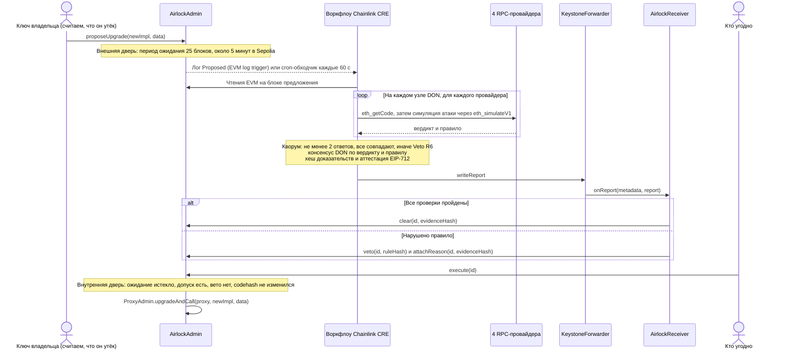

<div align="center">

# Upgrade Airlock

**Каждое обновление прокси проходит через две двери: период ожидания и допуск Chainlink CRE, который может получить только код, выдержавший симуляцию атаки.**

[English](README.md) · [简体中文](README.zh-CN.md) · [繁體中文](README.zh-TW.md) · [日本語](README.ja.md) · [한국어](README.ko.md) · [Español](README.es.md) · [Français](README.fr.md) · [Deutsch](README.de.md) · [Português (Brasil)](README.pt-BR.md) · **Русский** · [Tiếng Việt](README.vi.md)

[](https://github.com/jiapunk/upgrade-airlock/actions/workflows/ci.yml)
[](LICENSE)
[](https://upgrade-airlock.pages.dev)
[](https://sepolia.etherscan.io/address/0x28e7aAC40560804F480e454bF9C12F50C83b700B)
[](#chainlink-cre)

[Ключевые особенности](#highlights) · [Как это работает](#how-it-works) · [Правила](#rules) · [Chainlink CRE](#chainlink-cre) · [В сети Sepolia](#live-on-sepolia) · [Быстрый старт](#quick-start) · [Модель безопасности](#security-model)

</div>

## Обзор

Upgrade Airlock ставит перед каждым обновлением контракта две двери. **Внешняя дверь** — период ожидания, отсчитываемый в блоках. **Внутренняя дверь** открывается только после того, как воркфлоу Chainlink CRE атаковал новую реализацию в симуляторе через четыре независимых RPC-провайдера, все ответы совпали, DON пришёл к консенсусу по вердикту, а подписанный отчёт **Clear** оказался в блокчейне. Вредоносная реализация вместо этого получает подписанное **Veto** и не сможет выполниться никогда, даже если у атакующего есть ключ обновления. Проект создан для ETH Shenzhen 2026 на базе Ethereum Sepolia.

> [!TIP]
> **Онлайн-демо: [upgrade-airlock.pages.dev](https://upgrade-airlock.pages.dev)**
>
> Ситуационный центр (war room) читает Ethereum Sepolia прямо из браузера, в режиме только для чтения. Каждое предложение изображено в виде шлюза: **внешняя дверь** фиксирует предложение, **шлюзовая камера** отсчитывает период ожидания, а **внутренняя дверь** остаётся запертой, пока Clear от Chainlink CRE не окажется в блокчейне. Veto выбрасывает предложение из шлюза — с указанием правила, хеша доказательств и транзакции. Страница открывается на упрощённом китайском: [`?lang=en`](https://upgrade-airlock.pages.dev/?lang=en) переключает её на английский, а [`?lang=zh-TW`](https://upgrade-airlock.pages.dev/?lang=zh-TW) — на традиционный китайский. Все транзакции, которые она показывает, перечислены в [доказательствах реального прогона](docs/evidence/sepolia-live.md).

## <a id="highlights"></a>Ключевые особенности

- **Fail-closed по построению.** Обновление выполняется только при наличии допуска в блокчейне. Пропущенный лог, сбой RPC, расхождение провайдеров или неудачный прогон оставляют предложение без допуска или под вето: обновление может задержаться, но никогда не пройдёт без проверки. Вето всегда имеет приоритет над допуском.
- **Атака, а не чек-лист.** Каждый узел DON прогоняет обновление на реальном состоянии прокси через `eth_simulateV1` у четырёх RPC-провайдеров. Посторонний адрес с пополненным балансом вызывает каждый селектор из нового байткода, аргументы с подстановкой держателя подаются в каждую новую функцию, а эмиссия, владение и балансы сравниваются до и после. Ответить должны как минимум два провайдера, и все ответы должны совпасть.
- **Вердикты привязаны к предложению.** DON приходит к консенсусу по `{verdict, rule}`. Отчёт содержит аттестацию EIP-712, привязанную к точному содержимому предложения (`proposalDigest`), к сети, к получателю и к предельному блоку, а также хеш доказательств, который любой может пересчитать по данным блокчейна.
- **Ни одно предложение не остаётся без вердикта.** Cron-обходчик (sweeper) каждые 60 секунд проверяет 20 последних предложений и выносит вердикт по всем, которые пропустил log trigger, включая обновления, которым утверждающий (approver) выдал допуск вручную; его вето имеет приоритет.
- **Работает в Ethereum Sepolia.** Официальный CRE CLI выполнял воркфлоу на сервере и ответил в блокчейне на семь предложений: одно честное обновление получило допуск и было выполнено, шесть атак получили вето (R1, R2, R3, R3B, R7, R9). Все контракты верифицированы на Sourcify.
- **Проверено сквозными тестами.** 117 тестов Foundry, 118 юнит-тестов воркфлоу и 199 самопроверок ситуационного центра запускаются в [CI](.github/workflows/ci.yml); e2e-скрипт на форке прогоняет весь цикл через симулятор CRE.

## Проблема

Обновляемый прокси ставит весь протокол в зависимость от ключа обновления. Как только этот ключ утекает, атака занимает всего несколько шагов: развернуть вредоносную реализацию, перенаправить на неё прокси, выпустить токены или вывести средства. Такое происходило уже не раз:

- **PAID Network, март 2021.** С помощью ключей владельца прокси проверенный аудиторами код токена был заменён версией с функциями burn и mint, и атакующий выпустил около 59,5 млн PAID. ([разбор инцидента CertiK](https://www.certik.com/blog/paid-network-post-mortem))
- **Ankr, декабрь 2022.** С помощью скомпрометированного ключа деплоера атакующий заменил реализацию aBNBc на версию, которая выпускала токены без проверки авторизации: 60 трлн aBNBc. ([отчёт Ankr](https://www.ankr.com/blog/the-abnbc-token-report/))
- **Radiant Capital, октябрь 2024.** Атакующий, контролировавший 3 из 11 подписантов мультисига, захватил провайдер пулов кредитования и обновил реализацию пулов, выведя более $53 млн. ([rekt.news](https://rekt.news/radiant-capital-rekt2))

Таймлок лишь заставляет атакующего подождать, и никто не обязан что-либо проверять, пока идёт ожидание. К тому же долгие задержки блокируют экстренные исправления. Upgrade Airlock заставляет время ожидания работать: обновление не может выполниться, пока его не пропустит независимая децентрализованная проверка, и эта проверка автоматически запускается для каждого предложения.

## <a id="how-it-works"></a>Как это работает



1. **Предложение.** `AirlockAdmin` является владельцем `ProxyAdmin` из OpenZeppelin и `Ownable` токена. Ключ владельца может только предлагать: он никогда не бывает стражем (guardian), утверждающим (approver) или оракулом допуска. Каждое предложение (обновление или изменение самого шлюза: стражи, задержка, цель break-glass) получает `readyBlock = block.number + delayBlocks`. Целью обновления или break-glass может быть только обычный код контракта: делегированный аккаунт EIP-7702, ключ которого мог бы перенаправить его после вердикта, отклоняется (`DelegatedAccount`).
2. **Оценка.** Log trigger CRE срабатывает на событие `Proposed`. Изменение самого шлюза оценивается по данным, прочитанным из блокчейна (R7). Обновление сначала проходит статические правила (R5, R8), затем симуляцию атаки, привязанную к блоку предложения: слот реализации ERC-1967 прокси подменяется новым кодом, а новый посторонний адрес (выводится из хеша блока предложения) получает средства, как настоящий пользователь: токены от второго держателя и ETH. Держатель делает перевод, посторонний вызывает `transferFrom` без allowance, а затем — каждый селектор, найденный в новом байткоде, с пятью вариантами аргументов. Каждый селектор вне стандартного интерфейса токена дополнительно вызывается с подстановкой держателя: держатель с балансом — в каждом из первых четырёх слотов аргументов, тестовая сумма — в другом слоте, посторонний адрес или прокси — в остальных. Эмиссия, владелец и каждый отслеживаемый баланс считываются до и после, баланс держателя — сразу после каждого вызова с подстановкой держателя; кроме того, проверяются собственные события каждого пробного вызова (с R1 по R4, R3B). Наконец, новый байткод проверяется на опкоды, которые в реальном блоке ведут себя иначе, чем в симуляции (R9).
3. **Согласование.** Каждый узел DON запускает симуляцию у четырёх провайдеров. Ответить должны минимум два, и все ответы должны содержать один и тот же вердикт; в любом другом случае — вето (R6). Затем DON приходит к согласию по идентичному `{verdict, rule}`.
4. **Отчёт.** Воркфлоу хеширует канонический JSON доказательств, подписывает вердикт EIP-712 своим ключом аттестатора (секрет CRE) и записывает отчёт через форвардер. `AirlockReceiver` проверяет отправителя, актуальность, подпись и то, что вердикт привязан именно к этому предложению (`proposalDigest`), после чего вызывает в `AirlockAdmin` `clear` либо `veto` и `attachReason`.
5. **Выполнение.** Кто угодно может вызвать `execute(id)` после окончания периода ожидания. Вызов откатывается с ошибкой `TooEarly` во время ожидания, с `NotCleared` без допуска, с `ProposalVetoed` после вето и с `CodehashChanged`, если по целевому адресу больше нет кода, который был предложен и проверен. Вето всегда имеет приоритет над допуском.
6. **Обход.** Cron trigger каждые 60 секунд перепроверяет последние предложения и выносит вердикт по каждому ожидающему предложению, на которое CRE ещё не ответил (`oracleJudged`): лог, пропущенный триггером, событие `Proposed`, слишком большое для доставки, или обновление, которому утверждающий выдал допуск вручную. Его вето имеет приоритет над таким допуском.

**Все сбои ведут в одну сторону.** Пропущенный лог, сбой RPC, расхождение провайдеров или неудачный прогон оставляют предложение без допуска или накладывают на него вето, то есть задерживают обновление и никогда его не пропускают. Если CRE не может ответить вовсе, ключ утверждающего может вручную выдать обновлению допуск с зафиксированными доказательствами; обходчик всё равно оценит это обновление, как только CRE снова начнёт отвечать, а вето CRE или стража по-прежнему имеет приоритет. `breakGlass()` позволяет владельцу или любому стражу мгновенно переключить прокси на заранее зарегистрированную реализацию в режиме паузы. Выход из режима паузы — обычное обновление через обе двери.

Подробнее: [docs/design.md](docs/design.md) (модель угроз, конечный автомат допуска, привязка отчёта, бюджеты) и [cre/README.md](cre/README.md) (воркфлоу).

## <a id="rules"></a>Правила

`ruleHash = keccak256("GUARD/<ID>")`, записывается в блокчейн при каждом вето.

| Правило | Вето, если | Чем определяется |
|---|---|---|
| R1 `TOTAL_SUPPLY` | вызов постороннего изменяет `totalSupply` | симуляция атаки |
| R2 `OWNER` | вызов постороннего изменяет `owner()` | симуляция атаки |
| R3 `TRANSFER_CONSERVATION` | перевод держателем суммы X перемещает не ровно X или затрагивает чей-то ещё баланс | симуляция атаки |
| R3B `THIRD_PARTY_FUNDS` | посторонний перемещает токены любого держателя: `transferFrom` пополненного постороннего адреса без allowance проходит успешно, либо один из его пробных вызовов перемещает чужие токены, выпускает или сжигает токены, передаёт владение или оставляет баланс держателя ниже прежнего — даже без события и даже если последующий вызов это отменяет | симуляция атаки |
| R4 `TRANSFER_LIVENESS` | обычный перевод держателя не проходит | симуляция атаки |
| R5 `STRICT_CODEHASH` | включён строгий режим, а утверждающий не одобрил codehash | чтение из блокчейна |
| R6 `SIM_FAILURE` | симуляция не может вынести решение: провайдеры расходятся, отвечает слишком мало провайдеров, код не совпадает, откатывается view-вызов или пополнение постороннего адреса, либо пробные вызовы не умещаются в заданное конфигурацией число запросов | симуляция и кворум |
| R7 `CONFIG_GUARD` | смена стража, сокращение задержки или новая цель break-glass без предварительного одобрения утверждающего | чтение из блокчейна |
| R8 `INIT_DATA` | обновление содержит init data, которые утверждающий не одобрил вместе с codehash | чтение из блокчейна |
| R9 `NEW_OPCODES` | новый код содержит опкод контекста блока или транзакции (BASEFEE, TIMESTAMP, NUMBER, ORIGIN, GAS и другие), внешний вызов, create или selfdestruct, не покрытые фиксированным allowlist конфигурации (по умолчанию пустым), если только утверждающий не одобрил именно этот codehash | байткод |

**R9 закрывает обход симуляции.** `EvilBaseFeeImpl` ведёт себя как v1, пока `block.basefee == 0` — а именно это видит вызов `eth_simulateV1`, — и позволяет кому угодно выпускать токены в реальном блоке. Все инварианты в симуляции выполняются; вето ему приносит опкод `BASEFEE`. Allowlist никогда не зависит от кода, который прокси исполняет сейчас, поэтому одобрение распространяется на один codehash и ни на одно последующее обновление. Сканер пропускает хвост метаданных компилятора, только если это точная CBOR-карта solc, недостижимая ни для одной инструкции; всё остальное сканируется как код. Одобрение codehash освобождает его от R9 и допускает усечение пробных вызовов (R6) — и только: все остальные правила продолжают действовать.

**R3B закрывает тихий вывод средств.** `EvilDrainImpl` — это v1 плюс `rescue(from, to, amount)` без контроля доступа. Эмиссия, владелец, переводы и опкоды у неё такие же, как у v1, поэтому правила с R1 по R4 и R9 проходят. `rescue` — не стандартная функция токена, поэтому посторонний вызывает её ещё и с подстановкой держателя; вызов с держателем в качестве `from` перемещает токены держателя, и R3B накладывает вето. Вывод средств, спрятанный за условием «только для вызывающих, у которых есть токены или ETH», тоже обнаруживается, потому что у постороннего есть и то и другое.

### Автоматический и строгий режимы

**Автоматический режим** (по умолчанию): CRE самостоятельно выдаёт допуск или вето каждому обновлению по итогам ограниченного поиска атак — внешний вызывающий с пополненным балансом, каждый селектор нового кода и держатель в каждом из первых четырёх слотов аргументов каждой новой функции. **Строгий режим** (R5) добавляет проверку человеком: каждый новый codehash реализации сначала должен одобрить ключ утверждающего, а симуляция атаки всё равно выполняется. Автоматический режим подходит токену, которому нужен допуск рутинных обновлений за считанные минуты; строгий режим делает код-ревью частью допуска ([два режима](docs/design.md#two-modes-automatic-and-strict)).

## Chainlink CRE

CRE — оркестрирующий слой Upgrade Airlock: воркфлоу — единственный автоматический путь через внутреннюю дверь, и он ведёт каждый шаг от ончейн-триггера до ончейн-вердикта. Воркфлоу написан на CRE TypeScript SDK (`@chainlink/cre-sdk` 1.23.0) и скомпилирован в WASM с помощью CRE CLI v1.37.0.

| Технология Chainlink | Где используется | Роль в проекте |
|---|---|---|
| Раннер воркфлоу CRE | [`cre/veto/main.ts#L1-L9`](cre/veto/main.ts#L1-L9), [`cre/veto/workflow.yaml`](cre/veto/workflow.yaml), [`cre/project.yaml`](cre/project.yaml) | Два обработчика, цели `sepolia` и `sepolia-fork` |
| EVM log trigger | [`cre/veto/workflow.ts#L202-L211`](cre/veto/workflow.ts#L202-L211), [`#L193-L198`](cre/veto/workflow.ts#L193-L198), [`#L54-L65`](cre/veto/workflow.ts#L54-L65) | `AirlockAdmin.Proposed` на `LATEST`: предложение оценивается сразу после появления, за целый период ожидания до того, как его можно будет выполнить |
| Cron trigger | [`cre/veto/workflow.ts#L200`](cre/veto/workflow.ts#L200), [`#L209`](cre/veto/workflow.ts#L209), [`cre/veto/airlock.ts#L323-L389`](cre/veto/airlock.ts#L323-L389) | Обходчик: 20 последних id, каждую минуту |
| Чтение EVM (`callContract`) | [`cre/veto/workflow.ts#L114-L122`](cre/veto/workflow.ts#L114-L122), [`#L137-L142`](cre/veto/workflow.ts#L137-L142), [`cre/veto/chain.ts`](cre/veto/chain.ts) | Предложение, допуск, `oracleJudged`, одобрения и балансы — пакетами через Multicall3 на блоке предложения или на `LATEST` |
| Чтение EVM (`headerByNumber`) | [`cre/veto/workflow.ts#L125-L136`](cre/veto/workflow.ts#L125-L136) | Последний блок и хеш блока предложения, из которого выводится посторонний адрес для симуляции |
| HTTP capability в режиме узла (node mode) | [`cre/veto/workflow.ts#L167-L189`](cre/veto/workflow.ts#L167-L189), [`#L80-L94`](cre/veto/workflow.ts#L80-L94), [`cre/veto/judge.ts#L157-L220`](cre/veto/judge.ts#L157-L220) | Каждый узел отправляет каждому провайдеру `eth_getCode`, затем один или два запроса `eth_simulateV1` (каждый — в пределах лимита запроса 120 kb) |
| `consensusIdenticalAggregation` | [`cre/veto/workflow.ts#L184-L188`](cre/veto/workflow.ts#L184-L188), кворум в [`cre/veto/judge.ts#L244-L277`](cre/veto/judge.ts#L244-L277) | DON приходит к согласию по `{verdict, rule}` (не более 52 байт) |
| Секреты (Secrets) | [`cre/veto/workflow.ts#L160-L166`](cre/veto/workflow.ts#L160-L166), [`cre/secrets.yaml`](cre/secrets.yaml) | Ключ аттестатора EIP-712, загружается один раз за прогон |
| Отчёт + `writeReport` | [`cre/veto/workflow.ts#L143-L149`](cre/veto/workflow.ts#L143-L149), [`cre/veto/airlock.ts#L229-L282`](cre/veto/airlock.ts#L229-L282), [`cre/veto/report.ts`](cre/veto/report.ts) | `runtime.report` (ECDSA, keccak256) и `evm.writeReport`, затем чтение предложения для подтверждения результата |
| Форвардер + `IReceiver` | [`src/cre/AirlockReceiver.sol#L88-L120`](src/cre/AirlockReceiver.sol#L88-L120), [`#L156-L169`](src/cre/AirlockReceiver.sol#L156-L169), [`src/cre/IReceiver.sol`](src/cre/IReceiver.sol), [`script/DeployEth.s.sol#L142`](script/DeployEth.s.sol#L142) | `onReport` принимает отчёты только от настроенного форвардера и, если они заданы, проверяет workflow id и владельца воркфлоу |
| Селекторы сетей (chain selectors) | [`cre/veto/workflow.ts#L100-L104`](cre/veto/workflow.ts#L100-L104) | `ethereum-testnet-sepolia` |
| CRE CLI | [`cre/setup.sh`](cre/setup.sh), [`cre/scripts/fork-e2e.sh`](cre/scripts/fork-e2e.sh), [`scripts/sepolia/airlock.sh`](scripts/sepolia/airlock.sh), [`scripts/sepolia/sweep.sh`](scripts/sepolia/sweep.sh) | `cre workflow build`, `cre workflow simulate --broadcast` |

**Как воркфлоу работает сегодня.** Воркфлоу запускается командой CRE CLI `cre workflow simulate --broadcast` в сети Ethereum Sepolia. Слушатель ([`scripts/sepolia/airlock.sh`](scripts/sepolia/airlock.sh)) держит log trigger в режиме прослушивания, обходчик ([`scripts/sepolia/sweep.sh`](scripts/sepolia/sweep.sh)) каждую минуту запускает cron-обработчик, а каждый Clear и Veto — реальная транзакция в Sepolia через MockKeystoneForwarder, развёрнутый Chainlink в Sepolia, [`0x15fC6ae953E024d975e77382eEeC56A9101f9F88`](https://docs.chain.link/cre/guides/workflow/using-evm-client/forwarder-directory-ts). `AirlockReceiver` в текущем виде готов к развёртыванию воркфлоу в DON: достаточно развернуть его с `FORWARDER`, указывающим на продакшн-KeystoneForwarder, и с заданными `WORKFLOW_ID` / `WORKFLOW_OWNER` — тогда `onReport` дополнительно проверяет подписанные DON метаданные воркфлоу. `DeployEth` отказывается использовать permissionless MockKeystoneForwarder, если только не заданы оба значения или явно не указан `ALLOW_MOCK_FORWARDER=1` ([`script/DeployEth.s.sol#L96-L104`](script/DeployEth.s.sol#L96-L104)).

**Спроектирован под лимиты CRE на один прогон.** Не более 15 чтений из блокчейна (пакеты Multicall3 укладываются в лимит payload 5 kb), 12 из 15 HTTP-вызовов при четырёх провайдерах, одна симуляция атаки за прогон и значение консенсуса не более 52 байт. Бюджеты описаны в [docs/design.md](docs/design.md#budgets).

## <a id="live-on-sepolia"></a>В сети Sepolia

Ethereum Sepolia, chain id 11155111. Развёртывание выполнено скриптом [`script/DeployEth.s.sol`](script/DeployEth.s.sol) в блоке 11950682 (13 транзакций); все контракты верифицированы на Sourcify. Владелец, утверждающий, аварийный страж и аттестатор — четыре разных ключа. Период ожидания — 25 блоков.

| Контракт | Адрес |
|---|---|
| AirlockAdmin | [`0x28e7aAC40560804F480e454bF9C12F50C83b700B`](https://sepolia.etherscan.io/address/0x28e7aAC40560804F480e454bF9C12F50C83b700B) |
| AirlockReceiver | [`0xE40D463116F4Aa24d5E79776a65ED0f1b088c670`](https://sepolia.etherscan.io/address/0xE40D463116F4Aa24d5E79776a65ED0f1b088c670) |
| Прокси DemoBTC (dBTC) | [`0x88Cc569265faDAEAc2a16B69f35E10B2158e4b71`](https://sepolia.etherscan.io/address/0x88Cc569265faDAEAc2a16B69f35E10B2158e4b71) |
| ProxyAdmin | [`0x51a3fE6AD22BF7753574B7b7FD56aE9a65bd593E`](https://sepolia.etherscan.io/address/0x51a3fE6AD22BF7753574B7b7FD56aE9a65bd593E) |
| DemoBTC v1 | [`0x8f7d6453d77B3f3b008CBE4A144d82c5742eB108`](https://sepolia.etherscan.io/address/0x8f7d6453d77B3f3b008CBE4A144d82c5742eB108) |
| DemoBTC v2 (честное обновление) | [`0x4D959f981C01E3B81ac6C9A20E84816Fe5f6Bce3`](https://sepolia.etherscan.io/address/0x4D959f981C01E3B81ac6C9A20E84816Fe5f6Bce3) |
| EvilMintImpl | [`0x01502c4af90c27f53B2E1293941670C6B761CAAA`](https://sepolia.etherscan.io/address/0x01502c4af90c27f53B2E1293941670C6B761CAAA) |
| EvilOwnerImpl | [`0xBe849DE8e0a4D9b0010ba1468f94Eeb24A42d488`](https://sepolia.etherscan.io/address/0xBe849DE8e0a4D9b0010ba1468f94Eeb24A42d488) |
| EvilFeeImpl | [`0xB95Ffa7b970B1a73488e2fC32B787fA536F12AF5`](https://sepolia.etherscan.io/address/0xB95Ffa7b970B1a73488e2fC32B787fA536F12AF5) |
| EvilBaseFeeImpl | [`0xE1AAa4E88DB9cc7ceCca14722eE2874D834e0310`](https://sepolia.etherscan.io/address/0xE1AAa4E88DB9cc7ceCca14722eE2874D834e0310) |
| EvilDrainImpl | [`0x1d98D64BC5204AE139B5A0747855841Fa5333b6d`](https://sepolia.etherscan.io/address/0x1d98D64BC5204AE139B5A0747855841Fa5333b6d) |
| PausedImpl (цель break-glass) | [`0xb6573006fB607E96966d0F578B96AAB25413F5BE`](https://sepolia.etherscan.io/address/0xb6573006fB607E96966d0F578B96AAB25413F5BE) |
| Chainlink MockKeystoneForwarder | [`0x15fC6ae953E024d975e77382eEeC56A9101f9F88`](https://sepolia.etherscan.io/address/0x15fC6ae953E024d975e77382eEeC56A9101f9F88) |

Семь предложений — семь вердиктов в блокчейне. Блок в каждой ссылке — это блок, в который попала транзакция; `(+n)` показывает, через сколько блоков после предложения пришёл вердикт CRE.

| Карточка | Предложение | Вердикт CRE | Tx предложения | Tx отчёта | Затем |
|---|---|---|---|---|---|
| `v2`: честное обновление | #4 | Clear | [11950745](https://sepolia.etherscan.io/tx/0x3cd96ac220391e2b404d35591d1a96808b75256e7c685a414e2ca5a63bc54145) | [11950747 (+2)](https://sepolia.etherscan.io/tx/0x2c02d2a23016a72509900eb7ce92dabc06b0dd93a2394d076a62d687ce467efb) | `execute` [11950772](https://sepolia.etherscan.io/tx/0x01913c1854b9862763af74ddacd7be23a7f55232af7334714aa8213aa7021890), `version()` = "2" |
| `evil-mint`: выпускать токены может кто угодно | #1 | Veto R1 | [11950735](https://sepolia.etherscan.io/tx/0x862c5fdf826a8fef09fe2ff278d3e58191f93c267dbdd38ad9aaa270f39937b0) | [11950736 (+1)](https://sepolia.etherscan.io/tx/0xb0d74e25e2528fb9aad7d21de202dac288cd256048f2986b5214280fda4b84f6) | `execute` откатывается с `ProposalVetoed` |
| `evil-owner`: кто угодно может забрать владение | #6 | Veto R2 | [11950788](https://sepolia.etherscan.io/tx/0x32eb22039bd43602e0406b1a8f9a02c5cbcdb5cf2ef1c389919a45d05820da25) | [11950790 (+2)](https://sepolia.etherscan.io/tx/0x49451bee7a2f3351b18992d94b5f89b9ff89cf53be65a937400ab95fb79be551) | `execute` откатывается с `ProposalVetoed` |
| `evil-fee`: с каждого перевода удерживается 10% | #7 | Veto R3 | [11950792](https://sepolia.etherscan.io/tx/0xe06924c2e3961ab27d2803c0654b783fc06e52107345bda9bfeff391053fcad3) | [11950794 (+2)](https://sepolia.etherscan.io/tx/0x01f6055a683e0dabc8f34ae094e5daa5a81ddb11c687aa9c5ac6e30c7a7f3d3b) | `execute` откатывается с `ProposalVetoed` |
| `evil-basefee`: выпуск токенов открывается в реальном блоке | #3 | Veto R9 | [11950742](https://sepolia.etherscan.io/tx/0x3c29c118ca395ca92500abcaae6126244924fbd8e14f846af57b70f113cad6e1) | [11950743 (+1)](https://sepolia.etherscan.io/tx/0xb6db2d832112384287e5a7ccdd086127931360900d09c80645c21eac2bc165db) | `execute` откатывается с `ProposalVetoed` |
| `evil-drain`: кто угодно перемещает токены держателя | #2 | Veto R3B | [11950737](https://sepolia.etherscan.io/tx/0x0e52369921040eb0c901ac3a077aff762d370b4efd9503a52c91360d56366b16) | [11950740 (+3)](https://sepolia.etherscan.io/tx/0x40bbe374a8cee47a94da977f973cf66a67573c12bc84117483fcbd11430f90cb) | `execute` откатывается с `ProposalVetoed` |
| `remove-receiver`: убрать CRE из стражей | #5 | Veto R7 | [11950749](https://sepolia.etherscan.io/tx/0xda2bd1c9dc5f7770da3926358b8da3ffe5a1cd3154b499cafae440387eebb934) | [11950750 (+1)](https://sepolia.etherscan.io/tx/0xaa2f598bdcc7f46727e5456528521e50ac5c1d8e423805042cbf2d10a4c4cdac) | `execute` откатывается с `ProposalVetoed` |

Все вердикты выше вынес официальный CRE CLI, выполнявший этот воркфлоу на сервере (слушатель log trigger плюс 60-секундный обходчик, [`scripts/sepolia/systemd/`](scripts/sepolia/systemd)); собственные строки лога воркфлоу приведены в [`docs/evidence/sepolia-live.md`](docs/evidence/sepolia-live.md).

## <a id="quick-start"></a>Быстрый старт

### Требования

- [Foundry](https://getfoundry.sh) (`forge`, `cast`, `anvil`), `jq` и Node 22.
- Аккаунт CRE для симулятора (`cre login`); он нужен для сквозного прогона на форке и для операторского набора.
- [`cre/setup.sh`](cre/setup.sh) устанавливает CRE CLI v1.37.0 (с зафиксированным SHA-256) и bun 1.4.2 в `cre/.tools`.

### Сборка и тесты

```bash
git clone https://github.com/jiapunk/upgrade-airlock.git
cd upgrade-airlock

# контракты (OpenZeppelin и forge-std уже включены в lib/)
forge build                     # однократно загружает зафиксированную версию solc 0.8.37
forge test --offline            # 117 тестов

# воркфлоу CRE
cre/setup.sh
export PATH="$PWD/cre/.tools/bin:$PWD/cre/.tools/node_modules/.bin:$PATH"
(cd cre/veto && bun test && bun run typecheck)    # 118 тестов: правила, пробные вызовы, байткод, отчёты, бюджеты, обработчики

# ситуационный центр
(cd web && npm ci && npm run selftest)            # 199 проверок: режим реального времени и офлайн-воспроизведение
```

### Сквозной прогон на форке Sepolia

```bash
cre login                       # один раз; симулятору нужен аккаунт CRE
cre/scripts/fork-e2e.sh         # локальный anvil-форк Sepolia: в реальную сеть ничего не отправляется
```

[`cre/scripts/fork-e2e.sh`](cre/scripts/fork-e2e.sh) разворачивает стек на форке, запускает воркфлоу в симуляторе CRE с `--broadcast` и проверяет каждый результат в блокчейне:

- **Log trigger:** EvilMint получает вето R1, EvilOwner — R2, EvilFee — R3, EvilBaseFee — R9 (с указанием `BASEFEE`), EvilDrain — R3B (с указанием `rescue`, при том что все остальные правила проходят); ещё семь вариантов вывода средств ([`test/fixtures/DrainVariants.sol`](test/fixtures/DrainVariants.sol)) получают вето только по R3B: переставленные аргументы, проверка адреса токена, вывод, доступный лишь вызывающим с токенами или ETH, вариант без события `Transfer` и `transferFrom`, который для держателей токенов пропускает проверку allowance; честный v2 получает допуск и выполняется после периода ожидания; удаление получателя из стражей получает вето R7; сокращение задержки, заранее одобренное утверждающим, получает допуск.
- **Обходчик:** обновление, по которому никто не вынес вердикт, после периода ожидания откатывается с `NotCleared`, один прогон обходчика выдаёт ему допуск, и оно выполняется; два предложения, которым утверждающий выдал допуск вручную, оцениваются следующим прогоном: EvilDrain получает вето R3B поверх допуска, а увеличение задержки CRE тоже допускает; обновление с 6 KB init data получает вето R8 на последующем прогоне.
- **Доказательства:** каждое предложение под вето откатывается с `ProposalVetoed`, а хеш доказательств каждого вердикта пересчитывается по данным блокчейна ([`cre/veto/tools/check-evidence.ts`](cre/veto/tools/check-evidence.ts)).

### Операторский набор для Sepolia

[`scripts/sepolia/`](scripts/sepolia/README.md) — скрипты, на которых работает онлайн-демо. Ключи хранятся вне репозитория, по одному hex-ключу на файл в `KEY_DIR` (`owner`, `attester`, `sender`, `approver`, `emergency`); скрипты никогда их не выводят, а `deploy.sh` отказывается работать, если владелец, утверждающий, аварийный страж и аттестатор — не четыре разных ключа. Каждый скрипт можно запустить и на локальном форке с `FORK=<port>`, так что демо можно отрепетировать без каких-либо затрат.

```bash
scripts/sepolia/deploy.sh                    # 13 транзакций, записывает deployments/sepolia.json (FORCE=1 заменяет существующий)
bun scripts/sepolia/make-config.mjs          # конфигурация воркфлоу, 4 провайдера, кворум 2
scripts/sepolia/fund-sender.sh 0.05          # ETH для транзакций с отчётами
scripts/sepolia/airlock.sh                   # терминал A: слушатель CRE (log trigger)
scripts/sepolia/propose.sh v2                # терминал B: затем evil-mint, evil-owner, evil-fee, evil-basefee, evil-drain, remove-receiver
scripts/sepolia/execute.sh <id>              # выполняет допущенное предложение после периода ожидания, иначе показывает откат
scripts/sepolia/status.sh                    # все предложения: вердикт, оценено ли CRE, правило, доказательства, транзакции
```

`sweep.sh` однократно запускает cron-обходчик, `clear.sh` — ручной допуск утверждающего, `fork.sh` запускает, сохраняет и восстанавливает форк Sepolia, `probe-rpcs.ts` проверяет каждого провайдера собственным кодом оценки воркфлоу, а `systemd/` запускает слушатель и обходчик на Linux-сервере.

### Ситуационный центр

```bash
cd web
npm ci
npm run dev                     # http://127.0.0.1:5173/
npm run build:airlock           # синхронизирует deployments/sepolia.json в страницу, собирает web/dist-airlock
```

Ситуационный центр читает Sepolia напрямую и никогда ничего не подписывает и не отправляет. Он показывает каждое предложение в виде шлюза: период ожидания, допуск CRE, вето с правилом и доказательствами.

| Параметр URL | Действие |
|---|---|
| `?mode=airlock` | По умолчанию. Просмотр Ethereum Sepolia в реальном времени, только чтение |
| `?mode=offline` | Воспроизводит записанный прогон вообще без сетевого подключения |
| `?lang=en`, `?lang=zh-TW`, `?lang=zh-CN` | Язык интерфейса (по умолчанию `zh-CN`; клавиша `L` переключает их по кругу) |
| `?rpc=http://127.0.0.1:<port>` | Читает вместо этого локальный форк Sepolia — для репетиций |

В режиме реального времени нажмите `P`, чтобы воспроизвести последние предложения по их событиям в блокчейне.

## Структура репозитория

```
src/AirlockAdmin.sol            две двери: предложения, период ожидания, вето стража, допуск, execute, breakGlass
src/cre/AirlockReceiver.sol     получатель отчётов CRE: форвардер, метаданные воркфлоу, аттестация EIP-712, привязка digest
src/cre/IReceiver.sol           интерфейс получателя Chainlink CRE
src/DemoBTC.sol, DemoBTCV2.sol  демо-токен (dBTC) v1 и честный v2
src/PausedImpl.sol              цель break-glass: любое изменение баланса откатывается
src/attack/                     EvilMintImpl, EvilOwnerImpl, EvilFeeImpl, EvilBaseFeeImpl, EvilDrainImpl
script/DeployEth.s.sol          развёртывание (13 транзакций) с проверками ролей, форвардера и связей после деплоя
test/                           тесты Foundry; fixtures/DrainVariants.sol содержит семь вариантов вывода средств
cre/veto/                       воркфлоу CRE: workflow.ts (capabilities), airlock.ts (обработчики), judge.ts (правила,
                                кворум), simulate.ts (eth_simulateV1), bytecode.ts (селекторы, R9), report.ts
                                (отчёт, EIP-712, доказательства), chain.ts (бюджет чтений), keys.ts, rules.ts, config.ts
cre/veto/test/                  юнит-тесты Bun
cre/veto/tools/                 check-evidence.ts пересчитывает каждый ончейн-хеш доказательств
cre/scripts/fork-e2e.sh         сквозной прогон на anvil-форке Sepolia
cre/setup.sh                    зафиксированные версии CRE CLI и bun
scripts/sepolia/                операторский набор для онлайн-демо, с unit-файлами systemd для сервера
web/                            ситуационный центр (Vite, TypeScript, viem)
deployments/sepolia.json        действующее развёртывание
docs/design.md                  модель угроз, конечный автомат допуска, привязка отчёта, бюджеты
docs/evidence/                  запись реального прогона
.github/workflows/ci.yml        проверки контрактов, воркфлоу и ситуационного центра
```

## <a id="security-model"></a>Модель безопасности

Upgrade Airlock исходит из того, что ключ владельца утечёт, и построен так, чтобы одного ключа владельца никогда не хватало для выполнения обновления.

| Роль | Кто | Что может |
|---|---|---|
| Владелец (owner) | один ключ | предлагать обновления и изменения самого шлюза (стражи, задержка, цель break-glass); `breakGlass` |
| Утверждающий (approver) | отдельный ключ | вручную выдавать допуск, когда CRE не может ответить; одобрять codehash, init data и изменения шлюза (`approveCodehash`) |
| Аварийный страж (emergency guardian) | отдельный ключ | налагать `veto` на ожидающее предложение; `breakGlass` |
| Аттестатор (attester) | секрет CRE, отдельный ключ | подписывать вердикты EIP-712, которые принимает `AirlockReceiver` |
| AirlockReceiver | получатель отчётов CRE | оракул допуска (`clear`) и страж (`veto`, `attachReason`) |
| Кто угодно | | вызывать `execute` для предложения, прошедшего обе двери |

Роли никогда не пересекаются. Конструктор `AirlockAdmin` отклоняет владельца, который одновременно является утверждающим, стражем или оракулом допуска (`RoleOverlap`), а `DeployEth` выполняет развёртывание только тогда, когда владелец, утверждающий, аварийный страж и аттестатор — четыре разных адреса.

**Утёкший ключ владельца может предлагать.** Каждое предложение у всех на виду проходит период ожидания, пока CRE его оценивает, и требует допуска, который владелец не может выдать себе сам. Владелец также может задействовать аварийный тормоз (`breakGlass`), который лишь переключает прокси на заранее зарегистрированную реализацию в режиме паузы; выход из этого режима — обновление через обе двери.

**Тот же ключ не может:**

- выполнить обновление без допуска: у `AirlockAdmin` нет универсального пути вызова, и единственный способ сменить реализацию — `execute` допущенного обновления (или `breakGlass` на реализацию в режиме паузы);
- сначала ослабить шлюз: удаление получателя CRE, сокращение задержки или замена цели break-glass — это тоже предложения, и без предварительного одобрения утверждающего R7 накладывает на них вето;
- подменить код после вердикта: `execute` перепроверяет codehash цели (`CodehashChanged`), а делегированные аккаунты EIP-7702 отклоняются (`DelegatedAccount`);
- подделать или повторно использовать вердикт: `AirlockReceiver` принимает отчёт только от настроенного форвардера, только подписанный аттестатором, не позднее его `validUntilBlock` и привязанный к `proposalDigest` предложения в этой сети и для этого получателя.

Ручной допуск утверждающего — это ручное переопределение на случай, когда CRE не может ответить: обходчик всё равно оценивает такое предложение, пока оно входит в 20 последних id, а вето CRE или стража имеет приоритет. Полная модель угроз — в [docs/design.md](docs/design.md#threat-model).

## Технологии

- **Solidity 0.8.37** и **Foundry**, с OpenZeppelin Contracts 5.7.0 (`ProxyAdmin`, `TransparentUpgradeableProxy`, `EIP712`, `ECDSA`)
- **Chainlink CRE**: TypeScript SDK (`@chainlink/cre-sdk` 1.23.0) и CRE CLI v1.37.0 на Bun 1.4.2
- **viem** для ABI-кодирования и чтения блокчейна — в воркфлоу и в ситуационном центре
- **Vite** и TypeScript для ситуационного центра

## Инструменты ИИ

Upgrade Airlock создан под руководством автора с помощью [Claude Code](https://claude.com/claude-code): с ним написаны и проверены контракты, воркфлоу CRE, тесты, скрипты, ситуационный центр и эта документация.

## Лицензия

[MIT](LICENSE) © 2026 jiapunk
