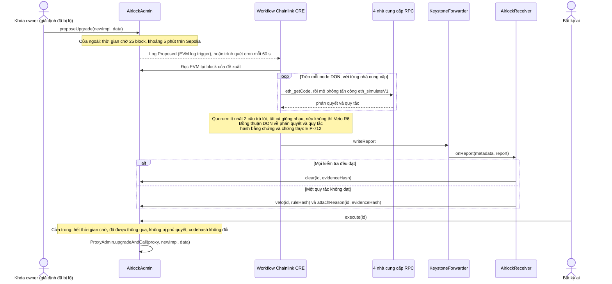

<div align="center">

# Upgrade Airlock

**Mỗi lần nâng cấp proxy đều phải đi qua hai cánh cửa: một khoảng thời gian chờ, và giấy thông hành từ Chainlink CRE mà chỉ mã nào vượt qua được mô phỏng tấn công mới nhận được.**

[English](README.md) · [简体中文](README.zh-CN.md) · [繁體中文](README.zh-TW.md) · [日本語](README.ja.md) · [한국어](README.ko.md) · [Español](README.es.md) · [Français](README.fr.md) · [Deutsch](README.de.md) · [Português (Brasil)](README.pt-BR.md) · [Русский](README.ru.md) · **Tiếng Việt**

[](https://github.com/jiapunk/upgrade-airlock/actions/workflows/ci.yml)
[](LICENSE)
[](https://upgrade-airlock.pages.dev)
[](https://sepolia.etherscan.io/address/0x28e7aAC40560804F480e454bF9C12F50C83b700B)
[](#chainlink-cre)

[Điểm nổi bật](#highlights) · [Cách hoạt động](#how-it-works) · [Quy tắc](#rules) · [Chainlink CRE](#chainlink-cre) · [Đang chạy trên Sepolia](#live-on-sepolia) · [Bắt đầu nhanh](#quick-start) · [Mô hình bảo mật](#security-model)

</div>

## Tổng quan

Upgrade Airlock đặt hai cánh cửa trước mọi lần nâng cấp hợp đồng. **Cửa ngoài** là một khoảng thời gian chờ tính bằng
block. **Cửa trong** chỉ mở khi một workflow Chainlink CRE đã tấn công implementation mới trong trình mô phỏng trên
bốn nhà cung cấp RPC độc lập, mọi câu trả lời đều khớp nhau, DON đã đạt đồng thuận về phán quyết, và một báo cáo
**Clear** (thông qua) có chữ ký đã được ghi lên chuỗi. Ngược lại, một implementation độc hại sẽ nhận **Veto** (phủ
quyết) có chữ ký và không bao giờ chạy được, kể cả khi kẻ tấn công đang nắm khóa nâng cấp. Dự án được xây dựng cho
ETH Shenzhen 2026 trên Ethereum Sepolia.

> [!TIP]
> **Demo trực tiếp: [upgrade-airlock.pages.dev](https://upgrade-airlock.pages.dev)**
>
> Phòng tác chiến (war room) đọc Ethereum Sepolia ngay từ trình duyệt của bạn, ở chế độ chỉ đọc. Mỗi đề xuất được vẽ
> thành một khoang khóa khí: **cửa ngoài** ghi nhận đề xuất, **khoang chờ** đếm ngược thời gian chờ, và **cửa trong**
> vẫn khóa cho đến khi lệnh Clear của Chainlink CRE được ghi lên chuỗi. Một Veto sẽ đẩy đề xuất ra ngoài, kèm theo quy
> tắc, hash bằng chứng và giao dịch tương ứng. Trang mặc định hiển thị tiếng Trung giản thể:
> [`?lang=en`](https://upgrade-airlock.pages.dev/?lang=en) chuyển sang tiếng Anh và
> [`?lang=zh-TW`](https://upgrade-airlock.pages.dev/?lang=zh-TW) chuyển sang tiếng Trung phồn thể. Mọi giao dịch phía
> sau đều được liệt kê trong [bằng chứng của lần chạy thực tế](docs/evidence/sepolia-live.md).

## <a id="highlights"></a>Điểm nổi bật

- **Fail-closed ngay từ thiết kế.** Một bản nâng cấp chỉ chạy được khi đã có giấy thông hành trên chuỗi. Một log bị
  bỏ lỡ, RPC gặp sự cố, các nhà cung cấp trả lời không khớp hay một lần chạy thất bại đều chỉ khiến đề xuất chưa được
  thông qua hoặc bị phủ quyết: chúng có thể làm chậm một bản nâng cấp, nhưng không bao giờ để nó lọt qua. Phủ quyết
  luôn được ưu tiên hơn giấy thông hành.
- **Một cuộc tấn công, không phải một danh sách kiểm tra.** Mỗi node DON chạy bản nâng cấp trên trạng thái thật của
  proxy bằng `eth_simulateV1` trên bốn nhà cung cấp RPC. Một người lạ được cấp sẵn tiền sẽ gọi mọi selector trong
  bytecode mới, mọi hàm mới đều bị gọi thử với đối số theo dạng holder (người nắm giữ token), và tổng cung, quyền sở
  hữu cùng các số dư được so sánh trước và sau. Ít nhất hai nhà cung cấp phải trả lời, và mọi câu trả lời phải khớp
  nhau.
- **Phán quyết gắn chặt với đề xuất.** DON đạt đồng thuận về `{verdict, rule}`. Báo cáo mang một chứng thực EIP-712
  gắn với đúng nội dung của đề xuất (`proposalDigest`), chain, receiver và một hạn chót tính theo block, kèm một hash
  bằng chứng mà bất kỳ ai cũng có thể tính lại từ dữ liệu trên chuỗi.
- **Không bỏ sót đề xuất nào.** Một trình quét cron kiểm tra 20 đề xuất mới nhất mỗi 60 giây và thẩm định mọi đề xuất
  mà log trigger đã bỏ lỡ, kể cả các bản nâng cấp mà approver đã thông qua thủ công; phủ quyết của trình quét được ưu
  tiên.
- **Đang chạy thật trên Ethereum Sepolia.** CRE CLI chính thức đã chạy workflow trên một máy chủ và trả lời bảy đề
  xuất trên chuỗi: một bản nâng cấp trung thực được thông qua và thực thi, sáu cuộc tấn công bị phủ quyết (R1, R2, R3,
  R3B, R7, R9). Mọi hợp đồng đều được xác minh trên Sourcify.
- **Kiểm thử end-to-end.** 117 bài test Foundry, 118 bài unit test cho workflow và 199 mục tự kiểm tra của war room
  chạy trong [CI](.github/workflows/ci.yml); một script end-to-end trên fork chạy trọn vòng xử lý qua trình mô phỏng
  CRE.

## Vấn đề

Một proxy có thể nâng cấp đặt toàn bộ giao thức phía sau khóa nâng cấp của nó. Một khi khóa đó bị lộ, cuộc tấn công
chỉ gồm vài bước: deploy một implementation độc hại, trỏ proxy sang đó, rồi mint hoặc rút cạn tài sản. Chuyện này đã
xảy ra nhiều lần:

- **PAID Network, tháng 3 năm 2021.** Các khóa của owner proxy đã được dùng để thay mã token đã kiểm toán bằng một
  phiên bản có hàm burn và mint, và kẻ tấn công đã mint khoảng 59.5 triệu PAID.
  ([Báo cáo sự cố của CertiK](https://www.certik.com/blog/paid-network-post-mortem))
- **Ankr, tháng 12 năm 2022.** Với khóa deployer bị xâm phạm, kẻ tấn công thay implementation của aBNBc bằng một bản
  mint được mà không kiểm tra quyền: 60 nghìn tỷ aBNBc.
  ([Báo cáo của Ankr](https://www.ankr.com/blog/the-abnbc-token-report/))
- **Radiant Capital, tháng 10 năm 2024.** Một kẻ tấn công kiểm soát 3 trong 11 người ký multisig đã chiếm quyền kiểm
  soát hợp đồng lending pool provider và nâng cấp implementation của các lending pool, rút cạn hơn 53 triệu USD.
  ([rekt.news](https://rekt.news/radiant-capital-rekt2))

Timelock chỉ bắt kẻ tấn công phải chờ, và trong lúc chờ không ai có nghĩa vụ phải để mắt tới. Độ trễ dài còn chặn cả
các bản vá khẩn cấp. Upgrade Airlock tận dụng chính khoảng chờ đó: một bản nâng cấp không thể chạy cho đến khi được
một bước kiểm tra độc lập, phi tập trung cho qua, và bước kiểm tra đó tự động chạy trên mọi đề xuất.

## <a id="how-it-works"></a>Cách hoạt động



1. **Đề xuất.** `AirlockAdmin` sở hữu `ProxyAdmin` của OpenZeppelin và `Ownable` của token. Khóa owner chỉ có thể đề
   xuất: nó không bao giờ là guardian, approver hay oracle cấp thông hành. Mỗi đề xuất (một bản nâng cấp, hoặc một
   thay đổi đối với chính airlock: guardian, độ trễ, mục tiêu break-glass) nhận `readyBlock = block.number + delayBlocks`.
   Mục tiêu nâng cấp hay mục tiêu break-glass phải là mã hợp đồng thông thường: tài khoản đã ủy quyền theo EIP-7702 sẽ
   bị từ chối (`DelegatedAccount`), vì khóa của tài khoản đó có thể trỏ nó sang mã khác sau khi có phán quyết.
2. **Thẩm định.** Log trigger của CRE kích hoạt khi có `Proposed`. Một thay đổi đối với airlock được thẩm định từ dữ
   liệu đọc trên chuỗi (R7). Một bản nâng cấp trước hết phải qua các quy tắc tĩnh (R5, R8), sau đó là mô phỏng tấn
   công, được ghim tại block của đề xuất: slot implementation ERC-1967 của proxy được ghi đè bằng mã mới, và một địa
   chỉ người lạ mới (suy ra từ hash của block đề xuất) được cấp tiền như một người dùng thật, gồm token lấy từ một
   holder thứ hai và ETH. Một holder thực hiện một lệnh chuyển, người lạ gọi `transferFrom` mà không có allowance, rồi
   gọi mọi selector tìm thấy trong bytecode mới với năm dạng đối số. Mọi selector nằm ngoài giao diện token chuẩn còn
   được gọi với đối số theo dạng holder: holder đã được cấp tiền lần lượt ở từng vị trí trong bốn vị trí đối số đầu
   tiên, số lượng thử ở một vị trí khác, người lạ hoặc proxy ở các vị trí còn lại. Tổng cung, owner và mọi số dư đang
   theo dõi được đọc trước và sau, số dư của holder được đọc ngay sau mỗi lời gọi dạng holder, và các event do chính
   từng lần thăm dò phát ra đều được kiểm tra (R1 đến R4, R3B). Cuối cùng, bytecode mới được quét để tìm các opcode
   hành xử khác nhau trên block thật so với trong mô phỏng (R9).
3. **Đồng thuận.** Mỗi node DON chạy mô phỏng trên bốn nhà cung cấp. Ít nhất hai nhà cung cấp phải trả lời và mọi câu
   trả lời phải cùng một phán quyết; mọi trường hợp khác đều dẫn đến phủ quyết (R6). Sau đó DON thống nhất trên cùng
   một `{verdict, rule}`.
4. **Báo cáo.** Workflow tính hash của một JSON bằng chứng ở dạng chuẩn tắc, ký một phán quyết EIP-712 bằng khóa
   attester của nó (một secret của CRE), và ghi báo cáo thông qua forwarder. `AirlockReceiver` kiểm tra bên gửi, tính
   còn hiệu lực, chữ ký và việc phán quyết được gắn với đúng đề xuất này (`proposalDigest`), rồi gọi `clear`, hoặc
   `veto` và `attachReason`, trên `AirlockAdmin`.
5. **Thực thi.** Bất kỳ ai cũng có thể gọi `execute(id)` khi thời gian chờ đã kết thúc. Lời gọi sẽ revert `TooEarly`
   trong thời gian chờ, `NotCleared` khi chưa có giấy thông hành, `ProposalVetoed` sau khi bị phủ quyết, và
   `CodehashChanged` khi mục tiêu không còn giữ đúng mã đã được đề xuất và thẩm định. Phủ quyết luôn được ưu tiên hơn
   giấy thông hành.
6. **Quét.** Một cron trigger kiểm tra lại các đề xuất mới nhất mỗi 60 giây và thẩm định mọi đề xuất đang chờ mà CRE
   chưa trả lời (`oracleJudged`): một log mà trigger đã bỏ lỡ, một event `Proposed` quá lớn để chuyển đi, hoặc một bản
   nâng cấp mà approver đã thông qua thủ công. Phủ quyết của trình quét được ưu tiên hơn giấy thông hành thủ công đó.

**Mọi sự cố đều dẫn về cùng một hướng.** Một log bị bỏ lỡ, RPC gặp sự cố, các nhà cung cấp không khớp nhau hay một
lần chạy thất bại đều khiến đề xuất không có giấy thông hành hoặc bị phủ quyết, nên chúng chỉ làm chậm bản nâng cấp và
không bao giờ để bản nâng cấp lọt qua. Khi CRE hoàn toàn không thể trả lời, khóa approver có thể thông qua thủ công
một bản nâng cấp kèm bằng chứng được ghi lại; trình quét vẫn thẩm định bản nâng cấp đó khi CRE trả lời trở lại, và
phủ quyết của CRE hoặc guardian vẫn được ưu tiên. `breakGlass()` cho phép owner hoặc bất kỳ guardian nào chuyển ngay
proxy sang một implementation tạm dừng đã đăng ký trước. Thoát khỏi trạng thái tạm dừng là một bản nâng cấp thông
thường, đi qua cả hai cánh cửa.

Chi tiết hơn: [docs/design.md](docs/design.md) (mô hình mối đe dọa, máy trạng thái thông hành, ràng buộc báo cáo,
ngân sách tài nguyên) và [cre/README.md](cre/README.md) (workflow).

## <a id="rules"></a>Quy tắc

`ruleHash = keccak256("GUARD/<ID>")`, được ghi trên chuỗi cùng với mỗi lần phủ quyết.

| Quy tắc | Phủ quyết khi | Căn cứ quyết định |
|---|---|---|
| R1 `TOTAL_SUPPLY` | lời gọi của một người lạ làm thay đổi `totalSupply` | mô phỏng tấn công |
| R2 `OWNER` | lời gọi của một người lạ làm thay đổi `owner()` | mô phỏng tấn công |
| R3 `TRANSFER_CONSERVATION` | lệnh chuyển X của một holder không chuyển đúng X, hoặc làm thay đổi số dư của bất kỳ ai khác | mô phỏng tấn công |
| R3B `THIRD_PARTY_FUNDS` | một người ngoài di chuyển token của bất kỳ holder nào: người lạ đã được cấp tiền gọi `transferFrom` khi không có allowance mà vẫn thành công, hoặc một lần thăm dò của người lạ di chuyển token của người khác, mint, burn hay chuyển quyền sở hữu, hoặc khiến số dư của holder giảm đi, kể cả khi không có event hoặc khi một lời gọi sau đó hoàn tác thay đổi | mô phỏng tấn công |
| R4 `TRANSFER_LIVENESS` | một lệnh chuyển thông thường của holder thất bại | mô phỏng tấn công |
| R5 `STRICT_CODEHASH` | chế độ nghiêm ngặt đang bật và approver chưa phê duyệt codehash | đọc dữ liệu trên chuỗi |
| R6 `SIM_FAILURE` | mô phỏng không thể đi đến kết luận: các nhà cung cấp không khớp nhau, quá ít nhà cung cấp trả lời, mã không khớp, một hàm view hoặc việc cấp tiền cho người lạ bị revert, hoặc các lần thăm dò không vừa trong số request đã cấu hình | mô phỏng và quorum |
| R7 `CONFIG_GUARD` | thay đổi guardian, rút ngắn độ trễ hoặc đặt mục tiêu break-glass mới mà không có phê duyệt trước của approver | đọc dữ liệu trên chuỗi |
| R8 `INIT_DATA` | một bản nâng cấp mang init data mà approver chưa phê duyệt cùng với codehash | đọc dữ liệu trên chuỗi |
| R9 `NEW_OPCODES` | mã mới chứa một opcode thuộc ngữ cảnh block hoặc giao dịch (BASEFEE, TIMESTAMP, NUMBER, ORIGIN, GAS và các opcode khác), một lệnh gọi ra ngoài, create hoặc selfdestruct mà allowlist cố định trong config (mặc định rỗng) không bao phủ, trừ khi approver đã phê duyệt đúng codehash đó | bytecode |

**R9 chặn kiểu né tránh mô phỏng.** `EvilBaseFeeImpl` hành xử giống v1 khi `block.basefee == 0`, cũng chính là điều
mà một lời gọi `eth_simulateV1` nhìn thấy, và cho phép bất kỳ ai mint trên block thật. Mọi bất biến trong mô phỏng đều
đạt; opcode `BASEFEE` của nó khiến nó bị phủ quyết. Allowlist không bao giờ phụ thuộc vào mã mà proxy đang chạy hiện
tại, nên một lần phê duyệt chỉ áp dụng cho một codehash và không áp dụng cho bất kỳ bản nâng cấp nào sau đó. Bước quét
chỉ bỏ qua phần metadata ở cuối do trình biên dịch thêm vào khi đó đúng là một map CBOR của solc mà không lệnh nào có
thể chạm tới; mọi thứ khác đều được quét như mã. Phê duyệt một codehash sẽ miễn cho nó khỏi R9 và chấp nhận việc các
lần thăm dò bị cắt bớt (R6), không hơn: mọi quy tắc khác vẫn chạy.

**R3B chặn kiểu rút tiền lặng lẽ.** `EvilDrainImpl` là v1 cộng thêm `rescue(from, to, amount)` không có kiểm soát truy
cập. Tổng cung, owner, các lệnh chuyển và opcode đều giống v1, nên R1 đến R4 và R9 đều đạt. `rescue` không phải là hàm
token chuẩn, nên người lạ còn gọi nó với đối số theo dạng holder; lời gọi đặt holder làm `from` sẽ di chuyển token
của holder, và R3B phủ quyết nó. Một hàm rút tiền nấp sau điều kiện "chỉ dành cho người gọi đang giữ token hoặc ETH"
cũng bị chạm tới, vì người lạ giữ cả hai.

### Chế độ tự động và chế độ nghiêm ngặt

**Chế độ tự động**, chế độ mặc định, để CRE tự mình thông qua hoặc phủ quyết mọi bản nâng cấp bằng một cuộc tìm kiếm
tấn công có giới hạn: một người gọi bên ngoài đã được cấp tiền, mọi selector trong mã mới, và holder lần lượt ở từng
vị trí trong bốn vị trí đối số đầu tiên của mọi hàm mới. **Chế độ nghiêm ngặt** (R5) bổ sung bước xem xét của con
người: mọi codehash của implementation mới trước hết phải được khóa approver phê duyệt, và mô phỏng tấn công vẫn chạy.
Chế độ tự động phù hợp với token muốn các bản nâng cấp thường lệ được thông qua trong vài phút; chế độ nghiêm ngặt đưa
việc review mã vào làm một phần của giấy thông hành
([hai chế độ](docs/design.md#two-modes-automatic-and-strict)).

## Chainlink CRE

CRE là lớp điều phối của Upgrade Airlock: workflow là con đường tự động duy nhất đi qua cửa trong, và nó đảm nhận mọi
bước từ trigger trên chuỗi đến phán quyết trên chuỗi. Workflow được viết bằng CRE TypeScript SDK
(`@chainlink/cre-sdk` 1.23.0) và biên dịch sang WASM bằng CRE CLI v1.37.0.

| Công nghệ Chainlink | Vị trí | Vai trò trong dự án |
|---|---|---|
| CRE workflow runner | [`cre/veto/main.ts#L1-L9`](cre/veto/main.ts#L1-L9), [`cre/veto/workflow.yaml`](cre/veto/workflow.yaml), [`cre/project.yaml`](cre/project.yaml) | Hai handler, các target `sepolia` và `sepolia-fork` |
| EVM log trigger | [`cre/veto/workflow.ts#L202-L211`](cre/veto/workflow.ts#L202-L211), [`#L193-L198`](cre/veto/workflow.ts#L193-L198), [`#L54-L65`](cre/veto/workflow.ts#L54-L65) | `AirlockAdmin.Proposed` tại `LATEST`: một đề xuất được thẩm định ngay khi vừa xuất hiện, sớm hơn trọn một khoảng thời gian chờ so với lúc nó có thể chạy |
| Cron trigger | [`cre/veto/workflow.ts#L200`](cre/veto/workflow.ts#L200), [`#L209`](cre/veto/workflow.ts#L209), [`cre/veto/airlock.ts#L323-L389`](cre/veto/airlock.ts#L323-L389) | Trình quét: 20 id mới nhất, mỗi phút một lần |
| EVM read (`callContract`) | [`cre/veto/workflow.ts#L114-L122`](cre/veto/workflow.ts#L114-L122), [`#L137-L142`](cre/veto/workflow.ts#L137-L142), [`cre/veto/chain.ts`](cre/veto/chain.ts) | Đề xuất, giấy thông hành, `oracleJudged`, các phê duyệt và số dư, gom lô qua Multicall3 tại block của đề xuất hoặc `LATEST` |
| EVM read (`headerByNumber`) | [`cre/veto/workflow.ts#L125-L136`](cre/veto/workflow.ts#L125-L136) | Block mới nhất, và hash của block đề xuất dùng làm hạt giống cho người lạ trong mô phỏng |
| HTTP capability ở node mode | [`cre/veto/workflow.ts#L167-L189`](cre/veto/workflow.ts#L167-L189), [`#L80-L94`](cre/veto/workflow.ts#L80-L94), [`cre/veto/judge.ts#L157-L220`](cre/veto/judge.ts#L157-L220) | Mỗi node gửi `eth_getCode` tới từng nhà cung cấp, sau đó một hoặc hai request `eth_simulateV1` (mỗi request đều dưới giới hạn 120 kb) |
| `consensusIdenticalAggregation` | [`cre/veto/workflow.ts#L184-L188`](cre/veto/workflow.ts#L184-L188), quorum trong [`cre/veto/judge.ts#L244-L277`](cre/veto/judge.ts#L244-L277) | DON thống nhất về `{verdict, rule}` (tối đa 52 byte) |
| Secrets | [`cre/veto/workflow.ts#L160-L166`](cre/veto/workflow.ts#L160-L166), [`cre/secrets.yaml`](cre/secrets.yaml) | Khóa attester EIP-712, được lấy một lần cho mỗi lần chạy |
| Report + `writeReport` | [`cre/veto/workflow.ts#L143-L149`](cre/veto/workflow.ts#L143-L149), [`cre/veto/airlock.ts#L229-L282`](cre/veto/airlock.ts#L229-L282), [`cre/veto/report.ts`](cre/veto/report.ts) | `runtime.report` (ECDSA, keccak256) và `evm.writeReport`, sau đó đọc lại đề xuất để xác nhận kết quả |
| Forwarder + `IReceiver` | [`src/cre/AirlockReceiver.sol#L88-L120`](src/cre/AirlockReceiver.sol#L88-L120), [`#L156-L169`](src/cre/AirlockReceiver.sol#L156-L169), [`src/cre/IReceiver.sol`](src/cre/IReceiver.sol), [`script/DeployEth.s.sol#L142`](script/DeployEth.s.sol#L142) | `onReport` chỉ chấp nhận forwarder đã cấu hình, đồng thời kiểm tra workflow id và owner khi chúng được cấu hình |
| Chain selectors | [`cre/veto/workflow.ts#L100-L104`](cre/veto/workflow.ts#L100-L104) | `ethereum-testnet-sepolia` |
| CRE CLI | [`cre/setup.sh`](cre/setup.sh), [`cre/scripts/fork-e2e.sh`](cre/scripts/fork-e2e.sh), [`scripts/sepolia/airlock.sh`](scripts/sepolia/airlock.sh), [`scripts/sepolia/sweep.sh`](scripts/sepolia/sweep.sh) | `cre workflow build`, `cre workflow simulate --broadcast` |

**Cách workflow đang chạy hiện nay.** Workflow chạy bằng lệnh `cre workflow simulate --broadcast` của CRE CLI trên
Ethereum Sepolia. Listener ([`scripts/sepolia/airlock.sh`](scripts/sepolia/airlock.sh)) giữ log trigger ở chế độ lắng
nghe, trình quét ([`scripts/sepolia/sweep.sh`](scripts/sepolia/sweep.sh)) chạy cron handler mỗi phút, và mọi Clear và
Veto đều là giao dịch Sepolia thật đi qua MockKeystoneForwarder trên Sepolia của Chainlink
[`0x15fC6ae953E024d975e77382eEeC56A9101f9F88`](https://docs.chain.link/cre/guides/workflow/using-evm-client/forwarder-directory-ts).
`AirlockReceiver` đã sẵn sàng để triển khai với DON mà không cần sửa đổi: deploy với `FORWARDER` trỏ tới
KeystoneForwarder production và đặt `WORKFLOW_ID` / `WORKFLOW_OWNER`, khi đó `onReport` còn kiểm tra cả metadata
workflow do DON ký. `DeployEth` từ chối MockKeystoneForwarder vốn permissionless, trừ khi cả hai giá trị trên đều được
đặt hoặc `ALLOW_MOCK_FORWARDER=1` cho phép một cách tường minh
([`script/DeployEth.s.sol#L96-L104`](script/DeployEth.s.sol#L96-L104)).

**Thiết kế vừa với giới hạn mỗi lần chạy của CRE.** Tối đa 15 lần đọc dữ liệu trên chuỗi (các lô Multicall3 nằm dưới
giới hạn payload 5 kb), dùng 12 trong số 15 lời gọi HTTP với bốn nhà cung cấp, một mô phỏng tấn công cho mỗi lần chạy,
và giá trị đồng thuận tối đa 52 byte. Chi tiết ngân sách nằm trong [docs/design.md](docs/design.md#budgets).

## <a id="live-on-sepolia"></a>Đang chạy trên Sepolia

Ethereum Sepolia, chain id 11155111. Được deploy bằng [`script/DeployEth.s.sol`](script/DeployEth.s.sol) tại block
11950682 (13 giao dịch); mọi hợp đồng đều được xác minh trên Sourcify. Owner, approver, guardian khẩn cấp và attester
là bốn khóa khác nhau. Thời gian chờ là 25 block.

| Hợp đồng | Địa chỉ |
|---|---|
| AirlockAdmin | [`0x28e7aAC40560804F480e454bF9C12F50C83b700B`](https://sepolia.etherscan.io/address/0x28e7aAC40560804F480e454bF9C12F50C83b700B) |
| AirlockReceiver | [`0xE40D463116F4Aa24d5E79776a65ED0f1b088c670`](https://sepolia.etherscan.io/address/0xE40D463116F4Aa24d5E79776a65ED0f1b088c670) |
| Proxy DemoBTC (dBTC) | [`0x88Cc569265faDAEAc2a16B69f35E10B2158e4b71`](https://sepolia.etherscan.io/address/0x88Cc569265faDAEAc2a16B69f35E10B2158e4b71) |
| ProxyAdmin | [`0x51a3fE6AD22BF7753574B7b7FD56aE9a65bd593E`](https://sepolia.etherscan.io/address/0x51a3fE6AD22BF7753574B7b7FD56aE9a65bd593E) |
| DemoBTC v1 | [`0x8f7d6453d77B3f3b008CBE4A144d82c5742eB108`](https://sepolia.etherscan.io/address/0x8f7d6453d77B3f3b008CBE4A144d82c5742eB108) |
| DemoBTC v2 (bản nâng cấp trung thực) | [`0x4D959f981C01E3B81ac6C9A20E84816Fe5f6Bce3`](https://sepolia.etherscan.io/address/0x4D959f981C01E3B81ac6C9A20E84816Fe5f6Bce3) |
| EvilMintImpl | [`0x01502c4af90c27f53B2E1293941670C6B761CAAA`](https://sepolia.etherscan.io/address/0x01502c4af90c27f53B2E1293941670C6B761CAAA) |
| EvilOwnerImpl | [`0xBe849DE8e0a4D9b0010ba1468f94Eeb24A42d488`](https://sepolia.etherscan.io/address/0xBe849DE8e0a4D9b0010ba1468f94Eeb24A42d488) |
| EvilFeeImpl | [`0xB95Ffa7b970B1a73488e2fC32B787fA536F12AF5`](https://sepolia.etherscan.io/address/0xB95Ffa7b970B1a73488e2fC32B787fA536F12AF5) |
| EvilBaseFeeImpl | [`0xE1AAa4E88DB9cc7ceCca14722eE2874D834e0310`](https://sepolia.etherscan.io/address/0xE1AAa4E88DB9cc7ceCca14722eE2874D834e0310) |
| EvilDrainImpl | [`0x1d98D64BC5204AE139B5A0747855841Fa5333b6d`](https://sepolia.etherscan.io/address/0x1d98D64BC5204AE139B5A0747855841Fa5333b6d) |
| PausedImpl (mục tiêu break-glass) | [`0xb6573006fB607E96966d0F578B96AAB25413F5BE`](https://sepolia.etherscan.io/address/0xb6573006fB607E96966d0F578B96AAB25413F5BE) |
| Chainlink MockKeystoneForwarder | [`0x15fC6ae953E024d975e77382eEeC56A9101f9F88`](https://sepolia.etherscan.io/address/0x15fC6ae953E024d975e77382eEeC56A9101f9F88) |

Bảy đề xuất, bảy phán quyết trên chuỗi. Block trong mỗi liên kết là block chứa giao dịch đó; `(+n)` là số block tính
từ đề xuất đến khi phán quyết của CRE được ghi lên chuỗi.

| Thẻ | Đề xuất | Phán quyết CRE | Tx đề xuất | Tx báo cáo | Sau đó |
|---|---|---|---|---|---|
| `v2`: bản nâng cấp trung thực | #4 | Clear | [11950745](https://sepolia.etherscan.io/tx/0x3cd96ac220391e2b404d35591d1a96808b75256e7c685a414e2ca5a63bc54145) | [11950747 (+2)](https://sepolia.etherscan.io/tx/0x2c02d2a23016a72509900eb7ce92dabc06b0dd93a2394d076a62d687ce467efb) | `execute` [11950772](https://sepolia.etherscan.io/tx/0x01913c1854b9862763af74ddacd7be23a7f55232af7334714aa8213aa7021890), `version()` = "2" |
| `evil-mint`: ai cũng có thể mint | #1 | Veto R1 | [11950735](https://sepolia.etherscan.io/tx/0x862c5fdf826a8fef09fe2ff278d3e58191f93c267dbdd38ad9aaa270f39937b0) | [11950736 (+1)](https://sepolia.etherscan.io/tx/0xb0d74e25e2528fb9aad7d21de202dac288cd256048f2986b5214280fda4b84f6) | `execute` revert `ProposalVetoed` |
| `evil-owner`: ai cũng có thể chiếm quyền sở hữu | #6 | Veto R2 | [11950788](https://sepolia.etherscan.io/tx/0x32eb22039bd43602e0406b1a8f9a02c5cbcdb5cf2ef1c389919a45d05820da25) | [11950790 (+2)](https://sepolia.etherscan.io/tx/0x49451bee7a2f3351b18992d94b5f89b9ff89cf53be65a937400ab95fb79be551) | `execute` revert `ProposalVetoed` |
| `evil-fee`: mỗi lệnh chuyển bị cắt 10% | #7 | Veto R3 | [11950792](https://sepolia.etherscan.io/tx/0xe06924c2e3961ab27d2803c0654b783fc06e52107345bda9bfeff391053fcad3) | [11950794 (+2)](https://sepolia.etherscan.io/tx/0x01f6055a683e0dabc8f34ae094e5daa5a81ddb11c687aa9c5ac6e30c7a7f3d3b) | `execute` revert `ProposalVetoed` |
| `evil-basefee`: quyền mint mở ra trên block thật | #3 | Veto R9 | [11950742](https://sepolia.etherscan.io/tx/0x3c29c118ca395ca92500abcaae6126244924fbd8e14f846af57b70f113cad6e1) | [11950743 (+1)](https://sepolia.etherscan.io/tx/0xb6db2d832112384287e5a7ccdd086127931360900d09c80645c21eac2bc165db) | `execute` revert `ProposalVetoed` |
| `evil-drain`: ai cũng có thể di chuyển token của holder | #2 | Veto R3B | [11950737](https://sepolia.etherscan.io/tx/0x0e52369921040eb0c901ac3a077aff762d370b4efd9503a52c91360d56366b16) | [11950740 (+3)](https://sepolia.etherscan.io/tx/0x40bbe374a8cee47a94da977f973cf66a67573c12bc84117483fcbd11430f90cb) | `execute` revert `ProposalVetoed` |
| `remove-receiver`: loại CRE khỏi vai trò guardian | #5 | Veto R7 | [11950749](https://sepolia.etherscan.io/tx/0xda2bd1c9dc5f7770da3926358b8da3ffe5a1cd3154b499cafae440387eebb934) | [11950750 (+1)](https://sepolia.etherscan.io/tx/0xaa2f598bdcc7f46727e5456528521e50ac5c1d8e423805042cbf2d10a4c4cdac) | `execute` revert `ProposalVetoed` |

Mọi phán quyết ở trên đều đến từ CRE CLI chính thức chạy workflow này trên một máy chủ (listener cho log trigger cùng
trình quét 60 giây, [`scripts/sepolia/systemd/`](scripts/sepolia/systemd)); các dòng log của chính workflow nằm trong
[`docs/evidence/sepolia-live.md`](docs/evidence/sepolia-live.md).

## <a id="quick-start"></a>Bắt đầu nhanh

### Yêu cầu

- [Foundry](https://getfoundry.sh) (`forge`, `cast`, `anvil`), `jq` và Node 22.
- Một tài khoản CRE cho trình mô phỏng (`cre login`), được dùng cho lần chạy end-to-end trên fork và bộ công cụ vận
  hành.
- [`cre/setup.sh`](cre/setup.sh) cài CRE CLI v1.37.0 (ghim SHA-256) và bun 1.4.2 vào `cre/.tools`.

### Build và kiểm thử

```bash
git clone https://github.com/jiapunk/upgrade-airlock.git
cd upgrade-airlock

# hợp đồng (OpenZeppelin và forge-std đã được vendor sẵn trong lib/)
forge build                     # tải solc 0.8.37 đã ghim phiên bản, chỉ một lần
forge test --offline            # 117 bài test

# workflow CRE
cre/setup.sh
export PATH="$PWD/cre/.tools/bin:$PWD/cre/.tools/node_modules/.bin:$PATH"
(cd cre/veto && bun test && bun run typecheck)    # 118 bài test: quy tắc, thăm dò, bytecode, báo cáo, ngân sách, handler

# war room
(cd web && npm ci && npm run selftest)            # 199 mục kiểm tra: chế độ xem trực tiếp và phát lại offline
```

### End-to-end trên fork Sepolia

```bash
cre login                       # một lần; trình mô phỏng cần tài khoản CRE
cre/scripts/fork-e2e.sh         # một fork anvil cục bộ của Sepolia: không gửi gì lên mạng thật
```

[`cre/scripts/fork-e2e.sh`](cre/scripts/fork-e2e.sh) deploy toàn bộ hệ thống lên fork, chạy workflow trong trình mô
phỏng CRE với `--broadcast` và kiểm tra mọi kết quả trên chuỗi:

- **Log trigger:** EvilMint bị phủ quyết R1, EvilOwner R2, EvilFee R3, EvilBaseFee R9 (nêu đích danh `BASEFEE`),
  EvilDrain R3B (nêu đích danh `rescue`, mọi quy tắc khác đều đạt); bảy biến thể rút tiền khác
  ([`test/fixtures/DrainVariants.sol`](test/fixtures/DrainVariants.sol)) đều chỉ bị R3B phủ quyết: đối số bị đảo thứ
  tự, một điều kiện chặn theo địa chỉ token, một hàm rút tiền chỉ mở cho người gọi đang giữ token hoặc ETH, một biến
  thể không phát event `Transfer`, và một `transferFrom` bỏ qua allowance đối với người đang giữ token; v2 trung thực
  được thông qua và thực thi sau thời gian chờ; việc loại receiver khỏi vai trò guardian bị phủ quyết R7; một độ trễ
  ngắn hơn đã được approver phê duyệt trước thì được thông qua.
- **Trình quét:** một bản nâng cấp chưa ai thẩm định sẽ revert `NotCleared` sau thời gian chờ, một lần chạy trình quét
  thông qua nó và nó được thực thi; hai đề xuất mà approver đã thông qua thủ công được lần chạy kế tiếp thẩm định:
  EvilDrain bị phủ quyết R3B bất chấp giấy thông hành thủ công, một độ trễ dài hơn cũng được CRE thông qua; một bản
  nâng cấp mang 6 KB init data bị lần chạy sau đó phủ quyết R8.
- **Bằng chứng:** mọi đề xuất bị phủ quyết đều revert `ProposalVetoed`, và hash bằng chứng của mọi phán quyết được tính
  lại từ dữ liệu trên chuỗi ([`cre/veto/tools/check-evidence.ts`](cre/veto/tools/check-evidence.ts)).

### Bộ công cụ vận hành Sepolia

[`scripts/sepolia/`](scripts/sepolia/README.md) vận hành demo trực tiếp. Các khóa nằm ngoài repo, mỗi khóa hex nằm
trong một file riêng trong `KEY_DIR` (`owner`, `attester`, `sender`, `approver`, `emergency`); các script không bao
giờ in chúng ra, và `deploy.sh` từ chối chạy trừ khi owner, approver, guardian khẩn cấp và attester là bốn khóa khác
nhau. Mọi script cũng chạy được trên một fork cục bộ với `FORK=<port>`, nên có thể diễn tập demo mà không tốn chi phí
nào.

```bash
scripts/sepolia/deploy.sh                    # 13 giao dịch, ghi deployments/sepolia.json (FORCE=1 để thay bản đã có)
bun scripts/sepolia/make-config.mjs          # config của workflow, 4 nhà cung cấp, quorum 2
scripts/sepolia/fund-sender.sh 0.05          # ETH cho các giao dịch báo cáo
scripts/sepolia/airlock.sh                   # terminal A: listener CRE (log trigger)
scripts/sepolia/propose.sh v2                # terminal B: sau đó là evil-mint, evil-owner, evil-fee, evil-basefee, evil-drain, remove-receiver
scripts/sepolia/execute.sh <id>              # chạy một đề xuất đã được thông qua sau thời gian chờ, nếu không thì hiển thị lỗi revert
scripts/sepolia/status.sh                    # mọi đề xuất: phán quyết, CRE đã thẩm định hay chưa, quy tắc, bằng chứng, các tx
```

`sweep.sh` chạy trình quét cron một lần, `clear.sh` là thao tác thông qua thủ công của approver, `fork.sh` khởi động,
lưu và khôi phục một fork Sepolia, `probe-rpcs.ts` kiểm tra từng nhà cung cấp bằng chính mã thẩm định của workflow, và
`systemd/` chạy listener cùng trình quét trên một máy chủ Linux.

### Phòng tác chiến (war room)

```bash
cd web
npm ci
npm run dev                     # http://127.0.0.1:5173/
npm run build:airlock           # đồng bộ deployments/sepolia.json vào trang, build web/dist-airlock
```

War room đọc Sepolia trực tiếp và không bao giờ ký hay gửi giao dịch. Nó hiển thị mỗi đề xuất như một khoang khóa khí:
thời gian chờ, giấy thông hành CRE, phủ quyết kèm quy tắc và bằng chứng.

| Tham số URL | Tác dụng |
|---|---|
| `?mode=airlock` | Mặc định. Chế độ xem trực tiếp Ethereum Sepolia, chỉ đọc |
| `?mode=offline` | Phát lại một lần chạy đã ghi, hoàn toàn không cần kết nối mạng |
| `?lang=en`, `?lang=zh-TW`, `?lang=zh-CN` | Ngôn ngữ giao diện (mặc định `zh-CN`; phím `L` chuyển vòng giữa các ngôn ngữ) |
| `?rpc=http://127.0.0.1:<port>` | Chuyển sang đọc một fork Sepolia cục bộ, dùng để diễn tập |

Nhấn `P` ở chế độ trực tiếp để phát lại các đề xuất gần đây nhất từ các event trên chuỗi của chúng.

## Cấu trúc repository

```
src/AirlockAdmin.sol            hai cánh cửa: đề xuất, thời gian chờ, phủ quyết của guardian, giấy thông hành, execute, breakGlass
src/cre/AirlockReceiver.sol     receiver báo cáo CRE: forwarder, metadata workflow, chứng thực EIP-712, ràng buộc digest
src/cre/IReceiver.sol           interface receiver của Chainlink CRE
src/DemoBTC.sol, DemoBTCV2.sol  token demo (dBTC) v1 và v2 trung thực
src/PausedImpl.sol              mục tiêu break-glass: mọi thay đổi số dư đều revert
src/attack/                     EvilMintImpl, EvilOwnerImpl, EvilFeeImpl, EvilBaseFeeImpl, EvilDrainImpl
script/DeployEth.s.sol          deploy (13 giao dịch) kèm kiểm tra vai trò, forwarder và kết nối sau khi deploy
test/                           test Foundry; fixtures/DrainVariants.sol chứa bảy biến thể rút tiền
cre/veto/                       workflow CRE: workflow.ts (capability), airlock.ts (handler), judge.ts (quy tắc,
                                quorum), simulate.ts (eth_simulateV1), bytecode.ts (selector, R9), report.ts
                                (báo cáo, EIP-712, bằng chứng), chain.ts (ngân sách đọc), keys.ts, rules.ts, config.ts
cre/veto/test/                  unit test Bun
cre/veto/tools/                 check-evidence.ts tính lại mọi hash bằng chứng trên chuỗi
cre/scripts/fork-e2e.sh         end-to-end trên fork anvil của Sepolia
cre/setup.sh                    CRE CLI và bun đã ghim phiên bản
scripts/sepolia/                bộ công cụ vận hành demo trực tiếp, kèm các unit systemd cho máy chủ
web/                            war room (Vite, TypeScript, viem)
deployments/sepolia.json        bản deploy đang chạy
docs/design.md                  mô hình mối đe dọa, máy trạng thái thông hành, ràng buộc báo cáo, ngân sách
docs/evidence/                  bản ghi lần chạy thực tế
.github/workflows/ci.yml        kiểm tra hợp đồng, workflow và war room
```

## <a id="security-model"></a>Mô hình bảo mật

Upgrade Airlock giả định khóa owner sẽ bị lộ, và được xây dựng sao cho chỉ riêng khóa owner thì không bao giờ có thể
chạy một bản nâng cấp.

| Vai trò | Người nắm giữ | Có thể |
|---|---|---|
| Owner | một khóa | đề xuất nâng cấp và thay đổi đối với airlock (guardian, độ trễ, mục tiêu break-glass); `breakGlass` |
| Approver | một khóa riêng | thông qua thủ công khi CRE không thể trả lời; phê duyệt codehash, init data và thay đổi airlock (`approveCodehash`) |
| Guardian khẩn cấp | một khóa riêng | `veto` một đề xuất đang chờ; `breakGlass` |
| Attester | một secret của CRE, một khóa riêng biệt | ký các phán quyết EIP-712 mà `AirlockReceiver` chấp nhận |
| AirlockReceiver | receiver báo cáo CRE | oracle cấp thông hành (`clear`) và guardian (`veto`, `attachReason`) |
| Bất kỳ ai | | `execute` một đề xuất đã đi qua cả hai cánh cửa |

Các vai trò không bao giờ chồng lấn. Constructor của `AirlockAdmin` từ chối một owner đồng thời là approver, guardian
hoặc oracle cấp thông hành (`RoleOverlap`), và `DeployEth` chỉ deploy khi owner, approver, guardian khẩn cấp và
attester là bốn địa chỉ khác nhau.

**Khóa owner bị lộ có thể đề xuất.** Mọi đề xuất phải chờ hết thời gian chờ một cách công khai trong khi CRE thẩm định
nó, và cần một giấy thông hành mà owner không thể tự cấp cho mình. Owner cũng có thể kéo phanh khẩn cấp
(`breakGlass`), thao tác này chỉ chuyển proxy sang implementation tạm dừng đã đăng ký trước; muốn thoát khỏi trạng
thái đó thì phải là một bản nâng cấp đi qua cả hai cánh cửa.

**Cũng chính khóa đó không thể:**

- thực thi khi không có giấy thông hành: `AirlockAdmin` không có đường gọi tổng quát nào, và cách duy nhất để thay
  đổi implementation là `execute` một bản nâng cấp đã được thông qua (hoặc `breakGlass` sang implementation tạm dừng);
- làm suy yếu airlock trước: loại bỏ receiver CRE, rút ngắn độ trễ hay đổi mục tiêu break-glass cũng đều là đề xuất,
  và R7 phủ quyết chúng nếu không có phê duyệt trước của approver;
- tráo mã sau khi có phán quyết: `execute` kiểm tra lại codehash của mục tiêu (`CodehashChanged`), và các tài khoản
  đã ủy quyền theo EIP-7702 bị từ chối (`DelegatedAccount`);
- giả mạo hoặc tái sử dụng phán quyết: `AirlockReceiver` chỉ chấp nhận báo cáo từ forwarder đã cấu hình, có chữ ký
  của attester, không muộn hơn `validUntilBlock` của báo cáo, và gắn với `proposalDigest` của đề xuất trên đúng chain
  và receiver này.

Việc approver thông qua thủ công là cơ chế ghi đè dành cho lúc CRE không thể trả lời: trình quét vẫn thẩm định đề
xuất đó khi nó còn nằm trong 20 id mới nhất, và phủ quyết của CRE hoặc guardian sẽ được ưu tiên. Mô hình mối đe dọa
đầy đủ nằm trong [docs/design.md](docs/design.md#threat-model).

## Công nghệ sử dụng

- **Solidity 0.8.37** và **Foundry**, cùng OpenZeppelin Contracts 5.7.0 (`ProxyAdmin`,
  `TransparentUpgradeableProxy`, `EIP712`, `ECDSA`)
- **Chainlink CRE**: TypeScript SDK (`@chainlink/cre-sdk` 1.23.0) và CRE CLI v1.37.0, chạy trên Bun 1.4.2
- **viem** để mã hóa ABI và đọc dữ liệu trên chuỗi, trong cả workflow lẫn war room
- **Vite** và TypeScript cho war room

## Công cụ AI

Upgrade Airlock được xây dựng bằng [Claude Code](https://claude.com/claude-code) dưới sự chỉ đạo của tác giả: hợp
đồng, workflow CRE, các bài test, script, war room và chính các tài liệu này đều được viết và kiểm tra bằng công cụ
này.

## Giấy phép

[MIT](LICENSE) © 2026 jiapunk
