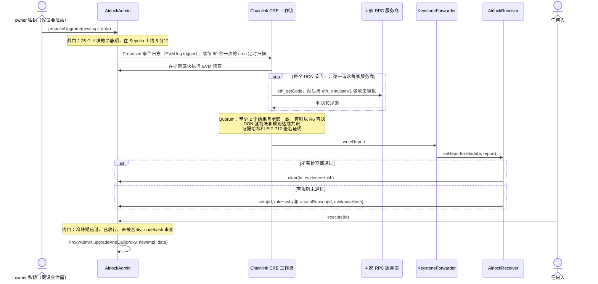

<div align="center">

# Upgrade Airlock 升级气闸

**每一次代理合约升级都要过两道门：一道是冷静期，一道是 Chainlink CRE 的放行，而只有扛过攻击模拟的代码才能拿到放行。**

[English](README.md) · **简体中文** · [繁體中文](README.zh-TW.md) · [日本語](README.ja.md) · [한국어](README.ko.md) · [Español](README.es.md) · [Français](README.fr.md) · [Deutsch](README.de.md) · [Português (Brasil)](README.pt-BR.md) · [Русский](README.ru.md) · [Tiếng Việt](README.vi.md)

[](https://github.com/jiapunk/upgrade-airlock/actions/workflows/ci.yml)
[](LICENSE)
[](https://upgrade-airlock.pages.dev)
[](https://sepolia.etherscan.io/address/0x28e7aAC40560804F480e454bF9C12F50C83b700B)
[](#chainlink-cre)

[亮点](#highlights) · [工作原理](#how-it-works) · [规则](#rules) · [Chainlink CRE](#chainlink-cre) · [Sepolia 链上运行](#live-on-sepolia) · [快速开始](#quick-start) · [安全模型](#security-model)

</div>

## 概览

Upgrade Airlock 为每一次合约升级设置两道门。**外门**是按区块计算的冷静期；**内门**只有在以下条件全部满足后才会打开：Chainlink CRE 工作流已在四家独立的 RPC 服务商上，用模拟器对新实现发起过攻击，所有结果一致，DON 已就判决达成共识，并且一份带签名的**放行（Clear）**报告已经上链。恶意实现拿到的则是一份带签名的**否决（Veto）**，即使攻击者握有升级私钥，它也永远无法执行。本项目为 ETH Shenzhen 2026 打造，部署在 Ethereum Sepolia 上。

> [!TIP]
> **在线演示：[upgrade-airlock.pages.dev](https://upgrade-airlock.pages.dev)**
>
> 战情室直接在浏览器里读取 Ethereum Sepolia，只读不写。每个提案都显示为一座气闸：**外门**记录提案，**气闸舱**为冷静期倒计时，**内门**始终锁住，直到 Chainlink CRE 的放行上链。一旦被否决，提案会被弹出舱外，同时列出对应的规则、证据哈希和交易。页面默认显示简体中文：[`?lang=en`](https://upgrade-airlock.pages.dev/?lang=en) 切换为英文，[`?lang=zh-TW`](https://upgrade-airlock.pages.dev/?lang=zh-TW) 切换为繁体中文。页面上的每一笔交易都收录在[线上运行证据](docs/evidence/sepolia-live.md)中。

## <a id="highlights"></a>亮点

- **从设计上就是 fail-closed（出错即拒绝）。** 只有链上已有放行，升级才能执行。漏掉事件日志、RPC 宕机、服务商结果不一致或运行失败，都只会让提案保持未放行或被否决：最多推迟升级，绝不会让升级通过。否决永远优先于放行。
- **真刀真枪的攻击，而不是检查清单。** 每个 DON 节点都在四家 RPC 服务商上用 `eth_simulateV1`，基于代理合约的真实状态执行这次升级。一个持有资金的陌生地址调用新字节码中的每一个选择器，并用填入持有者地址的参数逐一调用每个新函数，再对比调用前后的总供应量、所有权和余额。至少要有两家服务商返回结果，且所有结果必须一致。
- **判决与提案绑定。** DON 就 `{verdict, rule}` 达成共识。报告附带一份 EIP-712 签名证明，绑定提案的确切内容（`proposalDigest`）、链、接收合约和截止区块，另附一个任何人都能用链上数据重新算出的证据哈希。
- **没有提案会漏判。** cron 定时扫描每 60 秒检查最新的 20 个提案，补判 log trigger 漏掉的所有提案，包括 approver（审批人）手动放行的升级；它的否决优先。
- **已在 Ethereum Sepolia 上线运行。** 官方 CRE CLI 在服务器上运行这个工作流，在链上对七个提案作出了判决：一次正常升级被放行并执行，六次攻击被否决（R1、R2、R3、R3B、R7、R9）。所有合约均已在 Sourcify 上完成验证。
- **端到端测试。** [CI](.github/workflows/ci.yml) 中运行 117 个 Foundry 测试、118 个工作流单元测试和 199 项战情室自检；另有一个分叉链端到端脚本，通过 CRE 模拟器跑通完整闭环。

## 要解决的问题

可升级的代理合约把整个协议的安危都压在一把升级私钥上。私钥一旦泄露，攻击路径非常短：部署恶意实现，把代理合约指向它，然后增发或掏空资金。这样的事已经发生过很多次：

- **PAID Network，2021 年 3 月。** 代理合约所有者的私钥被用来把经过审计的代币代码替换为带有销毁和铸造函数的版本，攻击者铸出约 5950 万枚 PAID。（[CertiK 事后分析](https://www.certik.com/blog/paid-network-post-mortem)）
- **Ankr，2022 年 12 月。** 攻击者利用泄露的部署者私钥，把 aBNBc 的实现替换为不做权限检查就能铸币的版本，铸出 60 万亿枚 aBNBc。（[Ankr 官方报告](https://www.ankr.com/blog/the-abnbc-token-report/)）
- **Radiant Capital，2024 年 10 月。** 攻击者控制了 11 个多签签名者中的 3 个，接管借贷池的 provider 合约并升级借贷池的实现，卷走 5300 多万美元。（[rekt.news](https://rekt.news/radiant-capital-rekt2)）

时间锁只是让攻击者多等一会儿，而等待期间没有人有义务去检查；延迟拉得太长，又会挡住紧急修复。Upgrade Airlock 让这段等待真正发挥作用：升级必须先通过一项独立、去中心化的检查才能执行，而这项检查会在每一个提案上自动运行。

## <a id="how-it-works"></a>工作原理



1. **提案。** `AirlockAdmin` 是 OpenZeppelin `ProxyAdmin` 的所有者，也是代币 `Ownable` 的所有者。owner 私钥只能提案：它永远不会是 guardian（守护者）、approver（审批人）或放行预言机。每个提案（升级，或对气闸本身的修改：guardian、冷静期、紧急暂停目标）都会记录 `readyBlock = block.number + delayBlocks`。升级目标和紧急暂停目标都必须是普通的合约代码：EIP-7702 委托账户的私钥可以在判决之后把它重新指向别处，因此一律拒绝（`DelegatedAccount`）。
2. **判定。** CRE 的 log trigger 在 `Proposed` 事件发出时触发。对气闸本身的修改根据链上读取的数据判定（R7）。升级先过静态规则（R5、R8），再进入固定在提案区块上的攻击模拟：代理合约的 ERC-1967 实现槽被覆盖为新代码，一个全新的陌生地址（由提案区块哈希推导而来）像真实用户一样被注入资金，包括来自第二个持有者的代币和 ETH。先由持有者完成一笔转账，再由陌生地址在没有授权额度的情况下调用 `transferFrom`，然后用五种参数形式调用新字节码中找到的每一个选择器。凡是不属于标准代币接口的选择器，还会再用持有者参数调用一遍：持有资金的持有者依次填入前四个参数位置，测试金额填入另一个位置，其余位置填入陌生地址或代理合约地址。调用前后都会读取总供应量、owner 和每个受监控的余额，每次持有者参数调用之后立即读取持有者的余额，并检查每一次探测自身发出的事件（R1 至 R4、R3B）。最后扫描新字节码，找出在真实区块上与在模拟中行为不同的操作码（R9）。
3. **达成一致。** 每个 DON 节点都在四家服务商上运行模拟。至少要有两家返回结果，且所有结果必须是同一个判决；其他情况一律否决（R6）。随后 DON 就完全相同的 `{verdict, rule}` 达成共识。
4. **报告。** 工作流对规范化的证据 JSON 计算哈希，用 attester 私钥（CRE secret）签署一份 EIP-712 判决，再通过 forwarder 写入报告。`AirlockReceiver` 检查发送方、时效、签名，以及判决是否绑定到这一个提案（`proposalDigest`），然后在 `AirlockAdmin` 上调用 `clear`，或调用 `veto` 和 `attachReason`。
5. **执行。** 冷静期结束后，任何人都可以调用 `execute(id)`。冷静期内会以 `TooEarly` revert，没有放行时以 `NotCleared` revert，被否决后以 `ProposalVetoed` revert；如果目标地址上的代码已不是当初提案并经过判定的那一份，则以 `CodehashChanged` revert。否决永远优先于放行。
6. **定时扫描。** cron trigger 每 60 秒重新检查最新的提案，凡是仍待处理、CRE 尚未答复（`oracleJudged`）的提案都会被补判：log trigger 漏掉的事件、大到无法投递的 `Proposed` 事件，或 approver 手动放行的升级。它的否决优先于这次手动放行。

**所有失败都指向同一个方向。** 漏掉事件日志、RPC 宕机、服务商结果不一致或运行失败，结果都是提案得不到放行或被否决：只会推迟升级，绝不会让升级通过。当 CRE 完全无法给出结果时，approver 私钥可以附上记录在案的证据手动放行；CRE 恢复后，定时扫描仍会判定这个升级，CRE 或 guardian 的否决依然优先。`breakGlass()` 允许 owner 或任一 guardian 立即把代理合约切换到事先登记的暂停实现；退出暂停状态则是一次普通升级，同样要过两道门。

更多细节见 [docs/design.md](docs/design.md)（威胁模型、放行状态机、报告绑定、预算）和 [cre/README.md](cre/README.md)（工作流本身）。

## <a id="rules"></a>规则

`ruleHash = keccak256("GUARD/<ID>")`，每次否决都会把它记录在链上。

| 规则 | 何时否决 | 判定依据 |
|---|---|---|
| R1 `TOTAL_SUPPLY` | 陌生地址的调用改变了 `totalSupply` | 攻击模拟 |
| R2 `OWNER` | 陌生地址的调用改变了 `owner()` | 攻击模拟 |
| R3 `TRANSFER_CONSERVATION` | 持有者转出 X 时，实际转走的不恰好是 X，或者动了其他人的余额 | 攻击模拟 |
| R3B `THIRD_PARTY_FUNDS` | 外部地址动了任何持有者的代币：持有资金的陌生地址在没有授权额度的情况下成功调用 `transferFrom`，或者它的某次探测转走了别人的代币、铸币、销毁、转移所有权，或使持有者的余额减少；即使没有发出事件，或之后的调用又把变化撤销，也同样否决 | 攻击模拟 |
| R4 `TRANSFER_LIVENESS` | 持有者的普通转账失败 | 攻击模拟 |
| R5 `STRICT_CODEHASH` | 已开启严格模式，且 approver 尚未审批该 codehash | 链上读取 |
| R6 `SIM_FAILURE` | 模拟无法得出结论：服务商结果不一致、返回结果太少、代码不匹配、view 调用或陌生地址的注资发生 revert，或探测超出了配置的请求容量 | 模拟与 quorum |
| R7 `CONFIG_GUARD` | 修改 guardian、缩短冷静期或设置新的紧急暂停目标，却没有 approver 的事先审批 | 链上读取 |
| R8 `INIT_DATA` | 升级附带初始化数据，而 approver 没有连同 codehash 一起审批这些数据 | 链上读取 |
| R9 `NEW_OPCODES` | 新代码包含配置中固定允许清单（默认为空）未覆盖的区块或交易上下文操作码（BASEFEE、TIMESTAMP、NUMBER、ORIGIN、GAS 等）、外部调用、create 或 selfdestruct，除非 approver 审批的正是这个 codehash | 字节码 |

**R9 堵住的是模拟规避。** `EvilBaseFeeImpl` 在 `block.basefee == 0` 时（这正是 `eth_simulateV1` 调用看到的情况）表现得和 v1 一模一样，到了真实区块上却允许任何人铸币。模拟中的所有不变量检查都能通过，但它的 `BASEFEE` 操作码让它被否决。允许清单从不依赖代理合约当前运行的代码，因此一次审批只覆盖一个 codehash，不会延伸到之后的任何升级。只有当编译器的 metadata 尾段是格式完全符合 solc 规范的 CBOR map，且没有任何指令能执行到它时，扫描才会跳过这一段；其他情况一律当作代码扫描。审批某个 codehash 只会让它免于 R9，并容许探测被截断（R6），仅此而已：其他规则照常执行。

**R3B 堵住的是无声掏空。** `EvilDrainImpl` 就是 v1 加上一个没有任何权限控制的 `rescue(from, to, amount)`。它的总供应量、owner、转账和操作码都与 v1 相同，所以 R1 至 R4 和 R9 全部通过。`rescue` 不是标准代币函数，因此陌生地址还会用持有者参数调用它；把持有者作为 `from` 的那次调用转走了持有者的代币，R3B 随即将其否决。即便掏空函数只对“持有代币或 ETH 的调用者”开放，也同样逃不过，因为陌生地址两者都有。

### 自动模式与严格模式

**自动模式**为默认模式：CRE 通过有边界的攻击搜索，自主放行或否决每一次升级，搜索范围包括一个持有资金的外部调用者、新代码中的每一个选择器，以及把持有者依次填入每个新函数前四个参数位置的调用。**严格模式**（R5）再加一道人工审查：每个新实现的 codehash 都必须先经 approver 私钥审批，攻击模拟照常运行。自动模式适合希望常规升级在几分钟内获得放行的代币；严格模式则把代码审查纳入放行流程（详见[两种模式](docs/design.md#two-modes-automatic-and-strict)）。

## Chainlink CRE

CRE 是 Upgrade Airlock 的编排层：工作流是穿过内门的唯一自动化通道，从链上触发到链上判决的每一步都由它完成。工作流使用 CRE TypeScript SDK（`@chainlink/cre-sdk` 1.23.0）编写，并用 CRE CLI v1.37.0 编译为 WASM。

| Chainlink 技术 | 位置 | 在本项目中的作用 |
|---|---|---|
| CRE workflow runner | [`cre/veto/main.ts#L1-L9`](cre/veto/main.ts#L1-L9)、[`cre/veto/workflow.yaml`](cre/veto/workflow.yaml)、[`cre/project.yaml`](cre/project.yaml) | 两个 handler，target 为 `sepolia` 和 `sepolia-fork` |
| EVM log trigger | [`cre/veto/workflow.ts#L202-L211`](cre/veto/workflow.ts#L202-L211)、[`#L193-L198`](cre/veto/workflow.ts#L193-L198)、[`#L54-L65`](cre/veto/workflow.ts#L54-L65) | 以 `LATEST` 置信度监听 `AirlockAdmin.Proposed`：提案一出现就开始判定，比它最早可执行的时间早了整整一个冷静期 |
| Cron trigger | [`cre/veto/workflow.ts#L200`](cre/veto/workflow.ts#L200)、[`#L209`](cre/veto/workflow.ts#L209)、[`cre/veto/airlock.ts#L323-L389`](cre/veto/airlock.ts#L323-L389) | 定时扫描：每分钟检查最新的 20 个 id |
| EVM 读取（`callContract`） | [`cre/veto/workflow.ts#L114-L122`](cre/veto/workflow.ts#L114-L122)、[`#L137-L142`](cre/veto/workflow.ts#L137-L142)、[`cre/veto/chain.ts`](cre/veto/chain.ts) | 读取提案、放行状态、`oracleJudged`、审批记录和余额，通过 Multicall3 在提案区块或 `LATEST` 批量读取 |
| EVM 读取（`headerByNumber`） | [`cre/veto/workflow.ts#L125-L136`](cre/veto/workflow.ts#L125-L136) | 最新区块，以及用于推导模拟陌生地址的提案区块哈希 |
| node mode 下的 HTTP capability | [`cre/veto/workflow.ts#L167-L189`](cre/veto/workflow.ts#L167-L189)、[`#L80-L94`](cre/veto/workflow.ts#L80-L94)、[`cre/veto/judge.ts#L157-L220`](cre/veto/judge.ts#L157-L220) | 每个节点向每家服务商先发送 `eth_getCode`，再发送一到两个 `eth_simulateV1` 请求（每个都在 120 kb 的请求上限之内） |
| `consensusIdenticalAggregation` | [`cre/veto/workflow.ts#L184-L188`](cre/veto/workflow.ts#L184-L188)，quorum 逻辑见 [`cre/veto/judge.ts#L244-L277`](cre/veto/judge.ts#L244-L277) | DON 就 `{verdict, rule}` 达成共识（最多 52 字节） |
| Secrets | [`cre/veto/workflow.ts#L160-L166`](cre/veto/workflow.ts#L160-L166)、[`cre/secrets.yaml`](cre/secrets.yaml) | EIP-712 attester 私钥，每次运行只获取一次 |
| Report + `writeReport` | [`cre/veto/workflow.ts#L143-L149`](cre/veto/workflow.ts#L143-L149)、[`cre/veto/airlock.ts#L229-L282`](cre/veto/airlock.ts#L229-L282)、[`cre/veto/report.ts`](cre/veto/report.ts) | `runtime.report`（ECDSA、keccak256）和 `evm.writeReport`，随后读回提案以确认结果 |
| Forwarder + `IReceiver` | [`src/cre/AirlockReceiver.sol#L88-L120`](src/cre/AirlockReceiver.sol#L88-L120)、[`#L156-L169`](src/cre/AirlockReceiver.sol#L156-L169)、[`src/cre/IReceiver.sol`](src/cre/IReceiver.sol)、[`script/DeployEth.s.sol#L142`](script/DeployEth.s.sol#L142) | `onReport` 只接受配置的 forwarder，并在已配置时校验 workflow id 和 owner |
| Chain selectors | [`cre/veto/workflow.ts#L100-L104`](cre/veto/workflow.ts#L100-L104) | `ethereum-testnet-sepolia` |
| CRE CLI | [`cre/setup.sh`](cre/setup.sh)、[`cre/scripts/fork-e2e.sh`](cre/scripts/fork-e2e.sh)、[`scripts/sepolia/airlock.sh`](scripts/sepolia/airlock.sh)、[`scripts/sepolia/sweep.sh`](scripts/sepolia/sweep.sh) | `cre workflow build`、`cre workflow simulate --broadcast` |

**工作流目前的运行方式。** 工作流通过 CRE CLI 的 `cre workflow simulate --broadcast` 在 Ethereum Sepolia 上运行。监听器（[`scripts/sepolia/airlock.sh`](scripts/sepolia/airlock.sh)）让 log trigger 保持在监听模式，定时扫描（[`scripts/sepolia/sweep.sh`](scripts/sepolia/sweep.sh)）每分钟运行一次 cron handler；每一次放行和否决都是一笔真实的 Sepolia 交易，经由 Chainlink 在 Sepolia 上的 MockKeystoneForwarder [`0x15fC6ae953E024d975e77382eEeC56A9101f9F88`](https://docs.chain.link/cre/guides/workflow/using-evm-client/forwarder-directory-ts) 上链。`AirlockReceiver` 无需任何改动即可用于 DON 部署：部署时把 `FORWARDER` 设为生产环境的 KeystoneForwarder，并设置 `WORKFLOW_ID` / `WORKFLOW_OWNER`，`onReport` 就会同时校验 DON 签名的工作流 metadata。除非这两项都已设置，或通过 `ALLOW_MOCK_FORWARDER=1` 明确允许，否则 `DeployEth` 会拒绝使用无需许可的 MockKeystoneForwarder（[`script/DeployEth.s.sol#L96-L104`](script/DeployEth.s.sol#L96-L104)）。

**按 CRE 单次运行限额设计。** 最多 15 次链上读取（Multicall3 批量读取，每批都低于 5 kb 的 payload 上限）、四家服务商占用 15 次 HTTP 调用中的 12 次、每次运行一次攻击模拟、共识值最多 52 字节。完整预算见 [docs/design.md](docs/design.md#budgets)。

## <a id="live-on-sepolia"></a>Sepolia 链上运行

Ethereum Sepolia，chain id 11155111。合约通过 [`script/DeployEth.s.sol`](script/DeployEth.s.sol) 在区块 11950682 部署（13 笔交易），均已在 Sourcify 上完成验证。owner、approver、紧急 guardian 和 attester 是四把不同的私钥。冷静期为 25 个区块。

| 合约 | 地址 |
|---|---|
| AirlockAdmin | [`0x28e7aAC40560804F480e454bF9C12F50C83b700B`](https://sepolia.etherscan.io/address/0x28e7aAC40560804F480e454bF9C12F50C83b700B) |
| AirlockReceiver | [`0xE40D463116F4Aa24d5E79776a65ED0f1b088c670`](https://sepolia.etherscan.io/address/0xE40D463116F4Aa24d5E79776a65ED0f1b088c670) |
| DemoBTC 代理合约（dBTC） | [`0x88Cc569265faDAEAc2a16B69f35E10B2158e4b71`](https://sepolia.etherscan.io/address/0x88Cc569265faDAEAc2a16B69f35E10B2158e4b71) |
| ProxyAdmin | [`0x51a3fE6AD22BF7753574B7b7FD56aE9a65bd593E`](https://sepolia.etherscan.io/address/0x51a3fE6AD22BF7753574B7b7FD56aE9a65bd593E) |
| DemoBTC v1 | [`0x8f7d6453d77B3f3b008CBE4A144d82c5742eB108`](https://sepolia.etherscan.io/address/0x8f7d6453d77B3f3b008CBE4A144d82c5742eB108) |
| DemoBTC v2（正常升级） | [`0x4D959f981C01E3B81ac6C9A20E84816Fe5f6Bce3`](https://sepolia.etherscan.io/address/0x4D959f981C01E3B81ac6C9A20E84816Fe5f6Bce3) |
| EvilMintImpl | [`0x01502c4af90c27f53B2E1293941670C6B761CAAA`](https://sepolia.etherscan.io/address/0x01502c4af90c27f53B2E1293941670C6B761CAAA) |
| EvilOwnerImpl | [`0xBe849DE8e0a4D9b0010ba1468f94Eeb24A42d488`](https://sepolia.etherscan.io/address/0xBe849DE8e0a4D9b0010ba1468f94Eeb24A42d488) |
| EvilFeeImpl | [`0xB95Ffa7b970B1a73488e2fC32B787fA536F12AF5`](https://sepolia.etherscan.io/address/0xB95Ffa7b970B1a73488e2fC32B787fA536F12AF5) |
| EvilBaseFeeImpl | [`0xE1AAa4E88DB9cc7ceCca14722eE2874D834e0310`](https://sepolia.etherscan.io/address/0xE1AAa4E88DB9cc7ceCca14722eE2874D834e0310) |
| EvilDrainImpl | [`0x1d98D64BC5204AE139B5A0747855841Fa5333b6d`](https://sepolia.etherscan.io/address/0x1d98D64BC5204AE139B5A0747855841Fa5333b6d) |
| PausedImpl（紧急暂停目标） | [`0xb6573006fB607E96966d0F578B96AAB25413F5BE`](https://sepolia.etherscan.io/address/0xb6573006fB607E96966d0F578B96AAB25413F5BE) |
| Chainlink MockKeystoneForwarder | [`0x15fC6ae953E024d975e77382eEeC56A9101f9F88`](https://sepolia.etherscan.io/address/0x15fC6ae953E024d975e77382eEeC56A9101f9F88) |

七个提案，七个链上判决。每个链接上的区块号是该交易所在的区块；`(+n)` 表示 CRE 判决在提案之后第几个区块到达。

| 卡片 | 提案 | CRE 判决 | 提案交易 | 报告交易 | 后续 |
|---|---|---|---|---|---|
| `v2`：正常升级 | #4 | 放行 | [11950745](https://sepolia.etherscan.io/tx/0x3cd96ac220391e2b404d35591d1a96808b75256e7c685a414e2ca5a63bc54145) | [11950747 (+2)](https://sepolia.etherscan.io/tx/0x2c02d2a23016a72509900eb7ce92dabc06b0dd93a2394d076a62d687ce467efb) | `execute` [11950772](https://sepolia.etherscan.io/tx/0x01913c1854b9862763af74ddacd7be23a7f55232af7334714aa8213aa7021890)，`version()` = "2" |
| `evil-mint`：任何人都能铸币 | #1 | 否决 R1 | [11950735](https://sepolia.etherscan.io/tx/0x862c5fdf826a8fef09fe2ff278d3e58191f93c267dbdd38ad9aaa270f39937b0) | [11950736 (+1)](https://sepolia.etherscan.io/tx/0xb0d74e25e2528fb9aad7d21de202dac288cd256048f2986b5214280fda4b84f6) | `execute` 以 `ProposalVetoed` revert |
| `evil-owner`：任何人都能夺取所有权 | #6 | 否决 R2 | [11950788](https://sepolia.etherscan.io/tx/0x32eb22039bd43602e0406b1a8f9a02c5cbcdb5cf2ef1c389919a45d05820da25) | [11950790 (+2)](https://sepolia.etherscan.io/tx/0x49451bee7a2f3351b18992d94b5f89b9ff89cf53be65a937400ab95fb79be551) | `execute` 以 `ProposalVetoed` revert |
| `evil-fee`：转账暗扣 10% | #7 | 否决 R3 | [11950792](https://sepolia.etherscan.io/tx/0xe06924c2e3961ab27d2803c0654b783fc06e52107345bda9bfeff391053fcad3) | [11950794 (+2)](https://sepolia.etherscan.io/tx/0x01f6055a683e0dabc8f34ae094e5daa5a81ddb11c687aa9c5ac6e30c7a7f3d3b) | `execute` 以 `ProposalVetoed` revert |
| `evil-basefee`：到了真实区块才开放铸币 | #3 | 否决 R9 | [11950742](https://sepolia.etherscan.io/tx/0x3c29c118ca395ca92500abcaae6126244924fbd8e14f846af57b70f113cad6e1) | [11950743 (+1)](https://sepolia.etherscan.io/tx/0xb6db2d832112384287e5a7ccdd086127931360900d09c80645c21eac2bc165db) | `execute` 以 `ProposalVetoed` revert |
| `evil-drain`：任何人都能转走持有者的代币 | #2 | 否决 R3B | [11950737](https://sepolia.etherscan.io/tx/0x0e52369921040eb0c901ac3a077aff762d370b4efd9503a52c91360d56366b16) | [11950740 (+3)](https://sepolia.etherscan.io/tx/0x40bbe374a8cee47a94da977f973cf66a67573c12bc84117483fcbd11430f90cb) | `execute` 以 `ProposalVetoed` revert |
| `remove-receiver`：把 CRE 从 guardian 中移除 | #5 | 否决 R7 | [11950749](https://sepolia.etherscan.io/tx/0xda2bd1c9dc5f7770da3926358b8da3ffe5a1cd3154b499cafae440387eebb934) | [11950750 (+1)](https://sepolia.etherscan.io/tx/0xaa2f598bdcc7f46727e5456528521e50ac5c1d8e423805042cbf2d10a4c4cdac) | `execute` 以 `ProposalVetoed` revert |

上表中的每一个判决，都来自官方 CRE CLI 在服务器上运行的本工作流（log trigger 监听器加每 60 秒一次的定时扫描，见 [`scripts/sepolia/systemd/`](scripts/sepolia/systemd)）；工作流自身输出的日志见 [`docs/evidence/sepolia-live.md`](docs/evidence/sepolia-live.md)。

## <a id="quick-start"></a>快速开始

### 环境要求

- [Foundry](https://getfoundry.sh)（`forge`、`cast`、`anvil`）、`jq` 和 Node 22。
- 模拟器所需的 CRE 账号（`cre login`），分叉链端到端运行和运维工具包都会用到。
- [`cre/setup.sh`](cre/setup.sh) 会把 CRE CLI v1.37.0（固定 SHA-256 校验）和 bun 1.4.2 安装到 `cre/.tools`。

### 构建与测试

```bash
git clone https://github.com/jiapunk/upgrade-airlock.git
cd upgrade-airlock

# 合约（OpenZeppelin 和 forge-std 已随仓库放在 lib/ 中）
forge build                     # 首次运行时下载固定版本的 solc 0.8.37
forge test --offline            # 117 个测试

# CRE 工作流
cre/setup.sh
export PATH="$PWD/cre/.tools/bin:$PWD/cre/.tools/node_modules/.bin:$PATH"
(cd cre/veto && bun test && bun run typecheck)    # 118 个测试：规则、探测、字节码、报告、预算、handler

# 战情室
(cd web && npm ci && npm run selftest)            # 199 项检查：实时视图和离线回放
```

### 在 Sepolia 分叉链上端到端运行

```bash
cre login                       # 只需一次；模拟器需要 CRE 账号
cre/scripts/fork-e2e.sh         # 在本地 anvil 分叉的 Sepolia 上运行：不会向真实网络发送任何内容
```

[`cre/scripts/fork-e2e.sh`](cre/scripts/fork-e2e.sh) 在分叉链上部署整套合约，用 CRE 模拟器以 `--broadcast` 运行工作流，并在链上检查每一个结果：

- **Log trigger：** EvilMint 被 R1 否决，EvilOwner 被 R2 否决，EvilFee 被 R3 否决，EvilBaseFee 被 R9 否决（点名 `BASEFEE`），EvilDrain 被 R3B 否决（点名 `rescue`，其他规则全部通过）；另外七种掏空变体（[`test/fixtures/DrainVariants.sol`](test/fixtures/DrainVariants.sol)）都只因 R3B 被否决：参数顺序重排、带代币地址校验的守卫、只对持有代币或 ETH 的调用者开放的掏空、不发出 `Transfer` 事件的掏空，以及对代币持有者跳过授权额度检查的 `transferFrom`；正常的 v2 被放行，并在冷静期后执行；把 receiver 从 guardian 中移除的提案被 R7 否决；经 approver 事先审批的缩短冷静期提案被放行。
- **定时扫描：** 无人判定过的升级在冷静期后执行会以 `NotCleared` revert，一次扫描将其放行后即可执行；approver 手动放行的两个提案由下一次扫描判定：EvilDrain 被 R3B 否决（否决压过手动放行），延长冷静期的提案也再次由 CRE 放行；带 6 KB 初始化数据的升级在再下一次扫描中被 R8 否决。
- **证据：** 每个被否决的提案执行时都以 `ProposalVetoed` revert，每个判决的证据哈希都会用链上数据重新计算核对（[`cre/veto/tools/check-evidence.ts`](cre/veto/tools/check-evidence.ts)）。

### Sepolia 运维工具包

[`scripts/sepolia/`](scripts/sepolia/README.md) 用于运行线上演示。私钥存放在仓库之外：`KEY_DIR` 中每个文件存一把十六进制私钥（`owner`、`attester`、`sender`、`approver`、`emergency`）；脚本从不打印私钥，而且只有当 owner、approver、紧急 guardian 和 attester 是四把不同的私钥时，`deploy.sh` 才会执行部署。每个脚本也都能通过 `FORK=<port>` 在本地分叉链上运行，整套演示可以零成本彩排。

```bash
scripts/sepolia/deploy.sh                    # 13 笔交易，写出 deployments/sepolia.json（FORCE=1 时替换已有部署）
bun scripts/sepolia/make-config.mjs          # 生成工作流配置：4 家服务商，quorum 2
scripts/sepolia/fund-sender.sh 0.05          # 为报告交易充值 ETH
scripts/sepolia/airlock.sh                   # 终端 A：CRE 监听器（log trigger）
scripts/sepolia/propose.sh v2                # 终端 B：随后依次提交 evil-mint、evil-owner、evil-fee、evil-basefee、evil-drain、remove-receiver
scripts/sepolia/execute.sh <id>              # 冷静期后执行已放行的提案，否则显示 revert 原因
scripts/sepolia/status.sh                    # 列出每个提案：判决、CRE 是否已判定、规则、证据、交易
```

`sweep.sh` 运行一次 cron 定时扫描，`clear.sh` 是 approver 的手动放行，`fork.sh` 用于启动、保存和恢复 Sepolia 分叉链，`probe-rpcs.ts` 用工作流自身的判定代码检查每家服务商，`systemd/` 则在 Linux 服务器上运行监听器和定时扫描。

### 战情室

```bash
cd web
npm ci
npm run dev                     # http://127.0.0.1:5173/
npm run build:airlock           # 把 deployments/sepolia.json 同步进页面，构建 web/dist-airlock
```

战情室直接读取 Sepolia，从不签名，也从不发送交易。它把每个提案显示为一座气闸：冷静期、CRE 放行，以及附带规则和证据的否决。

| URL 参数 | 作用 |
|---|---|
| `?mode=airlock` | 默认。Ethereum Sepolia 实时视图，只读 |
| `?mode=offline` | 完全不联网，回放一次录制好的运行 |
| `?lang=en`、`?lang=zh-TW`、`?lang=zh-CN` | 界面语言（默认 `zh-CN`；按 `L` 键循环切换） |
| `?rpc=http://127.0.0.1:<port>` | 改为读取本地 Sepolia 分叉链，用于彩排 |

在实时模式下按 `P`，即可根据链上事件回放最近的提案。

## 仓库结构

```
src/AirlockAdmin.sol            两道门：提案、冷静期、guardian 否决、放行、执行、breakGlass
src/cre/AirlockReceiver.sol     CRE 报告接收合约：forwarder、工作流 metadata、EIP-712 签名证明、digest 绑定
src/cre/IReceiver.sol           Chainlink CRE 接收接口
src/DemoBTC.sol, DemoBTCV2.sol  演示代币（dBTC）v1 和正常的 v2
src/PausedImpl.sol              紧急暂停目标：任何余额变动都会 revert
src/attack/                     EvilMintImpl、EvilOwnerImpl、EvilFeeImpl、EvilBaseFeeImpl、EvilDrainImpl
script/DeployEth.s.sol          部署脚本（13 笔交易），检查角色、forwarder 和部署后的接线
test/                           Foundry 测试；fixtures/DrainVariants.sol 收录七种掏空变体
cre/veto/                       CRE 工作流：workflow.ts（capability）、airlock.ts（handler）、judge.ts（规则、
                                quorum）、simulate.ts（eth_simulateV1）、bytecode.ts（选择器、R9）、report.ts
                                （报告、EIP-712、证据）、chain.ts（读取预算）、keys.ts、rules.ts、config.ts
cre/veto/test/                  Bun 单元测试
cre/veto/tools/                 check-evidence.ts：重新计算每个链上证据哈希
cre/scripts/fork-e2e.sh         在 anvil 分叉的 Sepolia 上端到端运行
cre/setup.sh                    固定版本的 CRE CLI 和 bun
scripts/sepolia/                线上演示的运维工具包，附带服务器用的 systemd 单元
web/                            战情室（Vite、TypeScript、viem）
deployments/sepolia.json        线上部署记录
docs/design.md                  威胁模型、放行状态机、报告绑定、预算
docs/evidence/                  录制的线上运行记录
.github/workflows/ci.yml        合约、工作流和战情室的检查
```

## <a id="security-model"></a>安全模型

Upgrade Airlock 假定 owner 私钥会泄露，并据此设计：单凭 owner 私钥永远无法执行升级。

| 角色 | 持有方 | 权限 |
|---|---|---|
| Owner（所有者） | 一把私钥 | 提议升级以及对气闸本身的修改（guardian、冷静期、紧急暂停目标）；`breakGlass` |
| Approver（审批人） | 另一把独立私钥 | CRE 无法给出结果时手动放行；审批 codehash、初始化数据和气闸修改（`approveCodehash`） |
| 紧急 guardian（守护者） | 另一把独立私钥 | 对待定提案执行 `veto`；`breakGlass` |
| Attester（签名者） | CRE secret，独立的私钥 | 签署 `AirlockReceiver` 认可的 EIP-712 判决 |
| AirlockReceiver | CRE 报告接收合约 | 放行预言机（`clear`）和 guardian（`veto`、`attachReason`） |
| 任何人 | | 对已通过两道门的提案调用 `execute` |

各角色之间绝不重叠。如果 owner 同时是 approver、guardian 或放行预言机，`AirlockAdmin` 的构造函数会直接拒绝（`RoleOverlap`）；`DeployEth` 也只有在 owner、approver、紧急 guardian 和 attester 是四个不同地址时才会部署。

**泄露的 owner 私钥可以提案。** 但每个提案都要在公开状态下等完冷静期，同时接受 CRE 的判定，还需要一份 owner 无法自己给出的放行。owner 也可以拉下紧急制动（`breakGlass`），但这只会把代理合约切换到事先登记的暂停实现；要退出暂停状态，就得走一次过两道门的升级。

**同一把私钥无法：**

- 在没有放行的情况下执行：`AirlockAdmin` 没有通用的调用路径，更换实现的唯一途径是 `execute` 一个已放行的升级（或者用 `breakGlass` 切换到暂停实现）；
- 先削弱气闸：移除 CRE receiver、缩短冷静期或更换紧急暂停目标同样都是提案，没有 approver 的事先审批就会被 R7 否决；
- 在判决之后偷换代码：`execute` 会重新检查目标的 codehash（`CodehashChanged`），EIP-7702 委托账户一律拒绝（`DelegatedAccount`）；
- 伪造或重放判决：`AirlockReceiver` 只接受满足以下条件的报告：来自配置的 forwarder、由 attester 签名、不晚于其 `validUntilBlock`，并且绑定到本链、本接收合约上该提案的 `proposalDigest`。

approver 的手动放行是 CRE 无法给出结果时的人工兜底：只要该提案仍在最新的 20 个 id 之内，定时扫描照样会判定它，而且 CRE 或 guardian 的否决优先。完整的威胁模型见 [docs/design.md](docs/design.md#threat-model)。

## 技术栈

- **Solidity 0.8.37** 和 **Foundry**，使用 OpenZeppelin Contracts 5.7.0（`ProxyAdmin`、`TransparentUpgradeableProxy`、`EIP712`、`ECDSA`）
- **Chainlink CRE**：TypeScript SDK（`@chainlink/cre-sdk` 1.23.0）和 CRE CLI v1.37.0，运行在 Bun 1.4.2 上
- **viem**：用于工作流和战情室中的 ABI 编码与链上读取
- **Vite** 和 TypeScript：用于战情室

## 使用的 AI 工具

Upgrade Airlock 在作者的主导下使用 [Claude Code](https://claude.com/claude-code) 构建：合约、CRE 工作流、测试、脚本、战情室以及这些文档，都是借助它编写并检查的。

## 许可证

[MIT](LICENSE) © 2026 jiapunk
