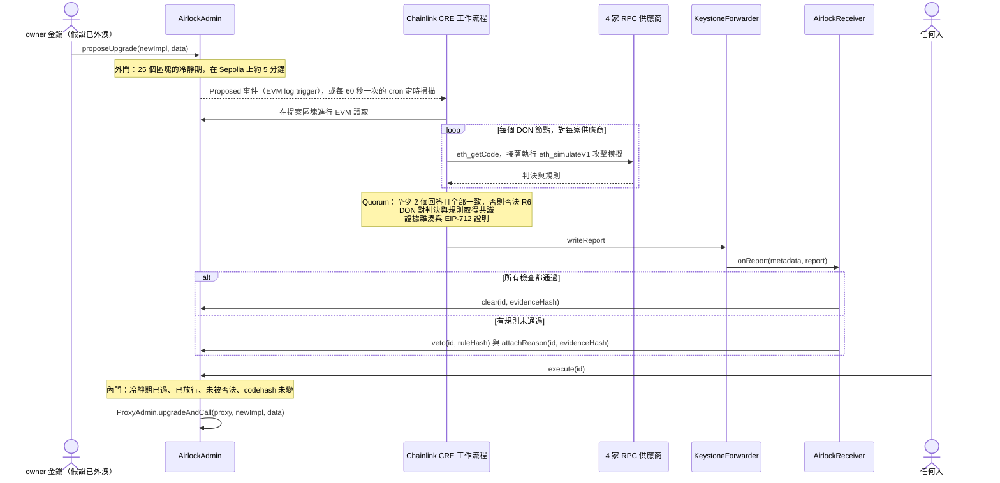

<div align="center">

# Upgrade Airlock 升級氣閘

**每一次代理合約升級都要通過兩道門：一段冷靜期，以及只有撐過攻擊模擬的程式碼才拿得到的 Chainlink CRE 放行。**

[English](README.md) · [简体中文](README.zh-CN.md) · **繁體中文** · [日本語](README.ja.md) · [한국어](README.ko.md) · [Español](README.es.md) · [Français](README.fr.md) · [Deutsch](README.de.md) · [Português (Brasil)](README.pt-BR.md) · [Русский](README.ru.md) · [Tiếng Việt](README.vi.md)

[](https://github.com/jiapunk/upgrade-airlock/actions/workflows/ci.yml)
[](LICENSE)
[](https://upgrade-airlock.pages.dev)
[](https://sepolia.etherscan.io/address/0x28e7aAC40560804F480e454bF9C12F50C83b700B)
[](#chainlink-cre)

[亮點](#highlights) · [運作方式](#how-it-works) · [規則](#rules) · [Chainlink CRE](#chainlink-cre) · [Sepolia 上線實況](#live-on-sepolia) · [快速開始](#quick-start) · [安全模型](#security-model)

</div>

## 概覽

Upgrade Airlock 為每一次合約升級設下兩道門。**外門**是以區塊計算的冷靜期；**內門**則要等 Chainlink CRE 工作流程在四家獨立 RPC 供應商的模擬器中對新實作發動攻擊、所有回答一致、DON 對判決達成共識，而且一份經過簽章的**放行**（Clear）報告已經上鏈，才會開啟。惡意實作拿到的則是一份經過簽章的**否決**（Veto），永遠無法執行，即使攻擊者握有升級金鑰也一樣。專為 ETH Shenzhen 2026 打造，部署於 Ethereum Sepolia。

> [!TIP]
> **線上展示：[upgrade-airlock.pages.dev](https://upgrade-airlock.pages.dev)**
>
> 戰情室直接在你的瀏覽器中讀取 Ethereum Sepolia，全程唯讀。每個提案都呈現為一座氣閘：**外門**記錄提案，**氣閘艙**倒數冷靜期，**內門**則一直鎖著，直到 Chainlink CRE 的放行（Clear）上鏈為止。否決（Veto）會把提案彈出氣閘，並附上對應的規則、證據雜湊與交易。頁面預設為簡體中文：[`?lang=en`](https://upgrade-airlock.pages.dev/?lang=en) 切換為英文，[`?lang=zh-TW`](https://upgrade-airlock.pages.dev/?lang=zh-TW) 切換為繁體中文。頁面背後的每一筆交易都列在[上線執行證據](docs/evidence/sepolia-live.md)中。

## <a id="highlights"></a>亮點

- **設計上就是失效即關閉（fail-closed）。** 鏈上有放行，升級才能執行。漏接事件、RPC 中斷、供應商結果不一致或執行失敗，都只會讓提案維持未放行或遭到否決：最多延後升級，絕不會讓升級闖關。否決永遠優先於放行。
- **以攻擊檢驗，而非照表打勾。** 每個 DON 節點都在四家 RPC 供應商上，以 `eth_simulateV1` 對代理合約的真實狀態執行這次升級。一個備有資金的陌生地址會呼叫新位元組碼中的每一個選擇器，並以代入持有人的參數組合呼叫每一個新函式，再比對前後的總供給量、擁有權與餘額。至少要有兩家供應商回應，而且所有回應必須一致。
- **判決與提案綁定。** DON 對 `{verdict, rule}` 達成共識。報告附帶一份 EIP-712 證明（attestation），綁定提案的確切內容（`proposalDigest`）、鏈、接收合約與區塊期限，另附一個任何人都能從鏈上資料重新算出的證據雜湊。
- **沒有任何提案漏判。** cron 定時掃描每 60 秒檢查最新的 20 個提案，凡是 log trigger 漏掉的都會補上判定，包括 approver（核准人）手動放行的升級；它的否決優先。
- **已在 Ethereum Sepolia 上線。** 官方 CRE CLI 在伺服器上執行這個工作流程，並在鏈上回應了七個提案：一次正常升級獲得放行並完成執行，六次攻擊遭到否決（R1、R2、R3、R3B、R7、R9）。所有合約都已在 Sourcify 完成驗證。
- **端對端完整測試。** 117 個 Foundry 測試、118 個工作流程單元測試與 137 項戰情室自我檢測都在 [CI](.github/workflows/ci.yml) 中執行；分叉鏈端對端腳本則透過 CRE 模擬器跑完整個流程。

## 要解決的問題

可升級的代理合約把整個協定押在一把升級金鑰上。金鑰一旦外洩，攻擊步驟很短：部署惡意實作、把代理合約指過去、鑄幣或掏空資金。這種事已經發生過很多次：

- **PAID Network，2021 年 3 月。** 代理合約擁有者的金鑰把經過稽核的代幣程式碼換成帶有銷毀與鑄造函式的版本，攻擊者鑄出約 5,950 萬枚 PAID。（[CertiK 事後分析](https://www.certik.com/blog/paid-network-post-mortem)）
- **Ankr，2022 年 12 月。** 攻擊者利用遭盜用的部署者金鑰，把 aBNBc 的實作換成不檢查權限就能鑄幣的版本，鑄出 60 兆枚 aBNBc。（[Ankr 官方報告](https://www.ankr.com/blog/the-abnbc-token-report/)）
- **Radiant Capital，2024 年 10 月。** 攻擊者控制 11 位多簽簽署人中的 3 位，接管借貸池的 provider 合約，並升級借貸池的實作，掏走超過 5,300 萬美元。（[rekt.news](https://rekt.news/radiant-capital-rekt2)）

時間鎖只是讓攻擊者多等一會兒，而等待期間沒有人有義務去檢查；拉長延遲又會卡住緊急修補。Upgrade Airlock 讓等待本身發揮作用：升級必須先通過一項獨立、去中心化的檢查才能執行，而每一個提案都會自動接受這項檢查。

## <a id="how-it-works"></a>運作方式



1. **提案。** `AirlockAdmin` 掌管 OpenZeppelin `ProxyAdmin` 以及代幣的 `Ownable` 擁有權。owner 金鑰只能提案：它永遠不會是 guardian（守護者）、approver（核准人）或放行預言機。每個提案（升級，或是對氣閘本身的變更：guardian、冷靜期、緊急暫停目標）都會得到 `readyBlock = block.number + delayBlocks`。升級與緊急暫停的目標必須是一般的合約程式碼：EIP-7702 委派帳戶的金鑰能在判決之後把它改指到別處，因此一律拒絕（`DelegatedAccount`）。
2. **判定。** `Proposed` 事件一發出，CRE 的 log trigger 就會觸發。對氣閘本身的變更以鏈上讀取判定（R7）。升級先通過靜態規則（R5、R8），再進行固定在提案區塊上的攻擊模擬：把代理合約的 ERC-1967 實作槽覆寫成新程式碼，並讓一個全新的陌生地址（由提案區塊的雜湊推導而來）像真實使用者一樣備有資金：它從第二位持有人那裡取得代幣，也持有 ETH。持有人先完成一筆轉帳，陌生地址在沒有授權額度的情況下呼叫 `transferFrom`，接著以五種參數組合呼叫新位元組碼中找到的每一個選擇器。不屬於標準代幣介面的選擇器，還會再以代入持有人的參數組合呼叫：備有資金的持有人輪流放進前四個參數欄位，測試金額放進另一欄，其餘欄位填入陌生地址或代理合約地址。前後都會讀取總供給量、owner 與每個受監看的餘額，每次代入持有人的呼叫之後立即讀取持有人的餘額，並檢查每一次探測自身發出的事件（R1 到 R4、R3B）。最後掃描新位元組碼，找出在真實區塊與模擬中行為不同的操作碼（R9）。
3. **共識。** 每個 DON 節點都在四家供應商上執行模擬。至少要有兩家回應，而且所有回應必須是同一個判決；其他情況一律否決（R6）。接著 DON 對完全相同的 `{verdict, rule}` 達成共識。
4. **報告。** 工作流程對標準化的證據 JSON 計算雜湊，以 attester 金鑰（CRE secret）簽署一份 EIP-712 判決，再透過 forwarder 寫入報告。`AirlockReceiver` 檢查發送者、時效、簽章，以及判決是否綁定到這個提案本身（`proposalDigest`），然後在 `AirlockAdmin` 上呼叫 `clear`，或是 `veto` 與 `attachReason`。
5. **執行。** 冷靜期結束後，任何人都可以呼叫 `execute(id)`。冷靜期內會以 `TooEarly` revert，沒有放行會以 `NotCleared` revert，被否決後會以 `ProposalVetoed` revert；目標地址上的程式碼若已不是當初提案並經判定的那一份，則以 `CodehashChanged` revert。否決永遠優先於放行。
6. **定時掃描。** cron trigger 每 60 秒重新檢查最新的提案，凡是仍待處理、CRE 尚未回應的（`oracleJudged`）都會加以判定：log trigger 漏接的事件、大到無法投遞的 `Proposed` 事件，或是 approver 手動放行的升級。它的否決優先於那次手動放行。

**所有失敗都導向同一個方向。** 漏接事件、RPC 中斷、供應商結果不一致或執行失敗，結果都是提案未獲放行或遭到否決：只會延後升級，絕不會讓升級通過。CRE 完全無法回應時，approver 金鑰可以附上記錄在案的證據手動放行；CRE 恢復回應後，定時掃描仍會判定這次升級，CRE 或 guardian 的否決依然優先。`breakGlass()` 讓 owner 或任一 guardian 立即把代理合約切換到事先登記的暫停實作；離開暫停狀態則是一次普通的升級，同樣要通過兩道門。

更多細節：[docs/design.md](docs/design.md)（威脅模型、放行狀態機、報告綁定、預算），以及 [cre/README.md](cre/README.md)（工作流程本身）。

## <a id="rules"></a>規則

`ruleHash = keccak256("GUARD/<ID>")`，每次否決都會記錄在鏈上。

| 規則 | 何時否決 | 判定依據 |
|---|---|---|
| R1 `TOTAL_SUPPLY` | 陌生地址的呼叫改變了 `totalSupply` | 攻擊模擬 |
| R2 `OWNER` | 陌生地址的呼叫改變了 `owner()` | 攻擊模擬 |
| R3 `TRANSFER_CONSERVATION` | 持有人轉出 X 時，實際移動的不是剛好 X，或動到了其他人的餘額 | 攻擊模擬 |
| R3B `THIRD_PARTY_FUNDS` | 外人動用了任何持有人的代幣：備有資金的陌生地址不需授權額度就成功呼叫 `transferFrom`，或它的某次探測動到他人的代幣、鑄幣、銷毀、轉移擁有權，或讓持有人的餘額減少；即使沒有發出事件，或之後的呼叫又將它復原，也一樣否決 | 攻擊模擬 |
| R4 `TRANSFER_LIVENESS` | 持有人的普通轉帳失敗 | 攻擊模擬 |
| R5 `STRICT_CODEHASH` | 已開啟嚴格模式，且 approver 尚未核准這個 codehash | 鏈上讀取 |
| R6 `SIM_FAILURE` | 模擬無法做出判斷：供應商結果不一致、回應數不足、程式碼不符、view 呼叫或陌生地址的注資 revert，或探測無法在設定的請求數內完成 | 模擬與 quorum |
| R7 `CONFIG_GUARD` | 更動 guardian、縮短冷靜期或更換緊急暫停目標，卻沒有 approver 的事先核准 | 鏈上讀取 |
| R8 `INIT_DATA` | 升級帶有 approver 未連同 codehash 一併核准的初始化資料 | 鏈上讀取 |
| R9 `NEW_OPCODES` | 新程式碼含有設定中固定允許清單（預設為空）未涵蓋的區塊或交易環境操作碼（BASEFEE、TIMESTAMP、NUMBER、ORIGIN、GAS 等）、外部呼叫、create 或 selfdestruct，除非 approver 核准了這個 codehash 本身 | 位元組碼 |

**R9 封住模擬規避。** `EvilBaseFeeImpl` 在 `block.basefee == 0`（也就是 `eth_simulateV1` 呼叫所看到的情況）時表現得和 v1 一模一樣，到了真實區塊上卻讓任何人都能鑄幣。所有模擬中的不變量都會通過，而它的 `BASEFEE` 操作碼讓它遭到否決。允許清單從不取決於代理合約目前執行的程式碼，因此一次核准只涵蓋一個 codehash，不會延伸到之後的任何升級。只有當編譯器的 metadata 尾段是完全符合 solc 格式、且沒有任何指令能執行到的 CBOR map 時，掃描才會跳過它；其他情況一律當成程式碼掃描。核准某個 codehash 只會讓它免於 R9，並容許探測遭截斷（R6），僅此而已：其他規則照常執行。

**R3B 封住無聲掏空。** `EvilDrainImpl` 就是 v1 加上一個沒有權限控管的 `rescue(from, to, amount)`。總供給量、owner、轉帳與操作碼都和 v1 相同，所以 R1 到 R4 和 R9 全部通過。`rescue` 不是標準的代幣函式，因此陌生地址還會以代入持有人的參數組合呼叫它；把持有人當成 `from` 的那一次呼叫搬走了持有人的代幣，R3B 隨即將它否決。藏在「只對持有代幣或 ETH 的呼叫者開放」條件後面的掏空同樣逃不掉，因為陌生地址兩者都有。

### 自動模式與嚴格模式

**自動模式**是預設模式：CRE 透過範圍明確的攻擊搜尋，自行放行或否決每一次升級，涵蓋備有資金的外部呼叫者、新程式碼中的每一個選擇器，以及把持有人輪流放進每個新函式前四個參數欄位的呼叫。**嚴格模式**（R5）再加上一道人工審查：每個新實作的 codehash 都必須先經 approver 金鑰核准，攻擊模擬也照樣執行。自動模式適合希望例行升級在幾分鐘內就獲得放行的代幣；嚴格模式則把程式碼審查納入放行流程（[兩種模式](docs/design.md#two-modes-automatic-and-strict)）。

## Chainlink CRE

CRE 是 Upgrade Airlock 的編排層：工作流程是通過內門唯一的自動化途徑，從鏈上觸發到鏈上判決的每一步都由它負責。它以 CRE TypeScript SDK（`@chainlink/cre-sdk` 1.23.0）撰寫，並以 CRE CLI v1.37.0 編譯成 WASM。

| Chainlink 技術 | 位置 | 在這裡的用途 |
|---|---|---|
| CRE 工作流程 runner | [`cre/veto/main.ts#L1-L9`](cre/veto/main.ts#L1-L9)、[`cre/veto/workflow.yaml`](cre/veto/workflow.yaml)、[`cre/project.yaml`](cre/project.yaml) | 兩個 handler，target 為 `sepolia` 與 `sepolia-fork` |
| EVM log trigger | [`cre/veto/workflow.ts#L202-L211`](cre/veto/workflow.ts#L202-L211)、[`#L193-L198`](cre/veto/workflow.ts#L193-L198)、[`#L54-L65`](cre/veto/workflow.ts#L54-L65) | 以 `LATEST` 監聽 `AirlockAdmin.Proposed`：提案一出現就立即判定，比它最早可執行的時間早了整整一個冷靜期 |
| Cron trigger | [`cre/veto/workflow.ts#L200`](cre/veto/workflow.ts#L200)、[`#L209`](cre/veto/workflow.ts#L209)、[`cre/veto/airlock.ts#L323-L389`](cre/veto/airlock.ts#L323-L389) | 定時掃描：最新 20 個 id，每分鐘一次 |
| EVM 讀取（`callContract`） | [`cre/veto/workflow.ts#L114-L122`](cre/veto/workflow.ts#L114-L122)、[`#L137-L142`](cre/veto/workflow.ts#L137-L142)、[`cre/veto/chain.ts`](cre/veto/chain.ts) | 提案、放行、`oracleJudged`、核准紀錄與餘額，透過 Multicall3 在提案區塊或 `LATEST` 批次讀取 |
| EVM 讀取（`headerByNumber`） | [`cre/veto/workflow.ts#L125-L136`](cre/veto/workflow.ts#L125-L136) | 最新區塊，以及用來推導模擬陌生地址的提案區塊雜湊 |
| node mode 下的 HTTP capability | [`cre/veto/workflow.ts#L167-L189`](cre/veto/workflow.ts#L167-L189)、[`#L80-L94`](cre/veto/workflow.ts#L80-L94)、[`cre/veto/judge.ts#L157-L220`](cre/veto/judge.ts#L157-L220) | 每個節點對每家供應商先送出 `eth_getCode`，再送出一到兩個 `eth_simulateV1` 請求（每個都在 120 kb 的請求上限內） |
| `consensusIdenticalAggregation` | [`cre/veto/workflow.ts#L184-L188`](cre/veto/workflow.ts#L184-L188)，quorum 位於 [`cre/veto/judge.ts#L244-L277`](cre/veto/judge.ts#L244-L277) | DON 對 `{verdict, rule}` 達成共識（最多 52 位元組） |
| Secrets | [`cre/veto/workflow.ts#L160-L166`](cre/veto/workflow.ts#L160-L166)、[`cre/secrets.yaml`](cre/secrets.yaml) | EIP-712 attester 金鑰，每次執行只取一次 |
| Report + `writeReport` | [`cre/veto/workflow.ts#L143-L149`](cre/veto/workflow.ts#L143-L149)、[`cre/veto/airlock.ts#L229-L282`](cre/veto/airlock.ts#L229-L282)、[`cre/veto/report.ts`](cre/veto/report.ts) | `runtime.report`（ECDSA、keccak256）與 `evm.writeReport`，之後再讀取提案以確認結果 |
| Forwarder + `IReceiver` | [`src/cre/AirlockReceiver.sol#L88-L120`](src/cre/AirlockReceiver.sol#L88-L120)、[`#L156-L169`](src/cre/AirlockReceiver.sol#L156-L169)、[`src/cre/IReceiver.sol`](src/cre/IReceiver.sol)、[`script/DeployEth.s.sol#L142`](script/DeployEth.s.sol#L142) | `onReport` 只接受設定好的 forwarder，若有設定，也會檢查 workflow id 與 owner |
| Chain selectors | [`cre/veto/workflow.ts#L100-L104`](cre/veto/workflow.ts#L100-L104) | `ethereum-testnet-sepolia` |
| CRE CLI | [`cre/setup.sh`](cre/setup.sh)、[`cre/scripts/fork-e2e.sh`](cre/scripts/fork-e2e.sh)、[`scripts/sepolia/airlock.sh`](scripts/sepolia/airlock.sh)、[`scripts/sepolia/sweep.sh`](scripts/sepolia/sweep.sh) | `cre workflow build`、`cre workflow simulate --broadcast` |

**工作流程目前的執行方式。** 工作流程透過 CRE CLI 的 `cre workflow simulate --broadcast` 對 Ethereum Sepolia 執行。監聽器（[`scripts/sepolia/airlock.sh`](scripts/sepolia/airlock.sh)）讓 log trigger 保持在監聽模式，定時掃描（[`scripts/sepolia/sweep.sh`](scripts/sepolia/sweep.sh)）每分鐘執行一次 cron handler，每一筆放行與否決都是一筆真實的 Sepolia 交易，經由 Chainlink 在 Sepolia 上的 MockKeystoneForwarder [`0x15fC6ae953E024d975e77382eEeC56A9101f9F88`](https://docs.chain.link/cre/guides/workflow/using-evm-client/forwarder-directory-ts) 送出。`AirlockReceiver` 不需任何修改就能接上 DON 部署：部署時把 `FORWARDER` 設為正式環境的 KeystoneForwarder，並設定 `WORKFLOW_ID` / `WORKFLOW_OWNER`，`onReport` 就會一併檢查 DON 簽署的工作流程 metadata。除非這兩項都已設定，或以 `ALLOW_MOCK_FORWARDER=1` 明確允許，否則 `DeployEth` 會拒絕任何人都能呼叫的 MockKeystoneForwarder（[`script/DeployEth.s.sol#L96-L104`](script/DeployEth.s.sol#L96-L104)）。

**依 CRE 每次執行的限額設計。** 最多 15 次鏈上讀取（以 Multicall3 批次處理，低於 5 kb 的 payload 上限）、四家供應商用掉 15 次 HTTP 呼叫中的 12 次、每次執行一次攻擊模擬，以及最多 52 位元組的共識值。完整預算見 [docs/design.md](docs/design.md#budgets)。

## <a id="live-on-sepolia"></a>Sepolia 上線實況

Ethereum Sepolia，chain id 11155111。以 [`script/DeployEth.s.sol`](script/DeployEth.s.sol) 於區塊 11950682 部署（13 筆交易）；所有合約都已在 Sourcify 完成驗證。owner、approver、緊急 guardian 與 attester 是四把不同的金鑰。冷靜期為 25 個區塊。

| 合約 | 地址 |
|---|---|
| AirlockAdmin | [`0x28e7aAC40560804F480e454bF9C12F50C83b700B`](https://sepolia.etherscan.io/address/0x28e7aAC40560804F480e454bF9C12F50C83b700B) |
| AirlockReceiver | [`0xE40D463116F4Aa24d5E79776a65ED0f1b088c670`](https://sepolia.etherscan.io/address/0xE40D463116F4Aa24d5E79776a65ED0f1b088c670) |
| DemoBTC 代理合約（dBTC） | [`0x88Cc569265faDAEAc2a16B69f35E10B2158e4b71`](https://sepolia.etherscan.io/address/0x88Cc569265faDAEAc2a16B69f35E10B2158e4b71) |
| ProxyAdmin | [`0x51a3fE6AD22BF7753574B7b7FD56aE9a65bd593E`](https://sepolia.etherscan.io/address/0x51a3fE6AD22BF7753574B7b7FD56aE9a65bd593E) |
| DemoBTC v1 | [`0x8f7d6453d77B3f3b008CBE4A144d82c5742eB108`](https://sepolia.etherscan.io/address/0x8f7d6453d77B3f3b008CBE4A144d82c5742eB108) |
| DemoBTC v2（正常升級） | [`0x4D959f981C01E3B81ac6C9A20E84816Fe5f6Bce3`](https://sepolia.etherscan.io/address/0x4D959f981C01E3B81ac6C9A20E84816Fe5f6Bce3) |
| EvilMintImpl | [`0x01502c4af90c27f53B2E1293941670C6B761CAAA`](https://sepolia.etherscan.io/address/0x01502c4af90c27f53B2E1293941670C6B761CAAA) |
| EvilOwnerImpl | [`0xBe849DE8e0a4D9b0010ba1468f94Eeb24A42d488`](https://sepolia.etherscan.io/address/0xBe849DE8e0a4D9b0010ba1468f94Eeb24A42d488) |
| EvilFeeImpl | [`0xB95Ffa7b970B1a73488e2fC32B787fA536F12AF5`](https://sepolia.etherscan.io/address/0xB95Ffa7b970B1a73488e2fC32B787fA536F12AF5) |
| EvilBaseFeeImpl | [`0xE1AAa4E88DB9cc7ceCca14722eE2874D834e0310`](https://sepolia.etherscan.io/address/0xE1AAa4E88DB9cc7ceCca14722eE2874D834e0310) |
| EvilDrainImpl | [`0x1d98D64BC5204AE139B5A0747855841Fa5333b6d`](https://sepolia.etherscan.io/address/0x1d98D64BC5204AE139B5A0747855841Fa5333b6d) |
| PausedImpl（緊急暫停目標） | [`0xb6573006fB607E96966d0F578B96AAB25413F5BE`](https://sepolia.etherscan.io/address/0xb6573006fB607E96966d0F578B96AAB25413F5BE) |
| Chainlink MockKeystoneForwarder | [`0x15fC6ae953E024d975e77382eEeC56A9101f9F88`](https://sepolia.etherscan.io/address/0x15fC6ae953E024d975e77382eEeC56A9101f9F88) |

七個提案，七個鏈上判決。每個連結上的數字是該筆交易被打包進的區塊；`(+n)` 表示 CRE 判決在提案之後第幾個區塊送達。

| 卡片 | 提案 | CRE 判決 | 提案交易 | 報告交易 | 後續 |
|---|---|---|---|---|---|
| `v2`：正常升級 | #4 | 放行 | [11950745](https://sepolia.etherscan.io/tx/0x3cd96ac220391e2b404d35591d1a96808b75256e7c685a414e2ca5a63bc54145) | [11950747 (+2)](https://sepolia.etherscan.io/tx/0x2c02d2a23016a72509900eb7ce92dabc06b0dd93a2394d076a62d687ce467efb) | `execute` [11950772](https://sepolia.etherscan.io/tx/0x01913c1854b9862763af74ddacd7be23a7f55232af7334714aa8213aa7021890)，`version()` = "2" |
| `evil-mint`：任何人都能鑄幣 | #1 | 否決 R1 | [11950735](https://sepolia.etherscan.io/tx/0x862c5fdf826a8fef09fe2ff278d3e58191f93c267dbdd38ad9aaa270f39937b0) | [11950736 (+1)](https://sepolia.etherscan.io/tx/0xb0d74e25e2528fb9aad7d21de202dac288cd256048f2986b5214280fda4b84f6) | `execute` 以 `ProposalVetoed` revert |
| `evil-owner`：任何人都能奪取擁有權 | #6 | 否決 R2 | [11950788](https://sepolia.etherscan.io/tx/0x32eb22039bd43602e0406b1a8f9a02c5cbcdb5cf2ef1c389919a45d05820da25) | [11950790 (+2)](https://sepolia.etherscan.io/tx/0x49451bee7a2f3351b18992d94b5f89b9ff89cf53be65a937400ab95fb79be551) | `execute` 以 `ProposalVetoed` revert |
| `evil-fee`：轉帳偷抽 10% | #7 | 否決 R3 | [11950792](https://sepolia.etherscan.io/tx/0xe06924c2e3961ab27d2803c0654b783fc06e52107345bda9bfeff391053fcad3) | [11950794 (+2)](https://sepolia.etherscan.io/tx/0x01f6055a683e0dabc8f34ae094e5daa5a81ddb11c687aa9c5ac6e30c7a7f3d3b) | `execute` 以 `ProposalVetoed` revert |
| `evil-basefee`：真實區塊上開放鑄幣 | #3 | 否決 R9 | [11950742](https://sepolia.etherscan.io/tx/0x3c29c118ca395ca92500abcaae6126244924fbd8e14f846af57b70f113cad6e1) | [11950743 (+1)](https://sepolia.etherscan.io/tx/0xb6db2d832112384287e5a7ccdd086127931360900d09c80645c21eac2bc165db) | `execute` 以 `ProposalVetoed` revert |
| `evil-drain`：任何人都能搬走持有人的代幣 | #2 | 否決 R3B | [11950737](https://sepolia.etherscan.io/tx/0x0e52369921040eb0c901ac3a077aff762d370b4efd9503a52c91360d56366b16) | [11950740 (+3)](https://sepolia.etherscan.io/tx/0x40bbe374a8cee47a94da977f973cf66a67573c12bc84117483fcbd11430f90cb) | `execute` 以 `ProposalVetoed` revert |
| `remove-receiver`：把 CRE 從 guardian 移除 | #5 | 否決 R7 | [11950749](https://sepolia.etherscan.io/tx/0xda2bd1c9dc5f7770da3926358b8da3ffe5a1cd3154b499cafae440387eebb934) | [11950750 (+1)](https://sepolia.etherscan.io/tx/0xaa2f598bdcc7f46727e5456528521e50ac5c1d8e423805042cbf2d10a4c4cdac) | `execute` 以 `ProposalVetoed` revert |

上表每一個判決都來自官方 CRE CLI 在伺服器上執行這個工作流程（log trigger 監聽器加上每 60 秒一次的定時掃描，[`scripts/sepolia/systemd/`](scripts/sepolia/systemd)）；工作流程本身的日誌紀錄收錄在 [`docs/evidence/sepolia-live.md`](docs/evidence/sepolia-live.md)。

## <a id="quick-start"></a>快速開始

### 環境需求

- [Foundry](https://getfoundry.sh)（`forge`、`cast`、`anvil`）、`jq` 與 Node 22。
- 模擬器所需的 CRE 帳號（`cre login`），分叉鏈端對端執行與操作工具包都會用到。
- [`cre/setup.sh`](cre/setup.sh) 會把 CRE CLI v1.37.0（以 SHA-256 鎖定）與 bun 1.4.2 安裝到 `cre/.tools`。

### 建置與測試

```bash
git clone https://github.com/jiapunk/upgrade-airlock.git
cd upgrade-airlock

# 合約（OpenZeppelin 與 forge-std 已內附於 lib/）
forge build                     # 第一次執行時會下載鎖定版本的 solc 0.8.37
forge test --offline            # 117 個測試

# CRE 工作流程
cre/setup.sh
export PATH="$PWD/cre/.tools/bin:$PWD/cre/.tools/node_modules/.bin:$PATH"
(cd cre/veto && bun test && bun run typecheck)    # 118 個測試：規則、探測、位元組碼、報告、預算、handler

# 戰情室
(cd web && npm ci && npm run selftest)            # 137 項檢查：即時檢視與離線重播
```

### 在 Sepolia 分叉鏈上端對端執行

```bash
cre login                       # 只需一次；模擬器需要 CRE 帳號
cre/scripts/fork-e2e.sh         # 在本機 anvil 分叉的 Sepolia 上執行：不會向真實網路送出任何東西
```

[`cre/scripts/fork-e2e.sh`](cre/scripts/fork-e2e.sh) 會在分叉鏈上部署整套合約，在 CRE 模擬器中以 `--broadcast` 執行工作流程，並在鏈上檢查每一個結果：

- **Log trigger：** EvilMint 以 R1 否決、EvilOwner 以 R2、EvilFee 以 R3、EvilBaseFee 以 R9（指出 `BASEFEE`）、EvilDrain 以 R3B（指出 `rescue`，其他規則全部通過）；另外七種掏空變體（[`test/fixtures/DrainVariants.sol`](test/fixtures/DrainVariants.sol)）都只被 R3B 否決：參數順序重排、加上代幣地址檢查、只對持有代幣或 ETH 的呼叫者開放的掏空、不發出 `Transfer` 事件的掏空，以及對代幣持有人略過授權額度的 `transferFrom`；正常的 v2 獲得放行，並在冷靜期過後執行；把 receiver 從 guardian 中移除的提案以 R7 否決；經 approver 事先核准的縮短冷靜期獲得放行。
- **定時掃描：** 無人判定過的升級在冷靜期後以 `NotCleared` revert，定時掃描執行一次就將它放行，隨後順利執行；approver 手動放行的兩個提案在下一次掃描中接受判定：EvilDrain 以 R3B 否決，蓋過原本的放行，延長冷靜期的提案則同樣獲得 CRE 放行；帶有 6 KB 初始化資料的升級在再下一次掃描中以 R8 否決。
- **證據：** 每個遭否決的提案都以 `ProposalVetoed` revert，每個判決的證據雜湊都會從鏈上資料重新算出（[`cre/veto/tools/check-evidence.ts`](cre/veto/tools/check-evidence.ts)）。

### Sepolia 操作工具包

[`scripts/sepolia/`](scripts/sepolia/README.md) 負責執行線上展示。金鑰存放在儲存庫之外，`KEY_DIR` 中每個檔案存一把十六進位金鑰（`owner`、`attester`、`sender`、`approver`、`emergency`）；腳本從不印出金鑰，而且除非 owner、approver、緊急 guardian 與 attester 是四把不同的金鑰，否則 `deploy.sh` 會拒絕執行。每個腳本也都能加上 `FORK=<port>` 對本機分叉鏈執行，整套展示可以零成本預演。

```bash
scripts/sepolia/deploy.sh                    # 13 筆交易，寫出 deployments/sepolia.json（FORCE=1 會取代既有的部署）
bun scripts/sepolia/make-config.mjs          # 產生工作流程設定：4 家供應商，quorum 2
scripts/sepolia/fund-sender.sh 0.05          # 報告交易所需的 ETH
scripts/sepolia/airlock.sh                   # 終端機 A：CRE 監聽器（log trigger）
scripts/sepolia/propose.sh v2                # 終端機 B：接著是 evil-mint、evil-owner、evil-fee、evil-basefee、evil-drain、remove-receiver
scripts/sepolia/execute.sh <id>              # 冷靜期過後執行已放行的提案，否則顯示 revert 原因
scripts/sepolia/status.sh                    # 每個提案的判決、CRE 是否已判定、規則、證據與交易
```

`sweep.sh` 執行一次 cron 定時掃描，`clear.sh` 是 approver 的手動放行，`fork.sh` 負責啟動、儲存與還原 Sepolia 分叉鏈，`probe-rpcs.ts` 以工作流程自身的判定程式碼檢查每家供應商，`systemd/` 則在 Linux 伺服器上執行監聽器與定時掃描。

### 戰情室

```bash
cd web
npm ci
npm run dev                     # http://127.0.0.1:5173/
npm run build:airlock           # 把 deployments/sepolia.json 同步進頁面，建置 web/dist-airlock
```

戰情室直接讀取 Sepolia，從不簽署也不送出任何交易。它把每個提案呈現為一座氣閘：冷靜期、CRE 放行，以及附上規則與證據的否決。

| URL 參數 | 作用 |
|---|---|
| `?mode=airlock` | 預設。Ethereum Sepolia 的即時檢視，唯讀 |
| `?mode=offline` | 完全不連網，播放一段事先錄製的執行過程 |
| `?lang=en`, `?lang=zh-TW`, `?lang=zh-CN` | 介面語言（預設 `zh-CN`；按 `L` 循環切換） |
| `?rpc=http://127.0.0.1:<port>` | 改為讀取本機的 Sepolia 分叉鏈，供預演使用 |

在即時模式下按 `P`，即可依鏈上事件重播最近的提案。

## 儲存庫結構

```
src/AirlockAdmin.sol            兩道門：提案、冷靜期、guardian 否決、放行、execute、breakGlass
src/cre/AirlockReceiver.sol     CRE 報告接收合約：forwarder、工作流程 metadata、EIP-712 證明、digest 綁定
src/cre/IReceiver.sol           Chainlink CRE 接收介面
src/DemoBTC.sol, DemoBTCV2.sol  示範代幣（dBTC）v1 與正常的 v2
src/PausedImpl.sol              緊急暫停目標：任何餘額變動都會 revert
src/attack/                     EvilMintImpl、EvilOwnerImpl、EvilFeeImpl、EvilBaseFeeImpl、EvilDrainImpl
script/DeployEth.s.sol          部署腳本（13 筆交易），檢查角色、forwarder 與部署後的接線
test/                           Foundry 測試；fixtures/DrainVariants.sol 收錄七種掏空變體
cre/veto/                       CRE 工作流程：workflow.ts（capability）、airlock.ts（handler）、judge.ts（規則、
                                quorum）、simulate.ts（eth_simulateV1）、bytecode.ts（選擇器、R9）、report.ts
                                （報告、EIP-712、證據）、chain.ts（讀取預算）、keys.ts、rules.ts、config.ts
cre/veto/test/                  Bun 單元測試
cre/veto/tools/                 check-evidence.ts：重新計算每個鏈上證據雜湊
cre/scripts/fork-e2e.sh         在 anvil 分叉的 Sepolia 上端對端執行
cre/setup.sh                    鎖定版本的 CRE CLI 與 bun
scripts/sepolia/                即時展示的操作工具包，附伺服器用的 systemd units
web/                            戰情室（Vite、TypeScript、viem）
deployments/sepolia.json        線上部署資訊
docs/design.md                  威脅模型、放行狀態機、報告綁定、預算
docs/evidence/                  上線執行的紀錄
.github/workflows/ci.yml        合約、工作流程與戰情室的檢查
```

## <a id="security-model"></a>安全模型

Upgrade Airlock 假設 owner 金鑰會外洩，並確保光靠 owner 金鑰永遠無法執行升級。

| 角色 | 持有者 | 可以做的事 |
|---|---|---|
| Owner（擁有者） | 一把金鑰 | 提出升級與氣閘本身的變更（guardian、冷靜期、緊急暫停目標）；`breakGlass` |
| Approver（核准人） | 另一把獨立金鑰 | CRE 無法回應時手動放行；核准 codehash、初始化資料與氣閘變更（`approveCodehash`） |
| 緊急 guardian（守護者） | 另一把獨立金鑰 | 對待處理的提案 `veto`；`breakGlass` |
| Attester（證明者） | CRE secret，獨立的一把金鑰 | 簽署 `AirlockReceiver` 接受的 EIP-712 判決 |
| AirlockReceiver | CRE 報告接收合約 | 放行預言機（`clear`）與 guardian（`veto`、`attachReason`） |
| 任何人 | | 對已通過兩道門的提案呼叫 `execute` |

角色絕不重疊。`AirlockAdmin` 的建構函式會拒絕同時身兼 approver、guardian 或放行預言機的 owner（`RoleOverlap`），而 `DeployEth` 只有在 owner、approver、緊急 guardian 與 attester 是四個不同地址時才會部署。

**外洩的 owner 金鑰可以提案。** 每個提案都要在眾目睽睽之下等完冷靜期，同時由 CRE 判定，而且還需要一個 owner 無法自行給予的放行。owner 也能拉下緊急煞車（`breakGlass`），但這只會把代理合約切換到事先登記的暫停實作；要離開暫停狀態，必須是一次通過兩道門的升級。

**同一把金鑰無法：**

- 沒有放行就執行：`AirlockAdmin` 沒有通用的呼叫路徑，更換實作的唯一途徑是對已放行的升級呼叫 `execute`（或以 `breakGlass` 切到暫停實作）；
- 先削弱氣閘：移除 CRE 接收合約、縮短冷靜期或更換緊急暫停目標同樣都是提案，沒有 approver 的事先核准就會被 R7 否決；
- 在判決之後偷換程式碼：`execute` 會重新檢查目標的 codehash（`CodehashChanged`），EIP-7702 委派帳戶則一律拒絕（`DelegatedAccount`）；
- 偽造或重複使用判決：`AirlockReceiver` 只接受來自設定好的 forwarder、由 attester 簽署、未超過 `validUntilBlock`，且綁定到本鏈與本接收合約上該提案 `proposalDigest` 的報告。

approver 的手動放行是 CRE 無法回應時才使用的人工覆寫：只要該提案仍在最新的 20 個 id 之內，定時掃描依然會判定它，而 CRE 或 guardian 的否決優先。完整的威脅模型見 [docs/design.md](docs/design.md#threat-model)。

## 使用技術

- **Solidity 0.8.37** 與 **Foundry**，搭配 OpenZeppelin Contracts 5.7.0（`ProxyAdmin`、`TransparentUpgradeableProxy`、`EIP712`、`ECDSA`）
- **Chainlink CRE**：TypeScript SDK（`@chainlink/cre-sdk` 1.23.0）與 CRE CLI v1.37.0，執行於 Bun 1.4.2
- **viem**：負責工作流程與戰情室中的 ABI 編碼與鏈上讀取
- **Vite** 與 TypeScript：用於戰情室

## AI 工具

Upgrade Airlock 是在作者主導下，以 [Claude Code](https://claude.com/claude-code) 打造的：合約、CRE 工作流程、測試、腳本、戰情室與這些文件，都是借助它撰寫並檢查的。

## 授權條款

[MIT](LICENSE) © 2026 jiapunk
